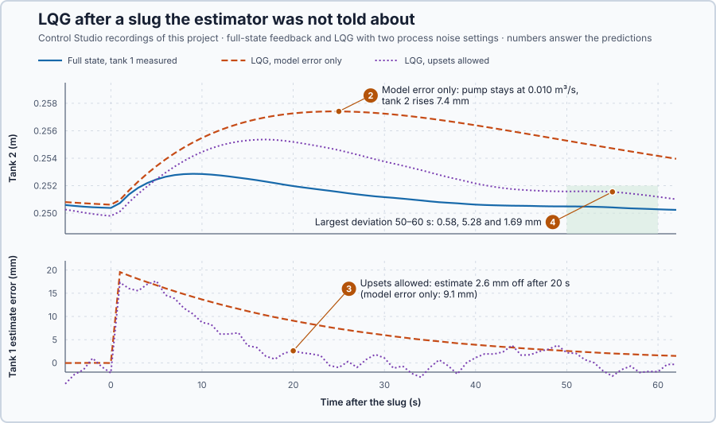

# 81. LQG control

In this lesson, you will feed the LQR gains with a Kalman filter's estimate of tank 1, let Control Studio design both, and compare the result with the same gains on both measured levels after a slug the estimator is not told about.

## The problem

Lesson 80's LQR with $R = 40000$ turned the pump down to 0.00845 m³/s the second after the slug and brought both levels within 2 mm 22 s later. It could do that because it measured both levels. The real installation measures only tank 2, so tank 1 must come from an estimate.

We will apply the LQR gains to a Kalman filter's estimate of tank 1 and compare the result with feedback on both measured levels, under the same noise and the same slug.

## What we need

We need to:

1. calculate the pump from the estimated state, in the right order each second;
2. design the feedback gains and the estimator gains; and
3. compare the result with feedback on both measured levels.

## The new idea

**LQG** feeds the Kalman filter's estimates into the LQR law, so the optimal feedback works with only the measured level. For the tanks, the pump acts on the filter's estimate of tank 1 as if it were measured.

**In words.** Lesson 80's LQR needs both levels; lesson 79's Kalman filter estimates both from tank 2's readings. LQG puts the two together: every second the filter gives its best estimate of both levels, and the LQR law uses that estimate in place of measurements. In PLC terms it is like a calculated substitute value that the control logic uses as if it came from a transmitter. The parts:

1. **The estimator.** Lesson 79's Kalman filter predicts with the model and the pump command that was applied, and corrects with tank 2's reading.
2. **The law.** Lesson 80's LQR gains, applied to the estimate.
3. **The order.** Each second the estimate is predicted and corrected first, and only then is the command calculated, so it uses the newest reading.

The two halves are designed separately: the gains as if both levels were measured, the filter as if it only watched. For the tanks this means the pump reacts to tank 1's water only as far as the estimate shows it, and the estimate knows only three things: the model, the commands and the readings.

**The formula.**

$$
v_k = -K\hat x_k^+, \qquad q_k = 0.010 + v_k\ \mathrm{m^3/s},
$$

with the setpoint term $N(r - 0.25)$ added as before. Each second runs three steps:

1. **Predict** from the previous estimate and the command actually applied last second: $\hat x^-_k = A_d\hat x^+_{k-1} + B_dv_{k-1}$.
2. **Correct** with the new reading of tank 2: $\hat x^+_k = \hat x^-_k + L(y_k - C\hat x^-_k)$.
3. **Command**: only then calculate $v_k = -K\hat x^+_k$.

- $K = [k_1, k_2]$ holds the LQR gains, in m²/s;
- $\hat x^-_k$ and $\hat x^+_k$ are the estimated level deviations before and after the correction, in metres;
- $v_{k-1}$ is the pump correction applied during the last second, in m³/s;
- $A_d$, $B_d$ and $C = [0, 1]$ are lesson 79's one-second model, and $y_k$ is tank 2's reading, in metres;
- $L = [l_1, l_2]^T$ is the filter's settled gain, in metres of correction per metre of disagreement: the Kalman gain stops changing after a few seconds, and the program uses that final value. It follows from the reading's noise variance, $(5\ \text{mm})^2$, and the **process noise** $Q$: the unexplained change per second that the filter allows each level, in m².

A command that was requested but not applied, for example because the pump clipped it, would give the model a wrong history of what entered tank 1.

The name is short for linear-quadratic-Gaussian: a linear model, a quadratic cost, and noise with a bell-shaped (Gaussian) spread. Under those assumptions the **separation principle** holds: the best gains and the best estimator can be designed separately and simply combined. The pump limit and the tanks' curved outflow lie outside those assumptions, so the combination must still be tested.

**Example: one second of the controller.** Take $K = [0.0787, 0.0239]$ m²/s and the filter gain $L = [0.239, 0.106]$. Last second the estimate was $\hat x^+ = [0.010, 0.004]$ m and the applied correction $-0.0009$ m³/s; now tank 2 reads 5.2 mm above rest.

1. Predict: $\hat x^- = [0.96 \cdot 0.010 + 2 \cdot (-0.0009),\ 0.04 \cdot 0.010 + 0.96 \cdot 0.004] = [0.0078, 0.00424]$ m. The model expects tank 2 at 4.24 mm.
2. Correct: the disagreement is $0.0052 - 0.00424 = 0.00096$ m, so $\hat x^+ = [0.0078 + 0.239 \cdot 0.00096,\ 0.00424 + 0.106 \cdot 0.00096] = [0.00803, 0.00434]$ m. Tank 2 is higher than expected, so the filter also raises tank 1's estimate, by 0.23 mm.
3. Command: $v = -(0.0787 \cdot 0.00803 + 0.0239 \cdot 0.00434) = -0.00074$ m³/s, so the pump runs at 0.00926 m³/s.

With $L = [0.0023, 0.0068]$ instead, the same 0.96 mm disagreement raises tank 1's estimate by $0.0023 \cdot 0.96 = 0.0022$ mm: a hundred times less.

**The limitation.** The estimate knows only the model, the commands and the readings. Water poured into tank 1 from outside is in none of them: it shows only as tank 2 rises more than predicted, and the filter puts that disagreement down to tank 1 only as far as its process noise $Q$ lets tank 1 change unexplained. $Q_{11} = 10^{-8}$ m², the model's error alone, allows about $\sqrt{10^{-8}} = 0.1$ mm per second and gives $L = [0.0023, 0.0068]$; $Q_{11} = 4 \cdot 10^{-6}$ m² allows about 2 mm per second and gives $L = [0.239, 0.106]$. A larger $L$ also moves the estimate further with every noisy reading. These two settings are a teaching choice that shows the trade-off.

## Prediction

Before running, answer these questions:

1. What pump flow does $v = -K\hat x^+$ give at $\hat x^+ = [0.02, 0]^T$ with $K = [0.0787, 0.0239]$?
2. After the slug, how does the pump react with the model's error alone?
3. How does the estimate behave with upsets allowed?
4. Which of the three controllers keeps both levels within 2 mm 50–60 s after the slug?

| Setting | Estimator gain $L$ | Expected behaviour |
| --- | ---: | --- |
| Full state, tank 1 measured | — | reacts at once |
| LQG, model error only | $[0.0023, 0.0068]$ | barely sees the slug |
| LQG, upsets allowed | $[0.239, 0.106]$ | catches up, noisier |

## Implementation

Open [`src/Main.st`](src/Main.st). The rig has two cascades with the same gains: A measures both levels, B measures only tank 2 and uses the estimate. Both read tank 2 with the same 5 mm noise. B's estimator predicts from its old estimate and the command it gave last second, corrects with the new reading, and then the command is calculated. The experiment returns tank 2's setpoint to 0.25 m for 60 s and then pours the slug into both: 0.020 m³/s for one second. The slug stands for water from outside, so B's estimator is told its controller's command, not the slug. Each cascade adds up the level and effort costs after the slug, and B scores its estimate against the true tank 1, which the estimator never uses.

**Exercise.** By hand, at $\hat x^+ = [0.02, 0]^T$: $q = 0.010 - 0.0787 \cdot 0.02 - 0.0239 \cdot 0 = 0.00843$ m³/s, the same as with measured levels: the law cannot tell a measured state from an estimated one. Then run [`src/tests.st`](src/tests.st) from the **Testing** view; it checks one estimator step, this command and the costs.

## Experiment in Control Studio

1. Open this lesson's project and start **Simulator**. Both cascades rest at 0.25 m with 0.010 m³/s. In the **truST** side bar, select **Control Studio**.
2. On **Identify**, choose **Supplied plant model** from **Method** and open `lqg-model.json`: the one-second model with only tank 2 measured.
3. On **Tune**, open **Requirements…** and enter **Setpoint change (m)** 0.01, **Maximum steady-state error (m)** 0.002, **Maximum settling time (s)** 90, **Settling band (±m)** 0.001 and **Validation duration (s)** 120; select **Done**.
4. Choose **Controller** **P1 · LQG** and **Tuning method** **State-space design**. Set **Solver policy** **Finite-horizon (fixed policy)**, **State weights (Q)** `[[400, 0], [0, 400]]`, **Input weights (R)** `[[40000]]`, **Process noise covariance** `[[1e-8, 0], [0, 1e-8]]`, **Measurement noise covariance** `[[2.5e-5]]`, **Finite horizon steps** 20 and **Terminal weights** `[[400, 0], [0, 400]]`, and press **Tune controller**.
5. On **Validate**, press **Validate controller**, then **Apply**.
6. On **Identify**, choose **Project experiment**. **Signals** shows `P1.Tank2SetpointM · Setpoint (m)`, `P1.EstimatedTank2M · Process value (m)` and `P1.EstimatedPumpM3PerS · Applied output (m3/s)`; add `P1.FullStateTank2M · state (m)`, `P1.FullStatePumpM3PerS · state (m3/s)`, `P1.EstimatedTank1M · state (m)` and `P1.EstimateTank1M · state (m)`. Select **Review project test**, check the declared **124 s** and select **Confirm and start**. The slug comes about 62 s later.
7. After the run, hover 1 s, 20 s and 55 s after the slug, and the end of `P1.EstimationRmsM`, `P1.FullStateLatePeakM` and `P1.EstimatedLatePeakM`.
8. Restart **Simulator** and repeat steps 4–7 with **Process noise covariance** `[[4e-6, 0], [0, 1e-8]]`. Each run ends with **Project test completed. Outputs restored.**

Select **Abort test** to stop early.

## Evidence and decision

The numbered marks answer predictions 2–4. **Tune controller** gave **Gain K1** 0.0787, **Gain K2** 0.0239 and **Reference gain N** 0.1226 m3/s/m in both runs, with **Estimator gain L1** and **L2** 0.002255 and 0.006778 for the model's error alone and 0.2393 and 0.1056 with upsets allowed. **Validate controller** passed both: the setpoint step settled in 38 s, and the estimator, started 4 mm wrong, recovered in 52 s and 34 s. Neither trial adds water from outside.

1. At $\hat x^+ = [0.02, 0]^T$ the pump flow is 0.00843 m³/s, as with measured levels.

From Control Studio's two recordings, times after the slug:

| Controller | Pump at 1 s | Tank 2 peak | Largest deviation 50–60 s | Level cost | Effort cost | Estimate RMS error |
| --- | ---: | ---: | ---: | ---: | ---: | ---: |
| Full state | 0.00840 m³/s | +2.9 mm at 9 s | 0.58 mm | 0.469 | 0.321 | — |
| LQG, model error only | 0.009997 m³/s | +7.4 mm at 25 s | 5.28 mm | 2.77 | 0.000 | 9.0 mm |
| LQG, upsets allowed | 0.00990 m³/s | +5.4 mm at 17 s | 1.69 mm | 1.39 | 0.091 | 6.4 mm |

2. With the model's error alone the estimate of tank 1 hardly moved: 30 s after the slug it read 0.2499 m while tank 1 stood at 0.2558 m. The pump stayed at 0.010 m³/s, and tank 2 rose 7.4 mm, as if uncontrolled.
3. With upsets allowed the estimate caught up within 20 s, from 17.3 mm low to 2.6 mm low, and the pump reacted; both levels were within 2 mm from 42 s after the slug.
4. Full-state feedback and LQG with upsets allowed met the 2 mm requirement 50–60 s after the slug; LQG with the model's error alone did not.

The cost of estimating tank 1 is level deviation: three times the full-state level cost even with upsets allowed. LQG with upsets allowed is accepted for these tanks with only tank 2 measured; LQG with the model's error alone is rejected, because it cannot see water it was not told about. Where tank 1 can be measured, measuring it is better. These are simulation results; the true tank 1 level was used only to score the estimate.

## Conclusion

LQG applies the LQR gains to the Kalman filter's estimate, and the two are designed separately: the law cannot tell an estimated state from a measured one.

The estimate knows only what the model, the commands and the readings tell it, so an upset from outside reaches the pump only as fast as the process noise lets the filter believe tank 1 changed.

## Check yourself

1. **At $\hat x^+ = [0.01, 0.005]^T$, what pump flow does the LQG law give?**
   $q = 0.010 - 0.0787 \cdot 0.01 - 0.0239 \cdot 0.005 = 0.009094$ m³/s.
2. **Why must the estimator predict with the applied command rather than the requested one?**
   Only the applied flow entered tank 1; a clipped request would give the model a wrong history of the water in the
   tank.
3. **Why did the estimator with the model's error alone miss the slug?**
   Its small $Q$ says tank 1 can change only as the model predicts, so it treated tank 2's rise as noise and barely
   corrected tank 1.

## Reason for the next lesson

The LQG law applies one gain at every level and lets the pump limit clip the result: it does not plan around future limits or a shared supply.

[Model predictive control](../73-mpc/README.md) plans the commands over the coming updates within their limits.
