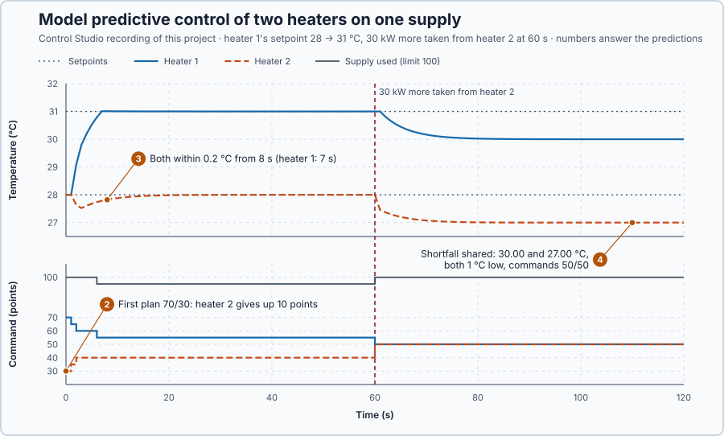

# 82. Model predictive control

This lesson is an introduction to model predictive control. You will plan the commands of two heaters that share one supply three seconds ahead, apply the first move of the best plan every second, and see how the plan shares the supply when both targets cannot be met.

## The problem

Lesson 81's LQG controller kept the tanks within 2 mm 50–60 s after the slug, but it applied one gain at every level and let the pump limit clip the result. It never planned around a limit, and it had only one actuator. Many plants have several actuators drawing on one shared budget, where two separate controllers could together ask for more than there is.

That needs a shared limit, so we leave the tanks for two electric water heaters of the familiar kind, drawing on one supply of 100 points. We will choose both commands together, by predicting what each pair would do and rejecting every pair that breaks a limit.

## What we need

We need to:

1. predict both temperatures for any pair of commands, a few seconds ahead;
2. reject every pair that breaks a limit, including the shared supply; and
3. rank the remaining pairs, so the best one is applied, also when both targets cannot be met.

## The new idea

**Model predictive control**, MPC, predicts the future for several possible plans, picks the best plan that respects every limit, applies only its first step, and plans again at the next update. For the two heaters, the supply limit is part of every plan instead of a clip applied afterwards.

**In words.** The controllers so far calculated a command from the present error and let a limit clip it afterwards. MPC decides by looking ahead: it tries the possible commands on the model, sees where each would lead, and keeps the best one that breaks no limit. It works like a navigation system: it plans the whole route within the road rules, you drive only to the next junction, and there it plans again from where you actually are. Every update has four parts:

1. **Predict.** For each possible plan, the model predicts both temperatures a few seconds ahead.
2. **Check the limits.** A plan that breaks any limit, a command range, the shared supply or a temperature range, is rejected before it is ever applied.
3. **Score.** Each remaining plan gets a cost: how far the predicted temperatures are from their setpoints, plus a small charge for moving the commands.
4. **Apply the first step, then plan again.** Only the first step of the cheapest plan is applied; next second, with new measurements, the planning starts over.

For the two heaters this means that the commands are chosen together, so they never ask for more than the 100 points of supply, and when both setpoints cannot be met, the cost decides how the shortfall is shared.

**The formula.** Each heater stores heat in 50 kJ per °C, loses 10 kW per °C above its 20 °C surroundings and receives 2 kW per command point, delivered one second late. One second ahead:

$$
T_{next} = T + \frac{2u_{previous} - 10(T - 20) - D}{50} .
$$

- $T$ is a heater's temperature, in °C;
- $u_{previous}$ is the command delivered during that second, in points: the command chosen one second earlier;
- $D$ is an extra heat extraction, in kW; and
- 50 kJ per °C divides the net power into a temperature change per second.

A plan here is one pair of commands $(u_1, u_2)$, held for three seconds; the first predicted second still uses the commands being delivered. The plans are the pairs on a 5-point grid within the limits

$$
0 \le u_i \le 100 \ \ (i = 1, 2), \qquad u_1 + u_2 \le 100,
$$

231 pairs. A plan whose predicted temperatures leave 26–33 °C is rejected; the others are scored by

$$
J = \sum_{k=1}^{3}\left[(T_{1,k} - r_1)^2 + (T_{2,k} - r_2)^2\right] + 0.002\left[(\Delta u_1)^2 + (\Delta u_2)^2\right].
$$

- $k$ counts the predicted seconds, 1 to 3, and $T_{1,k}$, $T_{2,k}$ are the predicted temperatures, in °C;
- $r_1$ and $r_2$ are the setpoints, in °C;
- $\Delta u_1$ and $\Delta u_2$ are the changes from the present commands, in points; and
- 0.002 is the charge per squared point of change, a teaching choice that makes large moves slightly more expensive.

**Example: the first decision.** Both heaters are at 28 °C with 40 points, and heater 1's setpoint rises to 31 °C while heater 2's stays at 28 °C.

1. Holding 40/40 keeps both at 28 °C for all three seconds: $J = 3 \cdot (28 - 31)^2 = 27$. Heater 1 is 3 °C short every second.
2. 50/40: heater 1 predicts 28 °C (the first second still gets 40 points), then $28 + (100 - 80)/50 = 28.4$ and $28.4 + (100 - 84)/50 = 28.72$ °C. So $J = 9 + 6.76 + 5.20 + 0.002 \cdot 10^2 = 21.16$: cheaper than holding, because heater 1 approaches its setpoint.
3. 70/40 asks for 110 points and is never considered. 10/90 would cool heater 1 to $26.8 + (20 - 68)/50 = 25.84$ °C in the third second and is rejected.
4. The program scores all 231 pairs this way, applies the first second of the cheapest feasible pair, and repeats the whole search a second later with the new temperatures.

The steady state shows when the setpoints themselves cannot be met. At steady state $2u = 10(T - 20) + D$: 31 °C needs 55 points and 28 °C needs 40, 95 together, within the supply. With 30 kW more taken from heater 2, it needs 15 points more: 110 together, more than the supply. Then no plan reaches both setpoints, and the cost decides how the shortfall is shared.

**The limitation.** The controller searches a finite grid three seconds ahead, so it finds the best of those plans, not an unrestricted optimum, and its predictions are only as good as the model. It also costs computing: 231 plans scored every second.

## Prediction

Before running, answer these questions:

1. What are $J$ for 55/40 and 60/40, and why are 60/50 and 100/0 never applied?
2. After heater 1's setpoint rises to 31 °C, what does the first plan do with heater 2's command?
3. From when are both heaters within 0.2 °C of their setpoints?
4. With 30 kW more taken from heater 2, where do the two temperatures settle?

| Steady need | Heater 1 at 31 °C | Heater 2 at 28 °C | Total |
| --- | ---: | ---: | ---: |
| Normal load | 55 points | 40 points | 95 points |
| 30 kW more from heater 2 | 55 points | 55 points | 110 points |

## Implementation

Open [`src/Main.st`](src/Main.st). `HeaterPlan` predicts one heater for one command and returns whether that part is feasible, its cost and the predicted temperatures. Because the heaters share only the supply, a plan's cost is the sum of the two parts, so the program evaluates `HeaterPlan` for each heater and each of its 21 commands, then compares the 231 pairs by adding two numbers. It applies the cheapest feasible pair and records the rejected plans and the plan cost; without a feasible plan it holds the commands and reports the failure. The experiment raises heater 1's setpoint from 28 to 31 °C and, from 60 s, takes 30 kW more from heater 2.

**Exercise.** Work plan 55/40 by hand: heater 1 predicts 28, then $28 + (110 - 80)/50 = 28.6$, then $28.6 + (110 - 86)/50 = 29.08$ °C, so $J = 9 + 5.76 + 3.6864 + 0.45 = 18.8964$. Then run [`src/tests.st`](src/tests.st) from the **Testing** view; it checks the worked plans and the rejected ones.

## Experiment in Control Studio

1. Open this lesson's project and start **Simulator**. Both heaters rest at 28 °C with 40 points. In the **truST** side bar, select **Control Studio**.
2. On **Identify**, choose **Project experiment** from **Method**. **Signals** shows `P1.Heater1C · Process value (°C)` and `P1.Command1Pct · Applied output (%)`; add `P1.Setpoint1C · state (°C)`, `P1.Heater2C · state (°C)`, `P1.Setpoint2C · state (°C)`, `P1.Command2Pct · state (%)` and `P1.SupplyPct · state (%)`.
3. Answer the predictions, select **Review project test** and check the declared **124 s**; select **Confirm and start**. The setpoint rises at the program's next one-second update, about 2 s later; times below count from it.
4. After the run, hover 0 s, 5 s, 8 s, 65 s and 110 s after the rise. Show `P1.RejectedPlans · state (1)` and `P1.PlanCost · state (1)`, and hover 0 s and 110 s.
5. At completion Control Studio shows **Project test completed. Outputs restored.**

Select **Abort test** to stop early; to repeat, restart **Simulator** so both heaters start at 28 °C.

## Evidence and decision

The numbered marks answer predictions 2–4. Prediction 1 is answered by calculation, which the program's tests check: $J = 18.90$ for 55/40 and 17.07 for 60/40; 60/50 asks for 110 points, and 100/0 would cool heater 2 to 25.12 °C. From Control Studio's recording, times after the setpoint rise:

| Time | Heater 1 | Heater 2 | Commands | Supply | Rejected plans | Plan cost |
| --- | ---: | ---: | ---: | ---: | ---: | ---: |
| 0 s | 28.00 °C | 28.00 °C | 70/30 | 100 | 111 | 15.62 |
| 5 s | 30.52 °C | 27.68 °C | 60/40 | 100 | 61 | 0.23 |
| 30 s | 31.00 °C | 28.00 °C | 55/40 | 95 | 61 | 0.00 |
| 65 s | 30.45 °C | 27.20 °C | 50/50 | 100 | 126 | 3.77 |
| 110 s | 30.00 °C | 27.00 °C | 50/50 | 100 | 140 | 6.00 |

2. The first plan was 70/30: it used the whole supply and took 10 points from heater 2, because heater 2's small error cost less than heater 1's large one. Heater 2 dipped to 27.52 °C.
3. Heater 1 was within 0.2 °C of 31 °C from 7 s and heater 2 of 28 °C from 8 s; then 55/40 held both with 95 points.
4. The 30 kW load made the targets infeasible. The plans moved to 50/50, the whole supply, and both heaters settled 1 °C low, at 30.00 and 27.00 °C, where the cost is $3(1^2 + 1^2) = 6$: with equal weights, sharing the shortfall equally costs least.

The benefit: the supply never exceeded 100 points and planning never failed, while two independent controllers could have asked for 110. The cost is computing: 231 plans every second, of which the limits rejected 61 to 140. The controller is accepted for these heaters; a different split of a shortfall needs different weights. These are simulation results.

## Conclusion

MPC decides by predicting: it compares the consequences of the plans within all limits, applies only the first move and plans again with every measurement, so a shared limit is part of every decision.

For the two heaters, both targets were met within 8 s on 95 points, and when they needed more than the supply, the cost shared the shortfall equally.

## Check yourself

1. **Heater 2 at 28 °C, $D = 0$: what does it predict after two seconds with 40 points being delivered and then 30 points?**
   First 28 °C, then $28 + (60 - 80)/50 = 27.6$ °C.
2. **Why does MPC apply only the first move of its best plan?**
   A new measurement arrives every second; planning again with it corrects the prediction errors that a fixed plan
   would carry on.
3. **With 30 kW more from heater 2, why did both heaters settle 1 °C low rather than one of them 2 °C low?**
   The cost adds squared errors: $1^2 + 1^2 = 2$ per second is less than $2^2 + 0 = 4$, so the equal split is cheaper.

## Reason for the next lesson

The plans stayed within their limits in these runs, but feasible plans and simulations do not prove that a controller is stable over a whole operating range, especially for a plant that is not linear.

[Lyapunov stability](../../12-nonlinear-adaptive-and-robust-control/74-lyapunov-stability/README.md) shows how stability can be established with an energy-like quantity.
