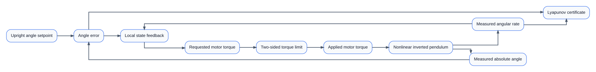
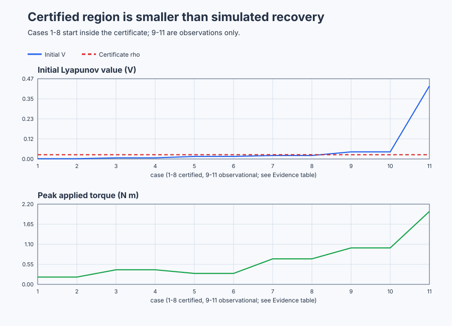

# Certify a nonlinear inverted pendulum locally

Course position: Lesson 69 of 84. Previous lesson: [Execute constrained two-zone building MPC](../../11-state-space-estimation-and-predictive-control/68-building-hvac-mpc/README.md). Next lesson: [Select scheduled or model-linearised robot-joint control](../70-robot-joint-nonlinear/README.md).

**Lesson objective:** Evaluate a local Lyapunov certificate on a nonlinear pendulum, map phase-plane trajectories, and reject global claims that are supported only by simulation.

**Evidence class:** Simulation evidence. No physical pendulum, motor, or laboratory rig is operated in this lesson.

## The problem

The equipment in this lesson is Motor-driven inverted-pendulum laboratory rig.

The equipment is a rigid pendulum driven by a torque motor at its pivot. The absolute pendulum angle ($\theta$) is measured in radians. The angular rate ($\omega$) states how quickly that angle changes, in radians per second. The motor produces requested and applied torque in newton metres.

The pendulum is upright when its absolute angle is pi radians. Its upright equilibrium is therefore pi rad, zero angular rate, and zero motor torque. Angle error ($\alpha$) means the measured absolute angle minus the upright angle setpoint. Positive and negative error identify opposite sides of upright.



Follow the boxes left to right: measured angle and rate feed the local state feedback, the requested torque passes through the two-sided limit before it ever reaches the pendulum, and the same two measured states are what the Lyapunov certificate evaluates — the certificate watches the feedback loop, it does not sit inside it.

The nonlinear simulator uses a rigid-joint model with inertia ($J$) 1 kilogram square metre and gravity-torque coefficient ($G$) 1 newton metre. $J$ and $G$ are **declared teaching values** for this simulation, configured directly in the plant model rather than measured. A learner obtaining them from a real rig would calculate $J$ from the measured mass distribution of the arm (or a bifilar swing-time test) and would obtain $G=mgL_{\mathrm{cm}}$ from the arm's mass, its centre-of-mass distance from the pivot, and local gravity — or equivalently measure the static holding torque needed to hold the arm at a few known angles away from vertical and fit the resulting sine relationship, the same holding-output method Lesson 5 used for the water heater. Friction is zero so the lesson isolates gravity, feedback, saturation, and the certificate. Applied torque is limited to -2 through +2 newton metres. These configured dynamics and every result in this lesson are Simulation evidence.

The plant advances with 10-millisecond Runge–Kutta substeps while the controller executes every 100 milliseconds. No closed-form solution exists for the sine term in the pendulum's motion, so the simulator integrates it numerically. A forward-Euler step — the only integration rule taught so far, in Lesson 25 — estimates the next state from the rate of change at the *current* instant only, so its error grows with the step size on curved motion. A fourth-order Runge–Kutta (RK4) step instead evaluates the rate of change at four points across the interval — the start, two trial midpoints, and the end — and combines them in a weighted average, tracking curved motion far more accurately than a single-point Euler step at the same step size. The independent oracle that checks this lesson's evidence must reproduce the same ten-millisecond RK4 sub-stepping as the simulator; comparing it against a coarser Euler oracle would report a mismatch caused by integration error, not by a genuine certificate or controller defect.

Lesson 68 predicted a coupled building with a linear model over a declared operating range. Local linear reasoning is useful, but it does not establish what happens far from that operating point.

One successful inverted-pendulum recovery has the same limitation. It does not prove that every nearby release converges, that the motion remains inside the assumed region, or that the argument survives motor saturation. This lesson adds a mathematical certificate and then tests its boundary without changing the controller.

## What we need

We need a mathematical certificate that proves local upright stability for declared pendulum states and a separate simulation record outside that certified region. Successful trajectories must not be promoted into a global proof.

## The new idea

A state is the smallest set of quantities needed to predict future motion. Here the state consists of angle error and angular rate. An equilibrium is a state that remains constant under its equilibrium input. At the upright equilibrium both state components and the required motor torque are zero.

A phase plane is a graph with angle error on its horizontal axis and angular rate on its vertical axis. Each initial state starts at one point. As the pendulum moves, its state draws a trajectory through the plane. Several trajectories reveal useful behavior, but a finite number of simulated trajectories cannot prove the boundary of every trajectory that was not run.

Local stability is a claim about a declared neighbourhood around an equilibrium. Global stability is a claim over the complete admissible state space. A region of attraction is the set of initial states known to converge to the equilibrium. This lesson certifies a local subset of that region; it makes no global claim.

The physical nonlinear equations come before the certificate. The absolute angle changes at the angular rate. Motor torque and gravity change the angular rate:

$\dot{\theta}=\omega$

$\dot{\omega}=\tau_{\mathrm{applied}}-\sin\left(\theta\right)$

Because the absolute angle equals pi plus the angle error, the sine of absolute angle is the negative sine of angle error. The error dynamics are therefore:

$\dot{\alpha}=\omega$

$\dot{\omega}=\tau_{\mathrm{applied}}+\sin\left(\alpha\right)$

The local feedback requests four newton metres per radian of angle correction and two newton metre seconds per radian of rate damping. These two gains are a **declared teaching choice**, not a measured property: they were chosen so that the linearized closed-loop system (derived below) has characteristic polynomial $s^{2}+2s+3=0$, placing both closed-loop poles at natural frequency $\sqrt{3}\approx1.73\,\mathrm{rad/s}$ with damping ratio $1/\sqrt{3}\approx0.58$ — a fast, well-damped local response that needs no analysis beyond what earlier lessons already taught.

$\tau_{\mathrm{requested}}=-4 \cdot \alpha-2 \cdot \omega$

Near upright, the sine of a small angle error is approximately the angle error, so the nonlinear rate equation $\dot{\omega}=\tau_{\mathrm{requested}}+\sin(\alpha)$ becomes $\dot{\omega}\approx\tau_{\mathrm{requested}}+\alpha$. Substituting the feedback law and collecting terms:

$\dot{\omega}=(-4 \cdot \alpha-2 \cdot \omega)+\alpha=-3 \cdot \alpha-2 \cdot \omega$

Together with $\dot{\alpha}=\omega$, this is the resulting local closed-loop matrix:

$\mathbf{A}_{cl}=\begin{bmatrix}0&1\\-3&-2\end{bmatrix}$

A Lyapunov function is a positive energy-like number that is zero at equilibrium and positive elsewhere. If it continually decreases away from equilibrium, the state cannot climb out through a fixed level boundary. The symmetric matrix $\mathbf{P}=\begin{bmatrix}P_{11}&P_{12}\\P_{12}&P_{22}\end{bmatrix}$ is obtained from the continuous Lyapunov equation $A_{cl}^{T}P+PA_{cl}=-I$. Choosing $-I$ asks the linearized energy derivative to equal minus the squared state length. Multiplying out both sides of that matrix equation and matching each of the three distinct entries gives three independent scalar equations in $P_{11}$, $P_{12}$, and $P_{22}$:

$-6 \cdot P_{12}=-1$

$P_{11}-2 \cdot P_{12}-3 \cdot P_{22}=0$

$2 \cdot P_{12}-4 \cdot P_{22}=-1$

The first equation gives $P_{12}=1/6$ directly. Substituting $P_{12}=1/6$ into the third equation gives $P_{22}=1/3$, and substituting both into the second equation gives $P_{11}=4/3$:

$\mathbf{P}=\begin{bmatrix}\frac{4}{3}&\frac{1}{6}\\\frac{1}{6}&\frac{1}{3}\end{bmatrix}$

Its first diagonal value is positive and its determinant is $\det\mathbf{P}=(4/3)(1/3)-(1/6)^2=5/12$, which is also positive. Those two facts make the matrix positive definite. The Lyapunov value ($V$) is:

$V=0.5 \cdot ((4/3) \cdot \alpha^{2}+(1/3) \cdot \alpha \cdot \omega+(1/3) \cdot \omega^{2})$

The mixed coefficient is $2P_{12}=1/3$ because expanding $x^TPx$ includes both symmetric off-diagonal terms. By the chain rule, the rate of change of $V$ is $\dot V=0.5(\dot x^TPx+x^TP\dot x)$; because $\dot x=A_{cl}x$ near equilibrium and $P$ is symmetric, the two terms combine into one expression, so differentiating $V=0.5x^TPx$ along the linearized closed loop gives $\dot V=0.5x^T(A_{cl}^TP+PA_{cl})x=-0.5(\alpha^2+\omega^2)$.

The actual pendulum still contains the sine function. The nonlinear remainder
($r(\alpha)$) is the difference between that sine and its local linear
approximation: $r(\alpha)=\sin(\alpha)-\alpha$. Including this remainder gives
the continuous Lyapunov derivative ($\dot V$):

$\dot V=-0.5 \cdot (\alpha^{2}+\omega^{2})+(\alpha/6+\omega/3) \cdot (\sin\left(\alpha\right)-\alpha)$

The **certificate level ($\rho$)** is the largest Lyapunov value the certificate covers; the certified sublevel set contains every state for which $V\le \rho=0.025$. $\rho=0.025$ is a **declared teaching value**, chosen well inside two independent margins rather than fitted to any single trajectory: it keeps the certified angle error small enough that the small-angle approximation and the cubic sine bound (below) stay tight, and — as the torque check below shows — it stays far inside the largest $\rho$ the 2-newton-metre torque limit would still allow. Its boundary lies within 0.2 radian angle error, its feedback request remains below the 2-newton-metre limit, and the continuous derivative is negative everywhere except the equilibrium. A decreasing value cannot cross outward through the fixed boundary. The sublevel set is therefore an invariant local subset of the region of attraction for this declared nonlinear model and unsaturated feedback.

Those limits can be checked rather than assumed. For a fixed angle error, the smallest possible Lyapunov value occurs at angular rate $\omega=-\alpha/2$. This gives $V\ge (5/8) \cdot \alpha^{2}$; setting $V=0.025$ gives $|\alpha|\le 0.2\text{ rad}$. For a fixed angular rate, the smallest value occurs at $\alpha=-\omega/8$. This gives $V\ge (5/32) \cdot \omega^{2}$ and therefore $|\omega|\le 0.4\text{ rad/s}$.

The next check confirms the feedback request never saturates anywhere inside the certified set — the largest value a linear quantity such as $\tau_{\mathrm{requested}}=c^Tx$ (feedback row $c=[4,2]$) can take on the boundary of the ellipse $0.5x^TPx=\rho$ occurs where the ellipse's outward direction lines up with $c$ itself, and that greatest magnitude works out to $\sqrt{2\rho\,c^TP^{-1}c}$. For a symmetric $2\times2$ matrix, the inverse is one divided by the determinant, multiplied by the matrix with its diagonal entries swapped and its off-diagonal entries negated:

$\mathbf{P}^{-1}=\frac{1}{\det\mathbf{P}}\begin{bmatrix}P_{22}&-P_{12}\\-P_{12}&P_{11}\end{bmatrix}=\frac{12}{5}\begin{bmatrix}1/3&-1/6\\-1/6&4/3\end{bmatrix}=\begin{bmatrix}0.8&-0.4\\-0.4&3.2\end{bmatrix}$

so $c^TP^{-1}c=19.2$ and the bound is $\sqrt{2(0.025)(19.2)}=\sqrt{0.96}=0.980$ newton metres, safely below the 2-newton-metre limit — and well below the $\rho\approx0.104$ that this same bound shows the torque limit alone would still permit, which is the margin that justified declaring $\rho=0.025$ above.

Finally, inside the angle bound, the Taylor remainder for sine satisfies $|\sin(\alpha)-\alpha|\le |\alpha|^{3}/6$ — a standard bound, because sine's third derivative never exceeds 1 in magnitude, so the omitted cubic term cannot exceed $|\alpha|^{3}$ divided by $3!=6$. Applying that bound to each remainder-weighted term of $\dot V$ and using the certified region's own limit $|\alpha|\le0.2$ (so $\alpha^{2}\le0.04$) gives two intermediate inequalities:

$(\alpha/6) \cdot (\sin(\alpha)-\alpha)\le \alpha^{4}/36\le \alpha^{2}/900$

$(\omega/3) \cdot (\sin(\alpha)-\alpha)\le |\omega| \cdot \alpha^{2} \cdot |\alpha|/18\le |\omega \cdot \alpha|/450\le (\alpha^{2}+\omega^{2})/900$

The second line first uses $|\alpha|^{3}\le0.04\,|\alpha|$ and then the arithmetic-mean/geometric-mean inequality $|\omega\alpha|\le(\alpha^{2}+\omega^{2})/2$, which bounds a product by the average of the two squares. Adding both bounds to the linear part of $\dot V$ gives $\dot V\le -(0.5-1/450)\alpha^{2}-(0.5-1/900)\omega^{2}$, which is strictly negative for every nonzero state in the sublevel set. These calculations certify the boundary; the trajectory plot is a separate executable check.

That statement does not prove global stability. It also does not cover a different model, gains, torque limit, sample interval, stale measurement, physical rig, or state outside the sublevel set.

## Prediction

Start with angle error 0.1 rad and angular rate zero. The feedback requests:

$\tau_{\mathrm{requested}}=-4 \cdot 0.1-2 \cdot 0=-0.4\text{ N m}$

The Lyapunov value is:

$V=0.5 \cdot (4/3) \cdot 0.1^{2}=0.0066667$

The nonlinear remainder makes the continuous derivative:

$\dot V=-0.5 \cdot 0.1^{2}+(0.1/6) \cdot (\sin\left(0.1\right)-0.1)=-0.0050028\text{ per second}$

The value is below 0.025, the derivative is negative, and requested torque is inside the actuator limit. Predict that this release is certified.

Now use angle error 0.25 rad and zero rate. Its value is $V=0.0416667$, which is above 0.025. Predict that it begins outside the certificate. It may still recover in simulation, but that outcome cannot retroactively certify its initial state.

## Implementation

The shipped Structured Text uses the measured nonlinear plant state. It does not integrate a private linear pendulum:

```st
AngleError := AbsoluteAngle - AngleSetpoint;
TorqueRequested := -LREAL#4.0 * AngleError - LREAL#2.0 * AngularRate;

IF Enabled THEN
    TorqueApplied := LIMIT(LREAL#-2.0, TorqueRequested, LREAL#2.0);
ELSE
    TorqueApplied := LREAL#0.0;
END_IF;
TorqueSaturated := Enabled AND ABS(TorqueRequested - TorqueApplied) > LREAL#1.0E-12;

// This quadratic value is the local certificate, not a second plant model.
LyapunovValue := LREAL#0.5 * (
    (LREAL#4.0 / LREAL#3.0) * AngleError * AngleError
    + (LREAL#1.0 / LREAL#3.0) * AngleError * AngularRate
    + (LREAL#1.0 / LREAL#3.0) * AngularRate * AngularRate
);

// The sine remainder keeps the derivative tied to the nonlinear plant.
LyapunovDerivative := -LREAL#0.5 * (
    AngleError * AngleError + AngularRate * AngularRate
) + (AngleError / LREAL#6.0 + AngularRate / LREAL#3.0)
    * (SIN(AngleError) - AngleError);

IF EvidenceInitialized THEN
    LyapunovDelta := LyapunovValue - PreviousLyapunovValue;
ELSE
    LyapunovDelta := LREAL#0.0;
END_IF;

InsideCertifiedSet := LyapunovValue <= CertificateLevel;
```

This is the shipped code verbatim. `TorqueRequested` is the controller calculation. `TorqueApplied` is the bounded plant input, held at exactly zero while `Enabled` is false. `TorqueSaturated` states when the two differ. `LyapunovDerivative` evaluates the continuous nonlinear formula shown above, including the sine remainder. `LyapunovDelta` compares consecutive sampled values, but only once `EvidenceInitialized` is true — the first scan after release has no previous sample to compare against. `CertificateValid` (evaluated later in the same program, not shown above) also requires enabled control, sublevel membership, no saturation, and decreasing value away from equilibrium.

## Experiment in Control Studio

This procedure observes the certified +0.1-radian release under the declared feedback and certificate. The simulator owns the initial state; the project owns feedback, torque limiting, certificate evaluation, and zero-torque restoration when authority is removed. The remaining certified map, outside releases, and saturation case are separate native test records. The deterministic Simulation seed is 20260829.

### Control Studio actions

1. **Monitor** — Select target **Simulator**, choose **Run**, then open **Control Studio → Monitor → Response**.
   - **Baseline check:** Wait until the header shows **Simulation**, **Running**, and current data. Confirm Upright angle setpoint (SP) reads 3.141592653589793 rad and Absolute pendulum angle (PV) starts at 3.241592653589793 rad — the declared +0.1 rad release. Confirm Requested and Applied motor torque both read 0 N m, because Control enabled (bound to `P1.ExperimentEnabled`) is still false. Because applied torque and friction are both zero, gravity alone now accelerates the unpowered pendulum away from upright: expect Absolute pendulum angle and Pendulum angular rate to keep drifting the longer Monitor is left open before Test is started. That drift is expected physics, not a fault; it is exactly why a mathematical certificate, rather than one lucky trace, is needed.
   - **Decision before action:** Because the certificate is valid only inside its declared sublevel set, decide now what a genuinely certified response must look like: a bounded torque request that starts near -0.4 N m (Prediction above) and a Lyapunov value that only ever decreases from about 0.0066667 toward zero. A request or value that grows instead would mean the release, model, or wiring does not match the declared certificate — it would not mean the certificate itself is wrong.
   - **Successful evidence:** The Response plot advances, Absolute pendulum angle and Pendulum angular rate change smoothly with no gaps, the displayed values stay finite and current, and **Start recording** is enabled. Select **Start recording** only after those conditions are visible.
   - **Recovery:** If recording is disabled or the plot reports unavailable or stale samples, stop the Simulator, correct the displayed runtime or binding problem, restart it, and repeat the baseline check.
   - **Record:** Write down the initial SP (3.141592653589793 rad), the PV at the instant Test starts, zero requested/applied torque, and your predicted -0.4 N m first request and 0.0066667 initial Lyapunov value before opening Test.

2. **Test** — Open **Control Studio → Test**.
   - **Baseline check:** Confirm **Experiment** = **Observe without excitation**, **Amplitude** = **0** (disabled), and **Maximum duration (s)** = **8.1**. The reviewed authority is **Experiment authority** (`P1.ExperimentEnabled`). It does not write angle, rate, or torque.
   - **Decision before action:** Before selecting **Review test**, predict that requested and applied torque stay equal (unsaturated) and inside Applied motor torque -2 N m to 2 N m, that Absolute pendulum angle stays inside 0 rad to 6.2832 rad, and that Pendulum angular rate stays inside -10 rad/s to 10 rad/s throughout — because a certified release that left any of those bounds would itself be a certificate or safety violation, not ordinary behavior.
   - **Successful evidence:** Select **Review test**, verify the signal, requested bound, duration, restoration, and stop conditions, then select **Confirm and start**. The state changes to **Running**, **Abort test** remains available, and Response must show requested and applied torque starting near -0.4 N m and shrinking together (no gap between them), Lyapunov value falling monotonically from about 0.0066667 toward zero, the angle-error/rate pair settling inside the 0.01 rad / 0.02 rad/s band by roughly 2.5 s, and both requested and applied torque returning to exactly 0 N m at the 8.1-second restoration.
   - **Recovery:** For a rejected, stale, unsafe, unavailable, failed, or aborted state, read the displayed reason, remove experiment authority, verify zero applied torque, wait for current data, and review a new test.
   - **Record:** Stop recording only after zero-torque restoration. Retain initial and maximum $V$, continuous derivative, sampled change, torque request/application, certificate state, terminal state, restoration result, and seed **20260829**. Use native evidence for the full certified map, the outside cases, and the saturated case; do not claim this visible run executed them.

## Evidence and decision

Initial Lyapunov value is the value at release. Maximum Lyapunov value is the largest value over the eight-second record. Maximum positive sampled change is the largest difference between consecutive values after evidence initialization. Maximum continuous derivative is the least-negative derivative observed away from equilibrium.

Settling time is the earliest sampled instant after which absolute angle error stays at most 0.01 rad and absolute angular rate stays at most 0.02 rad/s for every remaining sample through the end of the eight-second record — not any 0.5-second window part way through, but held continuously to the final sample. If that condition is never satisfied through the end of the record, report `Not settled`.

Also retain peak requested and applied torque in newton metres, saturation duration in seconds, sublevel-exit count, and certificate-violation count. Requested and applied torque are separate measures. Every result retains its source signals, model, initial state, interval, gains, limit, matrix, certificate level, units, window, tolerance, and Simulation classification.

An independent oracle must match the nonlinear ten-substep Runge–Kutta plant update and every Structured Text certificate calculation. Every non-equilibrium sample of every certified trajectory must retain $V\le 0.025$, have negative continuous derivative, have nonpositive sampled change after initialization, and remain unsaturated. After eight seconds, absolute angle error must be at most 0.01 rad and absolute angular rate at most 0.02 rad/s.

Both 0.25-radian releases must be marked outside the set at their first sample. Their later motion remains observational regardless of whether they enter the set. The 0.8-radian case must expose saturation and reject certificate validity. Disabled mode must apply zero torque.

The shipped native execution produced this Simulation evidence. Because angle error and angular rate are exactly the two phase-plane axes defined above, each row also states where that case's trajectory ends in the phase plane:

| Certified initial state $(\alpha, \omega)$ | Initial V | Peak applied torque | Settling time | Final $(\alpha, \omega)$ |
| --- | ---: | ---: | ---: | ---: |
| ±0.05 rad, 0 rad/s | 0.001667 | 0.200 N m | 1.5 s | 0.00001 rad, 0.00001 rad/s |
| ±0.10 rad, 0 rad/s | 0.006667 | 0.400 N m | 2.5 s | 0.00003 rad, 0.00003 rad/s |
| $(+0.15,-0.15)$ and its sign reverse | 0.015000 | 0.300 N m | 2.7 s | at most 0.00005 rad, 0.00002 rad/s |
| 0 rad, ±0.35 rad/s | 0.020417 | 0.700 N m | 3.2 s | at most 0.00003 rad, 0.00014 rad/s |

Across all eight certified records, sublevel exits, certificate violations, saturation duration, and maximum positive sampled Lyapunov change were all zero. The independent oracle matched the simulator's nonlinear ten-substep Runge–Kutta update and the Structured Text values.

Both ±0.25 rad, 0 rad/s records began at $V=0.041667$, outside the certificate. Each later entered the certified set and ended near 0.00006 rad, 0.00007 rad/s. That is useful simulated recovery evidence, but their initial states remain uncertified — the sublevel-exit and certificate-violation counts above are defined, and reported as zero, only for the eight releases that started inside the certified set. The 0.8 rad, 0 rad/s rejection began at $V=0.426667$, requested as much as 3.200 N m, was limited to 2.000 N m, and accumulated 0.4 s of saturation. It therefore cannot use the unsaturated certificate.

A plotted trajectory, source formula, or successful final state alone does not prove the declared certificate. Retained run and phase-portrait artifacts are still required before rendered acceptance.



The upper panel shows that cases 1 through 8 (the eight certified releases) start well under the $\rho=0.025$ line, while cases 9 through 11 (the two outside releases and the saturated case) start above it. The lower panel shows why case 11 alone cannot use the certificate: its peak applied torque reaches the 2 N m limit that the other ten cases stay clear of. This chart reports one initial Lyapunov value and one peak torque per case; it is not the phase-plane trajectory plot itself — the table above states each case's phase-plane starting point and where its trajectory ends, which is the retained evidence for that claim.

[Complete trace](figures/pendulum-lyapunov-evidence-trace.csv) · [Decision summary](figures/pendulum-lyapunov-evidence-summary.csv)

## Conclusion

For a certified release, the measured state produces a bounded feedback torque. The nonlinear plant moves, the positive Lyapunov value decreases, and the state remains inside the fixed sublevel boundary. Because the continuous derivative is negative everywhere away from equilibrium inside that boundary, this is more than one fortunate trace: the mathematical argument covers every state in the declared set under its assumptions.

The phase-plane runs still matter. They verify the executable model, sampling, controller, and calculation at representative states. They do not replace the proof or create a global claim. A recovered 0.25-radian trace shows useful behavior at one initial state; it does not prove all nearby untested states. Saturation changes the feedback law used in the derivative calculation, so the unsaturated certificate must fail closed when requested and applied torque differ.

## Reason for the next lesson

Use this local Lyapunov certificate only for the declared nonlinear model, upright equilibrium, feedback gains, torque limit, sampling assumptions, and $V\le 0.025$ sublevel set. Physical use requires an identified rig, guarding, an independent emergency stop, reviewed torque topology, explicit approval immediately before operation, and rollback. This lesson operates no physical pendulum.

Lesson 70 compares gain scheduling with feedback linearisation on a gravity-loaded robot joint. The need follows directly: the pendulum certificate is deliberately local, while the robot must work across a much wider nonlinear operating range.
