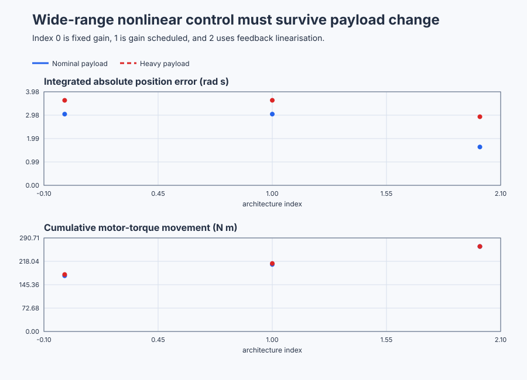

# Select scheduled or model-linearised robot-joint control

Course position: Lesson 70 of 84. Previous lesson: [Certify a nonlinear inverted pendulum locally](../69-pendulum-lyapunov/README.md). Next lesson: [Supervise adaptive pressure control on a polymer extruder](../71-extruder-adaptive/README.md).

**Lesson objective:** Select a robot-joint architecture from common nominal and payload-mismatch evidence and explain what scheduling and nonlinear cancellation each require.

**Evidence class:** Simulation evidence. No physical robot joint, motor, or cell is operated in this lesson.

## The problem

The equipment in this lesson is Gravity-loaded industrial robot joint.

The equipment is one rigid industrial robot arm axis driven by a bidirectional torque motor. Joint angle setpoint ($q_{\mathrm{sp}}$) is the demanded arm angle. Joint angle ($q$) is the encoder measurement. Angular rate ($\dot q$) states how quickly the joint moves. Angles use radians, rate uses radians per second, and requested and applied motor torque use newton metres.

The simulated arm has inertia 1 kilogram square metre, nominal gravity-torque coefficient 9.81 newton metres, and viscous coefficient 0.2 newton metre seconds per radian. The nonlinear plant advances every 5 milliseconds. The controller executes every 20 milliseconds. Applied torque is limited to -30 through +30 newton metres. The validated range is -1.2 through +1.2 radians and -4 through +4 radians per second.

The nominal and heavy-payload plants use the same controller-facing input and measurements. The heavy case increases actual gravity coefficient to 11.772 newton metres while the controller estimate remains 9.81. Actual payload truth is never supplied to the controller. Every result is Simulation evidence.

Lesson 69 proved a small local region around one upright equilibrium. A production robot cannot remain near one angle. As its arm rotates, gravity torque and the slope of gravity torque change continuously. A single controller tuned near zero angle therefore experiences different effective dynamics at large angles.

The engineering decision is not simply “use nonlinear control.” We need to compare two distinct responses to the limitation. Gain scheduling interpolates controller parameters that were validated at several operating points. Feedback linearisation trusts a nonlinear model enough to cancel its known terms. This lesson exposes what each choice gains and what it risks.

## What we need

We need joint control that remains credible as gravity torque and payload change across a wide angular range. Fixed, operating-point-adjusted, and model-cancelling alternatives must be compared with the same tracking, torque, constraint, and model-trust evidence.

## The new idea

Motor torque accelerates inertia after gravity and viscous friction have been overcome. Inertia ($J$) is the joint's resistance to angular acceleration, measured in kilogram square metres. Viscous coefficient ($b$) is the friction torque per unit of angular rate, measured in newton metre seconds per radian. Gravity-torque coefficient ($G$) is the peak gravity torque the arm's own weight exerts about the joint, measured in newton metres, and applied torque uses the same unit. Joint acceleration ($\ddot q$) is how quickly angular rate itself changes, measured in radians per second squared. Both $J=1\text{ kg m}^2$ and $b=0.2\text{ N m s/rad}$ are **declared teaching values** configured directly in the simulator; a learner would obtain them from the arm's rated mass distribution (for $J$) and from a measured no-load coast-down or a swept-frequency torque test (for $b$), the same routes used for the pendulum in Lesson 69. $G=9.81\text{ N m}$ (nominal) is likewise declared, and a learner would obtain it by measuring holding torque at a few angles away from horizontal, as Lesson 69 describes for the pendulum's gravity coefficient. With those four quantities named, the joint balance is:

$J \cdot \ddot q+b \cdot \dot q+G \cdot \sin\left(q\right)=\tau_{\mathrm{applied}}$

A local model is a linear approximation around one operating angle ($q_0$). Writing $q=q_0+\delta q$ and using $\sin(q_0+\delta q)\approx\sin(q_0)+\cos(q_0)\delta q$ shows that the constant term is the holding torque and the coefficient of small angle change is the local gravity stiffness $G\cos(q_0)$. It changes from its largest value near zero angle to a smaller value as the arm moves toward 1.2 radians. A fixed proportional gain therefore does not produce identical local closed-loop stiffness everywhere.

Natural frequency ($\omega_n$) describes the intended response speed of the local closed loop, in radians per second. Choose desired natural frequency ($\omega_{n}$) 5 rad/s — a **declared teaching choice**, roughly five times the pendulum's certified 1.73 rad/s from Lesson 69, fast enough to show a clear scheduling effect within the plant's 30 N m torque budget. Damping ratio ($\zeta$) describes how strongly oscillation is suppressed, where 1 is critically damped and values below 1 allow some overshoot. Choose damping ratio ($\zeta$) 0.8 — likewise declared, sitting close to critical damping so the local response settles with little overshoot rather than oscillating. With those choices, the local proportional and derivative gains are:

$K_p(q_{0})=J \cdot \omega_{n}^{2}-G \cdot \cos\left(q_{0}\right)$

$K_d=2 \cdot \zeta \cdot \omega_{n} \cdot J-b$

Before these formulas, name the control law that produces them: at operating angle $q_0$, the local controller supplies the gravity-holding torque for that angle, then trims proportionally on angle error and on measured rate:

$\tau_{\mathrm{requested}}=G\sin(q_{0})+K_{p} \cdot (q_{0}-q)-K_{d} \cdot \dot q$

Substituting this law into the joint balance, writing $q=q_0+\delta q$, and using the same small-angle step as above ($\sin(q_0+\delta q)\approx\sin(q_0)+\cos(q_0)\delta q$) leaves gravity's holding term on both sides, cancelling it:

$J\delta\ddot q+b\delta\dot q+G\cos(q_0)\delta q=-K_p\delta q-K_d\delta\dot q$

Collecting every term on one side gives the local error equation used above:

$J\delta\ddot q+(b+K_d)\delta\dot q+(G\cos(q_0)+K_p)\delta q=0$

Dividing by $J$ and matching it to the desired second-order polynomial $s^2+2\zeta\omega_n s+\omega_n^2$ gives the two coefficient equations above.

At absolute operating angles 0, 0.6, and 1.2 rad, substitution gives $25-9.81\cos(0)=15.190$, $25-9.81\cos(0.6)=16.904$, and $25-9.81\cos(1.2)=21.445$, each in newton metres per radian. The derivative calculation is $2(0.8)(5)(1)-0.2=7.800$, in newton metre seconds per radian.

Gain scheduling means selecting or interpolating parameters from validated local controller designs using a measurable scheduling variable. Here the scheduling variable is absolute setpoint angle, clamped to 1.2 radians. Linear interpolation connects the three proportional-gain points. Only the two plateau endpoints, 0 and 1.2 rad, are validated at steady state by the settling-time and final-error evidence below; the 0.6 rad midpoint gain is exercised only transiently while the schedule interpolates through it during a plateau change, never held there, so its own steady-state behavior remains a calculated design, not an independently measured one. Integral gain is a further **declared teaching choice**, kept fixed at 12 N m/(rad s) rather than scheduled: paired with the scheduled proportional gains it gives an integral time between about 1.27 and 1.79 seconds (derived below) — a few times slower than the 0.2-second period implied by $\omega_n=5\text{ rad/s}$, so integral action removes the remaining gravity offset without fighting the faster proportional-derivative response. Derivative gain remains 7.8 N m s/rad.

Fixed and scheduled PID use the same integral gain. Integral time ($T_i$) is proportional gain divided by integral gain. It therefore ranges from about 1.27 seconds at zero angle to 1.79 seconds at 1.2 radians. This gives integral action enough authority to build the required gravity-holding torque during each plateau while leaving scheduled proportional gain as the only difference between those two records.

Interpolation does not prove stability between the validated points or during a schedule transition. Those conditions must be tested. Scheduling is also not adaptation: these gains do not learn or change from performance data.

Feedback linearisation means using the nonlinear model to cancel known plant terms before applying desired linear error dynamics. The nominal model compensation ($\tau_{\mathrm{model}}$) uses estimated gravity coefficient ($\hat{G}$) and estimated viscous coefficient ($\hat{b}$):

$\tau_{\mathrm{model}}=\hat{G} \cdot \sin\left(q\right)+\hat{b} \cdot \dot q$

With estimated inertia ($\hat{J}$), the complete request is:

$\tau_{\mathrm{requested}}=\tau_{\mathrm{model}}+\hat{J} \cdot (24 \cdot (q_{sp}-q)-8 \cdot \dot q)$

The proportional coefficient is deliberately 24 rather than 25 N m/rad. A
1.2-radian step then initially requests 28.8 N m from feedback, leaving 1.2
N m below the motor's 30 N m limit for model compensation and numerical
margin. Designing exactly on an actuator boundary would make the nominal
architecture saturate before its claimed linear dynamics could be evaluated.

With exact nominal coefficients ($\hat{G}=G$, $\hat{b}=b$, $\hat{J}=J$), substitute the requested torque into the plant balance:

$J\ddot q+b\dot q+G\sin(q)=\hat{G}\sin(q)+\hat{b}\dot q+\hat{J} \cdot (24(q_{sp}-q)-8\dot q)$

Because the estimates equal the true coefficients, $G\sin(q)$ cancels $\hat{G}\sin(q)$ and $b\dot q$ cancels $\hat{b}\dot q$ on both sides, and dividing the remaining $J\ddot q=J \cdot (24(q_{sp}-q)-8\dot q)$ by $J$ leaves $\ddot q=24(q_{sp}-q)-8\dot q$. For a constant setpoint and error $e=q_{sp}-q$, this becomes $\ddot e+8\dot e+24e=0$. Its roots are $-4\pm j\sqrt{8}$, so the nominal error decays. Feedback is still necessary because initial error, disturbances, sensor error, and model error remain.

Input effectiveness is the coefficient that maps actuator command into state acceleration. It is $1/\hat{J}$ here. Feedback linearisation is eligible because this value stays finite, positive, and bounded throughout the declared range. On a different plant, dividing by input effectiveness that approaches zero would create a singular command. That architecture must be rejected rather than numerically clipped and called successful.

Residual dynamics are the tracking dynamics left after imperfect cancellation. A 20 percent heavy payload creates coefficient error because actual gravity is 11.772 while the controller still cancels 9.81. The resulting residual must remain visible in the comparison.

All three architectures use the shared Control.PID implementation. Fixed and scheduled forms retain integral action. The feedback-linearised form uses model compensation with proportional-derivative feedback and no integral action, specifically so constant model mismatch remains observable.

## Prediction

At measured joint angle 0.5 rad and zero rate, nominal gravity compensation is:

$\tau_{\mathrm{model}}=9.81 \cdot \sin\left(0.5\right)=4.703\text{ N m}$

At zero setpoint, scheduled proportional gain is 15.190 N m/rad. At 1.2-radian setpoint, it is 21.445 N m/rad.

When measured angle equals the 1.2-radian setpoint and rate is zero, nominal feedback error is zero. Exact feedback linearisation still requests the holding torque. The running program evaluates $\tau_{\mathrm{model}}$ before the proportional-derivative correction is added to it, so the learner can distinguish cancellation from ordinary error feedback; in the shipped Structured Text this term is `GravityCompensation` (the $\hat{G}\sin(q)$ part alone) plus the viscous part folded into `ModelCompensation`, both evaluated before `Input.FeedForward` carries the sum into `Controller.Update`.

$\tau_{\mathrm{model}}=9.81 \cdot \sin\left(1.2\right)=9.143\text{ N m}$

With heavy actual gravity but unchanged nominal compensation, the missing torque is:

$\tau_{\mathrm{residual}}=(11.772-9.81) \cdot \sin\left(1.2\right)=1.829\text{ N m}$

The no-integral feedback term needs roughly $1.829/24=0.076\text{ rad}$ of error to balance that residual. Predict a visible load-dependent offset for feedback linearisation. Predict that scheduled PID integral action eventually removes the constant residual, although it may move more slowly.

## Implementation

The shipped program has one shared Control.PID instance. The scheduling law and model term remain visible around it:

```st
SchedulingVariable := MIN(ABS(JointSetpoint), LREAL#1.2);
IF SchedulingVariable <= LREAL#0.6 THEN
    ScheduledProportionalGain := LREAL#15.19
        + (LREAL#16.903457618 - LREAL#15.19) * SchedulingVariable / LREAL#0.6;
ELSE
    ScheduledProportionalGain := LREAL#16.903457618
        + (LREAL#21.445270429 - LREAL#16.903457618)
            * (SchedulingVariable - LREAL#0.6) / LREAL#0.6;
END_IF;
...
IF ActiveArchitecture = INT#0 THEN
    ActiveProportionalGain := FixedProportionalGain;
    Parameters.ProportionalGain := ActiveProportionalGain;
    Parameters.IntegralGain := LREAL#12.0;
    Parameters.DerivativeGain := LREAL#7.8;
    Input.FeedForward := LREAL#0.0;
ELSIF ActiveArchitecture = INT#1 THEN
    ActiveProportionalGain := ScheduledProportionalGain;
    Parameters.ProportionalGain := ActiveProportionalGain;
    Parameters.IntegralGain := LREAL#12.0;
    Parameters.DerivativeGain := LREAL#7.8;
    Input.FeedForward := LREAL#0.0;
ELSE
    // Keep the nominal 1.2-radian step below the motor limit so model
    // compensation retains actuator authority instead of starting saturated.
    ActiveProportionalGain := LREAL#24.0 * EstimatedInertia;
    Parameters.ProportionalGain := ActiveProportionalGain;
    Parameters.IntegralGain := LREAL#0.0;
    Parameters.DerivativeGain := LREAL#8.0 * EstimatedInertia;
    Input.FeedForward := ModelCompensation;
END_IF;
Controller.Configure(Parameters := Parameters);
...
TorqueRequested := Controller.Update(Input := Input);
TorqueApplied := LIMIT(LREAL#-30.0, TorqueRequested, LREAL#30.0);
TorqueSaturated := Enabled AND ABS(TorqueRequested - TorqueApplied) > LREAL#1.0E-12;
```

This is the shipped code verbatim, with `...` marking elided lines that do not change the governing choice (the `ModelEligible`, `FallbackActive`, and `ActiveArchitecture` selection logic, and the `GravityCompensation`/`ModelCompensation` calculation, sit between the blocks shown). `ControllerMode` (an external request, always Auto in this observation) and `ActiveArchitecture` (INT#0 fixed, INT#1 scheduled, INT#2 feedback-linearised) states what actually runs — the third branch above is reached only when `ActiveArchitecture` is neither 0 nor 1, i.e. INT#2. `ModelEligible` requires bounded positive inertia and bounded gravity and friction estimates; an ineligible model requested for cancellation activates explicit scheduled fallback. `FixedProportionalGain`, `ScheduledProportionalGain`, and `ActiveProportionalGain` show exactly what is used, and each branch sets its own `Parameters.DerivativeGain` alongside it — 7.8 for the PID forms, $8\hat{J}$ for the linearised form. `GravityCompensation` contains only the nominal sine-gravity term; `ModelCompensation` adds nominal viscous friction. Neither uses actual payload truth. `TorqueRequested` and `TorqueApplied` remain separate, with `TorqueSaturated` showing any limit action.

## Experiment in Control Studio

This procedure observes scheduled PID on the nominal plant over the complete wide-angle trajectory. The project owns architecture selection, all four setpoint plateaus, and zero-torque restoration when authority is removed. Fixed PID, feedback linearisation, heavy-payload, and invalid-model fallback comparisons are separate native test records. The deterministic Simulation seed is 20260829.

### Control Studio actions

1. **Monitor** — Select target **Simulator**, choose **Run**, then open **truST sidebar → Control Studio → Monitor → Response**.
   - **Baseline check:** Wait until the header shows **Simulation**, **Running**, and current data. Confirm Joint angle setpoint (SP) and Joint angle (PV) both read 0 rad, Requested and Applied motor torque both read 0 N m, Active architecture reads scheduled (1), Active proportional gain reads 15.19 N m/rad, and Control enabled (`P1.Enabled`) is false because Experiment authority (`P1.ExperimentEnabled`) has not yet been granted. This zero-angle rest point is a genuine equilibrium — gravity torque is zero at $q=0$ — so, unlike a release away from equilibrium, nothing should drift while Monitor is open.
   - **Decision before action:** Before granting authority, decide what would show scheduling is actually happening rather than a fixed gain in disguise: Active proportional gain must move away from 15.19 N m/rad as soon as the setpoint leaves zero, reaching 21.445 N m/rad once the joint angle magnitude reaches 1.2 rad, while Active architecture stays at scheduled (1) throughout — because a lesson claiming "scheduled" control that never changes gain would be indistinguishable from fixed PID.
   - **Successful evidence:** The Response plot advances, the displayed values are finite and current, and **Start recording** is enabled. Select **Start recording** only after those conditions are visible.
   - **Recovery:** If recording is disabled or the plot reports unavailable or stale samples, stop the Simulator, correct the displayed runtime or binding problem, restart it, and repeat the baseline check.
   - **Record:** Write down the zero-angle SP, PV, requested/applied MV, Active architecture, and Active proportional gain (15.19 N m/rad) before opening Test.

2. **Test** — Open **Control Studio → Test**.
   - **Baseline check:** Confirm **Experiment** = **Observe without excitation**, **Amplitude** = **0** (disabled), and **Maximum duration (s)** = **31.1**. The reviewed authority is **Experiment authority** (`P1.ExperimentEnabled`). The project owns the 0, +1.2, 0, -1.2, 0-radian schedule.
   - **Decision before action:** Before selecting **Review test**, predict that requested and applied torque stay equal (unsaturated) and inside Applied motor torque -30 N m to 30 N m throughout, that Joint angle stays inside -1.5 rad to 1.5 rad, and that Joint angular rate stays inside -4 rad/s to 4 rad/s — because this scheduled-PID run is tuned to stay well inside the actuator's 30 N m limit, so any excursion beyond these bounds signals a wiring or model problem rather than expected behavior.
   - **Successful evidence:** Select **Review test**, verify the signal, requested bound, duration, restoration, and stop conditions, then select **Confirm and start**. The state changes to **Running**, **Abort test** remains available, and Response must show Active proportional gain step from 15.19 toward 21.445 N m/rad as the +1.2 rad plateau is reached near 11 s, settle by roughly 4.7 s into that plateau, mirror through the -1.2 rad plateau from 16-26 s, and return every signal to zero at the 31.1-second restoration.
   - **Recovery:** For a rejected, stale, unsafe, unavailable, failed, or aborted state, read the displayed reason, remove experiment authority, verify zero setpoint and applied torque, wait for current data, and review a new test.
   - **Record:** Stop recording only after restoration. Retain active gain, requested/active architecture, model
     eligibility, joint response, requested/applied torque, terminal state, restoration result, and
     seed **20260829**. Use native evidence for the other architectures and payload cases; do not
     claim this visible run executed them. The inherited limitation under test is: A tuning derived at zero angle has different effective stiffness and transient behavior as gravity curvature changes across the arm range. The decision this run supports is: Select scheduled PID when validated local designs and integral load rejection are stronger evidence than the cancellation model; select feedback linearisation only while model and input-effectiveness eligibility remain qualified.
## Evidence and decision

Segment integrated absolute angle error is the sum of absolute setpoint-minus-angle error multiplied by the 20-millisecond interval, in radian-seconds. Overshoot is the greatest movement beyond the commanded target divided by the magnitude of that segment's commanded change, in percent.

Settling time is valid only when absolute angle error is at most 0.02 rad and absolute angular rate is at most 0.05 rad/s continuously for the final 0.5 seconds of the plateau. An ineligible segment reports `Not settled` instead of a final-error ranking.

Applied-torque total variation is the sum of absolute consecutive applied-torque changes, in newton metres. Also retain peak requested and applied torque, saturation duration, and final-window mean absolute error over the final 0.5 seconds of each plateau. Requested and applied torque, nominal and heavy payload, requested and active architecture, model eligibility, and fallback state remain distinct in every table and plot. Every one of these measures is retained in [`figures/robot-joint-nonlinear-evidence-summary.csv`](figures/robot-joint-nonlinear-evidence-summary.csv), which extends the integrated-error and movement columns with the peak torque, saturation, settling, heavy-payload final-window error, and overshoot values reported below.

The active scheduled gain and nominal model compensation must match independent equations to `1e-9`. Applied torque must remain within -30 through +30 N m. On the nominal plant, scheduled PID should make wide-angle segment behavior more consistent than the fixed zero-angle tuning, while eligible feedback linearisation must meet every segment tolerance without saturation.

On the heavy plant, scheduled PID integral action must keep final-window mean absolute error at or below 0.02 rad on both nonzero plateaus. The unchanged no-integral feedback-linearised controller must expose a materially larger residual rather than using actual plant truth to hide it. Invalid estimated inertia must select scheduled fallback. Disabled mode must apply zero torque.

The shipped native execution produced the following common-trajectory results.
Values are rounded for reading; the test retains full precision.

| Plant and architecture | Integrated absolute error | Applied-torque travel | Peak applied torque | Saturation |
|---|---:|---:|---:|---:|
| Nominal, fixed PID | 3.028 rad s | 173.2 N m | 18.52 N m | 0.00 s |
| Nominal, scheduled PID | 3.028 rad s | 208.4 N m | 26.02 N m | 0.00 s |
| Nominal, feedback linearisation | 1.631 rad s | 264.2 N m | 28.80 N m | 0.00 s |
| Heavy payload, fixed PID | 3.614 rad s | 177.1 N m | 18.52 N m | 0.00 s |
| Heavy payload, scheduled PID | 3.616 rad s | 211.4 N m | 26.02 N m | 0.00 s |
| Heavy payload, feedback linearisation | 2.917 rad s | 264.3 N m | 28.80 N m | 0.00 s |

On the nominal nonzero plateaus, fixed PID settles in 3.14 and 3.22 seconds,
scheduled PID in 4.66 and 4.76 seconds, and feedback linearisation in 1.02
seconds for both directions. Across all four plateaus, the settling-time spread
is 0.92 seconds for fixed PID, 0.70 seconds for scheduled PID, and 0.02 seconds
for feedback linearisation. Scheduling makes behavior somewhat more consistent,
but it does not improve total integrated error and it increases torque travel.

On the heavy-payload nonzero plateaus, scheduled PID's final-window mean
absolute errors are 0.00189 and 0.00207 rad. Feedback linearisation retains
0.07380 rad on both plateaus, agreeing closely with the predicted 0.076 rad
model-mismatch offset. The fixed and scheduled return-to-zero segments are
still `Not settled` after five seconds on the heavy plant, so their final
samples are not ranked as steady-state evidence. Nominal feedback-linearised
overshoot remains below 0.38 percent; no architecture saturates in these
records.

The evidence therefore selects feedback linearisation for the qualified
nominal model when speed matters and model eligibility is continuously
enforced. It selects scheduled PID when rejecting an uncertain constant
payload torque is more important than nominal speed. Source equations or a
single attractive trace cannot make that decision.



Read left to right: feedback linearisation (right-most point) has the lowest integrated error on the nominal plant (upper panel, blue) but that advantage shrinks under heavy payload (red) exactly where its uncompensated residual appears, while its torque movement (lower panel) is consistently the highest of the three — the cost of driving the joint to target faster.

[Complete trace](figures/robot-joint-nonlinear-evidence-trace.csv) · [Decision summary](figures/robot-joint-nonlinear-evidence-summary.csv)

## Conclusion

The fixed controller changes behavior because actual local gravity stiffness changes while its gain does not. Scheduled PID changes only its proportional gain according to the bounded setpoint schedule; integral feedback still supplies the unknown holding torque. Feedback linearisation instead supplies the nominal holding torque immediately and asks feedback to regulate the remaining error.

With the nominal model, cancellation can produce simple and fast dynamics. With the heavy payload, the missing gravity torque becomes residual dynamics and creates the predicted offset because the selected linearised controller deliberately has no integral action. Scheduled PID can integrate that constant residual away. This does not mean scheduling is universally better or that model-based control is unsafe. It means the faster cancellation architecture requires stronger evidence that its model stays accurate enough for the operating envelope.

## Reason for the next lesson

Choose gain scheduling when a finite operating envelope and several local designs can be validated without trusting complete nonlinear cancellation. Choose feedback linearisation when the nonlinear model and input effectiveness are qualified and a bounded fallback exists. Physical robot operation also requires payload identification, collision and travel limits, guarding, independent stop functions, explicit approval immediately before motion, and rollback. This lesson operates no physical robot.

Lesson 71 introduces constrained adaptation for an extruder whose material parameters drift continuously rather than occupying a small set of validated operating regions.
