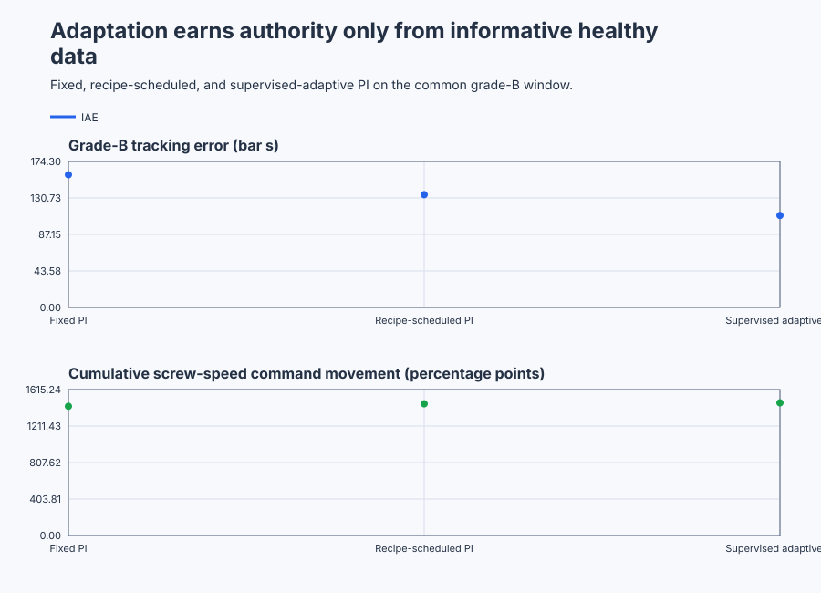

# Supervise adaptive pressure control on a polymer extruder

Course position: Lesson 71 of 84. Previous lesson: [Select scheduled or model-linearised robot-joint control](../70-robot-joint-nonlinear/README.md). Next lesson: [Qualify robust load alleviation on a flexible-wing test rig](../72-flexible-airframe-robust/README.md).

**Lesson objective:** Select fixed, recipe-scheduled or supervised adaptive PI from common extruder evidence and prove that adaptation freezes safely when information or pressure quality is lost.

**Evidence class:** Simulation evidence. No physical extruder, motor, heater, die, or polymer material is operated in this lesson.

## The problem

The equipment is a single-screw polymer-extruder die-pressure loop. Its motor moves polymer through a heated barrel and die. Screw-speed command changes material flow and therefore die pressure.

Die-pressure setpoint ($p_{\mathrm{sp}}$) is the desired pressure. Die pressure ($p$) is the pressure measured at the die. Both use bar. Requested screw speed ($u_{\mathrm{requested}}$) is the controller calculation. Applied screw speed ($u_{\mathrm{applied}}$) is the bounded command presented to the simulated motor. Both use percent and are limited from 0 through 100 percent.

The controller executes every 100 milliseconds. The plant advances in 20-millisecond substeps. Resin grade A has nominal pressure gain 1.0 bar/%; resin grade B has nominal pressure gain 0.75 bar/%. The known recipe changes from grade A to grade B at 60 seconds.

Moisture, melt temperature, wear, and blend variation can change pressure gain even within one named recipe. The simulator represents that unmeasured viscosity effect as a continuous multiplier from 0.85 through 1.15 over a 120-second cycle. The effective gain therefore moves from 0.85 through 1.15 bar/% in grade A and from 0.6375 through 0.8625 bar/% in grade B. The controller receives resin grade, measured pressure, and its own applied command. It never receives effective Simulation gain.

A bounded identification probe ($u_{\mathrm{probe}}$) alternates by 10 percentage points around the ordinary controller output. This deliberate movement is applied to all three comparison cases. It is not free and it is not hidden as noise. Physical probing would require an independently reviewed production experiment and explicit approval immediately before it runs. This lesson operates only Simulation equipment.

Every result in this lesson is Simulation evidence. It is not physical-extruder evidence and shall not be presented as approval to excite or control one.

Lesson 70 showed that a few validated controller designs can be scheduled from a measured robot angle. It also showed that an unmeasured payload error remains after nominal model cancellation.

The extruder has a similar split. Resin grade is known, so switching between two reviewed PI designs is reasonable. Effective viscosity is not measured as a scheduling variable and drifts within each grade. Adding schedule points without knowing which point the plant currently occupies does not solve that problem.

We therefore need to estimate a small, explicitly bounded plant model online. The lesson is not trying to prove that adaptation is always better. It asks when an online estimate contains enough trustworthy information to be used and what the controller must do when that evidence disappears.

## What we need

We need die-pressure control that can use known recipe changes and cautiously learn an unmeasured material drift without adapting on bad or uninformative data. Loss of excitation or pressure quality must freeze learning and preserve safe authority.

## The new idea

Screw speed creates an equilibrium pressure through a material-dependent gain. Stored and compressible material prevents pressure from reaching that equilibrium instantly.

Pressure time constant ($\tau_{p}$) states how quickly die pressure approaches its equilibrium and uses seconds. Effective process gain ($K$) states how many bar of equilibrium pressure one percent of applied screw speed produces and uses bar/%. Pressure bias ($B$) represents equilibrium pressure not explained by screw speed and uses bar. Applied screw speed ($u_{\mathrm{applied}}$) uses percent.

After those quantities are defined, the first-order pressure balance is:

$\tau_{p} \cdot dp/dt=K \cdot u_{\mathrm{applied}}+B-p$

This lesson uses a known pressure time constant of 5 seconds — a **declared teaching value**, representative of the barrel and die volume being compressed by the screw; a learner would obtain it on a real extruder the same way Lesson 37 obtained the heat exchanger's time constant, from a bounded open-loop step test at fixed screw speed while pressure settles. It estimates effective gain and pressure bias. Estimating both matters: if bias were silently fixed at zero, a sensor or operating-point offset could be misreported as gain.

Online parameter estimation means updating a model from synchronized measured input and output while the plant runs. It is not direct access to plant truth.

Controller interval ($\Delta t$) is 0.1 seconds. Previous pressure ($p_{\mathrm{previous}}$) is the preceding pressure sample. Reconstructed equilibrium-pressure observation ($z$) is the pressure target implied by the observed change over one interval. In words, take the previous pressure and add the measured pressure rate multiplied by the known time constant. Then write:

$z=p_{\mathrm{previous}}+\tau_{p} \cdot (p-p_{\mathrm{previous}})/\Delta t$

This follows by rearranging the plant balance to $Ku+B=p+\tau_p\,dp/dt$, approximating the rate by $(p-p_{previous})/\Delta t$, and using the pressure at the beginning of that interval. Thus $z$ estimates the equilibrium-pressure term $Ku+B$; it is not another pressure sensor.

Previous applied screw speed ($u_{\mathrm{previous}}$) is the command that produced that pressure change. Estimated gain parameter ($\theta_{K}$) represents process gain. Estimated scaled bias parameter ($\theta_{B}$) represents pressure bias divided by 100. Both sides are scaled by 100 to keep PLC arithmetic well conditioned:

$z/100=\theta_{K} \cdot (u_{\mathrm{previous}}/100)+\theta_{B}$

Estimated process gain ($\hat{K}$) equals $\theta_{K}$. Estimated pressure bias ($\hat{B}$) equals 100 times $\theta_{B}$.

**Least squares** means choosing the parameter values that make predicted output match measured output as closely as possible, in the sense of the smallest sum of squared prediction errors over the observed data. Recursive least squares (RLS) is an online estimator that corrects parameters from prediction error and an uncertainty matrix, one sample at a time, rather than solving that minimization over a stored batch. Regressor vector ($\phi$) contains previous applied speed divided by 100 and a constant one, so the model $z/100=\theta_K\cdot(u_{previous}/100)+\theta_B$ above is $y_{id}=\phi^T\theta$ in vector form. Scaled observation ($y_{\mathrm{id}}$) is z divided by 100. Innovation ($\varepsilon$) is the measured observation minus the model prediction. Covariance matrix (P) represents remaining parameter uncertainty. Forgetting factor ($\lambda$) states how much older evidence is retained; it is 0.98 here. A geometric record retains roughly $1/(1-\lambda)=50$ effective samples. At 0.1 second per sample this is about 5 seconds, short enough to follow the declared slow material drift without treating one sample as truth.

The estimator first calculates estimator gain vector ($L$), then corrects parameter vector ($\theta$), then updates covariance:

$L=P \cdot \phi/(\lambda+\phi^T \cdot P \cdot \phi)$

$L$ is the correction applied per unit of innovation: it grows when $P$ (remaining uncertainty) is large relative to $\lambda$ (the weight already given to past data), and shrinks as the estimate becomes confident. With a single scalar parameter and regressor $\phi=1$, this reduces to $L=P/(\lambda+P)$ — the same shape as the Kalman gain $K=P/(P+R)$ that Lesson 66 used to weigh a new measurement against prior confidence, with $\lambda$ here playing the role Lesson 66 gave to measurement-noise variance $R$.

$\theta_{\mathrm{next}}=\theta+L \cdot \varepsilon$

$P_{\mathrm{next}}=(P-L \cdot \phi^T \cdot P)/\lambda$

A forgetting factor below one allows slow tracking, but it can also let parameters wander when the data contain no new information. Forgetting is not evidence.

Persistent excitation means the measured input has enough independent variation to distinguish gain from bias. A constant screw speed cannot distinguish gain from bias: many identical input rows still describe only one direction in the two-parameter problem.

The estimator retains a two-by-two information matrix ($R$). Each healthy unsaturated sample adds the **outer product** of the regressor — the matrix formed by multiplying $\phi$ by its own transpose, $\phi\phi^T=\begin{bmatrix}\phi_1^2&\phi_1\\\phi_1&1\end{bmatrix}$ for this lesson's two-element $\phi=[\phi_1,1]^T$ — while older information is multiplied by 0.98. Its three distinct entries are exactly the shipped `Information11`, `Information12`, and `Information22`:

$R_{\mathrm{next}}=0.98 \cdot R+\phi \cdot \phi^T$

Information determinant ($D_{R}$) measures whether the two regressor directions span useful area rather than collapsing onto one line:

$D_{R}=R_{11} \cdot R_{22}-R_{12}^{2}$

Persistent excitation is accepted only when the information determinant is at least 0.10 — a **declared teaching floor**, small next to the determinant the designed probe reliably sustains once excitation has run for a while (23.543, measured at 60 seconds in the record below), so it demands only a modest fraction of the probe's own information rather than an unreachable one. The common probe alternates by +10 and -10 percentage points every 2 seconds to create enough bounded variation to distinguish both parameters. The resulting pressure and actuator cost remain visible.

Persistent excitation is a data condition, not permission to keep experimenting. The bounded probe window must also be explicitly authorized before an estimate may update. Otherwise, a controller-gain change can move screw speed, the estimator can mistake that self-induced motion for fresh experimental evidence, and adaptation can sustain its own apparent excitation. Removing probe authorization therefore freezes estimation immediately even if old information keeps the determinant above 0.10 for a while.

Parameter projection means restricting a candidate estimate to a reviewed physical set. Estimated gain is limited to 0.5 through 1.5 bar/%, a **declared teaching bound** wide enough to cover both resin grades' 0.6375-1.15 bar/% Simulation range with margin, yet narrow enough to reject a grossly wrong fit; on a real line this would come from the resin suppliers' data sheets. Estimated bias is limited to -20 through +20 bar, generously covering plausible sensor and operating-point offsets without permitting an unbounded runaway. ProjectionActive reports when a candidate reaches a boundary; clipping is not presented as successful identification. An estimate sitting exactly on either boundary is not qualified for adaptive controller authority.

The estimator starts from an initial covariance ($P_0$) of $\mathrm{diag}(10,10)$ — trace 20 — representing high initial uncertainty in both gain and bias before any data arrive. Estimator confidence uses covariance trace, which is covariance element $P_{11}$ plus covariance element $P_{22}$. An estimate becomes qualified only after at least 20 informative updates reduce covariance trace to 10.0 or less — a **declared teaching threshold** set at half the initial trace, so qualification demands the estimator has genuinely halved its starting uncertainty, not merely accumulated a handful of samples — while data and parameter bounds remain valid. A small covariance trace does not prove the model structure is correct; it only qualifies this declared estimator under this experiment.

Supervised adaptation is the state machine around RLS. Adaptation may update only when it is requested, control is enabled, pressure data are healthy, the previous applied output is not saturated, persistent excitation is present, and the bounded probe window is authorized. Loss of excitation authorization freezes the last qualified estimate. Bad pressure quality freezes estimation and applies the zero-speed safe output. Before qualification, an adaptive request uses recipe-scheduled PI instead of an unqualified estimate.

Indirect adaptive control means estimating a plant parameter and deriving ordinary controller settings from it. Closed-loop design time ($\lambda_{\mathrm{c}}$) is the desired model-based response time and is 3 seconds — a **declared teaching choice**, faster than the 5-second open-loop time constant but not so aggressive that probe-driven screw-speed movement becomes excessive. Design gain ($K_{\mathrm{design}}$) is fixed at 1.0 for fixed PI, selected as 1.0 or 0.75 for scheduled PI, and taken from qualified projected $\hat{K}$ for adaptive PI. The nominal values 1.0 and 0.75 bar/% are the midpoints of each grade's declared viscosity-multiplier range (0.85 through 1.15): grade A's midpoint is exactly 1.0, and grade B's is exactly $0.75\times(0.85+1.15)/2=0.75$. A learner would obtain each grade's nominal gain the same way Lesson 44 selected one representative design point for a self-regulating plant: a bounded open-loop step test at that grade's typical operating condition. Proportional gain ($K_p$) uses %/bar. Integral gain ($K_i$) uses %/(bar*s).

$K_p=\tau_{p}/(K_{\mathrm{design}} \cdot \lambda_{\mathrm{c}})$

$K_i=1/(K_{\mathrm{design}} \cdot \lambda_{\mathrm{c}})$

This is the Lambda/IMC rule Lesson 18 derived for a first-order self-regulating plant with no measured dead time: choosing $K_p=\tau/(K(\lambda+L))$ with $L=0$, and $K_i=K_p/\tau$, makes the closed loop itself behave like a first-order response with time constant $\lambda$. These equations ask the first-order plant to follow the desired closed-loop time $\lambda_c$. The proportional term is the plant time constant divided by process gain and desired response time. The integral gain is $K_p/\tau_p$, so substituting the proportional expression gives $K_i=1/(K_{design}\lambda_c)$.

Fixed PI, scheduled PI, and adaptive PI all use the same shared Control.PID function block, zero derivative gain, combined anti-windup, the same probe, and the same applied-speed limits.

## Prediction

For grade A, fixed and scheduled PI both use design gain 1.0 bar/%. They calculate:

$K_p=5/(1.0 \cdot 3)=1.667\text{ %/bar}$

$K_i=1/(1.0 \cdot 3)=0.333\text{ %/(bar s)}$

For grade B, scheduled PI uses design gain 0.75 bar/%:

$K_p=5/(0.75 \cdot 3)=2.222\text{ %/bar}$

$K_i=1/(0.75 \cdot 3)=0.444\text{ %/(bar s)}$

If a qualified adaptive estimate is 0.65 bar/%, adaptive PI calculates 2.564 %/bar and 0.513 %/(bar*s). If an update or forced test requests 2.3 bar/%, projection retains 1.5 bar/% and reports the boundary. Predict that removing probe authorization freezes $\hat{K}$ and $\hat{B}$ immediately. On the separate constant-grade plant, the information determinant then decays below 0.10 because no deliberate or naturally varying excitation remains.

## Implementation

The shipped Structured Text contains one Control.PID instance, configured and invoked inside the `AdaptiveExtruderController` function block (`src/AdaptiveExtruderController.st`). `Main.st` only supplies inputs and reads outputs; the estimator and supervisor logic below is this shipped excerpt, with `...` marking elided lines that do not change the governing choice:

```st
InformationDeterminant := Information11 * Information22
    - Information12 * Information12;
PersistentExcitation := InformationDeterminant >= LREAL#0.10;
AdaptationActive := Enabled
    AND AdaptationRequested
    AND DataHealthy
    AND NOT PreviousSaturated
    AND PersistentExcitation;
IF NOT ProbeEnabled THEN
    AdaptationActive := FALSE;
END_IF;
...
IF AdaptationActive THEN
    ...
    Denominator := LREAL#0.98 + Phi1 * PTimesPhi1 + PTimesPhi2;
    EstimatorGain1 := PTimesPhi1 / Denominator;
    EstimatorGain2 := PTimesPhi2 / Denominator;
    CandidateGain := EstimatedGain + EstimatorGain1 * Innovation;
    CandidateBiasScaled := BiasScaled + EstimatorGain2 * Innovation;
    ...
END_IF;
...
ActiveProportionalGain := LREAL#5.0 / (DesignGain * LREAL#3.0);
ActiveIntegralGain := LREAL#1.0 / (DesignGain * LREAL#3.0);
Controller.Configure(Parameters := Parameters);
ScrewSpeedRequested := Controller.Update(Input := Input);
ScrewSpeedApplied := LIMIT(LREAL#0.0, ScrewSpeedRequested, LREAL#100.0);
```

RequestedArchitecture selects fixed, scheduled, or adaptive PI. ActiveArchitecture reports what actually controls the plant. AdaptationRequested controls estimator updates separately from controller selection. AdaptationActive, EstimateFrozen, PersistentExcitation, EstimateQualified, FallbackActive, ProjectionActive, and FrozenReason explain every supervision decision. FrozenReason reports which single condition is currently blocking adaptation, checked in this order: `1` adaptation not requested, `2` control not enabled, `3` pressure data not healthy, `4` previous applied output was saturated, `5` probe window not authorized, `6` persistent excitation not present (information determinant below 0.10), and `0` when none of those block it. The program contains no actual effective gain and no built-in performance verdict.

## Experiment in Control Studio

This procedure observes supervised adaptive PI through the nominal recipe, drift, probe, and setpoint schedule. The project owns adaptation authorization, the grade change, the two setpoint changes, and zero-speed restoration. Fixed PI, recipe-scheduled PI, lost-excitation, bad-quality, recovery, and forced-projection comparisons remain separate native test records. The deterministic Simulation seed is 20260829.

### Control Studio actions

1. **Monitor** — Select target **Simulator**, choose **Run**, then open **truST sidebar → Control Studio → Monitor → Response**.
   - **Baseline check:** Wait until the header shows **Simulation**, **Running**, and current data. Confirm Die-pressure setpoint (SP) reads 0 bar and Requested/Applied screw speed both read 0 %, because Control enabled remains false and the project forces the setpoint to zero until Experiment authority (`P1.ExperimentEnabled`) is granted. Die pressure (PV) starts at 40 bar (the plant's initial state) but, with zero applied screw speed and the 5-second pressure time constant, expect it to drift away from 40 bar the longer Monitor is left open before Test starts — this is expected pre-authority physics, not the reviewed 40 bar operating point that Test itself establishes. The unresolved baseline problem is: Fixed PI cannot preserve the same response when known resin grade and unmeasured within-grade pressure gain both change.
   - **Decision before action:** Because a qualified estimate must earn authority from information, not from time alone, decide now what should distinguish real qualification from a coincidentally small covariance: Persistent excitation and Estimate qualified must both read true together, only after Informative-update count has reached at least 20, before Active architecture may show adaptive (2). Use this decision rule: Use a qualified frozen estimate only while its model, information, bounds and data remain valid; otherwise preserve scheduled fallback or safe output.
   - **Successful evidence:** The Response plot advances, the displayed values are finite and current, and **Start recording** is enabled. Select **Start recording** only after those conditions are visible.
   - **Recovery:** If recording is disabled or the plot reports unavailable or stale samples, stop the Simulator, correct the displayed runtime or binding problem, restart it, and repeat the baseline check.
   - **Record:** Write down the zero-authority SP and requested/applied MV, the PV at the instant Test starts, and your predicted grade-A gains (1.667 %/bar, 0.333 %/(bar s)) before opening Test.

2. **Test** — Open **Control Studio → Test**.
   - **Baseline check:** Confirm **Experiment** = **Observe without excitation**, **Amplitude** = **0** (disabled), and **Maximum duration (s)** = **120.1**. The reviewed authority is **Experiment authority** (`P1.ExperimentEnabled`). The project owns adaptation, probing, grade, and pressure schedules.
   - **Decision before action:** Before selecting **Review test**, predict that requested and applied screw speed stay equal (unsaturated) and inside 0 % to 100 %, that Die pressure stays inside 0 bar to 90 bar, and that Estimated process gain and Estimated pressure bias stay inside their projected bounds (0.5 to 1.5 bar/%, -20 to 20 bar) throughout — because this supervised run is designed to keep every signal inside its reviewed range, so any excursion signals a wiring or model problem rather than expected behavior.
   - **Successful evidence:** Select **Review test**, verify the signal, requested bound, duration, restoration, and stop conditions, then select **Confirm and start**. The state changes to **Running**, **Abort test** remains available, and Response must show the probe alternating applied screw speed by about ±10 percentage points every 2 seconds from the start, the setpoint step to 50 bar at 30 s, the known-recipe change to grade B at 60 s, the setpoint step to 60 bar at 90 s, Active architecture reaching adaptive (2) once Estimate qualified turns true, and every signal returning to zero at the 120.1-second restoration.
   - **Recovery:** For a rejected, stale, unsafe, unavailable, failed, or aborted state, read the displayed reason, remove experiment authority, verify frozen adaptation, zero setpoint, and zero applied speed, wait for current data, and review a new test.
   - **Record:** Stop recording only after restoration. Retain information determinant, covariance, estimate, qualification, projection, fallback, active gains, probe, pressure, requested/applied speed, terminal state, restoration result, and seed **20260829**. Use native evidence for alternative and fault cases; do not claim this visible run executed them.

## Evidence and decision

Pressure integrated absolute error is the sum of absolute setpoint-minus-pressure error multiplied by the 0.1-second interval, in bar seconds. Compare the declared 60-through-110-second grade-B window under identical probe conditions.

Settling time is valid only after absolute pressure error remains at most 0.5 bar continuously for 5 seconds. A case that does not satisfy this rule reports `Not settled` rather than using its last sample as steady state.

Applied-speed total variation is the sum of absolute changes between consecutive $u_{\mathrm{applied}}$ samples, in percentage points. It exposes the cost of probing and changing controller gains. Also retain peak requested and applied speed, saturation duration, projection count, informative-update count, frozen duration, covariance trace, $D_{R}$, architecture transitions, and exact parameter change during frozen windows. Every one of these measures, the projected-sample count during the grade transition, and the constant-grade determinant-decay and recovery times reported below are retained in [`figures/extruder-adaptive-evidence-summary.csv`](figures/extruder-adaptive-evidence-summary.csv).

Estimate root-mean-square error compares $\hat{K}$ with effective gain reconstructed independently from Simulation configuration over qualified samples. The declared 0.08 bar/% acceptance bound is about 8 percent of the full 0.5-1.5 bar/% projected gain range — tight enough to demonstrate the estimator genuinely tracks the drifting gain rather than merely staying inside its projection bounds. This metric is available only to the native Simulation oracle. A real extruder does not reveal true effective gain, so a field workflow must use independent validation data instead.

The shipped native test must match every RLS state and active PI gain against an independent oracle. Estimated gain must remain within 0.5 through 1.5 bar/% and estimated bias within -20 through +20 bar. Covariance and all commands must remain finite.

Under the common record, scheduled PI must improve the grade-B transition over fixed PI. After qualification, adaptive $\hat{K}$ must have Simulation-only root-mean-square error no greater than 0.08 bar/% and adaptive grade-B pressure error must not exceed scheduled PI error. Any additional probe or adaptation movement remains part of the decision.

When probe authorization is removed, $\hat{K}$ and $\hat{B}$ must stop changing immediately within 1e-12. The constant-grade record must then demonstrate loss of persistent excitation. Bad pressure quality must preserve the estimates and apply exactly zero speed. Restored healthy authorized excitation must resume bounded updates. A 2.3 bar/% candidate must project to 1.5 bar/%. Disabled output must be zero.

The focused native Simulation run produced:

| Architecture | Grade-B pressure IAE, 60–110 s (bar*s) | Applied-speed movement, 0–110 s (percentage points) | Settling after the 60-bar command | Saturation (s) |
| --- | ---: | ---: | --- | ---: |
| Fixed PI | 158.457 | 1430.5 | Not settled | 2.8 |
| Recipe-scheduled PI | 134.651 | 1457.9 | Not settled | 2.9 |
| Supervised adaptive PI | 109.792 | 1468.4 | Not settled | 3.0 |

The adaptive estimate's Simulation-only gain root-mean-square error was 0.07350 bar/%, inside the declared 0.08 bar/% limit. The grade transition caused 63 projected samples; an estimate on the 0.5 bar/% gain or 20 bar bias boundary was marked unqualified, so recipe-scheduled PI retained authority until the estimate returned inside its reviewed region.

On the separate constant-grade record, removing probe authorization froze both estimates on the first unauthorized sample. The information determinant subsequently fell from 23.543 at 60 seconds to 0.060 at 89.9 seconds, below the 0.10 eligibility threshold. Unhealthy pressure from 90 through 95 seconds applied exactly zero screw speed, and restored healthy authorized excitation resumed bounded updates by 105 seconds.

The lower adaptive IAE is useful, but it is not a complete win: none of the three probed responses met the five-second settling rule, and adaptive PI used the most applied-speed movement and saturation time. A moving estimate, small covariance number, or attractive pressure trace alone cannot qualify adaptive authority.



The upper panel shows adaptive PI's lower grade-B tracking error against the same fixed and scheduled baselines reported in the table above. The lower panel shows the cost of that improvement: cumulative screw-speed movement rises from fixed through scheduled to adaptive, because both the shared probe and the estimator's own gain corrections move the actuator.

[Complete trace](figures/extruder-adaptive-evidence-trace.csv) · [Decision summary](figures/extruder-adaptive-evidence-summary.csv)

## Conclusion

The known resin-grade transition changes scheduled PI gains because grade identity is a reviewed measurable variable. The unmeasured viscosity multiplier appears instead as model innovation. Probe variation creates independent regressor directions, which raises information determinant. Only then may RLS convert innovation into a bounded gain-and-bias correction.

Once a qualified $\hat{K}$ becomes $K_{\mathrm{design}}$, the same model-based equations adjust ordinary PI gains. This is indirect adaptation, not a new mysterious controller. Its benefit must be compared with probe-driven screw movement, estimator lag, projection, and model assumptions.

When probe authorization is removed, continuing to update would let controller-induced motion, forgetting, and noise masquerade as experimental evidence. Freezing immediately preserves the last evidenced controller. The later determinant decay independently shows that the constant-grade record no longer distinguishes gain from bias. Bad pressure quality is more severe: neither adaptive nor fallback feedback may safely act on a corrupt pressure value, so the lesson applies zero speed.

## Reason for the next lesson

Use supervised adaptive control only when the model structure, excitation, forgetting, projection bounds, confidence rule, fallback, safe state, restoration, and operating envelope are independently validated. Parameter motion is not proof of learning. Adaptation without information or constraints is a hazard, not an improvement.

A physical extruder also requires reviewed pressure, motor torque, melt temperature, heater, surge, die, product-quality, mechanical, and personnel limits. It requires explicit approval immediately before excitation and a tested rollback. Simulation evidence here does not authorize that action.

Lesson 72 addresses uncertainty that cannot be represented safely as a few slowly drifting parameters. It introduces robust design and worst-case evidence rather than responding with faster unsupported adaptation.
