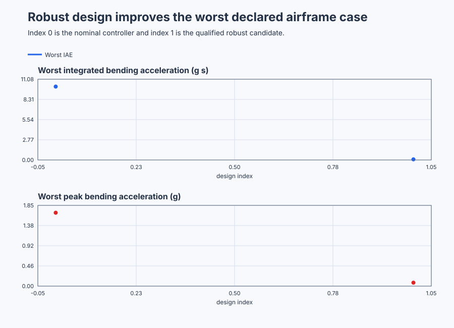

# Qualify robust load alleviation on a flexible-wing test rig

Course position: Lesson 72 of 84. Prerequisite: supervised adaptive extruder pressure control. Next lesson: networked control at a remote pumping station.

**Lesson objective:** Reject an aggressive nominal controller, select a filtered-PD candidate from common worst-case evidence, and state the exact boundary of the resulting robust claim.

**Evidence class:** Simulation evidence, not physical-plant qualification evidence.

## The problem

The equipment is a ground vibration-test flexible-wing load-alleviation rig. A controlled surface moves against a gust-induced bending mode so engineers can study load alleviation before considering a physical or flight implementation.

The wing-root bending response ($y$) is the accelerometer-derived bending signal in g. The desired bending response or setpoint ($r$) is zero g. The control-surface command ($u$) is the controller's requested surface position in percent. The applied control-surface command ($u_{\mathrm{applied}}$) is the position after the physical limit of -15 through +15 percent. The gust-equivalent load ($d$) is an independently generated aerodynamic-load input in g.

Positive surface position increases positive measured bending. Feedback must therefore command a negative surface position when the measured bending is positive. The controller runs every 20 milliseconds, while each simulated plant advances in 5-millisecond substeps.

Two independently restored plant copies receive the same gust. One uses the aggressive nominal controller and the other uses the robust candidate. Their requested and applied control-surface positions remain separate, so saturation cannot be mistaken for controller performance.

The previous lesson estimated a few slowly changing extruder parameters. It updated them only while an authorized experiment supplied enough information. That approach is not suitable for every uncertainty.

A flexible wing can vary in resonant frequency, damping and control-surface effectiveness. It can also contain residual dynamics that the chosen model does not describe individually. Making an adaptive estimator move faster would not prove that those uncertain resonances are safe.

The baseline controller was designed from one nominal model. Its large proportional gain looks attractive because it rejects low-frequency bending strongly. However, the controller also runs through a sampled one-cycle command-to-next-measurement path. In low-damping cases, that delay consumes the remaining damping. The nominal sampled loop becomes marginal or unstable inside the declared model set. We therefore need a design that evaluates the worst requirement over every declared uncertainty case.

## What we need

We need one load-alleviation controller whose worst-case evidence remains acceptable across the declared flexible-wing model set, not merely at the nominal plant. The claim must stop at the tested uncertainty and cannot stand in for flight or certification evidence.

## The new idea

### Two different descriptions of uncertainty

The nominal plant ($P_{0}$) is the best single linear model at the reviewed operating condition.

Structured uncertainty means uncertainty in named physical parameters. Here those parameters are modal frequency, damping and surface effectiveness. Because they have physical names and ranges, we can construct explicit plant cases.

Unstructured uncertainty means a bounded residual whose internal dynamics are not described one by one. Multiplicative uncertainty says that a local plant response may differ by a bounded fraction at each frequency. The local grid plant ($P_i$) is one structured case. The residual-uncertainty weight ($W_{\Delta}$) is the allowed fractional error. The normalized unknown residual ($\Delta$) may contain any stable dynamics whose $H_\infty$ norm is no greater than one.

Only after those quantities are defined do we write their relationship:

$P=P_{i} \cdot (1+W_{\Delta} \cdot \Delta)$

This relationship does not say that every real wing lies inside the envelope. The envelope needs independent identification and validation evidence for a physical article.

### Flexible-mode model

Surface motion and gust load accelerate one flexible bending mode. Structural stiffness returns the wing toward zero, while damping removes energy.

The natural angular frequency ($\omega_{n}$) is the undamped modal frequency in radians per second. The damping ratio ($\zeta$) is the dimensionless fraction describing modal energy loss. The control effectiveness ($g_{u}$) is a dimensionless scale on the installed surface-to-bending path. The Laplace frequency variable ($s$) is measured in radians per second.

The surface-to-bending plant for structured case i is:

$P_{i}(s)=0.1 \cdot g_{u} \cdot \omega_{n}^{2}/(s^{2}+2 \cdot \zeta \cdot \omega_{n} \cdot s+\omega_{n}^{2})$

Its input is surface position in percent and its output is bending in g. The gust-to-bending plant is:

$P_{\mathrm{d}},i(s)=\omega_{n}^{2}/(s^{2}+2 \cdot \zeta \cdot \omega_{n} \cdot s+\omega_{n}^{2})$

Its input and output are both in g.

The nominal model uses 4.0 rad/s natural angular frequency, 0.08 damping ratio and 1.0 control effectiveness. The structured grid contains 27 cases: natural angular frequency is 3.2, 4.0 or 4.8 rad/s; damping ratio is 0.03, 0.08 or 0.15; and control effectiveness is 0.8, 1.0 or 1.2. These points are executable evidence. A finite grid alone does not prove every intermediate plant.

### The three closed-loop paths

The controller response ($K$) converts measured bending error into requested surface position. The loop transfer ($L$) is the plant response multiplied by the controller response.

The sensitivity ($S$) is the closed-loop path that exposes low-frequency error and disturbance rejection. The complementary sensitivity ($T$) is the path that exposes resonance and multiplicative model uncertainty. The control sensitivity ($KS$) is the path from an error-producing input to control-surface effort.

After defining their meanings, the relationships are:

$L=P_{i} \cdot K$

$S=1/(1+L)$

$T=L/(1+L)$

$KS=K/(1+L)$

Improving one path can worsen another. Large loop gain reduces low-frequency sensitivity but can amplify uncertain resonance and demand excessive surface motion.

### Weights turn preferences into requirements

A weighting function is a frequency-dependent engineering limit. It is not decoration for a Bode plot.

The performance weight ($W_{p}$) requires useful low-frequency disturbance rejection. The residual-uncertainty weight ($W_{\Delta}$) represents an independently supplied 15-percent low-frequency residual that rises toward 75 percent at high frequency. The control-effort weight ($W_{u}$) scales surface demand into the common dimensionless decision.

The declared weights are:

$W_{p}(s)=1.5/(1+s/1)$

$W_{\Delta}(s)=0.15 \cdot (1+s/2)/(1+s/10)$

$W_{u}=0.005 g/\%$

Each weighted path must remain below one. An average is not allowed to hide one failed frequency or plant.

### H-infinity and the small-gain condition

The H-infinity norm of a stable scalar transfer is its greatest magnitude over all frequencies. The mixed-sensitivity score ($\gamma$) is the worst of the three weighted paths over every declared plant and frequency:

$\gamma=\max\left(\lVert W_{p} \cdot S \rVert_\infty,\lVert W_{\Delta} \cdot T \rVert_\infty,\lVert W_{u} \cdot KS \rVert_\infty\right)$

The small-gain robust stability condition says that a stable local loop remains stable for every stable normalized residual inside the declared multiplicative envelope when the weighted complementary-sensitivity peak is below one. Robust performance additionally requires the performance and effort peaks below one.

This lesson calculates a qualified numerical bound, not an exact continuous-frequency proof. The oracle evaluates 20,000 logarithmically spaced frequencies from 0.01 through 100 rad/s. It retains each peak's frequency and plant. The 20-millisecond sample interval has a Nyquist frequency of 157.08 rad/s, so higher frequencies are outside this lesson's claim.

### The controller that is actually sampled

The baseline is positional proportional control with proportional gain 40 %/g.

The robust candidates use proportional gain ($K_p$) in %/g, derivative gain ($K_d$) in %·s/g and measurement-filter time constant ($\tau_f$) in seconds. The finite candidate set is $(8,3,0.05)$, $(10,2,0.05)$, $(10,3,0.05)$ and $(12,3,0.05)$ for $(K_p,K_d,\tau_f)$.

The frequency calculation uses the actual 20 ms sampled loop: exact zero-order-hold discretization of each plant, the one-cycle command-to-next-measurement relationship, and the same first-order filter and backward measurement difference used by the Structured Text. It rejects a candidate if a sampled closed-loop pole is on or outside the unit circle.

The implemented robust controller uses `Control.LowPass` followed by derivative-on-measurement `Control.PID`. Integral gain is zero. Derivative setpoint weight is zero, so a setpoint change cannot create derivative kick. Requested output is calculated before the -15 through +15 percent physical limit; applied output is the limited value.

## Prediction

Consider zero frequency on the weakest plant, whose control effectiveness is 0.8. The selected candidate's proportional gain is 10 %/g. The plant's static surface gain is 0.1 g/% multiplied by 0.8.

The low-frequency loop gain is therefore:

$L=0.1 \cdot 0.8 \cdot 10=0.8$

The low-frequency sensitivity is:

$S=1/(1+0.8)=0.556$

The performance weight is approximately 1.5 at this frequency, giving:

$|W_{p} \cdot S|=1.5 \cdot 0.556=0.833$

Predict that this weak-control low-frequency case sets, or nearly sets, the selected design's mixed-sensitivity score.

Also predict that the aggressive nominal proportional controller fails at least one weighted bound and has at least one sampled pole outside the unit circle. Candidate (10,3,0.05) should keep all three weighted peaks below one and every declared sampled pole inside the unit circle.

There is a separate continuous local-stability check. After normalizing the surface path, the selected continuous filtered-PD approximation has proportional coefficient 1.0, derivative coefficient 0.3 and filter time constant 0.05 s. Its cubic Routh-Hurwitz determinant becomes:

$2 \cdot \zeta \cdot \omega_{n}+0.25 \cdot g_{u} \cdot \omega_{n}^{2}+0.2 \cdot \zeta^{2} \cdot \omega_{n}^{2}+0.005 \cdot \zeta \cdot \omega_{n}^{3}+0.03 \cdot g_{u} \cdot \zeta \cdot \omega_{n}^{3}$

Every term is positive for positive physical parameters. This predicts continuous local stability, but it does not replace the sampled-pole test or the residual-uncertainty test.

## Implementation

The shipped program runs the nominal and robust controllers on separate equivalent plant copies:

```st
FilteredRobustBending := RobustMeasurementFilter.Update(
    Input := RobustBending,
    CycleTime := LREAL#0.02
);

NominalRequested := LREAL#-40.0 * NominalBending;
RobustRequested := LREAL#-10.0 * FilteredRobustBending
    - LREAL#3.0
        * (FilteredRobustBending - LastFilteredBending) / LREAL#0.02;

NominalApplied := NominalController.Update(Input := NominalInput);
RobustApplied := RobustController.Update(Input := RobustInput);
```

`NominalController` is the positional P baseline. `RobustMeasurementFilter` and `RobustController` implement the selected sampled filtered-PD law. `ControllerEnabled` and `DataHealthy` gate both applied commands. `GustLoad` is copied into both independently bound plant inputs. `NominalBending` and `RobustBending` are separate plant outputs. `NominalRequested`, `NominalApplied`, `RobustRequested`, `RobustApplied`, `NominalSaturated` and `RobustSaturated` expose calculation and physical application without embedding any performance verdict in the PLC program.

## Experiment in Control Studio

This procedure tests one declared lesson change under controlled conditions. Evaluate the four filtered-PD candidates and execute the selected (10,3,0.05) realization on equivalent restored plants. The declared event lasts 25 seconds. It restores Gust-equivalent load to 0 g afterward. The deterministic Simulation seed is 20260829.

### Control Studio actions

1. **Monitor** — Start the **Simulator**, then open **truST sidebar → Control Studio → Monitor → Response**.
   - **Baseline check:** Wait until the header shows **Simulation**, **Running**, and current data. Confirm Wing-root bending setpoint (SP, g); Nominal-loop wing-root bending (PV, g) and Robust-loop wing-root bending (PV, g); Nominal requested surface position (MV, %) and Nominal applied surface position (MV, %), including units, limits, mode, and quality. The initial operating point is Wing-root bending setpoint = 0 g, Nominal-loop wing-root bending = 0 g, Robust-loop wing-root bending = 0 g. The unresolved baseline problem is: Aggressive nominal proportional control ignores the sampled delay and loses damping or stability over the declared flexible-mode set.
   - **Decision before action:** Read **Prediction** above, then state what should move first and in which direction. Use this decision rule: Accept only a candidate whose three weighted paths and sampled poles pass at every declared structured case; retain all peak locations and time-domain costs.
   - **Successful evidence:** The Response plot advances, the displayed values are finite and current, and **Start recording** is enabled. Select **Start recording** only after those conditions are visible.
   - **Recovery:** If recording is disabled or the plot reports unavailable or stale samples, stop the Simulator, correct the displayed runtime or binding problem, restart it, and repeat the baseline check.
   - **Record:** Write down the initial SP, PV, requested/applied MV where available, controller mode, and your predicted response before opening Test.

2. **Test** — Open **truST sidebar → Control Studio → Test**.
   - **Baseline check:** Set **Experiment** = **Load disturbance step**, **Amplitude** = **0.1 g**, and **Maximum duration (s)** = **25**. The affected signal is **Gust-equivalent load**; it starts at 0 g and must restore to 0 g.
   - **Decision before action:** Before selecting **Review test**, predict the response direction and confirm the requested change remains inside Nominal applied surface position -15 % to 15 %; Robust applied surface position -15 % to 15 %; Nominal-loop wing-root bending -1 g to 1 g; Robust-loop wing-root bending -1 g to 1 g.
   - **Successful evidence:** Select **Review test**, verify the signal, requested bound, duration, restoration, and stop conditions, then select **Confirm and start**. The state changes to **Running**, **Abort test** remains available, and the terminal state confirms completion and restoration while Response shows the measured SP/PV/MV sequence.
   - **Recovery:** For a rejected, stale, unsafe, unavailable, failed, or aborted state, read the displayed reason, restore Gust-equivalent load to 0 g, wait for current data, and review a new test.
   - **Record:** Compare the response with your prediction and retain the terminal state, restoration result, and deterministic seed **20260829**.

3. **Identify** — After **Stop recording**, open **truST sidebar → Control Studio → Identify**.
   - **Baseline check:** Use **Qualify recording** to inspect sample count, duration, timing, excitation, and clipping. **Model selection**, **Fit estimation run**, and **Accept model for design** are the shared low-order model workflow; they do not replace the project-owned **Sampled mixed-sensitivity loop shaping with structured and multiplicative uncertainty** model and must not be accepted as this lesson's design authority.
   - **Decision before action:** Decide whether the recording contains the input/output change needed for **Sampled mixed-sensitivity loop shaping with structured and multiplicative uncertainty** before fitting anything.
   - **Successful evidence:** A qualified recording has current, finite, sufficiently excited data. Use the project-owned model described under **Implementation** and **Evidence and decision**, and record its assumptions, units, validity range, and rejection rule.
   - **Recovery:** If qualification reports stale, clipped, poorly excited, or insufficient data, return to Test and repeat the bounded experiment; never force or relabel a rejected fit.
   - **Record:** State which model is retained or rejected and why, explicitly identifying the runnable project as the model authority.

4. **Tune / Design** — Open **truST sidebar → Control Studio → Tune**.
   - **Baseline check:** **Design method** and **Generate candidate** are disabled because **Sampled mixed-sensitivity loop shaping with structured and multiplicative uncertainty** is designed by the runnable project; shared Control.PID tuning is unavailable. Do not select an unrelated PID method.
   - **Decision before action:** Apply the equations and choices under **Implementation**, then compare the declared alternatives under **Evidence and decision** before accepting **Sampled mixed-sensitivity loop shaping with structured and multiplicative uncertainty**.
   - **Successful evidence:** Use **Monitor → Signals** to correlate the implemented project-owned design with its named live states and outputs. A disabled shared designer is only a visible ownership boundary, not successful design evidence.
   - **Recovery:** If the project-owned prerequisites or qualification flags are false, return to Test or Identify as directed by the lesson and do not bypass them with a generic PID candidate.
   - **Record:** State why the project-owned design is eligible, conditional, or rejected, including the decisive trade-off.

5. **Validate** — Open **truST sidebar → Control Studio → Validate**.
   - **Baseline check:** **Run required validation** is disabled because no shared Control.PID candidate exists. **Requirement details** and **Save result** cannot be used to claim a shared result; project-owned validation is executed by the runnable project's declared oracle.
   - **Decision before action:** Use the predeclared comparisons: selected_mixed_sensitivity_gamma < 1 (dimensionless) (tolerance 0.0001 (dimensionless)); selected_maximum_pole_radius < 1 (dimensionless) (tolerance 1e-8 (dimensionless)); robust_worst_case_iae < 999 g*s (tolerance 0.0001 g*s); robust_surface_saturation == 0 s (tolerance 0 s).
   - **Successful evidence:** Correlate the unrounded project-owned results with the named live signals and events in Monitor. Each applicable requirement must have a value, unit, limit, tolerance, evidence class, and Pass, Conditional pass, Fail, or Inconclusive disposition.
   - **Recovery:** If the project run aborts, becomes stale, fails, or violates restoration, discard that run and repeat the declared Test. Never present a disabled button or retained README table as newly executed evidence.
   - **Record:** State the validation disposition and name every failed or inconclusive requirement before continuing.

## Evidence and decision

### Measures and comparison

Classify stability and eligibility before comparing performance. An unstable controller is not allowed to win because one finite time window happens to look quiet.

Maximum weighted sensitivity is the largest $\left|W_{\mathrm{p\,S}}\right|$ over the declared plants and frequencies. Lower is better and values below one pass the declared performance weight.

Maximum weighted complementary sensitivity is the largest $\left|W_{\mathrm{delta\,T}}\right|$. Lower is better and values below one pass the small-gain residual-uncertainty condition, provided the local loop and residual assumptions are valid.

Maximum weighted control sensitivity is the largest $\left|W_{\mathrm{u\,KS}}\right|$. Lower is better and values below one pass the declared surface-effort weight.

Peak absolute bending is the maximum absolute wing-root bending response after gust onset, measured in g. Bending integrated absolute error is the sum of absolute bending multiplied by the 0.02-second interval from 5 through 25 seconds, measured in g*s.

Settling time is valid only when absolute bending remains at or below 0.005 g continuously for 2 seconds after the gust ends. Otherwise the result is `Not settled`.

Cumulative applied-surface movement is total variation: the sum of absolute changes between consecutive applied surface samples, measured in percentage points. Also retain peak requested and applied surface position and saturation duration. A requested position beyond 15 percent may be numerically valid while the physical actuator remains limited; the two signals are not interchangeable.

### Validation

The native test independently calculates the exact sampled plant, filter and controller responses. It also matches every executed filter, requested command, applied command and saturation state against a separate scan oracle.

The sampled-frequency qualification produced:

| Controller | Maximum weighted sensitivity | Maximum weighted complementary sensitivity | Maximum weighted control sensitivity | Mixed-sensitivity score | Maximum pole radius | Verdict |
| --- | ---: | ---: | ---: | ---: | ---: | --- |
| Nominal P | 343.053 | 1050.044 | 410.869 | 1050.044 | 1.008104 | Reject: unstable cases and failed bounds |
| Selected filtered PD | 0.8333 | 0.7714 | 0.3117 | 0.8333 | 0.976057 | Eligible on the declared sampled set |

The selected result agrees with the 0.833 low-frequency prediction. Its weighted-sensitivity peak occurs at 0.0100 rad/s on the 4.8 rad/s, 0.03-damping, 0.8-effectiveness plant. Its weighted complementary-sensitivity and control-sensitivity peaks occur at 10.0589 and 23.8105 rad/s on the 4.8 rad/s, 0.03-damping, 1.2-effectiveness plant. Retaining those locations shows which physical corner controls each requirement.

Across the 27 identical gust comparisons, the worst nominal and robust bending integrated absolute errors were 10.0757 and 0.0856 g*s. Worst peak bending was 1.6787 and 0.0790 g. Worst cumulative applied-surface movement was 1228.1 and 4.1 percentage points. Nominal saturation reached 9.30 seconds; the robust controller never saturated. Seventeen of 27 nominal cases were `Not settled`, while every robust case settled and the worst robust settling time was 2.12 seconds.

The separate quality record matched the controller scan oracle, applied exactly zero from both controllers while bending quality was bad, resumed bounded control after restoration, and applied zero after disable. These are Simulation results for the declared ground-rig models. A single favorable gamma, Bode curve or nominal trace still cannot qualify an undeclared plant.



[Complete trace](figures/flexible-airframe-robust-evidence-trace.csv) · [Decision summary](figures/flexible-airframe-robust-evidence-summary.csv)

## Conclusion

Sensitivity explains low-frequency gust rejection. Complementary sensitivity explains why uncertain resonant dynamics matter. Control sensitivity explains surface effort. The weights state how much of each path is acceptable at each frequency.

The aggressive nominal controller increases low-frequency authority, but its sampled command arrives after the measurement used to calculate it. In a lightly damped flexible mode, that phase delay can turn apparent correction into added oscillation. The robust controller uses less proportional aggression and filtered derivative action to add damping. The filter prevents the derivative calculation from treating high-frequency measurement content as unlimited surface demand.

That improvement has a price. The robust controller can permit more low-frequency sensitivity than the nominal design intended, and derivative action can increase surface movement. That is why the decision retains all three weighted paths and time-domain actuator evidence instead of celebrating one scalar score.

An analytic continuous Routh-Hurwitz result, a sampled frequency-grid qualification and a flight-worthy guarantee are different evidence classes. The first proves a local polynomial property under its assumptions. The second tests the declared numerical sampled set and residual envelope. Neither proves nonlinear aeroelastic behavior, structural integrity, flutter clearance or certification.

## Reason for the next lesson

Use this robust design only inside the stated ground-rig model set, residual envelope, frequency range, sampling, sensor, actuator and operating condition. Undeclared uncertainty is not guaranteed. A model weight with no physical provenance is not safety evidence.

Lesson 73 adds communication latency, jitter, loss, reordering and stale data to a remote pumping station. Those effects become part of the loop dynamics, so a controller qualified on a local deterministic connection is not automatically qualified across a network.
