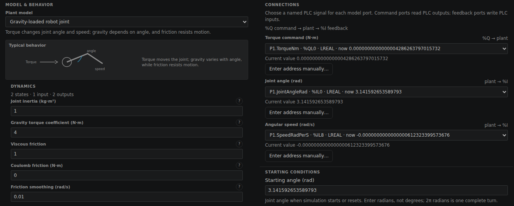
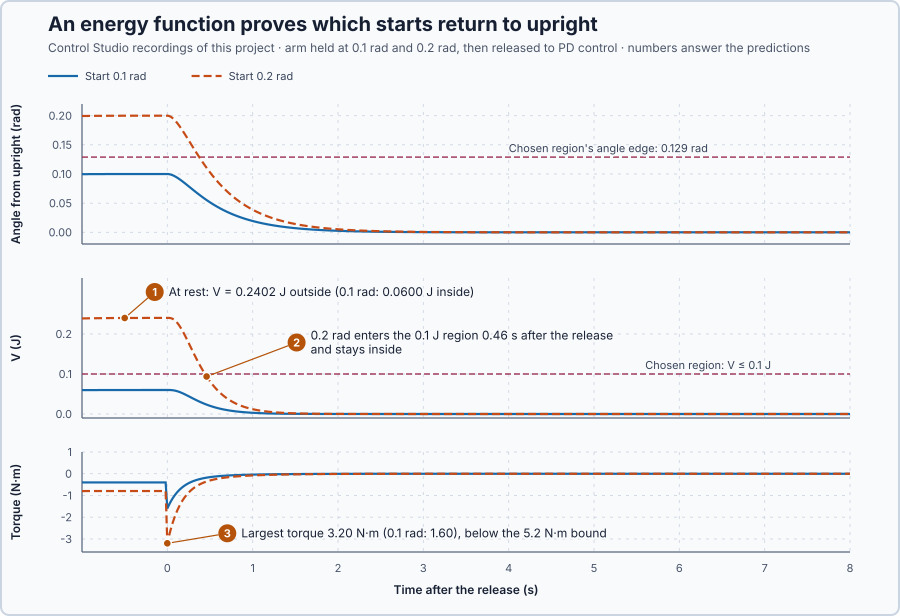

# 83. Lyapunov stability

In this lesson, you will build an energy-like quantity for an upright arm under PD control, calculate the region of starts from which it proves the arm returns to upright within the torque limit, and see what that proof says about a start outside the region.

## The problem

Lesson 82's MPC held both heaters within 0.2 °C from 8 s without exceeding the 100-point supply. That was one run, on heaters that settle by themselves, and a run proves no stability for the starts it did not try.

Some plants do not settle by themselves. We now take an arm balanced upright on a motor joint: gravity pulls it away with a torque that grows with the sine of the angle, a nonlinear plant, and only the motor brings it back. We will find an energy-like quantity for the arm under PD control, calculate the region of starts it proves will return within the torque limit, and check it with one start inside and one outside.

## What we need

We need to:

1. show that the arm returns to upright from every start in a region, not only from the starts we try;
2. check that the torque stays within its limit throughout that region; and
3. compare the result with runs from inside and outside the region.

## The new idea

**Lyapunov's method** finds an energy-like quantity that can only decrease while the arm moves. If the arm's energy keeps falling, it must come to rest at the target. For the arm, it adds the motion energy, the energy stored in the PD law as in a spring, and gravity's energy; friction and the D term only take energy away.

**In words.** Think of a ball rolling inside a bowl. Friction takes energy away at every moment, so however the ball starts, it must end at rest at the bottom. You do not need to follow its path to know where it ends: it is enough to know that its energy can only fall, and that the energy is lowest at the bottom. Lyapunov's method makes the same argument for a controlled plant, with an energy-like quantity that we build. For the arm it has four parts:

1. **Motion energy.** The faster the arm turns, the more energy it carries.
2. **Spring energy.** The P term pulls the arm back like a spring; the further from upright, the more energy that spring stores.
3. **Gravity's energy.** Gravity pulls the arm away from upright, so it lowers the energy away from upright: it makes the bowl's walls shallower.
4. **The losses.** Friction and the D term brake the motion and take energy out whenever the arm moves.

If the spring is stronger than gravity, the bowl has its bottom at upright, and every motion that starts low enough in the bowl ends there. One calculation then covers every start in a region, where runs cover only the starts we try.

**The formula.** Let:

- $\phi$ be the angle from upright, in radians, and $\omega$ the speed, in radians per second;
- $J = 1$ kg·m² be the inertia and $B = 1$ N·m·s/rad the friction;
- $G = 4$ N·m be the gravity torque coefficient: the arm's weight times the distance from the joint to its centre of mass; and
- $K_p = 16$ N·m/rad and $K_d = 7$ N·m·s/rad be the PD gains, a teaching choice; the torque is limited to ±20 N·m.

The arm and its law are

$$
J\dot\omega = \tau - B\omega + G\sin\phi, \qquad \tau = -K_p\phi - K_d\omega .
$$

The energy-like quantity, in joules, adds the three energies:

$$
V = \tfrac12 J\omega^2 + \tfrac12 K_p\phi^2 + G(\cos\phi - 1).
$$

By the chain rule, with $\dot\phi = \omega$ and the arm's equation, the torques of the spring and of gravity cancel, and only the losses remain:

$$
\dot V = J\omega\dot\omega + K_p\phi\,\omega - G\sin\phi\,\omega = -(B + K_d)\,\omega^2 = -8\omega^2 \le 0 .
$$

A quantity that is zero at the target, positive everywhere else and never increasing along the motion is a **Lyapunov function**.

**Example: the arm at 0.05 rad, moving outward at 0.2 rad/s.**

1. Torques: the law gives $\tau = -16 \cdot 0.05 - 7 \cdot 0.2 = -2.2$ N·m, gravity $4\sin 0.05 = +0.20$ N·m and friction $-0.2$ N·m, so $\dot\omega = -2.2$ rad/s²: the outward motion is braked.
2. Energy: $V = \tfrac12 \cdot 0.2^2 + 8 \cdot 0.05^2 + 4(\cos 0.05 - 1) = 0.0200 + 0.0200 - 0.0050 = 0.0350$ J. The gravity term is negative, because the arm would fall from there.
3. Its rate: $\dot V = -8 \cdot 0.2^2 = -0.32$ J/s: the energy falls while the arm moves.

Follow the argument that turns this into a proof:

1. **$V$ never increases**, since $-8\omega^2$ is never positive.
2. **$V$ is zero only at upright rest.** Because $1 - \cos\phi \le \phi^2/2$, the gravity term is at least $-2\phi^2$, so $V \ge \tfrac12\omega^2 + 6\phi^2$, positive everywhere else.
3. **A region.** Choose the level $V \le 0.1$ J. There $\tfrac12\omega^2 \le 0.1$ gives $|\omega| \le 0.447$ rad/s and $6\phi^2 \le 0.1$ gives $|\phi| \le 0.129$ rad. The torque is at most $16 \cdot 0.129 + 7 \cdot 0.447 = 5.2$ N·m, inside ±20 N·m, so the law is never clipped there, and a motion that starts inside stays inside, because $V$ cannot rise.
4. **Rest at the target.** $\dot V = 0$ only when $\omega = 0$, and staying at rest needs $16\phi = 4\sin\phi$, true only at $\phi = 0$. So every motion that starts in the region comes to rest upright: the example's arm, with 0.0350 J, is one of them.

**The limitation.** The level 0.1 J is a cautious teaching choice; a higher level is allowed as long as the same checks hold. Since $V \ge 6\phi^2$, a higher level first meets the program's 0.3 rad safety abort at $V = 6 \cdot 0.3^2 = 0.54$ J, with a torque bound of $16 \cdot 0.3 + 7\sqrt{2 \cdot 0.54} = 12.1$ N·m; beyond that this function proves nothing, though the arm may still return. The argument is for the continuous law; the program updates every 20 ms.

## Prediction

Before running, answer these questions:

1. What is $V$ at 0.1 rad and at 0.2 rad, both at rest, and which start lies inside $V \le 0.1$ J?
2. Does the 0.2 rad start return, and when does it enter the 0.1 J region?
3. What is the largest torque in each run, and is it within the region's 5.2 N·m bound?

| Start at rest | $V$ | In $V \le 0.1$ J | In $V \le 0.54$ J | Torque at release |
| --- | ---: | --- | --- | ---: |
| 0.1 rad | 0.0600 J | yes | yes | −1.6 N·m |
| 0.2 rad | 0.2403 J | no | yes | −3.2 N·m |

## Implementation

Open [`src/Main.st`](src/Main.st). `ArmEnergyJ` calculates $V$, `PdTorqueNm` the tested law and `HoldTorqueNm` the hold; `InsideCertificate` reports the chosen region:

```st
ArmEnergyJ := LREAL#0.5 * SpeedRadPerS * SpeedRadPerS + LREAL#8.0 * AngleRad * AngleRad
    + LREAL#4.0 * (COS(AngleRad) - LREAL#1.0);
InsideCertificate := EnergyJ <= LREAL#0.1 AND NOT Saturated;
```

The experiment holds the arm at the experiment setting `InitialAngleRad` for 3 s, then releases it to the tested law for 8 s. The joint measures from hanging down, so $\phi = \theta - \pi$. An angle beyond 0.3 rad, a speed beyond 2 rad/s or an update interval outside 20 ms ± 5 ms latches zero torque.

**Exercise.** By hand, `ArmEnergyJ` at 0.2 rad and rest gives $0.32 + 4(0.98007 - 1) = 0.2403$ J, and `PdTorqueNm` at the region's corner, 0.1291 rad and 0.4472 rad/s, gives $-2.066 - 3.130 = -5.196$ N·m. Then run [`src/tests.st`](src/tests.st) from the **Testing** view; it checks these values and the hold torque.

## Experiment in Control Studio

1. Open this lesson's project and start **Simulator**. First look at the new plant: in the **truST** side bar, select **Devices & Connections**, then the **SIMULATED PLANT** box **upright-arm**; **Configure plant** opens. Its **Plant model** is **Gravity-loaded robot joint**, with **Joint inertia (kg·m²)** 1, **Gravity torque coefficient (N·m)** 4 and **Viscous friction** 1. Under **CONNECTIONS**, **Torque command (N·m)** is `P1.TorqueNm`, the command your program writes; **Joint angle (rad)** is `P1.JointAngleRad` and **Angular speed (rad/s)** is `P1.SpeedRadPerS`, the values it reads. **Starting angle (rad)** 3.141592653589793 is π: upright. Close the panel with **Cancel**.

   

2. In the **truST** side bar, select **Control Studio**. On **Identify**, choose **Project experiment** from **Method**. Under **Declared experiment settings**, **Initial Angle Rad** shows 0.1 (rad, 0.05–0.25). Press **Inspect experiment parameters**, keep 0.1, press **Review parameter values** and then **Apply reviewed values**.
3. **Signals** shows `P1.AngleRad · Process value (rad)`, `P1.TorqueNm · Applied output (N·m)` and `P1.SpeedRadPerS · state (rad/s)`; add `P1.EnergyJ · state (J)` and `P1.InsideCertificate · state (1)`.
4. Answer the predictions, select **Review project test** and check the declared **13 s**: the start, the 3 s hold and 8 s after the release. Select **Confirm and start**; the release comes about 5 s later, and times below count from it.
5. After the run, hover the angle, $V$ and the torque at the release and 0.5 s, 1 s and 2 s after it, and find where `P1.InsideCertificate` turns on.
6. Restart **Simulator** and repeat with **Initial Angle Rad** 0.2: edit it, review and apply it. Each run ends with **Project test completed. Outputs restored.**

Select **Abort test** to stop early.

## Evidence and decision



The numbered marks answer the predictions with the same numbers. From Control Studio's two recordings, times after the release:

| Start | $V$ at release | Angle at 0.5 s | at 1 s | at 2 s | Largest torque | Inside $V \le 0.1$ J |
| --- | ---: | ---: | ---: | ---: | ---: | --- |
| 0.1 rad | 0.0600 J | 0.051 rad | 0.019 rad | 0.003 rad | 1.60 N·m | throughout |
| 0.2 rad | 0.2402 J | 0.103 rad | 0.039 rad | 0.005 rad | 3.20 N·m | from 0.46 s |

1. $V$ was 0.0600 J for the 0.1 rad start, inside the chosen region, and 0.2402 J for 0.2 rad, held at 0.19998 rad, outside it.
2. The 0.2 rad start returned: $V$ fell below 0.1 J 0.46 s after the release and stayed below, as the 0.54 J level proves.
3. The largest torques, 1.60 and 3.20 N·m at the release, stayed below the region's 5.2 N·m bound; neither run saturated.

$V$ never increased at a recorded update after either release, although the torque changed only every 20 ms: from 0.1 rad it fell to 0.0204 J in 0.5 s and 0.0030 J in 1 s. Both arms were upright within 0.001 rad in 3 s. The proof's benefit is its reach: one calculation covers every start in the region. Its cost is caution: the 0.1 J level left out a start that returns. The PD law is accepted for starts with $V \le 0.54$ J, at rest up to 0.3 rad from upright; beyond that this function gives no guarantee. These are simulation results.

## Conclusion

Lyapunov's method replaces many runs with one argument: a quantity that is zero at the target, positive elsewhere and never increasing along motion proves that every start in a region where those checks hold comes to rest at the target.

For the arm, $V$ falls at $8\omega^2$, and the proof holds up to $V = 0.54$ J, where the region meets the 0.3 rad abort.

## Check yourself

1. **The arm is upright and moving at 0.4 rad/s. What is $V$, and how fast is it falling?**
   $V = \tfrac12 \cdot 0.4^2 = 0.08$ J, inside the 0.1 J region, falling at $8 \cdot 0.16 = 1.28$ J/s.
2. **Why must the region keep the torque below its limit?**
   A clipped torque is no longer $-K_p\phi - K_d\omega$, so the cancellation that gives $-8\omega^2$ fails and $V$ may
   increase.
3. **Why is a start outside the chosen region not shown to be unstable?**
   The region only marks where the proof was checked; outside it the function says nothing, and here a larger level
   still proved the return.

## Reason for the next lesson

Near upright the arm returns to rest, where gravity's torque is zero. To hold it at another angle, the PD law must fight a gravity torque that changes with the angle, and it can supply that torque only from a position error.

[Feedback linearization](../75-feedback-linearization/README.md) adds the torque that cancels the known gravity torque, leaving a linear loop we already know how to tune.
