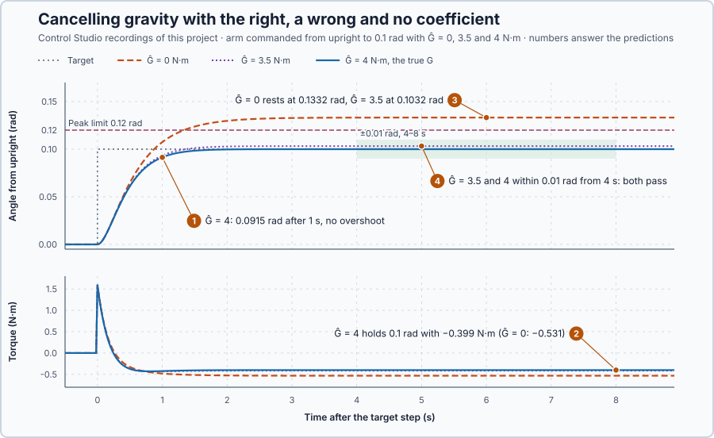

# 84. Feedback linearization

In this lesson, you will add gravity's torque, calculated from the measured angle, to the arm's PD law, and compare the right, a wrong and no gravity coefficient while holding the arm at 0.1 rad.

## The problem

Lesson 83's PD law brought the arm back to upright from 0.1 and 0.2 rad within 3 s, and its energy-like quantity proved the return for every start up to 0.54 J. Upright is the easy target: at rest there, gravity's torque is zero.

At 0.1 rad gravity pushes outward with $4\sin 0.1 = 0.40$ N·m even at rest, and that torque changes with the angle. PD produces a steady torque only from a position error, so the arm would rest where its error balances gravity. We will add gravity's torque, calculated from the measured angle, to the law, and compare the right, a wrong and no gravity coefficient while holding the arm at 0.1 rad.

## What we need

We need to:

1. supply gravity's torque at every angle without a position error;
2. keep the remaining loop linear, so the gains act as they were chosen to; and
3. see what an inexact gravity coefficient leaves behind.

## The new idea

**Feedback linearization** adds the torque that cancels the known nonlinear gravity torque, so the remaining loop behaves like the simple linear one we already know how to tune. For the arm, the law calculates gravity's torque from the measured angle at every update and supplies it, so the PD terms only have to move the arm.

**In words.** Away from upright, gravity pushes the arm outward with a torque that follows the sine of the angle, a nonlinear term. A PD law can supply a steady torque only from a position error, so it holds the arm past its target. But the law knows the angle, and if it knows how strong gravity is, it can calculate gravity's torque at that angle and supply the opposite torque itself. It is the gravity compensation of a vertical servo axis: the drive adds the load's holding torque, so the position loop does not have to build up an error to carry it. The law then has three parts:

1. **The cancellation.** From the measured angle and the assumed gravity coefficient, the law calculates gravity's torque and supplies its opposite at every update.
2. **The linear loop that remains.** With gravity cancelled, the arm is a plain inertia with friction, and the PD terms move it exactly as the gains were chosen to, at every angle.
3. **The residual.** If the assumed coefficient is wrong, part of gravity's torque is left over, and the PD terms must hold that part with a position error.

For the arm this means it can hold any angle with zero error, provided the gravity coefficient is right.

**The formula.** Let:

- $\phi$ be the angle from upright and $r$ the target angle, in radians;
- $\hat G$ be the gravity coefficient the controller assumes, in N·m; the arm's true $G$ is 4 N·m; and
- $J = 1$ kg·m², $B = 1$ N·m·s/rad, $K_p = 16$ N·m/rad and $K_d = 7$ N·m·s/rad be the arm and the gains of lesson 83.

The law is

$$
\tau = K_p(r - \phi) - K_d\dot\phi - \hat G\sin\phi .
$$

Putting it into the arm, $J\ddot\phi + B\dot\phi = \tau + G\sin\phi$, gives

$$
J\ddot\phi + (B + K_d)\dot\phi + K_p\phi = K_p r + (G - \hat G)\sin\phi .
$$

The left side is linear; the right side holds the target and the residual $(G - \hat G)\sin\phi$, which vanishes when $\hat G = G$. Then the loop is $\ddot\phi + 8\dot\phi + 16\phi = 16r$, with the characteristic equation $s^2 + 8s + 16 = (s + 4)^2 = 0$: both poles at −4 per second brake the arm just enough not to overshoot, and its step response is $\phi = r\left[1 - e^{-4t}(1 + 4t)\right]$. With $\hat G \ne G$ the arm rests where the P term holds the residual, $K_p(r - \phi) = -(G - \hat G)\sin\phi$, and with $\sin\phi \approx \phi$:

$$
\phi_{rest} \approx \frac{K_p\,r}{K_p - G + \hat G} .
$$

**Example: a target of 0.2 rad.**

1. Gravity's torque at 0.2 rad is $4\sin 0.2 = 0.795$ N·m, outward: the law must supply −0.795 N·m there just to hold the arm still.
2. At upright rest, when the target steps to 0.2 rad, $\tau = 16 \cdot 0.2 = 3.2$ N·m whatever $\hat G$, since $\sin 0 = 0$.
3. At the target at rest with $\hat G = 4$: $\tau = -4\sin 0.2 = -0.795$ N·m, exactly the torque that holds gravity; the PD terms contribute nothing.
4. With $\hat G = G$, after 0.5 s the arm is at $0.2\,(1 - e^{-2} \cdot 3) = 0.2 \cdot 0.594 = 0.119$ rad: 59 % of the way, and it then creeps up to 0.2 rad without passing it.
5. Without compensation, $\hat G = 0$: $\phi_{rest} \approx 3.2/(16 - 4) = 0.267$ rad, a third past the target (exactly 0.266 rad); the P term's $16(0.2 - 0.266) = -1.05$ N·m is what holds gravity there.

**The limitation.** The cancellation is only as good as $\hat G$. A wrong sign, $\hat G = -4$ N·m, doubles the outward term: for a 0.2 rad target the arm would head for $3.2/8 = 0.4$ rad, beyond the program's 0.3 rad abort; below $\hat G = G - K_p = -12$ N·m nothing would pull the arm back. The run below asks for a peak of at most 0.12 rad and an error of at most 0.01 rad from 4 s to 8 s; the coefficients 0, 3.5 and 4 N·m are a teaching choice.

## Prediction

Before running, answer these questions:

1. With $\hat G = 4$ N·m, how far has the arm moved after 1 s, and does it overshoot?
2. What torque holds it at 0.1 rad?
3. Where does the arm rest with $\hat G = 0$ and with $\hat G = 3.5$ N·m?
4. Which of the three meets both requirements?

| $\hat G$ | Rest angle | Holding torque | Peak and error met? |
| --- | ---: | ---: | --- |
| 0 N·m | 0.133 rad | −0.53 N·m | no: peak above 0.12 rad |
| 3.5 N·m | 0.103 rad | −0.41 N·m | yes |
| 4 N·m | 0.100 rad | −0.399 N·m | yes |

## Implementation

Open [`src/Main.st`](src/Main.st). `CompensatedTorqueNm` is the law:

```st
CompensatedTorqueNm := LREAL#16.0 * (SetpointRad - AngleRad) - LREAL#7.0 * SpeedRadPerS
    - GravityEstimateNm * SIN(AngleRad);
```

`GravityEstimateNm`, the controller's $\hat G$, is an experiment setting; the arm's own $G$ stays 4 N·m. The experiment steps the target from upright to 0.1 rad and records the peak angle and the largest error from 4 s to 8 s. As in lesson 83, the program updates every 20 ms, uses $\phi = \theta - \pi$, and latches zero torque beyond 0.3 rad or 2 rad/s.

**Exercise.** By hand, at the target at rest the law gives $-\hat G\sin 0.1$: −0.399 N·m for $\hat G = 4$ and 0 for $\hat G = 0$. Without compensation the arm rests where $16(0.1 - \phi) = -4\sin\phi$; check that $\phi = 0.1332$ rad gives −0.531 N·m against gravity's 0.531 N·m. Then run [`src/tests.st`](src/tests.st) from the **Testing** view; it checks these values.

## Experiment in Control Studio

1. Open this lesson's project and start **Simulator**. The arm rests upright. In the **truST** side bar, select **Control Studio**.
2. On **Identify**, choose **Project experiment** from **Method**. Under **Declared experiment settings**, **Gravity Estimate Nm** shows 4 (N·m, −8–8). Press **Inspect experiment parameters**, enter 0, press **Review parameter values** and then **Apply reviewed values**.
3. **Signals** shows `P1.AngleRad · Process value (rad)`, `P1.TorqueNm · Applied output (N·m)` and `P1.SetpointRad · state (rad)`; add `P1.PeakAngleRad · state (rad)` and `P1.LateErrorRad · state (rad)`.
4. Answer the predictions, select **Review project test** and check the declared **11 s**: the start and about 9 s at the 0.1 rad target. Select **Confirm and start**; the target steps about 2 s later, and times below count from that step.
5. After the run, hover the angle 1 s, 4 s and 8 s after the step and the torque at 8 s, then the end of `P1.PeakAngleRad` and `P1.LateErrorRad`.
6. Restart **Simulator** and repeat with **Gravity Estimate Nm** 3.5 and then 4. Each run ends with **Project test completed. Outputs restored.**

Select **Abort test** to stop early.

## Evidence and decision



The numbered marks answer the predictions with the same numbers. From Control Studio's three recordings, times after the target step:

| $\hat G$ | Angle at 1 s | Angle at 4 s | Peak | Largest error 4–8 s | Torque at 8 s |
| --- | ---: | ---: | ---: | ---: | ---: |
| 0 N·m | 0.107 rad | 0.1331 rad | 0.1332 rad | 0.0332 rad | −0.531 N·m |
| 3.5 N·m | 0.093 rad | 0.1032 rad | 0.1032 rad | 0.0032 rad | −0.412 N·m |
| 4 N·m | 0.0915 rad | 0.1000 rad | 0.1000 rad | 0.0000 rad | −0.399 N·m |

1. With $\hat G = 4$ N·m the arm was at 0.0915 rad after 1 s, close to the 0.091 rad of $(s + 4)^2$, and settled at 0.1000 rad without overshoot.
2. It held 0.1 rad with −0.399 N·m, exactly gravity's $-4\sin 0.1$.
3. Without compensation it rested at 0.1332 rad, where the P term's $16(0.1 - 0.1332) = -0.531$ N·m holds gravity; with $\hat G = 3.5$ N·m the residual $0.5\sin\phi$ left it at 0.1032 rad. Both agree with $16r/(16 - G + \hat G)$.
4. $\hat G = 3.5$ and 4 N·m met both requirements; no compensation missed both, with a 0.1332 rad peak and a 0.0332 rad error.

Every run started with 1.6 N·m, and none saturated. The benefit of the cancellation is a loop that behaves as designed at this angle, without an error to hold gravity; its cost is dependence on $\hat G$. Nominal compensation is accepted for this arm and target, and the 3.5 N·m estimate also passes; no compensation is rejected. These are simulation results.

## Conclusion

Feedback linearization calculates a known nonlinear torque from the measurement and cancels it inside the law, leaving the linear loop the gains were chosen for.

For the arm, the true coefficient held 0.1 rad with gravity's own −0.399 N·m and no overshoot; a 0.5 N·m error in $\hat G$ left 0.0032 rad, and no compensation left 0.0332 rad.

## Check yourself

1. **With $\hat G = 2$ N·m, where does the arm rest for $r = 0.1$ rad?**
   $\phi \approx 1.6/(16 - 4 + 2) = 0.114$ rad, inside the 0.12 rad peak limit but outside the 0.01 rad error band.
2. **Why does the arm without compensation rest above the target rather than below it?**
   Gravity pushes it outward, and P supplies holding torque only from an error, so the arm goes past the target until
   $16(0.1 - \phi)$ balances $4\sin\phi$.
3. **Why can exact compensation hold the arm with zero error?**
   The law supplies gravity's torque from the angle, so at the target the PD terms have nothing left to hold.

## Reason for the next lesson

The cancellation relied on knowing a process parameter, and in operation parameters change: a load changes the arm's gravity coefficient, and a fixed value is then wrong.

[Adaptive control](../76-adaptive-control/README.md) estimates a changing parameter from operating data and updates the controller with it.
