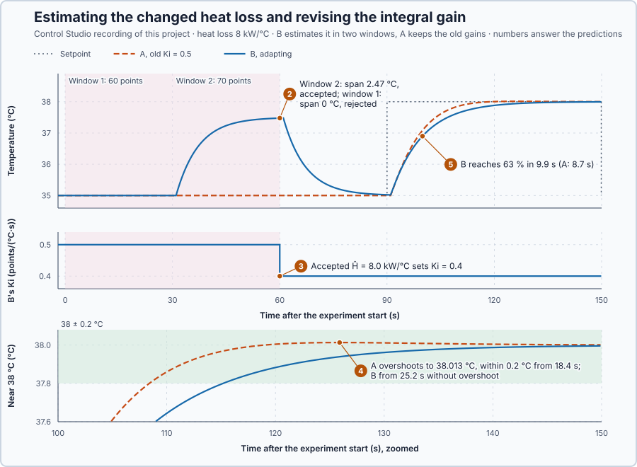

# 85. Adaptive control

In this lesson, you will estimate a heater's changed heat loss from its own measurements, reject a window of data that cannot tell that change from an unknown extraction, recalculate the PI gains from the accepted estimate, and compare them with the old gains.

## The problem

Lesson 84's compensation held the arm at 0.1 rad with exactly gravity's −0.399 N·m, because its coefficient matched the arm's; 0.5 N·m less left 0.0032 rad, and none left 0.0332 rad. A controller built on a model parameter is only as good as that parameter, and parameters change in operation.

We study such a change on the water heater, whose heat balance is linear in its one unknown parameter, so a short formula can estimate it. Its heat loss has fallen from 10 to 8 kW/°C, for example after new insulation, while its PI gains were designed for 10 kW/°C. We will estimate the heat loss from the heater's own measurements, accept the estimate only when the data can support it, and recalculate the gains from it.

## What we need

We need to:

1. estimate the heat loss from measured temperatures and commands while the heater runs;
2. reject data that cannot tell a changed heat loss from an unknown extraction; and
3. recalculate the PI gains from an accepted estimate and compare them with the old gains.

## The new idea

**Adaptive control** estimates a changing process parameter from operating data and updates the controller with it, but only when the data really contain that information. For the heater, the program estimates the heat loss from its temperatures and commands, and revises the integral gain only when the estimate passes its checks.

**In words.** The PI gains were calculated from a model parameter, the heat loss. When the heat loss changes, the gains no longer give the response they were designed for. An adaptive controller measures the parameter again while the plant runs and recalculates the gains from it. The hard part is knowing when the data can be trusted. It is like a weighing system's automatic tare: it learns a new zero only when the scale is steady and empty, never in the middle of filling. The parts:

1. **Measure the effect.** Every second, the heat balance turns a temperature and a command into one data pair: how far the water is above its surroundings, and how much heat it lost.
2. **Estimate.** A line through the pairs gives the heat loss: its slope.
3. **Check the data.** The estimate is accepted only if the data could have shown the heat loss: the temperature moved enough, the line fits, and its two halves agree.
4. **Update the controller.** Only an accepted estimate recalculates the gain.

For this heater, the heat loss has fallen from 10 to 8 kW/°C. The program can find that from its own measurements, but only from data in which the temperature moved.

**The formula.** The water stores heat; the heater adds 2 kW per command point, delivered one second late; heat leaves in proportion to the temperature above the 20 °C surroundings. Let:

- $C = 50$ kJ/°C be the thermal capacity and $a = 2$ kW per point the heater power;
- $H$ be the heat loss, in kW/°C, and $D$ an unknown extra extraction, in kW;
- $u_{delayed}$ be the command delivered during the second, in points, and $dT/dt$ the temperature's rate of change, in °C/s; and
- $x = T - 20$ be the temperature above the surroundings, in °C, and $y = a\,u_{delayed} - C\,dT/dt$ the heat lost, in kW.

The balance $C\,dT/dt = a\,u_{delayed} - Hx - D$ gives

$$
y = Hx + D .
$$

Many seconds give many pairs $(x_i, y_i)$. A least-squares fit, as in lesson 15, picks the $\hat H$ that makes $\sum_i (y_i - Hx_i)^2$ smallest; squared misses cannot cancel each other. Its derivative, $-2\sum_i x_i(y_i - Hx_i)$, is zero at

$$
\hat H = \frac{\sum_i x_iy_i}{\sum_i x_i^2} .
$$

The program forms one pair per second, from the mean temperature over the second and the command delivered during it. An accepted $\hat H$ sets the integral gain

$$
K_i = \frac{\hat H}{a\lambda}, \qquad K_p = \frac{C}{a\lambda},
$$

with $\lambda = 10$ s the desired time constant, $K_i$ in points/(°C·s) and $K_p$ in points/°C. This puts the PI's zero, $K_i/K_p = H/C$, on the heater's pole, so the integral term cancels the heater's own lag and the loop responds with a time constant of about $\lambda$.

**Example: the heater before the insulation, $H = 10$ kW/°C.**

1. One pair: holding 35 °C took 75 points with the temperature steady, so $x = 15$ °C and $y = 2 \cdot 75 - 50 \cdot 0 = 150$ kW. This pair alone says $H = 150/15 = 10$ kW/°C.
2. Three seconds with small misses, $(14, 141)$, $(15, 149)$ and $(16, 160)$: $\sum x_iy_i = 1974 + 2235 + 2560 = 6769$ and $\sum x_i^2 = 196 + 225 + 256 = 677$, so $\hat H = 6769/677 = 10.0$ kW/°C. The misses of +1, −1 and 0 kW average out.
3. Why the data must move: with $x = 15$ °C throughout, 150 kW fits $H = 10$ with $D = 0$, and equally $H = 8$ with a 30 kW extraction, $8 \cdot 15 + 30 = 150$. Only a change in $x$ separates them: at $x = 17$ °C the first gives 170 kW and the second 166 kW.
4. So the program accepts an estimate only when $x$ spans at least 1 °C, every miss $|y - \hat Hx|$ is within 5 kW, the two halves of the window agree within 0.5 kW/°C, and $\hat H$ lies in 7–13 kW/°C. These limits are a teaching choice.
5. The gains for 10 kW/°C are $K_i = 10/20 = 0.5$ points/(°C·s) and $K_p = 50/20 = 2.5$ points/°C: the gains both heaters start with. The zero, $0.5/2.5 = 0.2$ per second, sits on the pole, $10/50 = 0.2$ per second.

**The limitation.** Adaptation cannot add information that the data lack. A steady window may give the right number by luck or a wrong one with the same confidence, and an accepted estimate holds only while $C$, $a$ and $D$ are as assumed. Only $K_i$ follows the estimate; $K_p = 2.5$ points/°C stays.

## Prediction

Before running, answer these questions:

1. Window 1 holds the changed heater at a steady 35 °C with 60 points. What heat loss does it estimate?
2. Which window will be accepted: 30 s at a steady 60 points, or 30 s at 70 points?
3. What integral gain does the accepted estimate give?
4. After a 3 °C setpoint step, which heater overshoots, and which settles within 0.2 °C sooner?
5. Which heater reaches 63 % of the step in about $\lambda = 10$ s?

| Window | Estimate | Span of $x$ | Accepted? | $K_i$ afterwards |
| --- | ---: | ---: | --- | ---: |
| 1: steady 60 points | 8 kW/°C | 0 °C | no: span below 1 °C | 0.5 |
| 2: 70 points | 8 kW/°C | about 2.5 °C | yes | 0.4 |

## Implementation

Open [`src/Main.st`](src/Main.st). `HeatLossWindow` forms the 30 pairs of a window, calculates $\hat H$ with `LeastSquaresHeatLoss` and applies the four checks; an accepted estimate sets B's integral gain:

```st
IF Window.Accepted THEN
    AdaptiveKi := Window.EstimateKwPerC / LREAL#20.0;
END_IF;
```

Both heaters have the changed heat loss and rest at 35 °C with 60 points, each held by `Control.PID` as PI, updated every 0.1 s. Heater A keeps the old gains. For heater B the experiment switches `Control.PID` to Manual and holds 60 points for 30 s (window 1), 70 points for 30 s (window 2) and 60 points again. At 90 s both heaters are in Auto and their setpoint steps to 38 °C. A temperature outside 0–80 °C or an update interval outside 100 ms ± 10 ms latches zero output.

**Exercise.** By hand, the steady window gives $x = 15$ and $y = 2 \cdot 60 - 0 = 120$ kW every second, so $\hat H = 8$ kW/°C with a span of 0 °C. Then run [`src/tests.st`](src/tests.st) from the **Testing** view; it checks the worked estimate, one second of the balance and the rejection of the steady window.

## Experiment in Control Studio

1. Open this lesson's project and start **Simulator**. Both heaters rest at 35 °C with 60 points. In the **truST** side bar, select **Control Studio**.
2. On **Identify**, choose **Project experiment** from **Method**. **Signals** shows `P1.AdaptiveC · Process value (°C)`, `P1.FixedC · state (°C)` and `P1.SetpointC · state (°C)`: heater B, heater A and their setpoint. Add `P1.AdaptiveKi · state (%/(°C·s))`, `P1.Estimate2 · state (kW/°C)`, `P1.Span1 · state (°C)` and `P1.Span2 · state (°C)`.
3. Answer the predictions, select **Review project test** and check the declared **152 s**: two windows, 30 s back at 60 points and 60 s after the setpoint step. Select **Confirm and start**; the experiment starts about 2 s later, and times below count from that start.
4. After the run, hover B's temperature at 30 s and 60 s, B's integral gain before and after 60 s, and both heaters 10 s, 18 s and 25 s after the step at 90 s.
5. At completion Control Studio shows **Project test completed. Outputs restored.**

Select **Abort test** to stop early; to repeat, restart **Simulator** so both heaters start at rest.

## Evidence and decision



The numbered marks answer predictions 2–5, and the first table answers prediction 1: the steady window estimated 8.0 kW/°C, the right number. From Control Studio's recording:

| Window | Heater B | Estimate | Span of $x$ | Decision |
| --- | --- | ---: | ---: | --- |
| 1: 0–30 s | 60 points, 35.00 °C throughout | 8.0 kW/°C | 0.00 °C | rejected |
| 2: 30–60 s | 70 points, 35.00 → 37.47 °C | 8.0 kW/°C | 2.47 °C | accepted |

| Heater | 63 % of the step | Peak | Within 0.2 °C from | Largest error from 30 s |
| --- | ---: | ---: | ---: | ---: |
| B, revised $K_i = 0.4$ | 9.9 s | 37.996 °C | 25.2 s | 0.117 °C |
| A, old $K_i = 0.5$ | 8.7 s | 38.013 °C | 18.4 s | 0.013 °C |

2. Window 1 gave the right number and was rejected all the same: with the temperature constant, the same data fitted 10 kW/°C with a 30 kW heat input. Window 2 moved the temperature 2.47 °C, its halves agreed and its misses were small, so it was accepted.
3. The accepted 8.0 kW/°C set B's integral gain to 0.4 at 60 s.
4. A, with the old gain, overshot to 38.013 °C and was within 0.2 °C from 18.4 s; B approached without overshoot and was within 0.2 °C from 25.2 s.
5. B reached 63 % in 9.9 s, as $\lambda = 10$ s specifies, because its PI zero again sits on the heater's pole; A rose faster, in 8.7 s.

Both heaters were stable; the old gains simply no longer produced the response they were designed for. The benefit of adapting is the designed response on the changed heater; its cost is two windows of deliberate movement and checks that can refuse an estimate. The accepted estimate and the revised gain are adopted, and the steady window is rejected, however plausible its number. These are simulation results, with $C$ and $a$ known and no unknown extraction.

## Conclusion

Adaptive control is an estimate qualified by its data, followed by one revision of the controller: data in which the temperature does not change cannot separate a changed heat loss from an unknown extraction.

For the heater, the moving window gave 8.0 kW/°C, and the revised integral gain restored the designed 10 s response without overshoot.

## Check yourself

1. **The pairs are $(10, 90)$ and $(20, 170)$. What is $\hat H$?**
   $\hat H = (900 + 3400)/(100 + 400) = 8.6$ kW/°C.
2. **Why was the steady window rejected although its estimate was right?**
   With $x$ constant, any heat loss fits together with a matching unknown extraction, so the data cannot show which
   one is true.
3. **What integral gain would an accepted estimate of 9 kW/°C give?**
   $K_i = 9/20 = 0.45$ points/(°C·s).

## Reason for the next lesson

A parameter cannot always be estimated reliably: the data may not move enough, or an unknown disturbance may confuse the estimate, and then adaptation has nothing it can trust.

[Robust control](../77-robust-control/README.md) designs one controller that works for the whole range the parameter can take.
