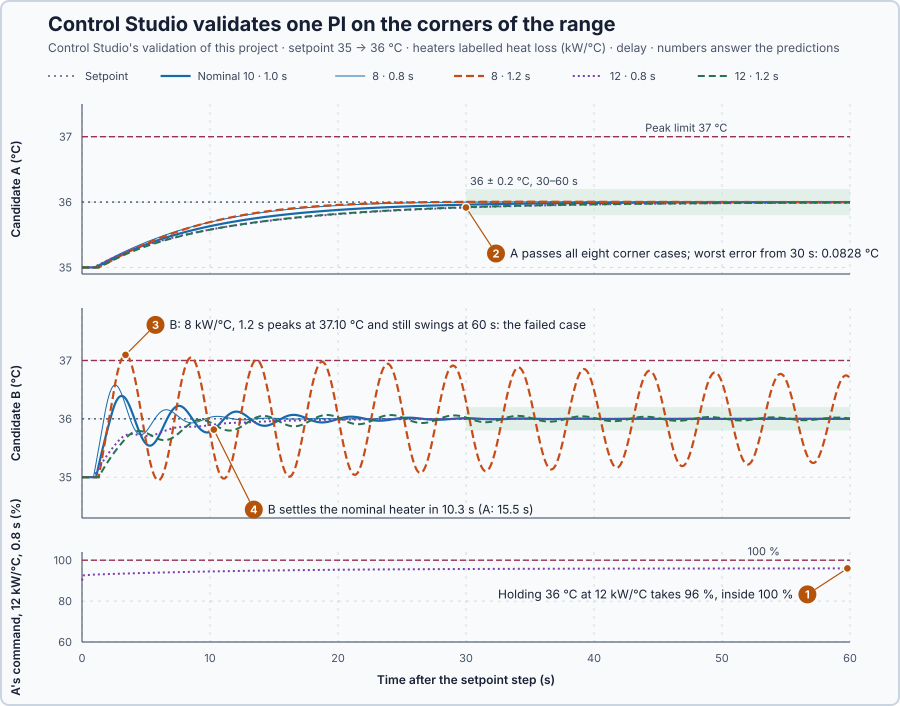

# 86. Robust control

This lesson is an introduction to robust control. You will check that the heater can meet the requirements at all, let Control Studio validate two fixed PI controllers on the corner heaters of an uncertain heat loss and delivery delay, and prove with a bound which one keeps every heater in the range stable.

## The problem

Lesson 85 accepted a heat-loss estimate of 8.0 kW/°C only because its window moved the temperature 2.47 °C. In operation such informative data are often missing. Here the heat loss lies between 8 and 12 kW/°C and the delivery delay between 0.8 and 1.2 s, depending on the installation, and neither can be estimated reliably while the heater runs. One PI, tuned once, must meet two requirements for every heater in that range:

- setpoint step 35 → 36 °C: peak at most 37 °C, and within 0.2 °C from 30 s to 60 s;
- a 10 kW extraction at 35 °C: at or above 33 °C, and within 0.2 °C from 30 s to 60 s.

We will check the heater's capacity, let Control Studio validate two candidates on the corners of the range, and show with a bound which one keeps every heater stable.

## What we need

We need to:

1. check that the heater has the power for the requirements at all;
2. validate each candidate on the same corner heaters and events; and
3. cover the heaters between the tested ones with an argument instead of more runs.

## The new idea

**Robust control** designs one controller that works for the whole range the process can be in, without knowing its exact value at any moment. For the heaters, one PI must serve every heat loss from 8 to 12 kW/°C and every delay from 0.8 to 1.2 s.

**In words.** Lesson 85 measured the parameter when the data allowed it. Robust control gives up knowing the exact value: it states how far the process can vary and makes sure one controller copes with all of it. It is the idea behind rating equipment for the worst case: a motor sized for the heaviest load runs every load, whatever today's load is. Two words name what we ask for: **robust stability** means the loop is stable for every process in the range; **robust performance** means it also meets the requirements for every one. The parts:

1. **The range.** State what can vary and how far, and keep it physical: here the heat loss sets both the heater's gain and its time constant, so they move together.
2. **Capacity.** Check that the heater has the power to meet the requirements at all, even at the worst end of the range. No tuning can supply missing power.
3. **The corners.** Run the controller on the extreme heaters, every combination of the highest and lowest heat loss and delay, with the required events.
4. **Stability in between.** Bound how far any heater in the range can differ from a reference heater, and turn that bound into a guarantee for every heater, not only the ones run.

For the heaters this means one PI, tuned once, is kept only if the power suffices, every corner meets the requirements and the bound guarantees stability between the corners.

**The formula.** At rest the heater's power equals the heat lost, so the holding command is

$$
u_{hold} = \frac{H(T - 20) + D}{2} \le 100\ \% ,
$$

with the heat loss $H$ in kW/°C, the temperature $T$ in °C, the extraction $D$ in kW and 2 kW per command point.

A heater is $G = 2e^{-Ls}/(50s + H)$ with delay $L$: its gain $2/H$ and time constant $50/H$ move together with $H$. Let:

- $G_0 = 0.2e^{-0.8s}/(5s + 1)$ be the reference heater, with $H = 10$ and $L = 0.8$ s;
- $\delta = G/G_0 - 1$ be a heater's relative model error, a complex number at each frequency $\omega$, in rad/s;
- $W(\omega)$ be a bound on its size, $|\delta(j\omega)| \le W(\omega)$, with $j$ as in lesson 49; and
- $T_0 = CG_0/(1 + CG_0)$ be the reference loop's complementary sensitivity (lesson 55), with the PI $C$.

The heat-loss difference, largest at $H = 8$, and up to 0.4 s of extra delay, which turns the phase by up to $0.4\omega$ rad, give for every heater in the range

$$
|\delta(j\omega)| \le W(\omega) = \frac{2}{\sqrt{64 + 2500\omega^2}} + \min(0.4\,\omega,\ 2),
$$

and every heater in the range is stable with $C$ if

$$
W(\omega)\,|T_0(j\omega)| < 1 \quad \text{at every frequency.}
$$

This is the **small-gain condition**. The reason: $CG = CG_0(1 + \delta)$ gives $1 + CG = (1 + CG_0)(1 + T_0\delta)$. The reference loop is stable, so a heater's loop can only fail where $T_0\delta$ reaches −1, and with $W|T_0| < 1$ the size of $T_0\delta$ stays below 1. The condition is sufficient, not necessary: failing it removes the guarantee, not the stability.

**Example: the heaters with candidate A, $C = 2.5 + 0.5/s$.**

1. Capacity on the nominal heater, 10 kW/°C: holding 36 °C needs $10 \cdot 16/2 = 80$ %, and 35 °C against 10 kW needs $(10 \cdot 15 + 10)/2 = 80$ %. Both fit; the corners with more heat loss need more.
2. The bound at $\omega = 0$: $W = 2/8 = 0.25$, because a heater with 8 kW/°C has $2/8 = 0.25$ °C per point against the reference's 0.2, 25 % more gain. At 0.2 rad/s: $W = 2/\sqrt{164} + 0.4 \cdot 0.2 = 0.156 + 0.080 = 0.236$.
3. The PI's zero, at $s = -0.5/2.5 = -0.2$ per second, cancels the reference pole, so $CG_0 = 0.1e^{-0.8s}/s$.
4. Then $|T_0(j\omega)|^2 = 0.01/(0.01 + \omega^2 - 0.2\,\omega\sin 0.8\omega)$. Since $\sin z \le z$, the denominator is at least $0.01 + 0.84\omega^2$, so $|T_0| \le 0.1/\sqrt{0.01 + 0.84\omega^2}$, and with $W \le 0.25 + 0.4\omega$ the product is at most $(0.025 + 0.04\omega)/\sqrt{0.01 + 0.84\omega^2}$.
5. Its derivative is zero at $\omega = 0.019$ rad/s, where it is 0.254: below 1 at every frequency. Every heater in the range is stable with candidate A.

**The limitation.** The bound covers stability of the continuous, unsaturated model, not the requirements: those are shown only for the heaters that validation runs, the corners. Candidate A's gains, and candidate B's below, are a teaching choice.

## Prediction

Before running, answer these questions:

1. What is the largest holding command the requirements need, and above which setpoint could no controller hold the 12 kW/°C heater?
2. Does candidate A, $K_p = 2.5$ %/°C and $K_i = 0.5$ %/(°C·s), pass all eight corner cases?
3. Candidate B is the same rule tuned faster: $K_p = 30$, $K_i = 6$. Which corner will it fail, and why that one?
4. Does B settle the nominal heater, 10 kW/°C with 1.0 s, faster than A?
5. Does B satisfy the small-gain condition?

| Check | Candidate A | Candidate B |
| --- | ---: | ---: |
| Largest $W\lvert T_0\rvert$ | 0.254 | 1.45 at 1.70 rad/s |
| Stability guaranteed for the whole range | yes | no |

## Implementation

Open [`src/Main.st`](src/Main.st). The project is the nominal heater, 10 kW/°C with 1.0 s, under the real `Control.PID` as PI; its `Parameters` start as candidate A, and Control Studio's **Apply** replaces them. A temperature outside 0–80 °C latches `SafetyAbort`, which removes heat and the extraction. [`control-loop.json`](control-loop.json) declares the eight corner scenarios: models of the heaters with 8 and 12 kW/°C and 0.8 and 1.2 s, each with the setpoint step and with the 10 kW extraction, entered as 5 points less heat at the heater's input, and each with the two requirements. `ModelErrorBound` calculates $W$:

```st
ModelErrorBound := LREAL#2.0 / SQRT(LREAL#64.0 + LREAL#2500.0 * OmegaRadS * OmegaRadS)
    + MIN(LREAL#0.4 * OmegaRadS, LREAL#2.0);
```

**Exercise.** By hand, `ModelErrorBound` at 0.2 rad/s gives $2/\sqrt{164} + 0.08 = 0.236$, and `HoldingCommandPct` at 12 kW/°C and 36 °C gives $12 \cdot 16/2 = 96$ %. Then run [`src/tests.st`](src/tests.st) from the **Testing** view; it checks these values and the bound.

## Experiment in Control Studio

1. Open this lesson's project and start **Simulator**. The heater rests at 35 °C with 75 %. In the **truST** side bar, select **Control Studio**.
2. On **Identify**, choose **Supplied plant model** from **Method** and open `provided-model.json`. Control Studio shows the **First-order model with delay** `G(s) = (0.2) / (5s +1) · e^(−1s)`, the nominal heater.
3. Answer the predictions.
4. On **Tune**, keep **P1.Controller · PI — recommended**, choose **Manual** in **Tuning method** and enter **Proportional gain (Kp)** 2.5 and **Integral gain (Ki)** 0.5. Select **Requirements…**, enter **Setpoint change (°C)** 1, **Maximum steady-state error (°C)** 0.2, **Maximum settling time (s)** 30, **Settling band (±°C)** 0.1 and **Validation duration (s)** 60, and select **Done**. Select **Tune controller**.
5. On **Validate**, select **Validate controller**. Control Studio runs the PI's actual ST for 60 s on the project's heater and on each corner scenario, and lists every requirement under **Requirement**, **Measured**, **Limit** and **Result**.
6. On **Tune**, enter 30 and 6, select **Tune controller**, and validate again.

Select **Abort** to stop validation early. To repeat, stop and restart **Simulator**.

## Evidence and decision



The numbered marks answer predictions 1–4. Control Studio's validation, with the largest error from 30 s and the range over 60 s:

| Heater, event | A: error | A: range | B: error | B: range |
| --- | ---: | ---: | ---: | ---: |
| Nominal, step | 0.0396 °C | settled 15.5 s | 0.0107 °C | settled 10.3 s |
| 8 kW/°C, 0.8 s, step | 0.0035 °C | 35–36 °C | 0.0001 °C | 35–36.58 °C |
| 8 kW/°C, 1.2 s, step | 0.0055 °C | 35–36.01 °C | 0.8967 °C, Fail | 34.95–37.10 °C, Fail |
| 12 kW/°C, 0.8 s, step | 0.0828 °C | 35–35.99 °C | 0.0022 °C | 35–36 °C |
| 12 kW/°C, 1.2 s, step | 0.0787 °C | 35–35.99 °C | 0.0581 °C | 35–36.07 °C |
| 8 kW/°C, 0.8 s, extraction | 0.0675 °C | 34.42–35 °C | 0.0004 °C | 34.78–35 °C |
| 8 kW/°C, 1.2 s, extraction | 0.0638 °C | 34.40–35 °C | 0.1462 °C | 34.72–35.15 °C |
| 12 kW/°C, 0.8 s, extraction | 0.1101 °C | 34.52–35 °C | 0.0006 °C | 34.80–35 °C |
| 12 kW/°C, 1.2 s, extraction | 0.1101 °C | 34.51–35 °C | 0.0597 °C | 34.74–35.10 °C |

1. The 12 kW/°C, 0.8 s heater held 36 °C with 96 %, as the capacity check predicted; above 36.7 °C it would need more than 100 %, 38 °C for example 108 %.
2. A passed all eight corner cases and the nominal heater: no heater rose above 36.01 °C or, in an extraction, fell below 34.40 °C. Control Studio made **Apply** available.
3. B failed one corner, 8 kW/°C with 1.2 s, the most delay with the highest gain: it peaked at 37.10 °C and still swung 0.8967 °C after 30 s. Control Studio showed **Verification failed: Observed measurement exceeds the declared limit. Next: Tune again.** and kept **Apply** unavailable.
4. B settled the nominal heater in 10.3 s, after 1.3 s at 100 %; A in 15.5 s.
5. B's product $W|T_0|$ is 1.45 at 1.70 rad/s, so the bound gives no guarantee, and one corner did not settle.

Candidate A is kept: Control Studio validated it on every corner, and the bound 0.254 shows that every heater between them is stable with it. Its cost is speed: 15.5 s against B's 10.3 s. The corner runs do not prove the requirements between the corners; the bound covers stability only. These are simulation results.

## Conclusion

Robust control fixes one controller for a stated range of processes: capacity first, then validation on the corners of the range, and a bound that covers stability between them.

For the heaters, Control Studio validated candidate A on all eight corner cases, with a bound of 0.254; candidate B, tuned for speed on the nominal heater, failed the corner with the most delay and the highest gain.

## Check yourself

1. **What holding command does a heater with 10 kW/°C need for 37 °C?**
   $u_{hold} = 10 \cdot 17/2 = 85$ %.
2. **Why must the heater's gain and time constant not be varied independently?**
   Both come from the heat loss, $2/H$ and $50/H$, so independent values would describe heaters that do not exist.
3. **Why does B's failed small-gain condition not prove that B is unstable?**
   The condition is sufficient, not necessary: failing it only removes the guarantee. The runs showed what B does.

## Reason for the next lesson

The range covered the heat loss and the delivery delay. Model bounds do not cover commands that arrive over a network: lost, reordered or old commands are not a model error.

[Networked control](../../13-networked-fault-aware-and-diagnostic-control/78-networked-control/README.md) accepts a remote command only if it is new, in order and recent enough, holds the last good one for a limited time and then falls back.
