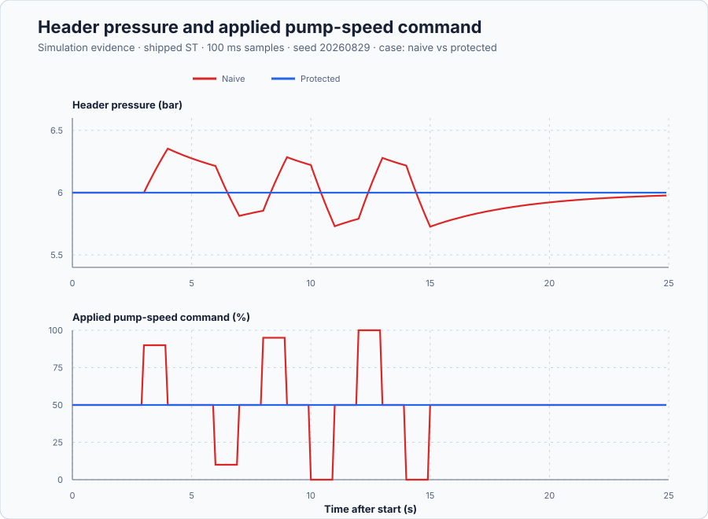

# Qualify network ownership at a remote pumping station

Course position: Lesson 73 of 84. Prerequisite: robust flexible-wing control on a local sampled path. Next lesson: multirate and fault-aware pumping control.

**Lesson objective:** Calculate the remote-loop delay reserve, reject ineligible command packets, and prove bounded transfer between remote coordination and local pressure control.

## The problem

The equipment is a remotely coordinated high-zone water-pumping station. Its normal header-pressure target is 6 bar. The local pressure transmitter supplies the process value, and the variable-speed pump drive receives the applied pump-speed command from 0 through 100 percent.

A remote coordinator may request pump speed when communication evidence is healthy. The station still owns four things locally: the live pressure measurement, the current station time, a pressure controller, and final drive authority. Losing the network must not remove the station's ability to regulate pressure.

The exercise runs two equivalent simulated headers. One is driven by a naive receiver and one by a protected receiver. Both receive the same delivered packet record. This produces deterministic Simulation evidence. It is not measured transport evidence, a commissioning test, or permission to operate a physical pumping station.

Lesson 72 qualified a controller over model uncertainty on a local deterministic sampled path. That evidence did not include a network. A remote path puts time between measurement, calculation, and actuation. That time adds phase lag and consumes stability margin.

Real packets do not all behave alike. Some take longer than others, some never arrive, and an older packet can arrive after a newer one. A source and receiver can also disagree about time. A locally stable controller therefore does not prove that a remotely delivered command is current, ordered, or safe to apply.

## What we need

We need remote pump commands to own the station only while their age, order, and communication delay remain inside a calculated reserve. Invalid packets must be rejected and authority must transfer to local pressure control without an unsafe command jump.

## The new idea

### Establish time without trusting a freshness flag

The source timestamp ($t_{\mathrm{source}}$) is the time at which a command was produced and travels in the packet. Local time ($t_{\mathrm{local}}$) is generated locally at the station; the sender cannot declare it.

Nominal packet age is the elapsed time between those two observations:

$age_{\mathrm{nominal}} = t_{\mathrm{local}} - t_{\mathrm{source}}$

Two clocks can remain slightly misaligned even after synchronization. Clock uncertainty ($\varepsilon_{\mathrm{clock}}$) is the reviewed upper bound on that remaining error. The receiver uses conservative packet age, meaning the greatest credible age:

$age_{\mathrm{worst}} = age_{\mathrm{nominal}} + \varepsilon_{\mathrm{clock}}$

A sender-provided Boolean such as “data fresh” is not evidence of freshness. The station calculates age from its own time, the source timestamp, and the synchronization bound. It also rejects a timestamp that lies farther in the future than the clock uncertainty permits.

### Distinguish the communication failures

Latency is elapsed time through one communication path. Jitter is variation in that latency. Packet loss means an expected update never arrives. Reordering means a delayed older packet arrives after a newer one. Data become stale when their calculated age exceeds the time for which the command was qualified.

A sequence number ($n$) records production order within one declared communication session. This lesson accepts a packet only if its sequence is greater than the last accepted sequence. Sender restart, session identity, integer wrap, authentication, and malicious traffic are outside this exercise; a physical protocol must specify them.

A jitter or resequencing buffer waits for packets so it can smooth arrival timing or restore production order. Waiting consumes delay margin. This station uses a zero-wait, latest-eligible policy: it rejects a late or reordered packet instead of waiting for a missing predecessor. Retaining one already accepted command until it expires is not a reorder buffer.

### Calculate delay margin before choosing an age limit

Delay margin ($L_{\mathrm{margin}}$) is the additional pure delay that brings the declared linear remote loop to its stability boundary. It is not a general network timeout.

The pressure plant has plant gain ($K_{\mathrm{plant}}$) of 0.04 bar per percent and plant time constant ($\tau$) of 4 seconds. The reviewed remote proportional controller has remote proportional gain ($K_{\mathrm{remote}}$) of 200 percent per bar. Gain-crossover angular frequency ($\omega_{\mathrm{c}}$) is the frequency where the loop magnitude becomes one:

$\omega_{\mathrm{c}} = \sqrt{(K_{\mathrm{remote}} \cdot K_{\mathrm{plant}})^{2} - 1} / \tau$

At that frequency the first-order plant contributes phase lag. The remaining angle can be converted into the model-based delay margin:

$L_{\mathrm{margin}} = (pi - \arctan\left(\omega_{\mathrm{c}} \cdot \tau\right)) / \omega_{\mathrm{c}}$

A latency budget lists every reviewed worst-case contribution. Measurement transport ($L_{\mathrm{measure}}$), remote calculation ($L_{\mathrm{compute}}$), command transport ($L_{\mathrm{command}}$), bounded jitter ($L_{\mathrm{jitter}}$), clock uncertainty ($\varepsilon_{\mathrm{clock}}$), and one local task interval ($T_{\mathrm{task}}$) give:

$L_{\mathrm{budget}} = L_{\mathrm{measure}} + L_{\mathrm{compute}} + L_{\mathrm{command}} + L_{\mathrm{jitter}} + \varepsilon_{\mathrm{clock}} + T_{\mathrm{task}}$

Delay reserve is the difference between the calculated margin and budget. A non-positive reserve rejects the remote design even when one favorable trace looks smooth.

### Relate pump speed to pressure

Header pressure ($p$) is measured in bar. Applied pump speed ($u_{\mathrm{applied}}$) is measured in percent. Zero-speed pressure ($p_{0}$) is 4 bar, plant gain ($K_{\mathrm{plant}}$) is 0.04 bar per percent, and time constant ($\tau$) is 4 seconds. Pressure moves toward the equilibrium created by the current applied speed:

$dp/dt = (p_{0} + K_{\mathrm{plant}} \cdot u_{\mathrm{applied}} - p) / \tau$

At 50 percent speed, the equilibrium is 4 bar plus 0.04 bar per percent multiplied by 50 percent, which is 6 bar.

### Compare two ownership rules

The naive receiver applies every delivered command in arrival order and retains the most recent arrival indefinitely. It clamps the command to the drive range, but a clamp does not make stale or reordered information valid.

The protected receiver calculates age locally. It requires good signal quality, synchronized clocks, clock uncertainty no greater than 0.05 seconds, conservative age no greater than 0.50 seconds, a strictly newer sequence, and a finite command inside 0 through 100 percent. An ineligible received packet latches a communication fault. Missing updates cause the retained command to expire.

When remote ownership is invalid, the station uses its local pressure controller. The shipped Control.PID runs as proportional-integral control from the live local pressure. While the remote path owns the drive, the local controller runs in track mode so its internal output follows the applied command. This tracking supports a bumpless transfer instead of allowing the inactive integral state to drift.

Requested pump-speed command and applied pump-speed command are kept separate. A physical limit or later actuator behavior can make them differ.

## Prediction

The remote loop's static gain is 200 percent per bar multiplied by 0.04 bar per percent, which equals 8. Therefore:

$\omega_{\mathrm{c}} = \sqrt{8^{2} - 1} / 4 = 1.984 rad/s$

The plant phase lag at crossover is approximately 1.446 radians. The calculated delay margin is:

$L_{\mathrm{margin}} = (pi - 1.446) / 1.984 = 0.855 s$

The reviewed worst-case contributions are 0.10 seconds for measurement transport, 0.02 seconds for calculation, 0.15 seconds for command transport, 0.05 seconds for jitter, 0.05 seconds for clock uncertainty, and 0.10 seconds for one station task:

$L_{\mathrm{budget}} = 0.10 + 0.02 + 0.15 + 0.05 + 0.05 + 0.10 = 0.47 s$

The predicted model-based reserve is approximately 0.385 seconds. This is positive, but it covers only the declared linear model and budget.

Before running, predict the receiver decisions:

| Delivered condition | Naive receiver | Protected receiver |
| --- | --- | --- |
| Eligible 50 percent command | Apply | Apply |
| No update beyond 0.50 seconds | Retain forever | Transfer to local control |
| Conservative age 0.60 seconds | Apply arrival | Reject as stale |
| Lower sequence after a newer sequence | Apply older arrival | Reject as reordered |
| Bad quality or unsynchronized clock | Apply arrival | Reject |
| Clock uncertainty 0.08 seconds | Apply arrival | Reject |
| Timestamp too far in the future | Apply arrival | Reject |

Predict that each protected fault transfer occurs within one 100-millisecond station scan. Predict that explicit recovery at the current applied command creates no more than 2.0 percentage points of command discontinuity.

## Implementation

The following shortened excerpt is from `src/Main.st`. It is the logic that actually runs:

```st
NominalAgeSeconds := LocalTimeSeconds - RemoteSourceTimeSeconds;
ConservativeAgeSeconds := NominalAgeSeconds + ClockUncertaintySeconds;

IF RemoteSampleReceived THEN
    IF NOT RemoteQualityGood THEN
        RejectionReason := INT#1;
    ELSIF NOT ClockSynchronized THEN
        RejectionReason := INT#2;
    ELSIF ConservativeAgeSeconds > LREAL#0.50 THEN
        RejectionReason := INT#5;
    ELSIF RemoteSequence <= LastAcceptedSequence THEN
        RejectionReason := INT#6;
    ELSE
        NewSampleEligible := RemoteEnabled;
    END_IF;
END_IF;

IF ProtectedRemoteOwned THEN
    LocalInput.Mode := PIDMode#Track;
    LocalInput.TrackingOutput := AcceptedDemand;
ELSE
    LocalInput.Mode := PIDMode#Auto;
END_IF;
LocalControllerOutput := LocalController.Update(Input := LocalInput);
```

Read the full program before the run. The complete code also checks clock uncertainty, impossible-future timestamps, command range, explicit recovery approval, retained-command expiry, requested outputs, applied outputs, and the fault latch.

## Experiment in Control Studio

This procedure tests one declared lesson change under controlled conditions. Run the timestamped bounded receiver against the same packet record with the tracked local PI fallback enabled. The declared event lasts 25 seconds. It restores Delivered remote pump demand to 50 % afterward. The deterministic Simulation seed is 20260829.

### Control Studio actions

1. **Monitor** — Start the **Simulator**, then open **truST sidebar → Control Studio → Monitor → Response**.
   - **Baseline check:** Wait until the header shows **Simulation**, **Running**, and current data. Confirm Protected header pressure setpoint (SP, bar); Naive header pressure (PV, bar) and Protected header pressure (PV, bar); Naive requested pump speed (MV, %) and Naive applied pump speed (MV, %), including units, limits, mode, and quality. The initial operating point is Protected header pressure setpoint = 6 bar, Naive header pressure = 6 bar, Protected header pressure = 6 bar. The unresolved baseline problem is: The receiver applies every arrival and retains it indefinitely, so stale, reordered, poor-quality, and clock-invalid commands can own the pump.
   - **Decision before action:** Read **Prediction** above, then state what should move first and in which direction. Use this decision rule: Accept remote ownership only while locally calculated age, order, quality, synchronization, uncertainty, range, and recovery conditions all pass; otherwise use the tracked local PI controller.
   - **Successful evidence:** The Response plot advances, the displayed values are finite and current, and **Start recording** is enabled. Select **Start recording** only after those conditions are visible.
   - **Recovery:** If recording is disabled or the plot reports unavailable or stale samples, stop the Simulator, correct the displayed runtime or binding problem, restart it, and repeat the baseline check.
   - **Record:** Write down the initial SP, PV, requested/applied MV where available, controller mode, and your predicted response before opening Test.

2. **Test** — Open **truST sidebar → Control Studio → Test**.
   - **Baseline check:** Set **Experiment** = **Observe without excitation**, **Amplitude** = **0 %**, and **Maximum duration (s)** = **25**. The affected signal is **Delivered remote pump demand**; it starts at 50 % and must restore to 50 %.
   - **Decision before action:** Before selecting **Review test**, predict the response direction and confirm the requested change remains inside Naive applied pump speed 0 % to 100 %; Protected applied pump speed 0 % to 100 %; Naive header pressure 0 bar to 12 bar; Protected header pressure 0 bar to 12 bar.
   - **Successful evidence:** Select **Review test**, verify the signal, requested bound, duration, restoration, and stop conditions, then select **Confirm and start**. The state changes to **Running**, **Abort test** remains available, and the terminal state confirms completion and restoration while Response shows the measured SP/PV/MV sequence.
   - **Recovery:** For a rejected, stale, unsafe, unavailable, failed, or aborted state, read the displayed reason, restore Delivered remote pump demand to 50 %, wait for current data, and review a new test.
   - **Record:** Compare the response with your prediction and retain the terminal state, restoration result, and deterministic seed **20260829**.

3. **Identify** — After **Stop recording**, open **truST sidebar → Control Studio → Identify**.
   - **Baseline check:** Use **Qualify recording** to inspect sample count, duration, timing, excitation, and clipping. **Model selection**, **Fit estimation run**, and **Accept model for design** are the shared low-order model workflow; they do not replace the project-owned **Timestamped bounded command ownership with local fallback** model and must not be accepted as this lesson's design authority.
   - **Decision before action:** Decide whether the recording contains the input/output change needed for **Timestamped bounded command ownership with local fallback** before fitting anything.
   - **Successful evidence:** A qualified recording has current, finite, sufficiently excited data. Use the project-owned model described under **Implementation** and **Evidence and decision**, and record its assumptions, units, validity range, and rejection rule.
   - **Recovery:** If qualification reports stale, clipped, poorly excited, or insufficient data, return to Test and repeat the bounded experiment; never force or relabel a rejected fit.
   - **Record:** State which model is retained or rejected and why, explicitly identifying the runnable project as the model authority.

4. **Tune / Design** — Open **truST sidebar → Control Studio → Tune**.
   - **Baseline check:** **Design method** and **Generate candidate** are disabled because **Timestamped bounded command ownership with local fallback** is designed by the runnable project; shared Control.PID tuning is unavailable. Do not select an unrelated PID method.
   - **Decision before action:** Apply the equations and choices under **Implementation**, then compare the declared alternatives under **Evidence and decision** before accepting **Timestamped bounded command ownership with local fallback**.
   - **Successful evidence:** Use **Monitor → Signals** to correlate the implemented project-owned design with its named live states and outputs. A disabled shared designer is only a visible ownership boundary, not successful design evidence.
   - **Recovery:** If the project-owned prerequisites or qualification flags are false, return to Test or Identify as directed by the lesson and do not bypass them with a generic PID candidate.
   - **Record:** State why the project-owned design is eligible, conditional, or rejected, including the decisive trade-off.

5. **Validate** — Open **truST sidebar → Control Studio → Validate**.
   - **Baseline check:** **Run required validation** is disabled because no shared Control.PID candidate exists. **Requirement details** and **Save result** cannot be used to claim a shared result; project-owned validation is executed by the runnable project's declared oracle.
   - **Decision before action:** Use the predeclared comparisons: protected_invalid_packet_acceptances == 0 (dimensionless) (tolerance 0 (dimensionless)); safe_transfer_latency <= 0.1 s (tolerance 1e-9 s); approved_recovery_discontinuity <= 2 pp (tolerance 1e-9 pp); protected_pressure_absolute_error_area < 999 bar*s (tolerance 0.0001 bar*s).
   - **Successful evidence:** Correlate the unrounded project-owned results with the named live signals and events in Monitor. Each applicable requirement must have a value, unit, limit, tolerance, evidence class, and Pass, Conditional pass, Fail, or Inconclusive disposition.
   - **Recovery:** If the project run aborts, becomes stale, fails, or violates restoration, discard that run and repeat the declared Test. Never present a disabled button or retained README table as newly executed evidence.
   - **Record:** State the validation disposition and name every failed or inconclusive requirement before continuing.

## Evidence and decision

### Measures and comparison

Define every decision measure before inspecting the result:

- **Invalid-packet acceptance count** is the number of stale, reordered, bad-quality, unsynchronized, excessive-uncertainty, or impossible-future packets that gain command ownership. Its unit is a count, and lower is better. The protected result must be zero.
- **Safe-transfer latency** is elapsed time from the first scan on which the current remote command is ineligible until local ownership is active. Its unit is seconds. The limit is one 0.10-second scan.
- **Recovery discontinuity** is the absolute change between consecutive applied pump-speed samples at an approved recovery. Its unit is percentage points. The limit is 2.0 percentage points.
- **Pressure absolute-error area** is the sampled sum of absolute difference between the 6-bar setpoint and pressure, multiplied by the 0.10-second interval. Its unit is bar-seconds, and lower is better.
- **Peak pressure departure** is the largest absolute difference between the 6-bar setpoint and pressure during the 25-second run. Its unit is bar, and lower is better.
- **Applied pump-speed travel** is total variation: the sum of absolute changes between consecutive applied commands. Its unit is percentage points, and lower values indicate less drive movement when the other requirements pass.
- **Remote availability** is the fraction of samples with qualified remote ownership. It is descriptive. It must not be improved by accepting invalid commands.

The native executable run produces this comparison from the same 250 samples
for both receivers:

| Measure | Naive arrival-order receiver | Protected bounded receiver |
| --- | ---: | ---: |
| Ineligible packets accepted | 6 | 0 |
| Pressure absolute-error area | 3.2508 bar-seconds | 0.0000 bar-seconds |
| Peak pressure departure | 0.3539 bar | 0.0000 bar |
| Applied pump-speed travel | 550.0 percentage points | 0.0 percentage points |
| Largest approved-recovery discontinuity | Not applicable | 0.0 percentage points |
| Qualified remote availability | Not defined | 72.4 percent |

The protected pressure remains exactly at the declared equilibrium because
every eligible command and the local fallback both request 50 percent in this
deterministic plant. That perfect value is Simulation evidence, not a promise
about sensor noise, hydraulic disturbances, or a physical pump. Remote
availability is lower by design during ineligible intervals; accepting an
invalid command would not be a legitimate availability improvement.

### Validation

Accept the lesson only when all of these statements are supported by retained executable evidence:

- The independent calculation gives approximately 1.984 rad/s crossover, 0.855 s delay margin, 0.47 s budget, and 0.385 s positive reserve.
- The naive path accepts or indefinitely retains stale and reordered information, so the comparison is real.
- No ineligible packet gains protected remote ownership.
- Retained data expire and every received fault selects local control within one 100-millisecond scan.
- Approved recovery is newer, eligible, explicitly approved, and no more than 2.0 percentage points from the current applied command.
- Requested and applied speeds remain finite and inside 0 through 100 percent, while both pressures remain inside 0 through 12 bar.
- An independent packet-policy oracle and independent first-order calculation agree with the shipped Structured Text and simulated plants.

Do not call the protected path “more available” merely because the naive path never gives up authority. Authority without valid evidence is a failure, not availability.



[Complete trace](figures/networked-pumping-evidence-trace.csv) · [Decision summary](figures/networked-pumping-evidence-summary.csv)

## Conclusion

An eligible packet begins with a source timestamp and sequence. The station combines the source timestamp with locally generated time and clock uncertainty. It then checks quality, synchronization, conservative age, order, range, and recovery conditions. Only a successful chain updates the retained command and remote ownership. Requested pump speed is then limited to the applied pump speed that drives header pressure.

The naive receiver interprets arrival order as production order. A delayed older command can therefore replace a newer one. Indefinite retention also turns packet loss into stale actuation. The protected receiver rejects both cases and uses a local controller whose measurement and execution do not depend on the failed network.

A larger reorder buffer might make an irregular packet stream look smoother, but every waiting interval consumes delay reserve. This design chooses zero waiting because the local controller provides a bounded alternative. That is an architecture decision, not a universal rule for every networked loop.

The positive calculated delay reserve answers one linear stability question. It does not prove clock integrity, packet authenticity, session restart behavior, nonlinear hydraulics, pump protection, or real transport performance. Those require separate evidence at their owning boundaries.

## Reason for the next lesson

Network timing and message validity belong in the feedback and safety contracts. A remote plant needs locally generated time, bounded synchronization uncertainty, explicit freshness and order rules, an independently stable local fallback, tracked ownership transfer, and evidence from the deployed transport before physical application.

This lesson proves only deterministic injected impairments around two first-order simulated headers. Lesson 74 adds multirate pressure and level sensors, actuator feedback, fault detection, isolation, degraded operation, watchdog behavior, and controlled recovery. Timely packets do not prove that a sensor or actuator is healthy.
