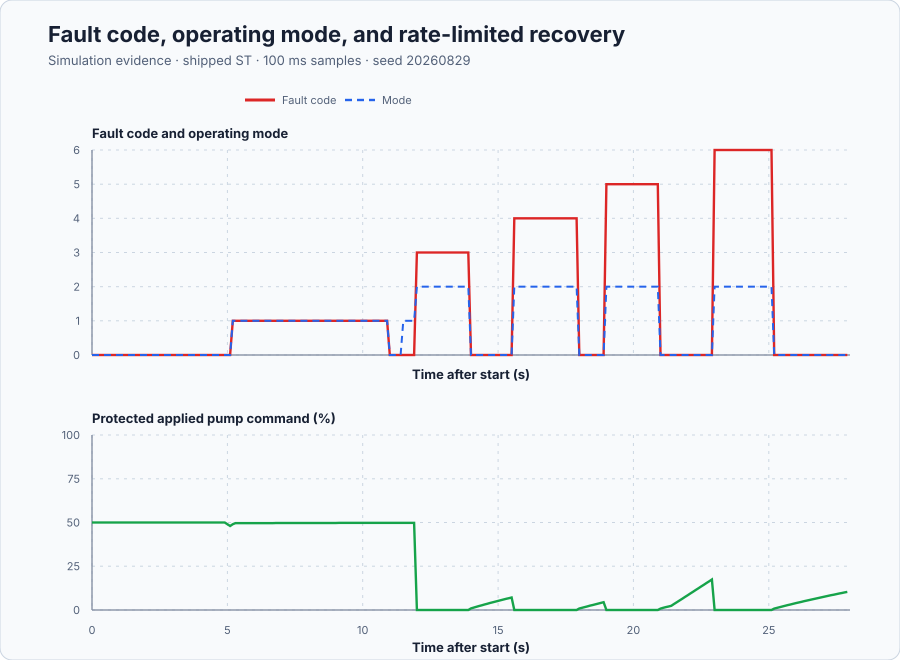

# Isolate multirate pumping faults and recover deliberately

Course position: Lesson 74 of 84. Previous lesson: [Bounded network ownership at the remote pumping station](../73-networked-pumping/README.md). Next lesson: [Diagnose a degraded loop before retuning it](../75-loop-diagnosis/README.md).

**Lesson objective:** Detect the declared sensor and actuator faults, isolate only supported causes, choose degraded or safe operation, and restore automatic control through explicit qualified authority.

**Evidence class:** Simulation evidence. Every transmitter, level sample, and drive-feedback fault is a deterministic injected event; none of it is physical transmitter, drive, reservoir, or pump evidence.

## The problem

The equipment is a high-zone pumping station with redundant pressure, suction level, and drive feedback. It is the station from Lesson 73. Two simulated discharge pressure transmitters update every 100 ms. A simulated suction-reservoir level transmitter updates every 500 ms. Simulated drive-speed feedback updates every 200 ms. The station task runs every 100 ms.

Pressure is measured in bar, reservoir level in percent full, and requested, applied, and measured pump speed in percent. The drive request is limited to 0 through 100 percent. Whenever the fault-aware controller holds automatic or degraded authority, its applied pump speed may also change by no more than 10 percent per second — not only during restoration — so no single scan can step the drive by more than the pump and downstream piping can absorb.

Two equivalent simulated header paths make the comparison honest. The baseline controller always trusts pressure transmitter A. The fault-aware controller may select transmitter A, select transmitter B after justified isolation, or remove automatic authority. The sensor bias, missing updates, low level, and stuck actuator are deterministic Simulation injections. They are not physical transmitter, drive, reservoir, network, or pump evidence.

Lesson 73 established when a remote packet was timely, ordered, and synchronized. A timely packet can still contain a biased sensor value. A healthy command packet also does not prove that the pump drive followed its request.

The station's devices update at different rates. If the controller treats a held 500-ms level sample as though it were newly measured every 100 ms, it hides age exactly when the safety constraint matters. We therefore need explicit multirate handling, redundancy, fault decisions, bounded degraded modes, watchdogs, and recovery authority before trusting the loop.

## What we need

We need the pumping station to distinguish supported sensor and actuator faults, continue only in a justified degraded mode, and enter a safe state when independent evidence is insufficient. Automatic authority must return through an explicit qualified recovery sequence.

## The new idea

### Keep every device on its own timeline

A sample interval is the time between new observations from one device. Multirate sampling means connected devices use different intervals. Here pressure is sampled every station task, level every fifth task, and drive feedback every second task.

Resampling places those observations on the controller task timeline. A zero-order hold retains the latest qualified value between device updates. Holding a value does not make it new: its source timestamp and age continue to advance. Linear interpolation is not used to invent a future reservoir-safety observation.

Freshness is the maximum permitted age of retained evidence. The pressure limit is 0.25 s, the level limit is 1.0 s, and the drive-feedback limit is 0.40 s. Each limit is a configured teaching value set to roughly two to three device intervals — 0.25 s is 2.5 pressure intervals, 1.0 s is two level intervals, and 0.40 s is two drive-feedback intervals — so one missed update is tolerated but a second is not silently held as new. A learner commissioning a real station would instead set each limit from the transmitter and drive network's measured worst-case update jitter. A watchdog is stateful supervision that detects when an expected update or execution event misses its deadline.

### Test plausibility before using a number

Plausibility means that a value is finite, inside its physical range, and consistent with the declared rate limits. Pressure must remain from 0 through 12 bar, level from 0 through 100 percent, and speed feedback from 0 through 100 percent. A value can pass all those checks and still be biased, so plausibility cannot replace redundancy.

Physical redundancy uses independent devices to measure the same physical quantity. Analytical redundancy compares a measurement with a prediction from a qualified model. Two disagreeing transmitters reveal a fault but cannot identify which one is wrong. The model prediction supplies a third independent relation for this bounded isolation decision.

### Define the pressure residuals

Pressure transmitter A ($p_{A}$) and pressure transmitter B ($p_{B}$) are measured in bar. Predicted pressure ($\hat{p}$) is the model's expected header pressure. Pressure discrepancy ($r_{\mathrm{AB}}$) is the absolute difference between the two transmitters. Model residuals ($r_{A}$) and ($r_{B}$) are each transmitter's absolute difference from the prediction:

$r_{\mathrm{AB}} = |p_{A} - p_{B}|$

$r_{A} = |p_{A} - \hat{p}|$

$r_{B} = |p_{B} - \hat{p}|$

The prediction uses preceding evidence only. The preceding predicted pressure is $\hat{p}_{k-1}$, preceding applied speed is $u_{\mathrm{applied},k-1}$, station interval is T, zero-speed pressure is $p_{0}$, plant gain is $K_{\mathrm{plant}}$, and pressure time constant is $\tau$. The executable Euler update is:

$\hat{p}_{k} = \hat{p}_{k-1} + (T/\tau) \cdot (p_{0} + K_{\mathrm{plant}} \cdot u_{\mathrm{applied},k-1} - \hat{p}_{k-1})$

This expression comes from the same continuous pressure balance used in Lesson 73,
$d\hat{p}/dt=(p_0+K_{\mathrm{plant}}u-\hat{p})/\tau$. Over one short task interval, forward Euler approximates the derivative by
$(\hat{p}_k-\hat{p}_{k-1})/T$. Substituting that approximation and solving for $\hat{p}_k$ produces the update above. Here $T/\tau=0.1/4=0.025$, which explains the literal `0.025` in the program. The predictor is diagnostic redundancy. It is not a hidden Simulation-truth input and does not drive the pressure controller directly.

A pressure discrepancy greater than 0.30 bar for three consecutive new pressure samples confirms disagreement. If exactly one transmitter has a model residual greater than 0.50 bar while the other remains no greater than 0.50 bar, the larger-residual transmitter is isolated. The controller may continue from the other qualified transmitter in degraded single-sensor mode. If the evidence cannot distinguish a sensor, automatic authority is removed. The 0.30-bar discrepancy and 0.50-bar residual thresholds are configured teaching values set well above an assumed ±0.05-bar transmitter noise band but well below the 1.0-bar bias this lesson injects, so genuine disagreement is confirmed without chattering on ordinary noise; a learner would instead set them from the transmitters' rated accuracy and the plant's normal reading-to-reading variation. Three consecutive samples, at the 100-ms pressure interval, reject one noisy reading before isolating a transmitter — the same three-sample pattern the actuator check below reuses.

### Protect a slow reservoir constraint

Retained level can fall between measurements. Conservative available level ($level_{\mathrm{safe}}$) subtracts the greatest credible drawdown since the last sample. The retained level sample ($level_{\mathrm{sample}}$) is percent full, maximum drawdown rate ($v_{\mathrm{level}}$) is 0.5 percentage points per second, and level age ($age_{\mathrm{level}}$) is seconds:

$level_{\mathrm{safe}} = level_{\mathrm{sample}} - v_{\mathrm{level}} \cdot age_{\mathrm{level}}$

The subtraction follows from the worst allowed case: if the reservoir has fallen at its maximum rate for the entire unobserved interval, the true level can be lower than the held sample by at most $v_{\mathrm{level}}age_{\mathrm{level}}$. Maximum drawdown rate is a configured teaching value representing a conservatively fast credible reservoir drain; a learner would instead derive it from the reservoir's minimum cross-sectional area and the pump's maximum draw rate. The low-suction trip is 20 percent. Recovery requires at least 30 percent. Both are configured teaching values with a 10-percentage-point gap between trip and restore that prevents the safe state from chattering right at the trip point; a learner would instead set them from the suction pipe's minimum submergence level and the drawdown margin above. The conservative projection does not extend the 1.0-s freshness limit; stale level still removes authority.

### Check whether the drive moved

Previous applied pump speed ($u_{\mathrm{applied},k-1}$) is the protected applied command the station sent on the previous scan — the shipped code's `PreviousProtectedApplied`, which is always rate-limited as declared above. Measured drive speed ($u_{\mathrm{feedback}}$) comes from the independent feedback channel, updated every 200 ms. Actuator tracking residual ($r_{u}$) is their absolute difference:

$r_{u} = |u_{\mathrm{applied},k-1} - u_{\mathrm{feedback}}|$

A residual greater than 5 percentage points for three consecutive new drive-feedback samples confirms an actuator tracking fault. 5 percentage points is a configured teaching value set safely above ordinary drive-tracking error under healthy control (assumed within 1-2 points) but well below the actuator's full range, so a genuine stuck condition is confirmed without tripping on ordinary lag; a learner would instead set it from the drive's measured healthy tracking-error distribution. Three samples occupy two 200-ms gaps from the first affected sample to the decision, or 0.4 s. The 0.6-s requirement is deliberately conservative because a fault can begin just after one update and wait almost 0.2 s before the first affected sample.

### Separate the fault decisions

Fault detection decides that evidence violated a rule. Fault isolation assigns the fault to a named component only when the evidence distinguishes it. Graceful degradation continues reduced service with one identified healthy pressure transmitter. A safe state removes automatic pump authority when evidence cannot support control.

Acknowledgement records that an operator has seen the fault; it does not clear anything. Cause removal makes the input evidence healthy again. Recovery qualification requires ten consecutive healthy 100-ms scans — a configured teaching value equal to one full second of continuous healthy evidence, long enough to reject a borderline flickering condition before authority returns. Reset approval is a separate explicit authority that clears the latch only after acknowledgement and qualification.

The protected applied pump speed is limited to 10 percent per second continuously whenever automatic or degraded authority is held (`FaultAwarePumpSupervisor.st:296-305`), not only during restoration; the same permanent bound is simply most visible there, when the setpoint step is largest. It is a configured teaching value chosen so a full-range command step reaches the drive over at least ten scans, bounding actuator wear and downstream water-hammer risk on every applied-speed change. The naive baseline path carries no such limit, so any comparison of applied-speed movement between the two paths reflects this declared design choice as well as the fault response, not the fault response alone.

## Prediction

At the normal equilibrium, both pressure transmitters and the predictor read approximately 6 bar. Their discrepancy and both model residuals are approximately zero.

Adding 1.0 bar to transmitter A while leaving transmitter B unchanged predicts:

- pressure discrepancy of approximately 1.0 bar;
- pressure-A residual of approximately 1.0 bar; and
- pressure-B residual of approximately 0 bar.

The fault-aware controller should isolate A on the third new pressure sample. With a 100-ms pressure interval, that is 0.2 s elapsed from the first biased sample and no later than the declared 0.30-s limit. The baseline controller should incorrectly reduce pump speed because it interprets the false high pressure as physical pressure.

Predict that loss of both pressure qualities removes authority on the detecting scan. A fresh 19-percent level sample should trip immediately. Missing level updates should trip on the first task after age exceeds 1.0 s. A stuck drive should be confirmed by the third new feedback residual above 5 percentage points, 0.4 s after the first affected sample. Acknowledgement alone and a premature reset must leave the fault latched. Approved restoration must change applied speed by no more than 1.0 percentage point per 100-ms scan — the same permanent limit declared above, not a special recovery-only behavior.

## Implementation

The following shortened excerpts come from the Structured Text that actually runs:

```st
PredictedPressure := PredictedPressure + LREAL#0.025
    * (LREAL#4.0 + LREAL#0.04 * PreviousProtectedApplied
        - PredictedPressure);
PressureDiscrepancy := ABS(PressureA - PressureB);
PressureAResidual := ABS(PressureA - PredictedPressure);
PressureBResidual := ABS(PressureB - PredictedPressure);

IF DisagreementCount >= INT#3 THEN
    IF (PressureAResidual > LREAL#0.50)
        AND (PressureBResidual <= LREAL#0.50) THEN
        PressureAIsolated := TRUE;
    END_IF;
END_IF;
```

The slow constraint and actuator supervision are also explicit:

```st
ConservativeLevel := LevelSample - LREAL#0.5 * LevelAge;
ActuatorTrackingResidual := ABS(PreviousProtectedApplied - DriveSpeedFeedback);

RecoveryReady := FaultLatched AND FaultAcknowledged
    AND (RecoveryHealthyCount >= INT#10);
```

Read `src/FaultAwarePumpSupervisor.st` before running. It contains the complete sample retention, ages, plausibility checks, symmetric A/B isolation, deterministic fault priority, mode selection, two real Control.PID instances, zero safe output, and rate-limited recovery. `src/Main.st` holds only the timed disturbance schedule below and calls this function block every scan.

## Experiment in Control Studio

The visible workflow is exactly **Monitor → Test**. Control Studio supplies authority, while the runnable project supplies the complete 28-second record. Because every learner runs the same sequence, no one can accidentally edit a diagnostic input halfway through the comparison. The deterministic Simulation seed is 20260829.

The interactive Test executes this project-owned schedule (`src/Main.st:70-123`):

| Scan window | Time | Injected condition |
| --- | --- | --- |
| 1–50 | 0.1–5.0 s | Healthy multirate baseline |
| 51–100 | 5.1–10.0 s | Pressure-A biased +1.0 bar |
| 116–130 | 11.6–13.0 s | Pressure-A quality lost |
| 121–130 | 12.1–13.0 s | Pressure-B quality also lost (ambiguous) |
| 151–170 | 15.1–17.0 s | Level updates withheld (stale) |
| 191–200 | 19.1–20.0 s | Fresh 19-percent low-level sample |
| 216–240 | 21.6–24.0 s | Setpoint raised to 7 bar |
| 221–240 | 22.1–24.0 s | Drive feedback stuck |

Each fault window is followed one scan later by an acknowledge pulse and, once ten healthy scans have elapsed after cause removal, an approved reset (`src/Main.st:114-123`). The retained native evidence plotted below uses an equivalent `simulation.toml`-driven fault schedule whose onsets can fall up to 0.1 s earlier than this interactive schedule; treat the two as consistent in sequence and duration, not identical to the tenth of a second.

### Control Studio actions

1. **Monitor** — Select target **Simulator**, choose **Run**, then open **Control Studio → Monitor → Response**.
   - **Baseline check:** Wait until the header shows **Simulation**, **Running**, and current data. Confirm Header pressure setpoint (SP, bar); Naive pressure transmitter A (PV, bar) and Protected pressure transmitter A (PV, bar); Naive requested pump speed (MV, %) and Naive applied pump speed (MV, %). The initial operating point is Header pressure setpoint = 6 bar, Naive pressure transmitter A = 6 bar, Protected pressure transmitter A = 6 bar, Protected pressure transmitter B = 6 bar. The unresolved baseline problem is: a timely in-range but biased pressure value silently moves the naive controller because quality and freshness alone cannot establish correctness.
   - **Decision before action:** Read **Prediction** above, then state what should move first and in which direction. Use this decision rule: continue with one isolated healthy pressure transmitter only when the model relation identifies the failed device; otherwise remove automatic authority and require cause removal, acknowledgement, healthy qualification, and approved reset. This matters because a bias that stays inside the physical range would pass every plausibility check alone — only the second transmitter and the model prediction can tell the controller which reading to disbelieve.
   - **Successful evidence:** The Response plot advances, the displayed values are finite and current, and **Start recording** is enabled. Select **Start recording** only after those conditions are visible.
   - **Recovery:** If recording is disabled or the plot reports unavailable or stale samples, stop the Simulator, correct the displayed runtime or binding problem, restart it, and repeat the baseline check.
   - **Record:** Write down the initial SP, PV, requested/applied MV where available, controller mode, and your predicted response before opening Test.

2. **Test** — Open **truST sidebar → Control Studio → Test**.
   - **Baseline check:** Confirm **Experiment** = **Observe without excitation**, **Amplitude** = **0** (disabled), and **Maximum duration (s)** = **28.1**. The reviewed authority is **Experiment authority** (`P1.ExperimentEnabled`). It does not write a pressure, quality flag, timestamp, acknowledgement, reset, setpoint, or pump command.
   - **Decision before action:** Before selecting **Review test**, predict each mode transition from the schedule above and confirm every pressure and pump-speed limit shown in Monitor. Predicting the sequence before it runs is the only way to tell a controller that reacted for the declared reason from one that merely landed on the right mode by coincidence.
   - **Successful evidence:** Select **Review test**, verify the signal, requested bound, duration, restoration, and stop conditions, then select **Confirm and start**. Keep **Abort test** visible. Response should show operating mode step from automatic to degraded near 5.1–5.3 s, back to automatic near 10.1–11.1 s, to safe near 11.6–14.1 s, automatic again, to safe near 15.1–18.1 s, automatic, to safe near 19.1–21.1 s, automatic, to safe near 21.6–25.4 s, and finally automatic through completion, with the fault code naming pressure A, ambiguous pressure, stale level, low level, and actuator in that order.
   - **Recovery:** Select **Abort test** for a rejected, stale, unsafe, unavailable, failed, or aborted state, then read the displayed reason and remove experiment authority. The project restores healthy qualities, samples, a 6-bar setpoint, 35-percent level, and false acknowledgement/reset requests before another run.
   - **Record:** Compare the response with your prediction and retain the terminal state, restoration result, and deterministic seed **20260829**.

## Evidence and decision

Define the decision measures before reading the result:

- **Sensor-isolation latency** is elapsed time from the first biased new pressure sample through confirmed isolation, in seconds. The limit is 0.30 s.
- **Actuator-fault confirmation latency** is elapsed time from the first new feedback sample whose residual exceeds 5 percentage points through the latched actuator fault, in seconds. The limit is 0.60 s.
- **False-trip count** is the number of degraded or safe transitions during the healthy interval. It must be zero.
- **Wrong-sensor selection count** is the number of scans in which an isolated or ineligible pressure value drives the protected controller. It must be zero.
- **Pressure absolute-error area** is the sampled integral of absolute difference from the 6-bar setpoint over a declared fault window, in bar-seconds.
- **Peak pressure departure** is the largest absolute departure from 6 bar in that window, in bar.
- **Safe-output latency** is elapsed time from an ambiguous, stale-critical, low-level, or confirmed actuator decision through zero requested output. It must be no more than one station scan after confirmation.
- **Restoration rate** is the largest consecutive applied-speed change divided by 0.10 s. Its unit is percent per second and its limit is 10 percent per second.
- **Service availability** reports time in normal or justified degraded control separately. It cannot be improved by using ineligible data.

The retained native trace records fault code and operating mode every 100 ms for the full 28-second run:

| Time in trace | Fault code | Mode | Interpretation |
| ---: | --- | --- | --- |
| 0.0 s | 0 healthy | 0 automatic | Multirate baseline |
| 5.2 s | 1 pressure A | 1 degraded | Bias confirmed and isolated; B continues alone |
| 11.0 s | 0 healthy | 0 automatic | Qualified recovery |
| 12.0 s | 3 ambiguous | 2 safe | Both transmitters ineligible together |
| 14.0 s | 0 healthy | 0 automatic | Qualified recovery |
| 15.6 s | 4 stale level | 2 safe | Level age exceeded the 1.0-s limit |
| 18.0 s | 0 healthy | 0 automatic | Qualified recovery |
| 19.0 s | 5 low level | 2 safe | Fresh 19-percent sample |
| 21.0 s | 0 healthy | 0 automatic | Qualified recovery |
| 23.0 s | 6 actuator | 2 safe | Stuck drive confirmed |
| 25.2 s | 0 healthy | 0 automatic | Final qualified recovery, held through 28.0 s |

From these transitions and the declared definitions above: pressure-A isolation latency is 0.2 s (first biased sample 5.0 s, confirmed 5.2 s), inside the 0.30-s limit. Actuator-fault confirmation latency is 0.4 s (first affected feedback sample 22.6 s, confirmed 23.0 s), inside the 0.6-s bound. Ambiguous-pressure and fresh-low-level safe output both land on the same detecting scan; stale-level safe output follows the declared 1.0-s freshness limit. False trips before the first injection: zero, matching the flat healthy trace from 0.0 through 5.1 s. Wrong-sensor selections: zero, enforced by the native test's acceptance gate rather than a separately plotted signal. The greatest approved-restoration rate measured across every recovery is 8.2 percent per second, inside the 10-percent-per-second limit. The shipped trace retains only fault code, operating mode, and applied command — it does not retain a pressure series — so pressure absolute-error area and peak pressure departure are defined above but not numerically reported here; the native test's own tolerance check, not this README, is their evidence.



The upper panel plots fault code and operating mode from the table above; the lower panel plots the protected applied pump command over the same 28 seconds. Every visible command step stays inside the declared 1-percentage-point-per-scan limit, including at the largest step near the 21.6-second setpoint change — the same permanent rate limit discussed above, not a recovery-only behavior.

[Complete trace](figures/pumping-fault-aware-evidence-trace.csv) · [Decision summary](figures/pumping-fault-aware-evidence-summary.csv)

Accept this lesson only if the registered native test compiles and executes the shipped Structured Text and shared Control library against the shipped simulation record and independent calculations. It must prove:

- no false healthy transition;
- pressure A isolation on the third biased pressure sample;
- pressure B remains selected throughout the isolated interval;
- no automatic authority when both pressure values are ineligible;
- level age continues to increase while its held value remains unchanged;
- stale and low level each produce zero safe output;
- drive request and feedback remain separate and the stuck actuator is confirmed from three new feedback residuals;
- acknowledgement and premature reset do not clear the fault;
- each reset requires ten healthy scans and explicit approval;
- restored output respects the declared rate; and
- predictor and independent first-order plant calculations match the executable record within tolerance.

Simulation success does not authorize a physical pump. Physical deployment needs reviewed transmitter independence, common-cause analysis, proof-test intervals, drive and motor protection, cavitation protection, hydraulic safe-state analysis, commissioning, and explicit approval.

## Conclusion

Every measurement first passes through its own sample pulse, source timestamp, retained value, age, quality, and plausibility. Pressure then gains consistency evidence from the second transmitter and model predictor. A single large residual is isolated only after three new samples. The selected healthy pressure drives the protected PID while the fault remains visible as degraded operation.

Two failed or ambiguous pressure paths do not support isolation, so automatic pressure authority is removed. The slow level path remains aged even while held, and its conservative projection cannot outlive the freshness deadline. Requested pump speed is not proof of motion; independent drive feedback closes that evidence gap.

Recovery is deliberately longer than fault detection. Fast shutdown limits exposure, while acknowledgement, cause removal, ten healthy scans, reset approval, and a permanently rate-limited return prevent an intermittent or unreviewed recovery from silently regaining authority. Because that rate limit runs at all times, not only during restoration, any applied-speed comparison against the unlimited naive path already carries this declared design choice — a second, deliberate difference between the two paths, not only the fault response.

## Reason for the next lesson

Fault handling is an explicitly designed operating mode with named evidence, priority, authority, and recovery. It is not an exception hidden inside the controller equation.

This lesson covers declared deterministic faults and model-consistent residuals in Simulation. It does not cover every failure or prove diagnostic coverage on a physical pump. Lesson 75 introduces diagnosis before changing gains because a commissioned loop can degrade gradually and different causes can produce similar symptoms. Retuning without diagnosing the cause can hide an instrument, actuator, process, interaction, or network problem.
