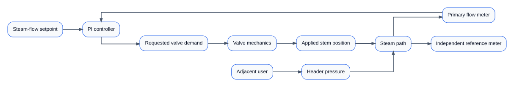
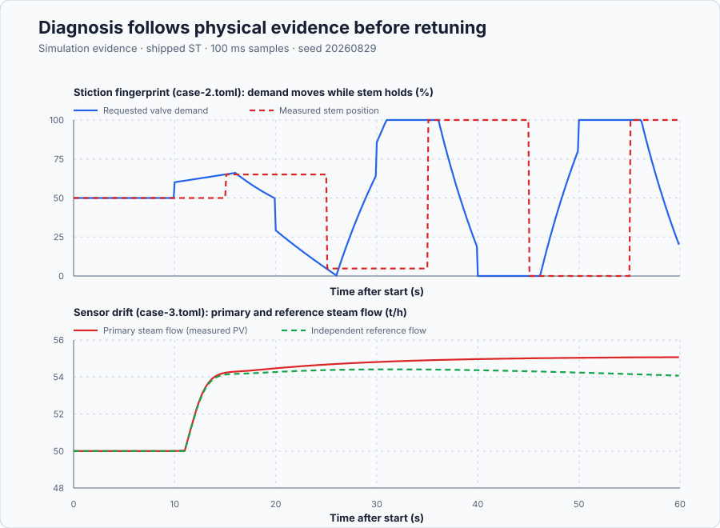

# Diagnose a steam-flow loop before retuning

Course position: Lesson 75 of 84. Previous lesson: [Multirate and fault-aware pumping control](../74-pumping-fault-aware/README.md). Next lesson: [Cold-storage capstone](../../14-integrated-capstones/76-cold-storage/README.md).

**Lesson objective:** Diagnose eight blinded steam-loop records and select the next evidence-producing action without treating retuning as the default remedy.

**Evidence class:** Simulation evidence. The eight-case casebook is deterministic Simulation evidence, not physical-plant evidence of an installed steam valve.

## The problem

The equipment in this lesson is an industrial steam-distribution flow loop.

A modulating steam valve supplies one production user. The steam-flow setpoint
and both flow measurements use tonnes per hour (`t/h`). Valve demand and
measured valve-stem position use percent. Upstream header pressure uses bar.
The adjacent production user's valve demand also uses percent.

The complete record contains:

- the desired steam flow, called the setpoint ($SP$);
- the primary measured steam flow, called the process value ($PV$);
- an independently maintained reference flow meter;
- the controller's requested manipulated variable ($MV_{\mathrm{requested}}$);
- the measured, physically applied valve-stem position
  ($MV_{\mathrm{applied}}$);
- upstream header pressure and adjacent-user valve demand;
- flow quality, controller mode, output limits, operating region, schedule
  transitions, timestamps, and measured controller interval.

The nominal local steam path has a gain of `1.0 t/h/%`, a time constant of
`5 s`, and a dead time of `1 s`. The controller runs every `100 ms`. The
baseline proportional-integral controller has proportional gain
`2.0 %/(t/h)` and integral gain `0.2 %/(t/h*s)`. The valve is one-sided and
limited from `0%` closed to `100%` open.

The plant gain, time constant, dead time, and baseline PI gains are declared
teaching values configured directly in the casebook's plant model, not fitted
from a measured commissioning test. A learner would instead obtain the plant
values from a bump test at a fixed valve position — the same step-identification
method taught in Lessons 16 through 18 — and would obtain commissioned PI gains
from the model-qualified method of Lesson 44. The machine-readable lesson
metadata records these same two gains with the abbreviated units `%` and
`1/s`, because the project's closed unit vocabulary has no `%/(t/h)` or
`%/(t/h*s)` entry; the engineering unit taught and used here is the one stated
in this paragraph.


The diagram shows why one process-value curve is insufficient. A cause can
enter through the controller, valve, instrument, header, adjacent user, or
local plant model.

Lesson 74 used dedicated redundant signals to detect named pumping faults. In
a commissioned process area, several faults can instead produce a similar
oscillation or offset. Retuning from the process value alone can conceal a
sticking valve, tune around a drifting transmitter, request capacity the valve
cannot deliver, or amplify interaction with another steam user.

Therefore the first question is not “Which gain should I change?” It is “Which
signal changed first, and what bounded test can reject the strongest competing
explanation?”

## What we need

We need to match each abnormal steam-flow record to the next evidence-producing action instead of treating retuning as the default cure. Valve, instrument, capacity, disturbance, interaction, model, and schedule causes must remain separate until the record supports one.

## The new idea

### Establish a comparable baseline

A **performance baseline** is a qualified healthy record from the same
operating region, setpoint range, controller revision, actuator limits, sample
interval, and evidence class. It establishes normal variability and timing. It
does not define normal operation forever.

An **event** is a bounded change with a declared source, onset, and duration.
Event detection marks departure from the baseline band. Synchronized samples
let you compare the order of cause, controller reaction, actuator motion, and
process response.

### Name the controller signals precisely

The process error ($e$) is the steam-flow setpoint ($SP$) minus the primary steam
flow process value ($PV$):

$e_{k} = SP_{k} - PV_{k}$

The requested manipulated variable ($MV_{\mathrm{requested}}$) is the valve demand
calculated by the controller. The applied manipulated variable ($MV_{\mathrm{applied}}$) is
the measured valve-stem position. These can differ because a real valve has
limits, dynamics, friction, or a fault.

### Measure degradation without pretending it identifies the cause

Integrated absolute error describes the accumulated magnitude of flow error.
It uses the controller sample interval ($T$), has units of `t/h*s`, and is
calculated over a declared eligible window:

$IAE = \sum\left(|SP_{k} - PV_{k}| \cdot T\right)$

Each sample represents a rectangle whose height is absolute error and whose
width is $T$ seconds. Adding those rectangle areas approximates the continuous
area under $|e(t)|$; that is why the result has units `t/h*s`. IAE ranks flow performance. It cannot tell whether poor performance came from
tuning, a valve, a transmitter, unavailable capacity, or an external event.

### Distinguish the causal signatures

An **oscillation** is a repeatable alternating component, not merely a noisy
trace. The oscillation period ($P_{\mathrm{osc}}$) is the time between equivalent
consecutive peaks. The cross-correlation lag between requested valve demand
and steam flow estimates which signal consistently leads.

Formally, for two synchronized sample sequences $x_{k}$ (requested valve
demand) and $y_{k}$ (steam flow) recorded at the same interval, the
cross-correlation at a trial lag of $m$ samples is:

$R_{xy}(m) = \sum_{k} x_{k} \cdot y_{k+m}$

The cross-correlation lag is the value of $m$ that produces the largest
$R_{xy}(m)$. A positive lag means $y$ must be shifted backward by $m$ samples
to align with $x$, so $x$ leads $y$ by $m$ samples at the sample interval.
Worked example: valve demand steps from 50 to 60 percent at sample 3, and
steam flow steps from 50 to 55 t/h at sample 5, both recorded at the 100-ms
interval. Shifting the flow signal 2 samples earlier lines its step up exactly
with the demand step, so the cross-correlation lag is 2 samples, or 0.2 s:
valve demand leads steam flow by 0.2 s, the order a healthy loop should show.

Poor tuning is eligible only when requested valve movement comes first, the
measured stem follows, no limit is active, an external signal does not lead,
measurement quality is good, and the response repeats at the same operating
condition. Oscillation alone does not prove poor tuning.

**Valve stiction** is static friction that holds measured stem position while
requested demand continues to move, followed by a breakaway jump. Held-demand
travel ($TV_{\mathrm{hold}}$) is the cumulative requested-demand movement while measured
stem movement stays within `0.2` percentage points. Stem jump ($\Delta_{\mathrm{stem}}$) is
the applied-position change at breakaway. This lesson requires at least three
cycles with $TV_{\mathrm{hold}}$ greater than `2` percentage points and $\Delta_{\mathrm{stem}}$ greater
than `1` percentage point. Without stem feedback, stiction and poor tuning can
remain **Inconclusive**.

A transmitter can have a constant bias or a changing drift. Flow disagreement
($d_{\mathrm{flow}}$) is primary flow minus the independently measured reference flow:

$d_{\mathrm{flow},k} = PV_{k} - PV_{\mathrm{reference},k}$

The **drift slope** is the change in flow disagreement divided by elapsed time,
in `t/h/s`. A slope above `0.01 t/h/s`, with a qualified reference and
consistent valve behavior, supports instrument verification rather than
retuning.

For a window from sample $a$ to sample $b$, the simplest endpoint estimate is
$m=(d_{\mathrm{flow},b}-d_{\mathrm{flow},a})/(t_b-t_a)$. The numerator removes
any constant offset; the denominator converts the remaining change to a rate.
Real commissioning would normally fit all eligible points and report uncertainty,
but this bounded casebook uses the declared deterministic calculation.

**Limit occupancy** is the percentage of eligible samples at the lower or
upper applied-valve limit. The declared saturation window runs from `20.0 s`
through `59.9 s`, after constraint entry. If positive flow error persists while
the applied stem remains at `100 percent` for more than `90 percent` of that window,
the plant lacks authority. Increasing gain cannot create valve or steam
capacity.

If $N_{\mathrm{limit}}$ eligible samples are at the relevant limit and
$N_{\mathrm{eligible}}$ samples exist in the window, occupancy is
$100N_{\mathrm{limit}}/N_{\mathrm{eligible}}$. Counting only eligible samples
prevents missing or invalid data from being mistaken for time at a limit.

A measured upstream disturbance must precede the controlled-flow change and
controller response. The required order is header -> flow -> valve response;
precedence matters because correlation alone is not causation.

Interaction is supported when another loop acts before the shared process and
local controller react. At least three repetitions of
other MV -> header/flow -> local MV justify an interaction study. They do not
by themselves prove which decoupler should be used.

A model residual ($\varepsilon_{\mathrm{model}}$) is measured flow minus independently
predicted flow, calculated from the nominal first-order-plus-dead-time model
declared above (gain 1.0 t/h per percent, time constant 5 s, dead time 1 s)
driven by the same requested valve demand. A persistent residual beginning at an operating-region
transition, while sensors and valve remain eligible, supports model or
schedule validation. A schedule-aligned mismatch is not evidence for changing
feedback gains.

A **diagnostic hypothesis** names a possible cause. A **discriminating test**
is a bounded next action whose outcomes differ between the two leading
hypotheses. When signatures overlap, conflict, or lack a required signal, the
result is `Inconclusive`; the system must not invent confidence.

## Prediction

One worked numeric prediction anchors the qualitative table below. If the
flow-disagreement window runs from `t=10 s` to `t=60 s` and the reference and
primary meters disagree by 0.6 t/h more at the end of that window than at the
start, the endpoint drift-slope estimate is:

$m = 0.6 / (60 - 10) = 0.012$ t/h/s

That is above the declared 0.01 t/h/s instrument-verification threshold, so a
disagreement of this size over this window would already support instrument
verification rather than retuning.

Before opening the answer key, write down the expected leading evidence and
next action for all eight records:

| Candidate | Evidence that must lead or persist | Evidence-qualified next action |
|---|---|---|
| Healthy baseline | Eligible quality, stem tracking, no sustained limit or unexplained event | Continue monitoring |
| Poor controller tuning | Requested valve first; stem follows; no limit or external leader | Controlled tuning comparison |
| Valve stiction | Three demand-ramp, stem-hold, breakaway cycles | Valve inspection or reviewed travel test |
| Transmitter drift | Primary/reference disagreement slope above `0.01 t/h/s` | Instrument verification |
| Saturation | Applied stem at `100%` for over `90%` of the event while error persists | Capacity and operating-demand review |
| Upstream disturbance | Header pressure changes before flow and local valve response | Disturbance-source investigation |
| Interaction | Adjacent valve leads shared header/flow and local valve on three events | Interaction test and coordination review |
| Model/schedule mismatch | Residual begins at an operating-region transition | Revalidate model and schedule |

These are casebook boundaries, not universal diagnostic thresholds.

## Implementation

The actual Structured Text configures one baseline controller. It exposes the
diagnostic signals but contains no scenario label, diagnosis, remedy, or
automatic gain change:

```st
Parameters.ProportionalGain := ConfiguredProportionalGain;
Parameters.IntegralGain := ConfiguredIntegralGain;
Parameters.Bias := LREAL#50.0;
Controller.Configure(Parameters := Parameters);

Input.Setpoint := Setpoint;
Input.ProcessValue := ProcessValue;
Input.FeedForward := LREAL#0.0;
IF (MeasuredCycleTime >= LREAL#0.01) AND (MeasuredCycleTime <= LREAL#1.0) THEN
    Input.CycleTime := MeasuredCycleTime;
ELSE
    Input.CycleTime := LREAL#0.1;
END_IF;
ValveRequested := Controller.Update(Input := Input);
```

The guard keeps a corrupted or momentarily unavailable measured interval from
reaching the controller unfiltered: outside 0.01 through 1.0 seconds, the
program substitutes the nominal 100-ms interval instead.

`ValveRequested` is $MV_{\mathrm{requested}}$. `ValveStemPosition` is the separately
measured $MV_{\mathrm{applied}}$. The simulator creates the faults; hidden controller
branches do not manufacture the verdict.

## Experiment in Control Studio

The learner-facing workflow is exactly **Monitor → Test**. The visible project runs the qualified healthy reference record: 10 seconds at 50 t/h, a bounded 60 t/h setpoint interval through 40 seconds, then recovery to 50 t/h. The seven degraded records and the sealed answer comparison are owned by the native casebook test, where they can be run without leaking their labels. The deterministic Simulation seed is 20260829.

### Control Studio actions

1. **Monitor** — Select target **Simulator**, choose **Run**, then open **Control Studio → Monitor → Response**.
   - **Baseline check:** Wait until the header shows **Simulation**, **Running**, and current data. Confirm Steam-flow setpoint (SP, t/h); Primary steam flow (PV, t/h) and Reference steam flow (PV, t/h); Requested valve demand (MV, %) and Applied valve-stem position (MV, %), including units, limits, mode, and quality. The initial operating point is Steam-flow setpoint = 50 t/h, Primary steam flow = 50 t/h, Reference steam flow = 50 t/h, Requested valve demand = 50 %, Applied valve-stem position = 50 %, Upstream header pressure = 8 bar, Adjacent-user valve demand = 0 %, Operating region = 0 (dimensionless). The unresolved baseline problem is: A process-value oscillation or offset is a symptom shared by different controller, actuator, measurement, capacity, disturbance, interaction, and model causes. The industrial steam-distribution area record must show steam-flow setpoint in t/h and valve-stem position in percent before diagnosis.
   - **Decision before action:** Read **Prediction** above, then state what should move first and in which direction. Use this decision rule: use synchronized causal signatures and a discriminating test to select the responsible engineering action; report Inconclusive when required evidence is absent. This matters because two different causes can produce the same oscillating process value — only the order in which signals move, and a bounded follow-up test, can tell them apart.
   - **Successful evidence:** The Response plot advances, the displayed values are finite and current, and **Start recording** is enabled. Select **Start recording** only after those conditions are visible.
   - **Recovery:** If recording is disabled or the plot reports unavailable or stale samples, stop the Simulator, correct the displayed runtime or binding problem, restart it, and repeat the baseline check.
   - **Record:** Write down the initial SP, PV, requested/applied MV where available, controller mode, and your predicted response before opening Test.

2. **Test** — Open **truST sidebar → Control Studio → Test**.
   - **Baseline check:** Confirm **Experiment** = **Observe without excitation**, **Amplitude** = **0** (disabled), and **Maximum duration (s)** = **60.1**. The reviewed authority is **Experiment authority** (`P1.ExperimentEnabled`). The project writes its own setpoint schedule.
   - **Decision before action:** Before selecting **Review test**, predict the response direction and confirm the requested change remains inside Primary steam flow 0 t/h to 120 t/h; Reference steam flow 0 t/h to 120 t/h; Requested valve demand 0 % to 100 %; Applied valve-stem position 0 % to 100 %; Upstream header pressure 0 bar to 16 bar. Predicting the healthy record's own timing first gives the baseline band that every degraded record is later judged against.
   - **Successful evidence:** Select **Review test**, verify the signal, requested bound, duration, restoration, and stop conditions, then select **Confirm and start**. The state changes to **Running**, **Abort test** remains available, and the terminal state confirms completion and restoration while Response shows steam flow holding near 50 t/h through 10 s, a bounded setpoint step to 60 t/h from 10 s through 40 s, and recovery back to 50 t/h through 60 s.
   - **Recovery:** For a rejected, stale, unsafe, unavailable, failed, or aborted state, read the displayed reason and remove experiment authority. The project disables the controller and restores the 50 t/h setpoint before another run.
   - **Record:** Compare the response with your prediction and retain the terminal state, restoration result, and
     deterministic seed **20260829**. The decision this run supports is: Use synchronized causal signatures and a discriminating test to select the responsible engineering action; report Inconclusive when required evidence is absent.
## Evidence and decision

Define every measure before reading its value:

- **Correct diagnosis count** is the number of complete records whose supported
  diagnosis matches the sealed answer. Higher is better.
- **Incorrect diagnosis count** counts unsupported classifications. Zero is
  required.
- **Justified inconclusive count** counts records deliberately withheld because
  required evidence is missing. It is reported separately, not treated as an
  error or silently forced into a label.
- **Remedy-selection accuracy** is the fraction whose next action matches the
  evidence-qualified owner and action. Retuning is not the default.
- Event precedence uses seconds with one-sample (`0.1 s`) uncertainty.
- $P_{\mathrm{osc}}$ uses seconds; $TV_{\mathrm{hold}}$ and $\Delta_{\mathrm{stem}}$ use percentage points; drift slope
  uses `t/h/s`; model-residual mean uses `t/h`; limit occupancy uses percent;
  and IAE uses `t/h*s`.

The source signals, window, sample interval, validity prerequisite, and desired
direction must remain in the exported artifact. Do not rank a value from an
ineligible record.

The shipped trace retains the two fingerprints that the figure below plots:
the stiction case (`case-2.toml`) and the sensor-drift case (`case-3.toml`).
Recomputing held-demand travel and stem jump from the retained requested- and
measured-stem samples, using the definitions above, finds five qualifying
hold-then-breakaway cycles:

| Cycle (breakaway time) | Held-demand travel ($TV_{\mathrm{hold}}$) | Stem jump ($\Delta_{\mathrm{stem}}$) |
| ---: | ---: | ---: |
| 15.1 s | 15.10 pp | +15.10 pp |
| 25.1 s | 62.18 pp | -60.28 pp |
| 35.1 s | 103.69 pp | +95.18 pp |
| 45.1 s | 100.00 pp | -100.00 pp |
| 55.1 s | 100.00 pp | +100.00 pp |

Every cycle clears the declared 2-percentage-point travel and 1-percentage-point
jump thresholds, satisfying the at-least-three-cycle requirement above.
Recomputing the endpoint drift-slope estimate from the retained primary and
reference samples over the same 10-through-59.9-second window used by the
acceptance gate gives $m = 0.0200$ t/h/s, above the 0.01 t/h/s threshold.

The other six cases (`case-0.toml` healthy baseline, `case-1.toml` poor
tuning, `case-4.toml` saturation, `case-5.toml` upstream disturbance,
`case-6.toml` interaction, `case-7.toml` model/schedule mismatch) are proved
only by the native executable test against the sealed answer key; the shipped
figures do not retain a plotted trace or a numeric signature for them, so none
is reported here. The learner-facing Control Studio Test above executes only
the healthy reference record; running the seven degraded cases and comparing
them against the sealed answer requires the native test command, not a Control
Studio action, because Control Studio has no control that swaps the loaded
scenario file. Shipping the answer key in plain text alongside the cases it
grades is a known packaging gap in this project that a README change cannot
fix; it is reported here for the platform team, not corrected.

The native executable test compiles the shipped Structured Text with the
shared Control library and executes the same controller against all eight
deterministic cases. Its independent oracle does not read the sealed label
until after classification. Acceptance requires eight correct diagnoses,
eight correct next actions, zero incorrect diagnoses, no automatic gain
change, and an `Inconclusive` result when stem feedback is deliberately
removed from the tuning-versus-stiction record.

The learner-facing result table and plots may be populated only from retained
run artifacts. Simulation results must never be labelled as measurements from
a physical steam plant.



The upper panel plots requested valve demand against measured stem position
for the stiction case (`case-2.toml`): five held-and-broken-away cycles, listed
above, are visible as flat stem segments under a moving demand trace. The
lower panel plots the primary and independent reference flow for the
sensor-drift case (`case-3.toml`): the two traces separate at a constant rate
after `t=10 s`, the 0.0200 t/h/s slope computed above.

[Complete trace](figures/loop-diagnosis-evidence-trace.csv) · [Decision summary](figures/loop-diagnosis-evidence-summary.csv)

## Conclusion

Explain each decision as a causal sequence: external event, measured process
response, controller request, actual valve motion, and recovery. Then name the
signal that rejects the strongest alternative.

- A pinned valve is an authority problem, not proof that gain is too small.
- Primary/reference divergence is an instrument problem until proven otherwise.
- Stem hold and breakaway distinguish stiction from controller-only cycling.
- External precedence distinguishes a disturbance or interaction from a local
  controller initiating the response.
- A residual aligned with a schedule transition requires model validation.
- Only controller-led repetition with eligible valve, measurement, limits, and
  disturbances supports a controlled retuning experiment.

## Reason for the next lesson

You can now decide whether evidence belongs to controls tuning, valve
maintenance, instrumentation, equipment capacity, process operations,
interaction engineering, model/schedule ownership, or further data
acquisition. These eight deterministic cases do not prove universal diagnostic
coverage or physical-plant health.

Lesson 76 starts the capstones. You will receive a real control problem and
must select and combine previously learned methods without being told the
controller or remedy in advance.
