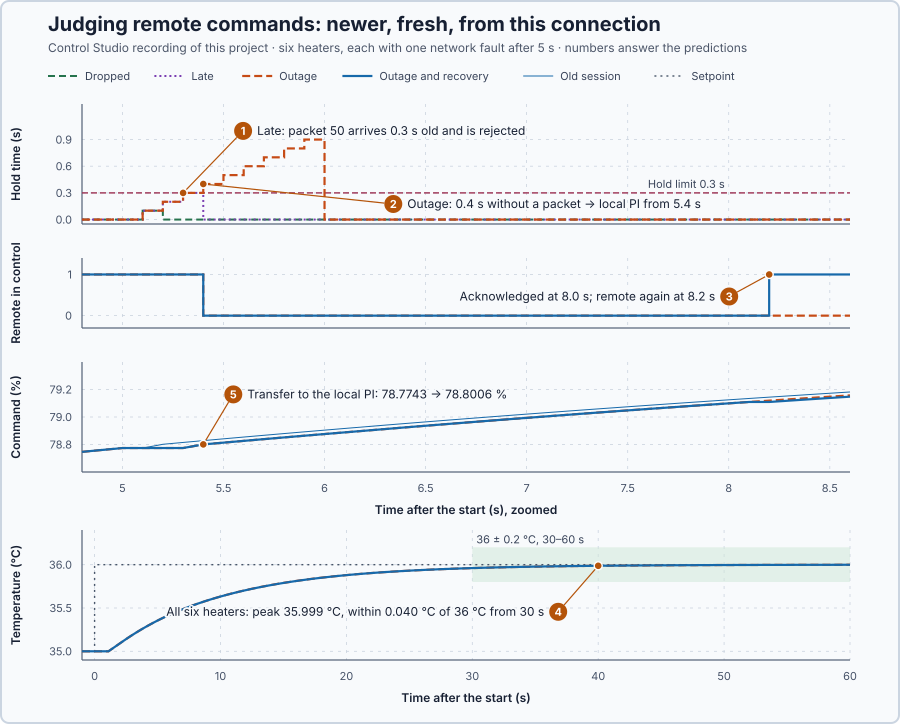

# 87. Networked control

In this lesson, you will let a remote PI command the heater only through packets that are newer, fresh and from the current connection, hold its last command for at most 0.3 s, fall back to a local PI when the network fails, and return to remote control only on purpose.

## The problem

Lesson 86's candidate A met both requirements on all eighteen heaters, and its small-gain bound of 0.254 covered every heater in the range. That range assumed that every command reaches the heater.

Here the PI runs on a remote computer and sends the heater command as a packet every 0.1 s. A packet can be lost, delayed or reordered, and a packet left from an earlier connection can arrive. An old packet can then overwrite a newer command, and when the link fails the last command stays applied while the water changes. We will accept only commands that are new, in order and recent enough, hold the last good one for a limited time, and then fall back to a local PI.

## What we need

We need to:

1. decide which packets may set the heater command;
2. limit how long the last accepted command may be used, and then hand over to local control without a bump; and
3. return to remote control only when someone chooses to.

## The new idea

**Networked control** accepts a remote command only if it is new, in order and recent enough, holds the last good command for a limited time, and then falls back to a safe local action. For the heater, every packet from the remote PI is checked before its command is applied, and a local PI stands ready.

**In words.** Over a network a command can be lost, delayed, overtaken by a later one, or left over from an earlier connection. Applying whatever arrives last would let an old command overwrite a newer one, and a link that fails silently would leave the last command applied while the water changes. It is the same idea as a fieldbus device's watchdog: when the cyclic data stop arriving, the device keeps its last outputs for a set time and then goes to its fail-safe values. The heater does this per packet, in five parts:

1. **Is it from the current connection?** Packets left over from an earlier connection are thrown away.
2. **Is it newer?** A packet that is not newer than the last accepted one is thrown away, so a late packet cannot overwrite a newer command.
3. **Is it fresh?** A packet that took too long is thrown away, even if it is the newest.
4. **Hold, then fall back.** Without an accepted packet, the last good command is held for a limited time; then a local PI takes over. It has followed the applied command all along, so it continues without a bump.
5. **Return on purpose.** When packets come back, control stays local until someone chooses to return to remote control.

For the heater this means no lost, old or overtaken command decides the heat, and a failed link leaves the last command in place only briefly.

**The formula.** Normally a packet takes 0.1 s to arrive. That is network delay; the heater's 1 s between command and heat belongs to the process, and no packet shows it. Each packet carries:

- a **sequence number**, which says which command is newer within a connection;
- a **connection identity**, which says to which established connection the packet belongs; and
- its send time $t_{sent}$, in seconds, from which the heater calculates the packet's age at the moment $t_{now}$ it arrives:

$$
\text{age} = t_{now} - t_{sent} .
$$

The heater accepts a packet only if all three checks pass:

| Check | Accept when | Stops |
| --- | --- | --- |
| Connection | it belongs to the current connection | an old connection's packets, however high their numbers |
| Sequence | its number is higher than the last accepted one | reordered and repeated packets |
| Age | 0 ≤ age ≤ 0.2 s | packets that took too long, even the newest |

The **hold time** is the time since the last packet was accepted. While it is at most 0.3 s, the heater keeps the last accepted command; when it exceeds 0.3 s, the local PI takes over, provided the heater's own temperature reading is valid. Remote control returns only after an operator acknowledges, three packets have been accepted since, and the remote command is within 0.1 point of the applied one.

**Example: three faults the checks stop.** Packets are sent every 0.1 s; packet 49, sent at 4.9 s, was accepted at 5.0 s.

1. A normal packet: packet 50, sent at 5.0 s, arrives at 5.1 s. Its age is $5.1 - 5.0 = 0.1$ s, its number is higher than 49 and its connection is current: accepted, and the hold time starts again from 0.
2. A dropped packet: packet 50 is lost. At 5.1 s nothing arrives, so the hold time is 0.1 s and the command of packet 49 stays. At 5.2 s packet 51, sent at 5.1 s, is 0.1 s old and newer: accepted.
3. Reordered packets: packet 51 arrives at 5.1 s and is accepted; packet 50 arrives at 5.2 s, 0.2 s old and still fresh, but 50 is not higher than 51: rejected, and packet 51's command stays.
4. A packet of the previous connection arrives at 5.1 s with sequence number 4000, sent at 5.0 s, and a command of 0 %. Its number is higher and its age normal, but its connection is not the current one: rejected. Without that check, an old 0 % would have switched the heat off.

Each check stops a packet that the other two let through.

**The limitation.** The age needs both times on one clock. If the heater's clock runs $\delta \pm \varepsilon$ ahead of the sender's, the true age is $t_{now} - t_{sent} - \delta$, known only within $\varepsilon$; with $\varepsilon = 50$ ms, the 0.2 s limit can only be trusted as 0.15 s. The 0.2 s and 0.3 s limits are a teaching choice for a 0.1 s packet period.

## Prediction

Lesson 86's nominal heater, 10 kW/°C with a 1 s delivery delay, rests at 35 °C with 75 %, and its setpoint steps to 36 °C at the start, with candidate A's gains in both PIs. After 5 s, six copies each see one network fault:

| Case | What the network does |
| --- | --- |
| Dropped | packet 50, sent at 5.0 s, is lost |
| Reordered | packet 51 arrives at 5.1 s, packet 50 only at 5.2 s |
| Late | packet 50 arrives at 5.3 s; packets 51 and 52 are lost |
| Old session | at 5.1 s a packet of the previous connection arrives: sequence 4000, sent at 5.0 s, 0 % |
| Outage | packets 50–58 are lost; packets arrive again from 6.0 s |
| Outage and recovery | the same outage, and the operator acknowledges at 8.0 s |

Before running, answer these questions:

1. Which check rejects the late packet, and how long is the command held?
2. When does the outage case switch to local control: at 5.3 s or at 5.4 s?
3. When does remote control return in the last case?
4. Do the faults affect the temperature requirement: a peak of at most 37 °C and within 0.2 °C of 36 °C from 30 s to 60 s?
5. How much does the command change when the local PI takes over?

## Implementation

Open [`src/Main.st`](src/Main.st). `CommandReceiver` is the part to reuse: it keeps the connection's identity, the last accepted sequence number and the time of the last accepted packet, and applies the checks in order:

```st
IF Packet.Epoch <> Epoch THEN
    RejectedOldSession := RejectedOldSession + UDINT#1;
ELSIF HaveAccepted AND Packet.Sequence <= LastSequence THEN
    RejectedNotNewer := RejectedNotNewer + UDINT#1;
ELSIF Packet.SentMs > NowMs OR AgeMs > UDINT#200 THEN
    RejectedByAge := RejectedByAge + UDINT#1;
```

Times are whole milliseconds on one clock, so the 0.3 s boundary is exact: in `LREAL` seconds, 5.3 − 5.0 is 0.30000000000000071, already more than 0.3 s. `NetworkedHeater` runs one heater under a remote and a local `Control.PID`, with the network simulated in the same block. `Cases` holds the six heaters, and `AcknowledgementTime` is an experiment setting. A temperature outside 0–80 °C or an update interval outside 100 ms ± 10 ms latches zero heat.

**Exercise.** By hand, for the late case: packet 50 arrives 0.3 s after it was sent, more than 0.2 s, so it is rejected; the hold is then 0.3 s, not more than 0.3 s, so the remote command stays. Then run [`src/tests.st`](src/tests.st) from the **Testing** view; it checks each rule and the recovery.

## Experiment in Control Studio

1. Open this lesson's project and start **Simulator**. The six heaters rest at 35 °C. In the **truST** side bar, select **Control Studio**.
2. On **Identify**, choose **Project experiment** from **Method**. Under **Declared experiment settings**, **Acknowledgement Time** shows 8 (s, 0–60). Press **Inspect experiment parameters**, keep 8, press **Review parameter values** and then **Apply reviewed values**.
3. **Signals** shows `P1.RecoveryC · Process value (°C)`, `P1.SetpointC · state (°C)` and the other five heaters, from `P1.DroppedC · state (°C)` to `P1.OutageC · state (°C)`. Add `P1.DroppedHoldS · state (s)`, `P1.LateHoldS · state (s)`, `P1.OutageHoldS · state (s)`, `P1.LateAgeS · state (s)`, `P1.OutageRemote · state (1)`, `P1.RecoveryRemote · state (1)` and `P1.OutagePct · state (%)`.
4. Answer the predictions, select **Review project test** and check the declared **64 s**: the start and 60 s after it. Select **Confirm and start**; the experiment starts about 2 s later, and times below count from that start.
5. After the run, hover the hold times at 5.1 s, 5.3 s and 5.4 s, the late packet's age at 5.3 s, who controls at 5.4 s, 8.1 s and 8.2 s, the outage command at 5.3 s and 5.4 s, and the temperatures at 30 s and 60 s.
6. At completion Control Studio shows **Project test completed. Outputs restored.**

Select **Abort test** to stop early; to repeat, restart **Simulator** so the six heaters start at rest.

## Evidence and decision



The numbered marks answer the predictions with the same numbers. From Control Studio's recording, times after the start:

| Case | What the heater did after 5 s |
| --- | --- |
| Dropped | held the command 0.1 s at 5.1 s; accepted packet 51 at 5.2 s |
| Reordered | accepted packet 51 at 5.1 s; rejected packet 50 at 5.2 s as not newer |
| Late | held 0.1, 0.2 and 0.3 s; rejected packet 50 at 5.3 s, 0.3 s old; accepted packet 53 at 5.4 s |
| Old session | rejected the previous connection's packet at 5.1 s; the command stayed at 78.77 %, never 0 % |
| Outage | held 0.1–0.3 s; switched to the local PI at 5.4 s; accepted packets again from 6.0 s but stayed local |
| Outage and recovery | the same until the acknowledgement at 8.0 s; fresh packets at 8.0, 8.1 and 8.2 s; remote again from 8.2 s |

1. The age check rejected the late packet, 0.3 s old; the command was held 0.3 s, within the limit.
2. The outage case switched at 5.4 s, when the hold first exceeded 0.3 s.
3. Remote control returned at 8.2 s, after the acknowledgement and the third fresh packet.
4. All six heaters peaked at 35.999 °C and stayed within 0.040 °C of 36 °C from 30 s; all six cases passed.
5. At 5.4 s the command went from the held 78.7743 % to the local PI's 78.8006 %, 0.026 points; at 8.2 s the remote PI took over at the applied 79.109 %.

Each check stopped a packet the others let through: the old connection's packet had a higher number and a normal age, and the late packet was the newest from the current connection. The cost is a local PI and a deliberate restart; the benefit is that no old or lost command decides the heat. The receiver is kept. These are simulation results on one shared clock.

## Conclusion

Networked control applies a remote command only if it is new, in order and recent enough, holds the last good one for a stated time, and then hands over to a local controller that has tracked the applied command.

For the heater, every faulty packet was rejected by one check, the outage handed over at 5.4 s with 0.026 points of change, and remote control returned only after the acknowledgement.

## Check yourself

1. **A packet of the current connection, newer than the last, is sent at 12.35 s and arrives at 12.52 s. Is it accepted?**
   Yes: its age is 0.17 s, within 0.2 s.
2. **Why does an old connection's packet need its own check when its sequence number is high?**
   Sequence numbers restart with each connection, so an old packet can carry a higher number; only the connection
   identity shows that it is old.
3. **Why does the heater not return to remote control as soon as packets arrive again?**
   A restart after an outage must be someone's decision, and the remote command must first agree with the applied one
   so the return is bumpless.

## Reason for the next lesson

Every packet was judged, but the heater's own temperature reading was trusted. Fresh, correctly delivered data can still come from a faulty sensor.

[Fault-aware control](../79-fault-aware-control/README.md) checks whether its measurements still make sense, by range, by age and by comparing two sensors.
