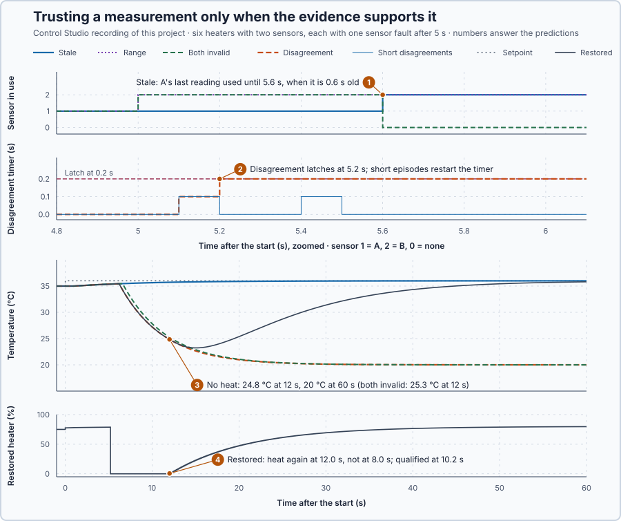

# 88. Fault-aware control

In this lesson, you will decide from two temperature sensors whether the heater's measurement can still be trusted: control on the healthy sensor when the other is clearly invalid or stale, remove heat when two fresh readings disagree, and restart only on qualified readings and a new Auto request.

## The problem

Lesson 87's heater rejected every faulty packet with one of three checks, and its outage handed control to the local PI with 0.026 points of change. Both controllers, however, trusted the heater's temperature reading. A sensor can fail in a way that is easy to see: it reads 85 °C, or it stops delivering new readings. It can also fail quietly, its readings arriving correctly, fresh and plausible but wrong, and a PI that follows a wrong reading heats in the wrong direction.

The heater now has two sensors, A and B. We will check each reading for range and age, compare the two, switch to the healthy sensor or remove heat when the readings cannot be trusted, and restart only on evidence and a decision.

## What we need

We need to:

1. recognise a reading that is out of range or too old;
2. decide what to do when two fresh readings disagree; and
3. restart only when the readings are trustworthy again and someone asks for it.

## The new idea

**Fault-aware control** checks whether its measurements still make sense, by range, by age and by comparing two sensors, and switches to a backup or a safe action when they do not. For the heater, a reading outside 0–80 °C or older than 0.5 s is invalid, and two valid readings must agree.

**In words.** A controller believes its measurement completely: if the reading is wrong, the PI heats in the wrong direction. Some sensor faults are easy to see, such as a reading of 85 °C or a reading that has stopped changing because the sensor no longer delivers. Others are quiet: the readings arrive fresh and plausible, but wrong. Only a second sensor can reveal those. It works like the discrepancy monitoring of a two-channel emergency stop: both channels must agree within a discrepancy time, or the safety relay trips. The parts:

1. **Range.** A reading outside what the water can be, 0–80 °C, is invalid at once.
2. **Age.** A reading older than 0.5 s, or stamped with a time after now, is invalid: a sensor that stops delivering leaves its last value behind, which looks fine but no longer follows the water.
3. **Comparison.** Two valid readings must agree within a stated limit. A disagreement that lasts proves a fault, but not which sensor has it.
4. **Action.** If one sensor is invalid, control continues on the other. If the two valid readings disagree, or no sensor is valid, the heater latches a fault and removes heat: zero heat is the only command that does not depend on the measurement.
5. **Recovery.** The fault clears only on evidence, readings that agree again, followed by a decision: a new Auto request.

For the heater this means a sensor that fails visibly is replaced by the other one, and a quiet fault stops the heating instead of letting a guess decide it.

**The formula.** For each sensor, with its reading $T$ in °C, its acquisition time $t_{acq}$ and the present time $t_{now}$, in seconds:

$$
\text{valid} = (0 \le T \le 80) \ \text{and} \ (t_{acq} \le t_{now}) \ \text{and} \ (t_{now} - t_{acq} \le 0.5\ \text{s}) .
$$

For two valid readings $T_A$ and $T_B$, the disagreement is

$$
d = |T_A - T_B| ,
$$

in °C. Two valid readings disagree when $d$ exceeds 0.4 °C for 0.2 s:

- with 0.1 s updates, the disagreement timer counts the time since $d$ was first seen above 0.4 °C;
- the timer restarts whenever $d$ is back within 0.4 °C or a sensor becomes invalid; and
- the fault clears only after three acquisitions in which both sensors are valid and agree, each new acquisition counted once, followed by a new Auto request.

When control moves from A to B, or restarts, `Control.PID` is re-initialised with the applied command and the new reading, so the command does not jump.

**Example: the heater's two sensors.**

1. Range: A reads 85 °C. It is invalid at once; control continues on B, and the PI starts from the applied command, so the command does not jump.
2. Age: a reading acquired at 7.0 s is $7.3 - 7.0 = 0.3$ s old at 7.3 s, still valid.
3. Agreement: A at 35.40 °C and B at 35.65 °C give $d = 0.25$ °C, within the limit. If each sensor is accurate to ±0.1 °C, their errors alone can make $d = 0.2$ °C, so the 0.4 °C limit leaves a margin.
4. Disagreement: A at 35.40 °C and B at 36.00 °C give $d = 0.60$ °C, more than 0.4 °C.
5. Timing: suppose B reads 0.6 °C high at 20.0 and 20.1 s, agrees at 20.2 s, and reads high again from 20.3 s. The timer shows 0.1 s at 20.1 s, restarts at 20.2 s, shows 0.1 s at 20.4 s and reaches 0.2 s at 20.5 s: only then does the fault latch.
6. Which sensor? B 0.6 °C high and A 0.6 °C low give the same $d$. A third, independent measurement could decide; two cannot, so the heater removes heat.

**The limitation.** A quiet fault smaller than the limit is not detected at all: if A, the sensor in use, reads 0.3 °C high, the PI holds the water 0.3 °C below its setpoint, and $d = 0.3$ °C raises no alarm (calculated). And when a fault is detected, two sensors cannot say where it is, so the heater must stop heating. The 0.4 °C, 0.2 s and 0.5 s limits are a teaching choice.

## Prediction

The heater has 10 kW/°C and a 1 s delivery delay, rests at 35 °C with 75 % and steps to 36 °C at the start, with $K_p = 2.5$ %/°C and $K_i = 0.5$ %/(°C·s). Six copies each see one sensor fault after 5 s:

| Case | What the sensors do |
| --- | --- |
| Stale | A stops acquiring at 5.0 s |
| Range | A reads 85 °C from 5.0 s |
| Disagreement | B reads 0.6 °C high from 5.0 s |
| Short disagreements | B reads 0.6 °C high at 5.0, 5.1, 5.3 and 5.4 s only |
| Both invalid | A reads 85 °C from 5.0 s, and B stops acquiring at 5.0 s |
| Restored | B reads 0.6 °C high from 5.0 to 9.9 s; Auto is requested at 8.0 s and again at 12.0 s |

Before running, answer these questions:

1. When does the stale case stop using A: at 5.5 s or at 5.6 s?
2. When does the disagreement latch, and why do the short disagreements not latch?
3. What happens to the temperature when heat is removed?
4. When does the restored heater get heat again: at 8.0 s, 10.2 s or 12.0 s?

## Implementation

Open [`src/Main.st`](src/Main.st). `SensorSelector` is the part to reuse: it classifies both readings, times a disagreement, latches the fault and counts agreeing acquisitions by their acquisition times, so a repeated reading does not count twice. Its checks are:

```st
ValidA := A.ValueC >= LREAL#0.0 AND A.ValueC <= LREAL#80.0 AND A.AcquiredMs <= NowMs AND NowMs - A.AcquiredMs <= UDINT#500;
ValidB := B.ValueC >= LREAL#0.0 AND B.ValueC <= LREAL#80.0 AND B.AcquiredMs <= NowMs AND NowMs - B.AcquiredMs <= UDINT#500;
Excessive := ValidA AND ValidB AND ABS(A.ValueC - B.ValueC) > LREAL#0.4;
```

`SensedHeater` puts one heater under a `Control.PID` as PI, updated every 0.1 s, on the selected reading; the two sensors are simulated in the same block. `Cases` holds the six heaters, and `AutoRequestTime` is an experiment setting. An update interval outside 100 ms ± 10 ms latches zero heat.

**Exercise.** By hand: a reading acquired at 5.0 s is still valid at 5.5 s, 500 ms old, and invalid at 5.6 s; A at 35.2 °C and B at 35.7 °C give $d = 0.5$ °C, a disagreement. Then run [`src/tests.st`](src/tests.st) from the **Testing** view; it checks the age and range limits, the disagreement timing, the loss of both sensors and the recovery.

## Experiment in Control Studio

1. Open this lesson's project and start **Simulator**. The six heaters rest at 35 °C. In the **truST** side bar, select **Control Studio**.
2. On **Identify**, choose **Project experiment** from **Method**. Under **Declared experiment settings**, **Auto Request Time** shows 12 (s, 0–60). Press **Inspect experiment parameters**, keep 12, press **Review parameter values** and then **Apply reviewed values**.
3. **Signals** shows `P1.RestoredC · Process value (°C)`, `P1.SetpointC · state (°C)` and the other five heaters, from `P1.StaleC · state (°C)` to `P1.BothC · state (°C)`. Add `P1.StaleSource · state (1)`, `P1.BothSource · state (1)`, `P1.DisagreementTimerS · state (s)`, `P1.ShortTimerS · state (s)`, `P1.RestoredQualified · state (1)` and `P1.RestoredPct · Applied output (%)`.
4. Answer the predictions, select **Review project test** and check the declared **64 s**: the start and 60 s after it. Select **Confirm and start**; the experiment starts about 2 s later, and times below count from that start.
5. After the run, hover the sources at 5.0 s, 5.5 s and 5.6 s, the timers at 5.1 s, 5.2 s and 5.4 s, the temperatures at 12 s and 60 s, and the restored heater's command at 8.0 s and 12.0 s.
6. At completion Control Studio shows **Project test completed. Outputs restored.**

Select **Abort test** to stop early; to repeat, restart **Simulator** so the six heaters start at rest.

## Evidence and decision



The numbered marks answer the predictions with the same numbers. From Control Studio's recording, times after the start:

| Case | What the heater did after 5 s |
| --- | --- |
| Stale | kept using A's last reading, 35.36 °C, while the water rose to 35.40 °C; switched to B at 5.6 s |
| Range | switched to B at 5.0 s |
| Disagreement | timed 0.1 and 0.2 s at 5.1 and 5.2 s, latched at 5.2 s and removed heat |
| Short disagreements | timed 0.1 s at 5.1 s, restarted at 5.2 s, timed 0.1 s again at 5.4 s; no fault |
| Both invalid | switched to B at 5.0 s; latched at 5.6 s, when B's reading was 0.6 s old, and removed heat |
| Restored | latched at 5.2 s; refused the Auto request at 8.0 s; qualified at 10.2 s; restarted at 12.0 s |

1. The stale case stopped using A at 5.6 s, when A's last reading was 0.6 s old.
2. The disagreement latched at 5.2 s; the short disagreements restarted the timer at 5.2 s and never reached 0.2 s.
3. The latched heaters were at 24.8 and 25.3 °C at 12 s and at 20 °C at 60 s: without heat the water cooled toward 20 °C.
4. The restored heater got heat again at 12.0 s, not at 8.0 s, when the readings still disagreed, and not at 10.2 s, when it qualified after agreeing readings at 10.0, 10.1 and 10.2 s. It restarted with 0.558 %, only its integral step; the command rose to 47 % at 20 s, and the water was back at 35.81 °C at 60 s.

The changes of sensor moved the command by at most 0.032 points, and the stale, range and short-disagreement heaters peaked at 35.999 °C and stayed within 0.039 °C of 36 °C from 30 s. The cost of refusing to guess is a cold heater; the benefit is that no wrong reading decides the heat. The rules are kept. These are simulation results with exact sensors apart from the injected faults.

## Conclusion

A fault that one sensor shows by itself, out of range or too old, is handled by the other sensor with the controller realigned; a disagreement between two fresh readings proves a fault but not where, so the heater removes heat instead of guessing.

For the heater, the healthy sensor took over with at most 0.032 points of change, the disagreements latched at 0.2 s, and the restored heater restarted only on qualified readings and the second request.

## Check yourself

1. **A reads 35.2 °C and B 35.5 °C, both fresh and in range. Is that a disagreement?**
   No: $d = 0.3$ °C, within the 0.4 °C limit.
2. **Why does the heater remove heat instead of following the lower reading?**
   A disagreement proves a fault but not which sensor has it; following one is a guess, and zero heat is the only
   command that does not depend on the measurement.
3. **Why did the Auto request at 8.0 s not restart the restored heater?**
   The readings still disagreed; the fault clears only after three agreeing acquisitions and a new request.

## Reason for the next lesson

Each mechanism worked on its own problem: tuning, bounds, packet checks and sensor checks. A complete application with competing requirements has not yet been designed independently.

[Independent design](../../14-integrated-capstones/84-independent/README.md) states the requirements, compares two designs and defends the choice with measured evidence.
