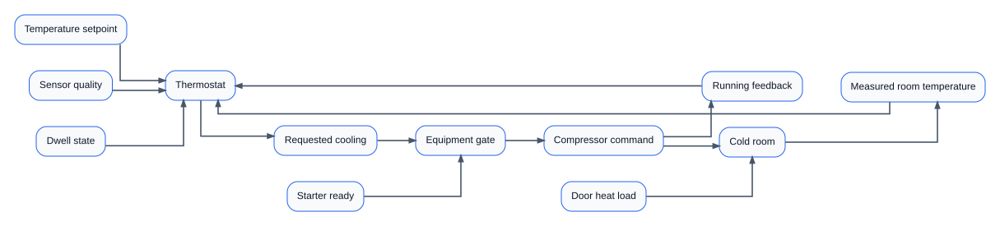
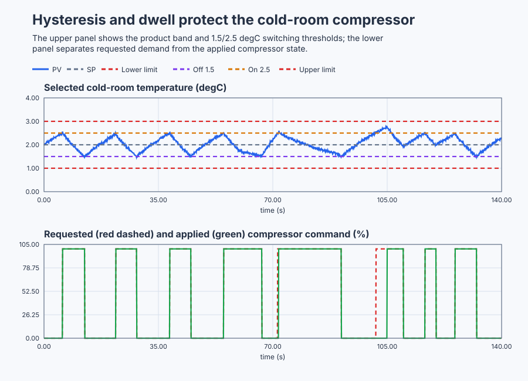

# Commission a walk-in cold-storage thermostat

Course position: Lesson 76 of 84.
Prerequisite: `control-loop-diagnosis`.

**Lesson objective:** Select and validate the simplest discrete controller that maintains the qualified product-temperature band without short-cycling the compressor.

Plant: Walk-in food cold-storage room.

This is Lesson 76, the beginner capstone. You make the engineering choice; the
lesson does not reveal a preferred candidate before the comparison. Every
result is deterministic **Simulation evidence**, not physical evidence,
food-safety evidence, or compressor-endurance evidence.

## The problem

The equipment in this lesson is Walk-in food cold-storage room.

The desired room temperature is `2.0 degrees Celsius`. The accepted qualified
air-temperature band is `1.0` through `3.0 degrees Celsius`. The compressor can
remove heat but cannot actively add heat, and its only commands are `0 percent`
and `100 percent`.

The setpoint ($SP$) is the desired temperature. The process value ($PV$) is the
qualified measured room-air temperature. Requested manipulated variable
($MV_{\mathrm{requested}}$) is the thermostat's compressor demand. Applied manipulated
variable ($MV_{\mathrm{applied}}$) is the separately measured compressor-running feedback.
An electrical starter lockout or equipment fault can make them different.

The simulated room has a cooling gain of `-0.05 degrees Celsius per percent`,
a `20 second` time constant, and a closed-door no-cooling equilibrium of
`4.0 degrees Celsius`. A door opening raises that equilibrium to
`6.0 degrees Celsius` from `60` through `90 seconds`. The controller runs every
`100 milliseconds`; qualified sensor noise has a `0.03 degrees Celsius`
standard deviation and fixed seed `20260829`.


The controller owns the thermostat request. The starter owns restart
permission. The running feedback, not the request, establishes applied-state
duration.

Lessons 1 through 3 showed three failures in order: watching the room does not
regulate it, a single threshold repeatedly reacts to measurement noise, and
hysteresis plus dwell protection bounds compressor cycling. Lesson 75 then
required evidence before changing a controller.

This capstone removes the guided answer. You must compare a single-threshold,
hysteresis-only, and hysteresis-plus-dwell design under identical conditions.
You must also explain why P, PI, or PID would add unnecessary continuous
calculation when the installed compressor has only two states and the required
temperature band can be met discretely.

## What we need

We need the simplest discrete compressor strategy that keeps qualified room temperature inside the product band without short-cycling. Candidate rejection, abnormal operation, restoration, and the physical-evidence boundary must all be explicit before commissioning is recommended.

## The new idea

### One switching boundary

A single-threshold controller starts cooling above one boundary and stops it
below the same boundary. Sensor noise can move the measurement back and forth
across that boundary while the room itself has barely changed. The result is
repeated transitions and possible short cycling.

### Two switching boundaries

Hysteresis gives the controller state memory. Cooling starts at the warmer
boundary and remains on until temperature reaches the colder boundary.

Hysteresis width ($\Delta T_{\mathrm{hys}}$) is the temperature separation between those
boundaries. After defining the physical temperatures, the symmetric equations
are:

$T_{\mathrm{on}} = SP + \Delta T_{\mathrm{hys}}/2$

$T_{\mathrm{off}} = SP - \Delta T_{\mathrm{hys}}/2$

The equations describe a cooling thermostat: high temperature requests
cooling; low temperature releases it.

### Protect applied equipment time

Minimum off time prevents a restart before the compressor's protected off
interval has elapsed. Minimum on time prevents a new start from stopping
before the protected running interval is complete. The dwell timer measures
elapsed time in the measured applied state, not merely time since a request.

The starter-ready signal is external equipment evidence. After controller
restart the program commands `0 percent` until the starter reports ready. The
PLC must not invent retained starter history that it does not own.

### Separate control from safety

A safety band and a control band have different meanings. Crossing a control
threshold causes an ordinary thermostat action. Crossing a safety limit aborts
the experiment and requires the declared safe or manual response. The selected
thresholds must leave margin inside the product band for sensor noise and
thermal movement.

### Define the evidence before reading it

Maximum eligible temperature is the highest qualified PV in a declared
window. Time outside the `1.0..3.0 degrees Celsius` product band is the number
of eligible samples outside the inclusive band multiplied by `0.1 seconds`.

Transition count is the number of changes in measured $MV_{\mathrm{applied}}$, not changes
in $MV_{\mathrm{requested}}$. Completed on duration and completed off duration are elapsed
seconds between measured state changes. The initial partial interval and a
declared manual or safety interruption are not credited as ordinary completed
cycles.

## Prediction

A `1.0 degree Celsius` symmetric hysteresis around `2.0 degrees Celsius`
produces a switch-on threshold of `2.5 degrees Celsius` and a switch-off
threshold of `1.5 degrees Celsius`. Each threshold retains
`0.5 degrees Celsius` of static margin to the nearest product limit.

The noise standard deviation of `0.03 degrees Celsius` is much smaller than
the `1.0 degree Celsius` separation, so noise alone should not reverse the
requested state. With minimum on and off times of `5.0 seconds`, every ordinary
completed applied-state interval must last at least `5.0 seconds`.

Predict before running:

1. The single threshold will expose repeated noise-sensitive transitions.
2. Hysteresis-only will reduce those transitions.
3. Hysteresis-plus-dwell will be the simplest candidate eligible for both
   temperature and compressor-cycling requirements.
4. Restart with starter-ready false will hold $MV_{\mathrm{applied}}$ at `0 percent`; normal
   cooling can begin only after readiness returns.

## Implementation

The actual Structured Text implements one configurable two-state thermostat.
It contains no PID object, scenario label, transition script, or precomputed
winner:

```st
OnThreshold := Setpoint + HysteresisWidth * LREAL#0.5;
OffThreshold := Setpoint - HysteresisWidth * LREAL#0.5;

IF ProcessValue >= OnThreshold THEN
    CoolingRequested := TRUE;
ELSIF ProcessValue <= OffThreshold THEN
    CoolingRequested := FALSE;
END_IF;
```

The program then combines `CoolingRequested`, measured `CompressorRunning`,
`DwellElapsed`, `TemperatureQualityGood`, `StarterReady`, and `AutoMode` to
produce `CompressorCommand`. Invalid quality is latched. Recovery requires
valid quality, an acknowledgement in manual mode, equipment readiness, and an
explicit return to automatic mode.

## Experiment in Control Studio

This procedure tests one declared lesson change under controlled conditions. Run hysteresis-only and hysteresis-plus-dwell candidates with all other conditions identical, then select the simplest eligible design. The declared event lasts 140 seconds. It restores Cold-room air temperature to 0 degC afterward. The deterministic Simulation seed is 20260829.

### Control Studio actions

1. **Monitor** — Start the **Simulator**, then open **truST sidebar → Control Studio → Monitor → Response**.
   - **Baseline check:** Wait until the header shows **Simulation**, **Running**, and current data. Confirm Cold-room temperature setpoint (SP, degC); Cold-room air temperature (PV, degC); Requested compressor demand (MV, %) and Applied compressor-running feedback (MV, %), including units, limits, mode, and quality. The initial operating point is Cold-room temperature setpoint = 2 degC, Cold-room air temperature = 2 degC, Requested compressor demand = 0 %, Applied compressor-running feedback = 0 %, Temperature quality good = 1 (dimensionless), Starter ready = 1 (dimensionless). The unresolved baseline problem is: A single switching threshold reacts repeatedly to qualified measurement noise near the boundary.
   - **Decision before action:** Read **Prediction** above, then state what should move first and in which direction. Use this decision rule: Compare single-threshold, hysteresis-only, and hysteresis-plus-dwell behavior under equivalent conditions, then select the simplest candidate satisfying product-band, cycling, restart, quality, and recovery requirements.
   - **Successful evidence:** The Response plot advances, the displayed values are finite and current, and **Start recording** is enabled. Select **Start recording** only after those conditions are visible.
   - **Recovery:** If recording is disabled or the plot reports unavailable or stale samples, stop the Simulator, correct the displayed runtime or binding problem, restart it, and repeat the baseline check.
   - **Record:** Write down the initial SP, PV, requested/applied MV where available, controller mode, and your predicted response before opening Test.

2. **Test** — Open **truST sidebar → Control Studio → Test**.
   - **Baseline check:** Set **Experiment** = **Observe without excitation**, **Amplitude** = **0 degC**, and **Maximum duration (s)** = **140**. The affected signal is **Cold-room air temperature**; it starts at 2 degC and must restore to 0 degC.
   - **Decision before action:** Before selecting **Review test**, predict the response direction and confirm the requested change remains inside Cold-room air temperature -30 degC to 20 degC; Requested compressor demand 0 % to 100 %; Applied compressor-running feedback 0 % to 100 %. For the walk-in cold-storage room, select the simplest discrete controller that keeps temperature inside the product band without compressor short-cycling.
   - **Successful evidence:** Select **Review test**, verify the signal, requested bound, duration, restoration, and stop conditions, then select **Confirm and start**. The state changes to **Running**, **Abort test** remains available, and the terminal state confirms completion and restoration while Response shows the measured SP/PV/MV sequence.
   - **Recovery:** For a rejected, stale, unsafe, unavailable, failed, or aborted state, read the displayed reason, restore Cold-room air temperature to 0 degC, wait for current data, and review a new test.
   - **Record:** Compare the response with your prediction and retain the terminal state, restoration result, and deterministic seed **20260829**.

3. **Identify** — After **Stop recording**, open **truST sidebar → Control Studio → Identify**.
   - **Baseline check:** Use **Qualify recording** to inspect sample count, duration, timing, excitation, and clipping. **Model selection**, **Fit estimation run**, and **Accept model for design** are the shared low-order model workflow; they do not replace the project-owned **Independent discrete-controller selection and commissioning** model and must not be accepted as this lesson's design authority.
   - **Decision before action:** Decide whether the recording contains the input/output change needed for **Independent discrete-controller selection and commissioning** before fitting anything.
   - **Successful evidence:** A qualified recording has current, finite, sufficiently excited data. Use the project-owned model described under **Implementation** and **Evidence and decision**, and record its assumptions, units, validity range, and rejection rule.
   - **Recovery:** If qualification reports stale, clipped, poorly excited, or insufficient data, return to Test and repeat the bounded experiment; never force or relabel a rejected fit.
   - **Record:** State which model is retained or rejected and why, explicitly identifying the runnable project as the model authority.

4. **Tune / Design** — Open **truST sidebar → Control Studio → Tune**.
   - **Baseline check:** **Design method** and **Generate candidate** are disabled because **Independent discrete-controller selection and commissioning** is designed by the runnable project; shared Control.PID tuning is unavailable. Do not select an unrelated PID method.
   - **Decision before action:** Apply the equations and choices under **Implementation**, then compare the declared alternatives under **Evidence and decision** before accepting **Independent discrete-controller selection and commissioning**.
   - **Successful evidence:** Use **Monitor → Signals** to correlate the implemented project-owned design with its named live states and outputs. A disabled shared designer is only a visible ownership boundary, not successful design evidence.
   - **Recovery:** If the project-owned prerequisites or qualification flags are false, return to Test or Identify as directed by the lesson and do not bypass them with a generic PID candidate.
   - **Record:** State why the project-owned design is eligible, conditional, or rejected, including the decisive trade-off.

5. **Validate** — Open **truST sidebar → Control Studio → Validate**.
   - **Baseline check:** **Run required validation** is disabled because no shared Control.PID candidate exists. **Requirement details** and **Save result** cannot be used to claim a shared result; project-owned validation is executed by the runnable project's declared oracle.
   - **Decision before action:** Use the predeclared comparisons: door_event_maximum_temperature <= 3 degC (tolerance 0.02 degC); minimum_completed_on_duration >= 5 s (tolerance 0.1 s); minimum_completed_off_duration >= 5 s (tolerance 0.1 s); ineligible_command_count == 0 (dimensionless) (tolerance 0 (dimensionless)).
   - **Successful evidence:** Correlate the unrounded project-owned results with the named live signals and events in Monitor. Each applicable requirement must have a value, unit, limit, tolerance, evidence class, and Pass, Conditional pass, Fail, or Inconclusive disposition.
   - **Recovery:** If the project run aborts, becomes stale, fails, or violates restoration, discard that run and repeat the declared Test. Never present a disabled button or retained README table as newly executed evidence.
   - **Record:** State the validation disposition and name every failed or inconclusive requirement before continuing.

## Evidence and decision

### Measures and comparison

First mark each candidate eligible or rejected. Only then compare performance.

| Measure | Signal and window | Unit | Preferred direction |
|---|---|---:|---|
| Maximum eligible temperature | Qualified PV during door event and recovery | degrees Celsius | Lower, while remaining above the lower product limit |
| Time outside product band | Qualified PV outside inclusive `1.0..3.0` band | seconds | Zero |
| Noise-only transition count | Measured $MV_{\mathrm{applied}}$ during fixed quiet-room window | count | Lower |
| Minimum completed on duration | Measured running intervals, excluding declared interruption | seconds | At least `5.0` |
| Minimum completed off duration | Measured stopped intervals, excluding declared interruption | seconds | At least `5.0` |
| Ineligible command count | $MV_{\mathrm{requested}}$ while quality, readiness, or mode disallows operation | count | Zero |

A candidate that violates temperature, discrete-command, readiness, quality,
or dwell criteria is rejected; a low transition count cannot make it eligible.

### Validation

The native test compiles this Structured Text and runs all candidates against
the shipped simulated room. It independently checks thresholds, requested
state, measured-state dwell, door response, restart lockout, quality latch,
manual safe command, explicit recovery, discrete output, and deterministic
replay. It also proves that the single threshold switches more often under the
same noise record and that the project instantiates no continuous controller.

The current executable run produced:

| Result | Single threshold | Hysteresis only | Hysteresis plus dwell |
|---|---:|---:|---:|
| Quiet-window applied-state transitions | 204 | 5 | 5 |
| Minimum completed on duration | Not eligible | Not required | 6.4 s |
| Minimum completed off duration | Not eligible | Not required | 5.1 s |
| Door-event maximum eligible temperature | Not selected | Not selected | 2.600 degrees Celsius |

The single-threshold candidate is rejected before ranking because its repeated
noise crossings violate the cycling objective. Hysteresis-only removes that
failure, but it does not enforce the stated equipment-time requirement. The
hysteresis-plus-dwell candidate is the simplest one that satisfies both sets
of requirements in this declared Simulation case.

The retained plot must show PV with the product limits and on/off thresholds,
then $MV_{\mathrm{requested}}$ and $MV_{\mathrm{applied}}$ on the same time axis. The plot comes from the
real run artifact; a hand-drawn result curve is not evidence.



[Complete trace](figures/cold-storage-capstone-evidence-trace.csv) · [Decision summary](figures/cold-storage-capstone-evidence-summary.csv)

## Conclusion

The single threshold responds to measurement crossings, not necessarily to a
meaningful thermal change. Hysteresis remembers the current requested state and
requires a full temperature excursion before reversing. Dwell protection adds
an equipment-time constraint based on measured running feedback. The door heat
load changes cycle timing and peak temperature but does not change the basic
two-state controller principle. Starter readiness remains external because the
equipment protection owns physical restart permission.

ON/OFF control is selected because the installed actuator is discrete and the
evidence shows the required band can be met. A continuous controller is not
being rejected for every refrigeration plant; a variable-speed compressor or
tighter requirement would require a new comparison.

## Reason for the next lesson

Export a commissioning record containing requirements, rejected candidates,
threshold derivation, dwell rationale, selected settings, plant and seed,
eligible measures, abnormal tests, safe/manual behavior, plot provenance,
Simulation evidence label, limitations, and physical approval boundary.

Lesson 77 applies the same independent workflow to a recirculating water
heater. That plant has a continuously modulated heater, so model choice,
proportional and integral behavior, tuning, saturation, and anti-windup become
necessary engineering decisions.
