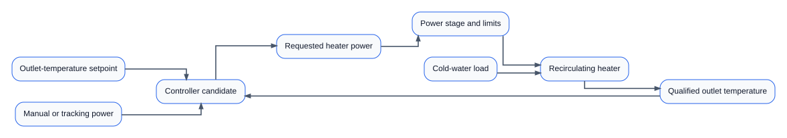
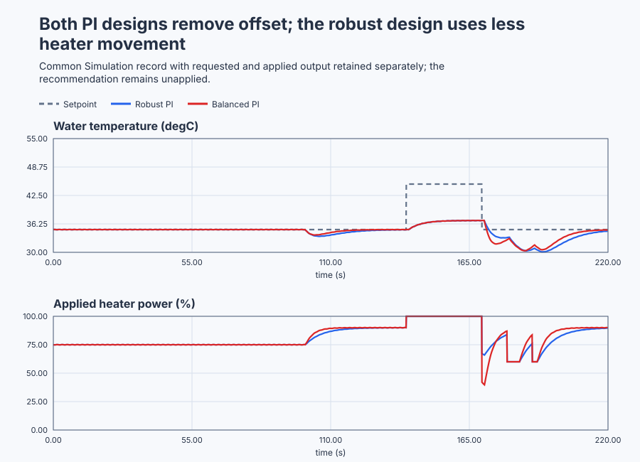

# Commission a recirculating water-heater PI loop

Course position: Lesson 77 of 84. Previous lesson: [Commission a walk-in cold-storage thermostat](../76-cold-storage/README.md). Next lesson: [Commission a flexible rotary indexing servo](../78-servo/README.md).

**Lesson objective:** Derive, identify, validate, tune, and abnormally qualify one unapplied PI recommendation for a continuously modulated recirculating water heater.

**Evidence class:** Simulation evidence. All runs in this lesson are deterministic Simulation evidence, not physical commissioning evidence.

## The problem

The equipment in this lesson is Recirculating electric water heater. This is
Lesson 77, the process-control capstone: it combines the earlier water-heater,
modelling, identification, tuning, and commissioning lessons into one
decision, and the recommendation remains unapplied.

The desired outlet-water temperature is `35 degrees Celsius`. Heater request
and applied power are limited from `0` through `100 percent`. The heater can add
heat but cannot actively cool. Water circulation, independent overtemperature
protection, and electrical permission are assumed available in Simulation; a
physical test would require separate verified signals and approvals.

The setpoint ($SP$) is desired outlet temperature. The process value ($PV$) is the
qualified measured outlet temperature. The temperature error ($e$) is SP minus
PV. Requested manipulated variable ($MV_{\mathrm{requested}}$) is the controller's bounded
heater command. Applied manipulated variable ($MV_{\mathrm{applied}}$) is the power delivered
through the actuator model. They remain separate because a real power stage can
lag, interlock, saturate, or fail.

The nominal local model has process gain `0.2 degrees Celsius per percent`,
time constant `5 seconds`, dead time `1 second`, and `100 millisecond` controller
interval. These four values are the same declared heater plant Lessons 4
through 8 already used; this capstone inherits them unchanged rather than
re-measuring them. Zero heater power tends toward `20 degrees Celsius`. Holding
`35 degrees Celsius` nominally requires `75 percent` heater power. A colder-
water load lowers the zero-power equilibrium by `3 degrees Celsius` at
`100 seconds`; that load magnitude and timing are new values configured for
this capstone's abnormal-event schedule. Sensor interference is a
deterministic `0.02 degree Celsius`, `0.5 hertz` sine, also a new configured
teaching value chosen to exercise the derivative-rejection decision below
without dominating the measured response.


Four equivalent plant copies expose P plus bias, historical PI, Robust SIMC PI,
and Balanced SIMC PI under one event schedule. Candidate comparison never
changes confirmed controller revision `77`.

The earlier progression supplied the pieces but not the complete decision. P
control left load-dependent offset. Bias corrected only one equilibrium.
Integral-only control removed constant error slowly. PI combined prompt and
accumulated action. Saturation exposed windup, and anti-windup and tracking
bounded recovery. Later lessons derived, identified, independently validated,
and tuned plant models.

The capstone asks whether those facts agree in one commissioning package. A
known simulator coefficient is not automatically a physical model; a fitted
model is not valid merely because it fits its training record; and a faster
tuning is not automatically the better engineering decision.

## What we need

We need one traceable path from heater requirements and physical balance through identification, independent validation, controller choice, tuning, and abnormal tests. The final recommendation must remain unapplied until approval and rollback are ready.

## The new idea

### Predict the operating point from energy balance

At thermal equilibrium, electrical heat input balances heat loss and the
incoming-water load. In the local linear model, steady temperature change is
process gain ($K$) multiplied by applied-power change.

The required holding power ($MV_{\mathrm{hold}}$) is the desired temperature rise divided
by steady process gain. The zero-power temperature is $T_{\mathrm{zero}}$:

$MV_{\mathrm{hold}} = (SP - T_{\mathrm{zero}})/K = (35 - 20)/0.2 = 75$ percent

This prediction assumes the declared flow, heat loss, heater efficiency, and
operating region. It is not a universal heater equation.

### Derive and identify dynamics for different reasons

Thermal capacitance and heat-loss conductance create a first-order time
constant. Transport and sensor placement create dead time. State those physical
assumptions before reducing the energy balance to a first-order-plus-dead-time
model.

When physical coefficients are uncertain, use a safe power-step identification
experiment. Estimate steady gain from settled input and output changes. Estimate
delay from the first response beyond the declared noise band. Estimate the time
constant from the time needed to reach `63.2 percent` of the delay-adjusted
final change. Fit both a first-order and a first-order-plus-dead-time candidate.

Fit data and independent validation data must not be the same record. Use the
second record to examine prediction error and residual structure. A good fit to
the identification step does not prove future prediction.

The physical model and the identified model shall therefore be compared on an
independent record. Their prediction errors and residual patterns show whether
either model is credible outside the data used to construct or fit it.

### Select the simplest eligible controller structure

The process error is:

$e = SP - PV$

P with the correct `75 percent` bias can hold the nominal operating point, but
it retains changed-load offset. Integral-only action can remove constant error
but lacks prompt proportional correction. PI is the simplest eligible structure
when prompt response and zero constant-load error are both required.

Derivative action is rejected here unless a separate response requirement and
noise-qualified comparison demonstrate a benefit. The capstone does not add a
term merely because PID exists.

### Understand the implemented limits and modes

The shared parallel `Control.PID` uses proportional gain in percent per degree
Celsius and integral gain in percent per degree-Celsius-second. Combined
anti-windup compares the controller's private nominal candidate with its bounded
output. Public $MV_{\mathrm{requested}}$ and $MV_{\mathrm{applied}}$ do not pretend to expose that private
state. They instead show actuator behavior.

Manual mode gives the controller the applied manual power. Tracking through the
shared state prevents automatic return from creating an unnecessary step. The
controller's requested output remains bounded from `0` through `100 percent`.

### Compare tuning objectives, not formula names

Robust SIMC uses proportional gain `3.26087` and integral gain `0.65217`.
Balanced SIMC uses proportional gain `5.76923` and integral gain `1.15385`.
The historical PI uses `4` and `0.8` — a configured pre-engineering plant
setting retained as the fourth candidate, not Lesson 7's own selected `8` and
`4` result on this identical plant — and it remains a genuine candidate, not a
straw candidate selected to lose.

Balanced tuning is expected to reduce error area and response time while using
more actuator movement and robustness reserve. Robust tuning is expected to
trade some nominal speed for lower activity and more tolerance to model error.

These values come from the FOPDT SIMC PI equations. Here $K$ converts power to
temperature, $T$ describes thermal inertia, $L$ is transport delay, and the
chosen closed-loop time $\lambda$ expresses the speed-versus-robustness trade:

$K_p=T/[K(\lambda+L)],\qquad T_i=\min[T,4(\lambda+L)],\qquad K_i=K_p/T_i$

Robust uses $\lambda=6.667$ seconds, so
$K_p=5/[0.2(6.667+1)]=3.26087$, $T_i=5$ seconds, and
$K_i=3.26087/5=0.65217$. Balanced uses $\lambda=3.333$ seconds, so
$K_p=5/[0.2(3.333+1)]=5.76923$, $T_i=5$ seconds, and
$K_i=5.76923/5=1.15385$. The smaller $\lambda$ requests a faster loop and
therefore produces the larger gain and actuator movement.

## Prediction

Before opening a result:

1. Calculate `75 percent` nominal holding power from the energy balance.
2. Recover gain, time constant, and dead time from the safe identification
   record, then check them against independent validation residuals.
3. Reproduce the Robust and Balanced SIMC values from the validated model.
4. Predict that P plus bias will hold nominal `35 degrees Celsius` but retain
   offset after the colder-water event.
5. Predict that each eligible PI removes the constant-load offset.
6. Predict Balanced PI will have lower integrated absolute error but greater
   applied-power total variation than Robust PI.
7. Predict that the unreachable `45 degrees Celsius` request will hold applied
   power at `100 percent`, and that combined anti-windup plus manual tracking
   will bound restoration.

## Implementation

The actual Structured Text runs four real controller instances on equivalent
plant copies:

```st
CurrentParameters.ProportionalGain := LREAL#3.260869565;
CurrentParameters.IntegralGain := LREAL#0.652173913;
CandidateParameters.ProportionalGain := LREAL#5.769230769;
CandidateParameters.IntegralGain := LREAL#1.153846154;

CurrentRequested := CurrentController.Update(Input := CurrentInput);
CandidateRequested := CandidateController.Update(Input := CandidateInput);
CurrentApplied := LIMIT(LREAL#0.0, CurrentRequested, LREAL#100.0);
CandidateApplied := LIMIT(LREAL#0.0, CandidateRequested, LREAL#100.0);
```

`CurrentController` is the confirmed Robust PI. `CandidateController` is the
unapplied Balanced PI. The program also executes P-plus-bias and historical PI
copies. `ManualMode`, `ManualOutput`, `TemperatureQualityGood`, `CycleTime`, and
`ControllerRevision` remain visible. The program contains no model fit, tuning
formula, result table, scenario label, or automatic winner.

## Experiment in Control Studio

The learner-facing workflow is exactly **Monitor → Test**. The project runs all
four controller copies through the same 220-second load, unreachable-demand,
manual, quality, and recovery record without changing revision 77. The native
test owns identification, independent model validation, uncertainty variants,
candidate ranking, and the unapplied recommendation.

### Control Studio actions

1. **Monitor** — Start the **Simulator**, then open **truST sidebar → Control Studio → Monitor → Response**.
   - **Baseline check:** Wait until the header shows **Simulation**, **Running**, and current data. Confirm Outlet-temperature setpoint (SP, degC); P-plus-bias temperature (PV, degC) and Historical-PI temperature (PV, degC); P-plus-bias applied heater power (MV, %) and Historical-PI applied heater power (MV, %), including units, limits, mode, and quality. The initial operating point is Outlet-temperature setpoint = 35 degC, P-plus-bias temperature = 35 degC, Historical-PI temperature = 35 degC, Robust-PI temperature = 35 degC, Balanced-PI temperature = 35 degC, P-plus-bias applied heater power = 75 %, Historical-PI applied heater power = 75 %, Robust-PI applied heater power = 75 %. The unresolved baseline problem is: P plus correct nominal bias retains changed-load offset, while the historical PI has not yet been justified against independently validated model and robustness evidence.
   - **Decision before action:** Read **Prediction** above, then state what should move first and in which direction. Use this decision rule: Compare all four structures on equivalent nominal and uncertainty scenarios, preserve the confirmed revision, and export the simplest eligible PI as an unapplied recommendation.
   - **Successful evidence:** The Response plot advances, the displayed values are finite and current, and **Start recording** is enabled. Select **Start recording** only after those conditions are visible.
   - **Recovery:** If recording is disabled or the plot reports unavailable or stale samples, stop the Simulator, correct the displayed runtime or binding problem, restart it, and repeat the baseline check.
   - **Record:** Write down the initial SP, PV, requested/applied MV where available, controller mode, and your predicted response before opening Test.

2. **Test** — Open **truST sidebar → Control Studio → Test**.
   - **Baseline check:** Confirm **Experiment** = **Observe without excitation**, **Amplitude** = **0** (disabled), and **Maximum duration (s)** = **220.1**. The reviewed authority is **Experiment authority** (`P1.ExperimentEnabled`). The project owns every setpoint and mode transition.
   - **Decision before action:** Before selecting **Review test**, predict the response direction and confirm the requested change remains inside P-plus-bias temperature 0 degC to 80 degC; Historical-PI temperature 0 degC to 80 degC; Robust-PI temperature 0 degC to 80 degC; Balanced-PI temperature 0 degC to 80 degC; Robust-PI applied heater power 0 % to 100 %; Balanced-PI applied heater power 0 % to 100 %.
   - **Successful evidence:** Select **Review test**, verify the signal, requested bound, duration, restoration, and stop conditions, then select **Confirm and start**. The state changes to **Running**, **Abort test** remains available, and the terminal state confirms completion and restoration while Response shows the measured SP/PV/MV sequence.
   - **Recovery:** For a rejected, stale, unsafe, unavailable, failed, or aborted state, read the displayed reason and remove experiment authority. The project restores a 35-degree setpoint, valid quality, and tracked 60-percent manual power.
   - **Record:** Compare the response with your prediction and retain the terminal state, restoration result, and deterministic seed **20260829**.

Identify, Tune, and Validate are not learner steps in this capstone. The native
test performs those engineering calculations against retained data; disabled
generic panels cannot establish a model, tuning, or validation result.

## Evidence and decision

Model-fitting score and independent validation score are separate. A model that
fits one record but predicts the second poorly is rejected.

Final-window absolute error is the mean absolute SP-minus-PV value only after
the settling criterion passes. Overshoot is peak eligible PV above SP after an
increase. Integrated absolute error uses degree-Celsius-seconds. Applied-power
total variation uses percentage points. Saturation occupancy and restoration
time use $MV_{\mathrm{applied}}$. Requested-versus-applied mismatch is separate actuator
evidence and is not renamed as private controller saturation state.

Each nominal and uncertainty run is first classified as eligible, settled,
saturated, not settled, or invalid. Only eligible runs enter the ranking. The
decision then balances final-window error, overshoot, integrated absolute error,
total variation, saturation recovery, and robustness.

The native executable test compiles this Structured Text with the shared
Control library and runs the four equivalent plants under nominal, low-gain,
high-gain, and increased-delay scenarios. Independent calculations reproduce
the physical holding power, identified FOPDT coefficients, Robust and Balanced
SIMC gains, plant dynamics, final-window measures, error area, movement,
saturation, manual tracking, and unchanged revision. Identification recovers a
gain, time constant, and dead time consistent with the nominal `0.2`, `5.0`,
and `1.0` values before either SIMC tuning is trusted; that check passes in
this run, but the retained tabulated and plotted evidence below reports only
the two ranked candidates, so no invented identified-coefficient figure is
printed here. P plus bias is rejected on structural grounds alone: fixed bias
cannot track the changed thermal equilibrium after the load event, so its
final-window error necessarily stays above the declared `1-degree-Celsius`
ineligibility limit; that structural argument does not need a retained curve.
Historical PI shares the eligible PI structure with Robust and Balanced and is
not rejected on structural grounds, but it is not part of the retained
tabulated or plotted ranking in this run, which compares only the two
SIMC-derived candidates against each other.

The retained deterministic run gives the following evidence. Values are rounded
only for presentation; the native test evaluates the unrounded samples.

| Evidence | Measured result | Engineering meaning |
| --- | ---: | --- |
| Robust PI integrated absolute error | `23.93 degree-Celsius-seconds` | Eligible, but slower than Balanced PI over the declared comparison window. |
| Balanced PI integrated absolute error | `14.17 degree-Celsius-seconds` | Eligible and faster by the declared error-area measure. |
| Robust PI applied-power total variation | `28.7 percentage points` | Eligible and lower actuator movement. |
| Balanced PI applied-power total variation | `41.8 percentage points` | Eligible, but uses more actuator movement for its faster response. |

Both PI tunings also satisfy the declared final-window error limit in the
low-gain, high-gain, and increased-delay cases. Because both candidates meet the
mandatory limits, Robust PI remains the recommendation: it uses less applied-
power movement, while the current requirements do not demand the additional
speed supplied by Balanced PI. Balanced PI remains a justified alternative if
a future response-time requirement is tightened and its extra actuator movement
is accepted. Revision `77` remains unchanged; this comparison does not apply
either candidate automatically.

The final retained plots must place SP and all eligible PV traces above their
requested and applied heater-power traces on aligned time axes. Limits, load,
unreachable demand, manual mode, quality, candidate identity, units, and
Simulation evidence class must be visible. Curves come from the run artifact.



[Complete trace](figures/water-heater-capstone-evidence-trace.csv) · [Decision summary](figures/water-heater-capstone-evidence-summary.csv)

## Conclusion

The `75 percent` energy-balance prediction explains the nominal operating
point. Independent validation determines whether the identified dynamics are
credible enough for tuning. P plus bias fails after the load changes because a
new steady heater power requires nonzero error. Integral action changes that
steady power until constant error is removed, so PI is sufficient.

Balanced and Robust PI solve the same control problem with different priorities:
speed and error area versus actuator movement and uncertainty reserve. Combined
anti-windup bounds the controller internally at the declared output limits;
manual operation updates controller state so automatic recovery is bumpless.
None of this turns Simulation evidence into a commissioned physical controller.

## Reason for the next lesson

Export the requirements, physical derivation, identification record, independent
model validation, rejected structures, tuning calculations, equivalent
candidate evidence, uncertainty cases, abnormal validation, requested/applied
plots, selected gains, unchanged revision, application state, explicit approval
steps, limitations, and rollback.

Lesson 78 applies the same complete workflow to a motion system. There,
derivative damping, mechanical resonance, root locus, frequency response,
discrete implementation, encoder noise, and motor torque limits become material.
