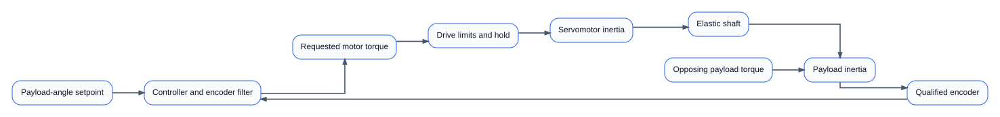
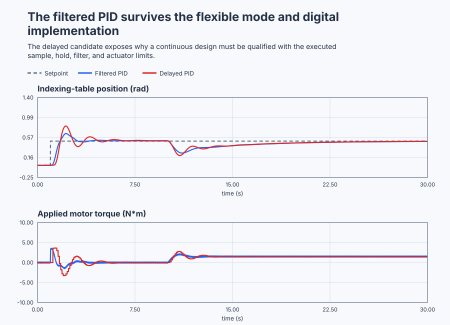

# Commission a flexible rotary indexing servo

Course position: Lesson 78 of 84.
Prerequisite: `control-capstone-water-heater`.

**Lesson objective:** Select and qualify the minimum P, PD, or PID structure that positions a flexible payload under load, noise, drive limits, model variation, and the implemented sample-and-delay behavior.

Plant: Flexible rotary indexing table.

This is Lesson 78, the motion-control capstone. It asks you to commission a
flexible rotary indexing table and select the minimum eligible structure from
measured evidence. The controller revision remains unapplied. Every executable
result is deterministic **Simulation evidence**, not physical machine evidence.

## The problem

The equipment in this lesson is Flexible rotary indexing table.

The equipment is a servomotor driving a rotary payload table through an elastic
shaft. The motor and payload can rotate in either direction. The drive can apply
from minus 10 through plus 10 newton metres and can change torque by no more than
200 newton metres per second. The normal controller runs every 0.01 seconds.

The setpoint ($SP$) is the desired payload angle, in radians. The process value
($PV$) is the payload angle reported by the qualified encoder, also in radians.
The position error ($e$) is the setpoint minus the process value. A positive error
means the payload has not yet rotated far enough in the positive direction.

The requested manipulated variable ($MV_{\mathrm{requested}}$) is the motor torque requested
by the controller, in newton metres. The applied manipulated variable
($MV_{\mathrm{applied}}$) is the torque that remains after the drive's amplitude and slew
limits. They can differ on a physical drive, so this lesson retains them
separately even when an ideal nominal run makes them equal.

The motor inertia is 0.2 kilogram-square-metres. The payload inertia is
0.8 kilogram-square-metres. The shaft stiffness is 20 newton metres per radian,
and the shaft damping is 0.5 newton-metre-seconds per radian. Motor and payload
viscous damping are 0.2 and 0.3 newton-metre-seconds per radian. Those values
describe the local linear model around this move; they do not describe every
mechanical mode of an installed machine.

The experiment commands 0.5 radians at 1 second. At 10 seconds, an opposing
1.5-newton-metre payload torque begins. The qualified encoder contains a
deterministic 0.002-radian, 20-hertz interference. The complete nominal record
lasts 30 seconds.


The diagram matters because the controller does not act directly on payload
position. Torque first accelerates the motor, twists the shaft, and then moves
the payload measured by the encoder.

The earlier motion lessons exposed one limitation at a time. P control left a
lightly damped move. PD added motion damping, but a constant payload torque
still required nonzero position error. PID supplied the missing steady torque.
Derivative-on-measurement avoided setpoint kick, and low-pass filtering reduced
encoder-noise activity at the price of lag. Later root-locus, Bode, sensitivity,
and sampled-data lessons showed that one smooth trace cannot prove stability or
robustness.

In compact engineering terms: P is lightly damped, PD handles motion but retains
error under a constant payload torque, and PID can achieve zero constant-load
error by retaining the required holding torque.

This capstone joins those facts into one decision. The selected controller must
meet the same time-response, frequency-margin, digital, load, noise, and torque
requirements. Passing only one of those views is not enough.

## What we need

We need a payload-position controller justified from mechanical requirements, dynamic analysis, exact digital execution, actuator limits, and encoder noise. Simpler structures and unqualified sample intervals must be rejected by the same declared evidence.

## The new idea

### Predict the flexible mechanical mode

The motor angle ($\theta_{m}$) is motor-shaft rotation in radians. The payload angle
($\theta_{\mathrm{l}}$) is table rotation in radians. Shaft twist is motor angle minus payload
angle. Relative angular velocity is motor speed minus payload speed.

The elastic part of shaft torque is shaft stiffness multiplied by shaft twist.
The damping part is shaft damping multiplied by relative angular velocity. The
motor and payload rotational balances say that applied torque changes angular
momentum after shaft torque, viscous loss, and payload load have been accounted
for. These words must be understood before converting the balances into the
four-state matrix stored in `simulation.toml`.

Ignoring damping for one prediction, the flexible-mode natural angular
frequency is the square root of shaft stiffness multiplied by the sum of the
inverse inertias:

$\omega_{\mathrm{f}} = \sqrt{k_{s} \cdot (1/J_{m} + 1/J_{\mathrm{l}})}$

Here the shaft stiffness ($k_{s}$) is 20 newton metres per radian, motor inertia
($\mathbf{J}_{m}$) is 0.2 kilogram-square-metres, and payload inertia ($J_{\mathrm{l}}$) is
0.8 kilogram-square-metres:

$\omega_{\mathrm{f}} = \sqrt{20 \cdot (1/0.2 + 1/0.8)} = 11.18 radians per second$

The measured resonant peak will shift and broaden because damping and feedback
are present. The calculation tells us where to look; it does not replace the
frequency experiment.

### Decide why P, PD, and PID are different

Proportional gain ($K_p$) states how many newton metres the positional controller
requests for each radian of present error. With $K_p$ equal to 7 newton metres per
radian, the initial 0.5-radian error predicts:

$P torque = K_p \cdot e = 7 \cdot 0.5 = 3.5 newton metres$

Increasing P gain can reduce error, but it does not directly measure motion and
can excite the lightly damped flexible response.

Derivative gain ($K_d$) states how much damping torque is requested per radian per
second of measured motion. Derivative setpoint weight is zero, so derivative
acts on measurement rather than the setpoint. The setpoint step therefore does
not create derivative kick. PD should damp the commanded move.

At equilibrium the derivative contribution is zero. Under the constant
1.5-newton-metre load, PD must use proportional error to supply holding torque.
The steady load error ($e_{\mathrm{ss}}$) is predicted by load torque divided by
proportional gain:

$e_{ss} = 1.5 / 7 = 0.2143 radians$

Integral gain ($K_i$) changes retained torque from accumulated error, in newton
metres per radian-second. PID can therefore supply 1.5 newton metres at zero
constant error. For this plant and these requirements, filtered PID is the
minimum eligible structure: P lacks useful damping, and PD retains load error.

### Filter without hiding the encoder

Raw encoder position is the noisy sensor signal. Filtered position is the
controller-facing signal after a first-order low-pass filter with a time
constant of 0.05 seconds. The filter reduces 20-hertz noise before numerical derivative
action, but its phase lag consumes stability margin. Both raw encoder and
filtered position remain visible. A smooth filtered plot is not evidence that
the physical encoder is quiet.

The filter transfer is $H(s)=1/(1+\tau_f s)$. At angular frequency $\omega$,
its magnitude is $1/\sqrt{1+(\omega\tau_f)^2}$. The 20-hertz interference has
$\omega=2\pi(20)=125.66$ radians per second, so with
$\tau_f=0.05$ seconds the magnitude is about `0.157`: the position ripple is
reduced to roughly 16 percent before differentiation. The same denominator has
phase $-\arctan(\omega\tau_f)$, which explains why stronger smoothing cannot be
treated as free noise removal.

Backlash, stiction, resonance, torque saturation, slew limiting, and encoder
noise have different signatures. This lesson represents resonance, limits, and
noise directly. A physical axis showing lost motion would first require a
mechanical diagnosis; increasing PID gains is not a substitute.

### Use root locus and frequency response for different questions

A root locus shows where the closed-loop poles move as a declared controller
gain changes. Pole locations predict mode speed and damping for the stated
model. The plot must retain the flexible pole pair; hiding it would hide the
mechanism we need to control.

A Bode plot shows loop magnitude and phase against angular frequency. Gain
margin is the additional loop-gain factor available at the minus-180-degree
phase crossing. Phase margin is the phase still available before minus
180 degrees when loop magnitude is one. The resonance and filter phase lag
must remain visible on the same model used for these calculations.

The loop transfer ($L_{\mathrm{loop}}$) is the controller transfer multiplied by the plant
transfer. Sensitivity ($S$) is the path from an output disturbance to control
error. Complementary sensitivity ($T$) is the path from setpoint or measurement
noise to process output. Only after those meanings are established do we write:

$S = 1 / (1 + L_{\mathrm{loop}})$

$T = L_{\mathrm{loop}} / (1 + L_{\mathrm{loop}})$

Maximum sensitivity is the largest magnitude of sensitivity over the declared
frequency grid. It exposes robustness that one nominal step cannot establish.

### Treat digital execution as part of the controller

Sampling reads the encoder at controller update instants. Zero-order hold keeps
the applied torque unchanged between updates. A one-update computation delay
means the torque calculated now is applied at the following update.

The Nyquist angular frequency is pi divided by sample interval. It is
314.159 radians per second at 0.01 seconds and 31.416 radians per second at
0.1 seconds. A continuous controller does not remain qualified automatically
when sampling, hold, delay, or filter realization changes.

## Prediction

The selected candidate uses $K_p$ = 7 newton metres per radian, $K_i$ = 1.2 newton
metres per radian-second, and $K_d$ = 2 newton-metre-seconds per radian. On the
declared continuous-model frequency grid, independently predict crossover near
3.10 radians per second, phase margin near 38 degrees, gain margin near 1.94,
and maximum sensitivity near 2.07.

Before running, write these predictions:

1. P requests 3.5 newton metres initially and remains too lightly damped to
   satisfy settling.
2. PD damps the move but retains approximately 0.2143 radians of load error.
3. PID removes constant-load error while meeting the declared torque and noise
   boundaries.
4. Unchanged PID at 100 milliseconds plus one-update delay has much less digital
   reserve. Reject it if its overshoot, settling, or discrete-pole requirement
   fails, even if its last sample is near setpoint.

## Implementation

The shipped Structured Text composes the shared controller and filter in one
small `ServoCandidate` function block. The selected fine candidate is configured
as follows:

```st
PIDController.Configure(
    ProportionalGain := LREAL#7.0,
    IntegralGain := LREAL#1.2,
    DerivativeGain := LREAL#2.0,
    FilterTimeConstant := LREAL#0.05,
    InitialPosition := PIDRawPosition
);

PIDAppliedTorque := PIDController.Update(
    Setpoint := PositionSetpoint,
    MeasuredPosition := PIDRawPosition,
    AutomaticMode := AutomaticEnabled,
    QualityGood := MeasurementQualityGood,
    ManualTorque := ManualTorque,
    CycleTime := FineCycleTime
);
```

The program executes P, filtered PD, selected filtered PID, and unchanged coarse
filtered PID on four equivalent plant copies. `RawPosition`,
`FilteredPosition`, `RequestedTorque`, `PendingTorque`, and `AppliedTorque`
remain separate. `FineUpdatePulse` and `CoarseUpdatePulse` expose the real update
schedule. `LoadTorque`, `MeasurementQualityGood`, `AutomaticEnabled`, and
`ControllerRevision` remain observable. No pole, margin, metric, acceptance
label, or winner is embedded in the PLC program.

## Experiment in Control Studio

The learner-facing workflow is exactly **Monitor → Test**. The runnable project
owns the common 30-second zero-to-0.5-radian reference and 1.5-newton-metre load
sequence, then restores zero reference, zero load, and zero torque. The native
test owns the frequency, discrete, uncertainty, abnormal, and candidate
qualification calculations.

### Control Studio actions

1. **Monitor** — Start the **Simulator**, then open **truST sidebar → Control Studio → Monitor → Response**.
   - **Baseline check:** Wait until the header shows **Simulation**, **Running**, and current data. Confirm Payload-position setpoint (SP, rad); P raw encoder position (PV, rad) and PD raw encoder position (PV, rad); P applied motor torque (MV, N m) and PD applied motor torque (MV, N m), including units, limits, mode, and quality. The initial operating point is Payload-position setpoint = 0 rad, P raw encoder position = 0 rad, PD raw encoder position = 0 rad, PID raw encoder position = 0 rad, Coarse PID raw encoder position = 0 rad, P applied motor torque = 0 N m, PD applied motor torque = 0 N m, PID applied motor torque = 0 N m. The unresolved baseline problem is: P does not satisfy the settling requirement; filtered PD damps the move but retains constant-load position error.
   - **Decision before action:** Read **Prediction** above, then state what should move first and in which direction. Use this decision rule: Qualify filtered PID across time, frequency, discrete, actuator, noise, uncertainty, and abnormal evidence while retaining revision 78 unapplied.
   - **Successful evidence:** The Response plot advances, the displayed values are finite and current, and **Start recording** is enabled. Select **Start recording** only after those conditions are visible.
   - **Recovery:** If recording is disabled or the plot reports unavailable or stale samples, stop the Simulator, correct the displayed runtime or binding problem, restart it, and repeat the baseline check.
   - **Record:** Write down the initial SP, PV, requested/applied MV where available, controller mode, and your predicted response before opening Test.

2. **Test** — Open **truST sidebar → Control Studio → Test**.
   - **Baseline check:** Set **Experiment** = **Observe without excitation**, **Amplitude** = **0**, and **Maximum duration (s)** = **30.01**. Control Studio writes only `P1.ExperimentEnabled`; amplitude zero is intentional because the project owns reference, load, and restoration.
   - **Decision before action:** Before selecting **Review test**, predict the response direction and confirm the requested change remains inside PID raw encoder position -1.5 rad to 1.5 rad; PID applied motor torque -10 N m to 10 N m; Coarse PID raw encoder position -1.5 rad to 1.5 rad; Coarse PID applied motor torque -10 N m to 10 N m.
   - **Successful evidence:** Select **Review test**, verify the signal, requested bound, duration, restoration, and stop conditions, then select **Confirm and start**. The state changes to **Running**, **Abort test** remains available, and the terminal state confirms completion and restoration while Response shows the measured SP/PV/MV sequence.
   - **Recovery:** For a rejected, stale, unsafe, unavailable, failed, or aborted state, remove experiment authority. The project enters the reviewed zero-torque state and restores zero reference and load before another run.
   - **Record:** Compare the response with your prediction and retain the terminal state, restoration result, and deterministic seed **20260829**.

Identify, Tune, and Validate are not learner steps. The native executable test
owns those model, frequency, digital, uncertainty, and pass/fail calculations;
disabled generic panels are not evidence.

## Evidence and decision

### Measures and comparison

Classify each run and each measure as eligible, not settled, saturated, aborted,
or invalid before ranking it.

Overshoot is the peak eligible payload position above the 0.5-radian setpoint,
reported in radians and as percent of the commanded move. Two-percent settling
time begins at the step and ends only when position enters and remains within
0.01 radians for at least 1 second. A run that does not settle receives no
steady-state-error value.

Final-window load error is the mean absolute setpoint-minus-position value from
25 through 30 seconds, and is reported only after settling qualification.
Applied-torque total variation is the sum of absolute sample-to-sample applied-
torque changes, in newton metres. Noise-driven applied-torque root-mean-square
activity uses the declared 7-through-9-second quiet window.

Also retain peak speed, requested and applied torque, saturation time,
requested/applied mismatch, dominant poles, damping, crossover, gain margin,
phase margin, delay margin, maximum sensitivity, maximum complementary
sensitivity, frequency grid, exact discrete poles, sample/hold/delay identity,
and numerical tolerances.

### Validation

The selected 0.01-second PID must overshoot by no more than 35 percent, settle
within 5 seconds, end with no more than 0.02 radians final-window load error,
stay inside torque and speed limits, and keep quiet-window torque RMS below
0.10 newton metres. Its continuous-model phase margin must be at least
35 degrees, gain margin at least 1.7, and maximum sensitivity no greater than
2.5. Exact implemented discrete poles must remain inside the unit circle.

The unchanged delayed 0.1-second candidate is rejected when a declared time- or
discrete-domain requirement fails. Heavy-payload, reduced-damping, and doubled-
noise results are separate abnormal Simulation evidence. A failed or invalid
measure cannot make an uncertainty case look better.

The retained deterministic run gives the following evidence. Displayed values
are rounded for reading; the native oracle evaluates unrounded samples.

| Evidence | Result | Decision |
| --- | ---: | --- |
| Predicted flexible-mode frequency | `11.180 radians per second` | The Bode analysis must include the represented shaft mode. |
| Selected-loop crossover | `3.096 radians per second` | The controller operates well below the represented flexible mode. |
| Phase margin | `38.34 degrees` | Passes the `35-degree` requirement. |
| Gain margin | `1.94` | Passes the `1.7` requirement. |
| Maximum sensitivity | `2.07` | Passes the `2.5` requirement. |
| Fine implemented dominant-pole radius | `0.998179` | Inside the unit circle; the slow integral pole remains visible. |
| P settling | `Not settled` | Ineligible for a steady-state-error comparison. |
| PD settling | `2.90 seconds` | Damping succeeds, but the controller fails the constant-load error requirement. |
| Selected PID settling | `4.46 seconds` | Passes the `5-second` requirement. |
| Selected PID overshoot | `31.4 percent` | Passes the `35-percent` requirement. |
| Selected PID final-window load error | `0.0100 radians` | Passes the `0.02-radian` requirement. |
| Selected PID quiet torque RMS | `0.0571 newton metres` | Passes the `0.10-newton-metre` nominal-noise requirement. |
| Selected PID applied-torque total variation | `188.1 newton metres` | Retained actuator-activity cost; it is not an instantaneous torque. |
| Delayed 100-millisecond PID settling | `7.40 seconds` | Fails the `5-second` requirement. |
| Delayed 100-millisecond PID overshoot | `62.4 percent` | Fails the `35-percent` requirement. |
| Heavy-payload final-window error | `0.0100 radians` | Passes the declared abnormal-case error limit. |
| Reduced-damping final-window error | `0.0100 radians` | Passes the declared abnormal-case error limit. |
| Doubled-noise torque RMS | `0.1141 newton metres` | Higher than nominal as predicted and retained as separate abnormal evidence. |

Filtered PID is therefore retained as the unapplied recommendation at the
qualified 0.01-second interval. P and PD are rejected by observed structure
limitations. The unchanged delayed 0.1-second implementation is rejected by
both settling and overshoot, even though its final position eventually becomes
close to setpoint. No result changes controller revision 78.

The native executable test compiles the actual Structured Text with
`Control.PID` and `Control.LowPass`, executes every shipped plant configuration,
and independently reproduces the mechanical prediction, frequency metrics,
time measures, torque measures, digital schedule, uncertainty response, safe
manual behavior, invalid-quality response, and unchanged revision. Retained
plots must be generated from the run artifact rather than drawn by hand.



[Complete trace](figures/servo-capstone-evidence-trace.csv) · [Decision summary](figures/servo-capstone-evidence-summary.csv)

## Conclusion

The two-inertia model predicts the flexible mode because motor motion reaches
the payload through shaft twist. P responds to position error but does not
directly oppose velocity, so its low-frequency closed-loop pair remains poorly
damped. Derivative-on-measurement supplies damping without differentiating the
reference step. PD cannot create the constant holding torque at zero error, so
it retains the predicted load offset. Integral action supplies that missing
equilibrium torque.

The encoder filter reduces noise-driven derivative activity but adds phase lag.
Root locus, Bode margins, sensitivity, exact sampled poles, time response, and
torque traces therefore have to describe the same implemented controller. The
coarse case shows why gains, filter, update interval, hold, and computation delay
form one design rather than independent settings.

## Reason for the next lesson

Export the requirements, equipment and safety scope, physical model, approved
identification design, residual evidence, rejected P and PD structures,
controller and filter values, root-locus and frequency plots, exact digital
realization, equivalent time traces, torque and noise evidence, uncertainty and
abnormal results, selected gains, unchanged revision, Simulation boundary,
explicit application approval, rollback, and maintenance limits.

Lesson 79 applies the same commissioning discipline to a jacketed chemical
reactor. That reactor requires several feedback, feedforward, cascade,
split-range, override, and tracking paths to cooperate through startup,
production disturbances, constraints, and shutdown.
