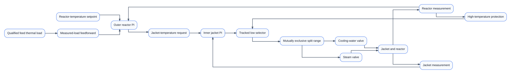
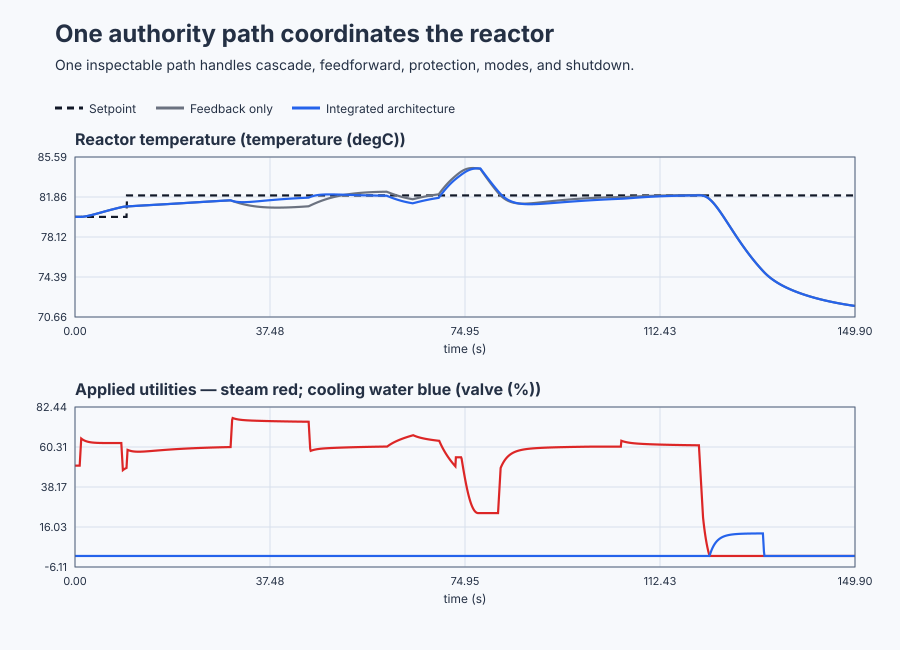

# Commission one jacketed-reactor control architecture

Course position: Lesson 79 of 84. Previous lesson: [Commission a flexible rotary indexing servo](../78-servo/README.md). Next lesson: [Commission full-range control of a gravity-drained tank](../80-gravity-tank/README.md).

**Lesson objective:** Commission one maintainable reactor-temperature architecture across inner-loop startup, production, measured feed load, protection takeover, degradation, manual operation, and controlled shutdown.

**Evidence class:** Simulation evidence. All executable results in this lesson are deterministic Simulation evidence, not physical reactor evidence.

## The problem

The equipment is a jacketed continuously stirred chemical reactor. This is
Lesson 79, the industrial-process capstone: you will commission one jacketed
stirred reactor from startup through production, a temperature constraint,
and controlled shutdown, and the proposed architecture remains unapplied.

Steam warms the jacket, cooling water cools it, and heat crosses the jacket
wall into or out of the well-mixed reactor inventory. Incoming feed changes
the reactor's thermal load. The lesson models temperatures and utility
control, not reaction kinetics or process safety.

The reactor-temperature setpoint ($SP_{r}$) is the desired product temperature, in
degrees Celsius. The reactor process value ($PV_{r}$) is the measured reactor
temperature, also in degrees Celsius. The reactor-temperature error ($e_{r}$) is
the desired temperature minus the measured temperature.

The jacket-temperature setpoint ($SP_{j}$) is the temperature requested from the
faster jacket loop. The jacket process value ($PV_{j}$) is the measured jacket
temperature. Both use degrees Celsius. The outer reactor controller requests
$SP_{j}$; the inner jacket controller then moves the utilities to achieve it.

The feed thermal load ($D_{\mathrm{feed}}$) is a qualified normalized measurement of the
feed's cooling or heating effect. A positive value represents colder or greater
feed that needs more jacket heating. It is a teaching signal, not a substitute
for measured flow, inlet temperature, heat capacity, reaction heat, or a
validated plant heat balance.

The signed utility demand ($U$) is the inner controller's requested heating or
cooling authority, in percentage points. Positive demand selects steam;
negative demand selects cooling water. Requested steam and cooling are retained
separately from applied steam and cooling because valve limits, availability,
interlocks, and physical feedback can make a request differ from what reaches
the plant.

The local simulation has a jacket time constant of 2 seconds and a reactor time
constant of 12 seconds. The jacket is therefore six times and at least three
times faster than the reactor. This separation is a prerequisite for the
chosen cascade arrangement; naming one loop "inner" does not make it fast
enough.


The diagram shows one authority path. Feedforward changes the normal cascade
request; protection competes with that normal request at one selector; and only
the selected demand reaches the split-range valves.

Earlier lessons introduced cascade, feedforward, split-range, override,
tracking, and operating modes separately. That is not yet a safe industrial
architecture. Independent fragments can fight each other, retain incompatible
internal states, or leave it unclear which controller owns the valves.

This capstone starts with a specific measured limitation. During a cold-feed
event, cascade feedback waits until $PV_{r}$ has fallen before it can correct the
heat input. A qualified feed measurement is available earlier. The lesson asks
whether adding only that feedforward path reduces the disturbance error while
preserving the same cascade, protection, valve, mode, and safety behavior.

## What we need

We need one maintainable authority chain for reactor production, feed-load compensation, protection takeover, degradation, Manual operation, and controlled shutdown. Every applied valve movement must be traceable to the measurement, mode, and owner that requested it.

## The new idea

### Commission the faster loop first

The inner jacket loop directly controls the utility-facing jacket temperature.
The outer reactor loop is slower because heat must cross the jacket wall and
change the reactor inventory. Production authority shall not be granted merely
because both controllers exist.

In `InnerCommissioning`, the inner loop follows a bounded jacket test while the
outer loop uses `Track`. Tracking aligns an inactive controller with the value
already used by the plant. Only after the jacket response and signal quality
are acceptable may the sequence grant Production authority to the outer loop.

For a first-order local approximation, a time constant is the time required to
complete about 63.2 percent of a response after dead time. The jacket time
constant ($\tau_{j}$) is 2 seconds and the reactor time constant ($\tau_{r}$) is 12
seconds. These two time constants, the jacket model's pole magnitude below,
the feed-load gain, and the jacket-to-reactor gain introduced further down are
all declared configured teaching values for this local linear reactor-and-
jacket model; this plant is new to the course, so none of them is inherited.
The Evidence and decision section reports an independent identification
experiment that recovers consistent parameters from the plant's own step
response, which is how a learner would obtain them on real equipment. Their
time-scale ratio is the slower value divided by the faster one:

$\tau_{r} / \tau_{j} = 12/2 = 6$

Six is greater than the lesson's minimum separation of three.

The jacket model's pole magnitude is 0.5 per second. The selected inner
proportional gain ($K_{p,j}$) is 10 percentage points per degree Celsius and the
selected inner integral gain ($K_{i,j}$) is 5 percentage points per degree-Celsius-
second. Their ratio places the PI zero at the local plant pole:

$K_{i,j} / K_{p,j} = 5 / 10 = 0.5$ per second

For the declared jacket input coefficient of 0.08 degrees Celsius per
percentage-point-second, cancelling that pole predicts an inner closed-loop
time constant of 1 divided by 0.08 times the jacket proportional gain
($K_{p,j}$):

$\tau_{\mathrm{inner}} = 1 / (0.08 \cdot 10) = 1.25$ seconds

The local jacket transfer is $0.08/(s+0.5)$. The PI is
$10(s+0.5)/s$ because $K_{i,j}/K_{p,j}=0.5$. Their product cancels the
qualified plant pole and leaves open loop $0.8/s$; unity feedback then gives
$0.8/(s+0.8)$, whose time constant is $1/0.8=1.25$ seconds.
This is a local model-based design that still requires the commissioning test;
pole cancellation is never assumed exact on physical equipment.

### Add measured load before feedback can respond

Feedback corrects an error after it appears in $PV_{r}$. Feedforward instead uses a
qualified disturbance measurement before that disturbance has completed its
effect on the reactor. It does not replace feedback: model error and unmeasured
loads still require PI trim.

The local feed-load gain says one positive load unit lowers reactor temperature
by 0.6 degrees Celsius at equilibrium. The local jacket-to-reactor gain says
one degree Celsius of jacket change raises reactor temperature by about 1.143
degrees Celsius. The feedforward gain ($K_{\mathrm{ff}}$) is the jacket change required to
cancel one load unit:

$K_{\mathrm{ff}} = 0.6 {}^\circ\mathrm{C}/load-unit / 1.143 {}^\circ\mathrm{C}/{}^\circ\mathrm{C} = 0.525 {}^\circ\mathrm{C}/load-unit$

When $D_{\mathrm{feed}}$ is four load units, the predicted immediate jacket correction is:

$K_{\mathrm{ff}} \cdot D_{\mathrm{feed}} = 0.525 \cdot 4 = 2.10\,{}^\circ\mathrm{C}$

The feedback-only copy waits for $PV_{r}$ to move. The integrated copy immediately
adds 2.10 degrees Celsius to the normal outer-loop jacket request while the
feed measurement remains qualified. If feed quality is invalid, the
contribution returns deterministically to zero; stale feedforward is not used.

### Map one signed demand to two physical utilities

The inner loop produces one signed utility demand U. Positive demand opens
steam and closes cooling. Negative demand opens cooling and closes steam. This
mutual exclusion prevents simultaneous requested heating and cooling.

A practical split-range station may include a dead zone to avoid chatter near
the crossover, or controlled overlap when process physics and safety justify
it. Valve characterization also changes installed gain because equal valve
travel does not necessarily produce equal heat flow. This lesson uses the
simplest mutually exclusive zero-crossover map so authority can be inspected
without hiding those later engineering requirements.

For the zero-crossover map, $H=\max(U,0)$ and $C=\max(-U,0)$, where $H$
and $C$ are steam and cooling requests. Positive $U$ forces $C=0$ and
negative $U$ forces $H=0$, so $HC=0$ for every command. This derives mutual
exclusion from the mapping.

### Let the constraint own the same demand path

The normal cascade and high-temperature protection each calculate a signed
utility demand. Lower demand means less heating or more cooling, so a low
selector chooses the more protective request. High-temperature protection
latches at 83.5 degrees Celsius and may release below 82.5 degrees Celsius only
when the normal request is no more aggressive than the protection request.

The inactive path uses tracking. Without tracking, its integral state could
continue toward an unavailable request and create a bump when authority
returns. Protection takeover, protection release, Manual entry, Manual return,
and shutdown all use the same selected-demand history. The applied valves may
change by no more than 5 percentage points per 100-millisecond scan.

### Treat mode as plant authority, not a tuning parameter

`InnerCommissioning` gives authority only to the jacket loop. `Production`
enables the complete cascade and qualified feedforward. `Manual` uses the
operator demand while both controllers track. `ControlledShutdown` drives the
reactor toward the declared cool state and then closes both utilities. `Safe`
closes both utilities when measurement or selected utility authority is not
credible.

These modes do not replace independent trips, relief protection, process-safety
interlocks, or a safety instrumented system. The simulated high-temperature
controller is a control override, not a certified protection layer.

## Prediction

Record these predictions before starting the run:

1. The jacket-to-reactor time-scale ratio is 6, so the inner loop is eligible
   for the cascade experiment.
2. A qualified four-unit cold-feed event produces an immediate 2.10-degree-
   Celsius feedforward contribution in the integrated copy and zero in the
   feedback-only copy.
3. The integrated copy should reduce cold-load integrated absolute error by at
   least 25 percent under otherwise equivalent conditions.
4. An unmeasured negative 12-unit thermal event with invalid feedforward quality
   should activate the high-temperature low selector before $PV_{r}$ reaches 86
   degrees Celsius.
5. Steam and cooling shall never be requested together, every applied valve
   transition shall remain within 5 percentage points per scan, and controlled
   shutdown shall end at or below 75 degrees Celsius with both valves closed.

## Implementation

The shipped Structured Text uses two equivalent `ReactorTrain` instances. The
feedback-only copy configures feedforward gain to zero. The integrated copy
changes only that gain to 0.525.

```st
IntegratedTrain.Configure(
    MeasuredFeedforwardGain := LREAL#0.525,
    InitialReactorTemperature := IntegratedReactorTemperature,
    InitialJacketTemperature := IntegratedJacketTemperature
);

IntegratedTrain.Update(
    OperatingMode := OperatingMode,
    ReactorSetpoint := ReactorSetpoint,
    JacketCommissioningSetpoint := JacketCommissioningSetpoint,
    MeasuredReactorTemperature := IntegratedReactorTemperature,
    MeasuredJacketTemperature := IntegratedJacketTemperature,
    FeedThermalLoad := FeedThermalLoad,
    FeedLoadQualityGood := FeedLoadQualityGood,
    ReactorQualityGood := ReactorQualityGood,
    JacketQualityGood := JacketQualityGood,
    HeatingAvailable := HeatingAvailable,
    CoolingAvailable := CoolingAvailable,
    ManualUtilityDemand := ManualUtilityDemand,
    CycleTime := CycleTime
);
```

Inside `ReactorTrain`, the outer and inner controllers are actual shared
`Control.PID` objects. `NormalUtilityDemand`, `ProtectionDemand`,
`SelectedUtilityDemand`, `HeatingRequested`, `CoolingRequested`,
`HeatingApplied`, `CoolingApplied`, `ProtectionActive`, `ActiveAuthority`, and
`ArchitectureRevision` expose the complete decision path. No test result or
winning label is embedded in the PLC program. `ControllerAuto` is true only in
`Production`; it gives Control Studio an unambiguous Boolean permission signal
without asking the tool to guess what the numeric operating modes mean.

## Experiment in Control Studio

The learner-facing workflow is exactly **Monitor → Test**. The project owns the
complete 150-second inner commissioning, production, feed-load, quality-loss,
override, manual, and controlled-shutdown sequence for both reactor copies.
The native test owns the independent calculations and architecture decision;
revision 79 remains unapplied.

### Control Studio actions

1. **Monitor** — Start the **Simulator**, then open **truST sidebar → Control Studio → Monitor → Response**.
   - **Baseline check:** Wait until the header shows **Simulation**, **Running**, and current data. Confirm Reactor-temperature setpoint (SP, degC); Feedback-only reactor temperature (PV, degC) and Integrated reactor temperature (PV, degC); Feedback-only applied steam valve (MV, %) and Feedback-only applied cooling valve (MV, %), including units, limits, mode, and quality. The initial operating point is Reactor-temperature setpoint = 80 degC, Feedback-only reactor temperature = 80 degC, Integrated reactor temperature = 80 degC, Feedback-only jacket temperature = 80 degC, Integrated jacket temperature = 80 degC, Feedback-only applied steam valve = 50 %, Feedback-only applied cooling valve = 0 %, Integrated applied steam valve = 50 %. The unresolved baseline problem is: Cascade feedback waits for reactor temperature to respond to a measured cold-feed load before correcting it.
   - **Decision before action:** Read **Prediction** above, then state what should move first and in which direction. Use this decision rule: Add only model-qualified measured-load feedforward while preserving the same inner-first cascade, mutually exclusive split range, tracked protection selector, modes, limits, and unapplied revision.
   - **Successful evidence:** The Response plot advances, the displayed values are finite and current, and **Start recording** is enabled. Select **Start recording** only after those conditions are visible.
   - **Recovery:** If recording is disabled or the plot reports unavailable or stale samples, stop the Simulator, correct the displayed runtime or binding problem, restart it, and repeat the baseline check.
   - **Record:** Write down the initial SP, PV, requested/applied MV where available, controller mode, and your predicted response before opening Test.

2. **Test** — Open **truST sidebar → Control Studio → Test**.
   - **Baseline check:** Confirm **Experiment** = **Observe without excitation**, **Amplitude** = **0** (disabled), and **Maximum duration (s)** = **150.1**. The reviewed authority is **Experiment authority** (`P1.ExperimentEnabled`). The project owns mode, load, quality, and restoration.
   - **Decision before action:** Before selecting **Review test**, predict the response direction and confirm the requested change remains inside Feedback-only reactor temperature 0 degC to 86 degC; Integrated reactor temperature 0 degC to 86 degC; Feedback-only applied steam valve 0 % to 100 %; Integrated applied steam valve 0 % to 100 %; Integrated applied cooling valve 0 % to 100 %.
   - **Successful evidence:** Select **Review test**, verify the signal, requested bound, duration, restoration, and stop conditions, then select **Confirm and start**. The state changes to **Running**, **Abort test** remains available, and the terminal state confirms completion and restoration while Response shows the measured SP/PV/MV sequence.
   - **Recovery:** For a rejected, stale, unsafe, unavailable, failed, or aborted state, remove experiment authority. The project enters Safe, removes feed load, restores valid measurements and utilities, and requires inner commissioning before Production.
   - **Record:** Compare the response with your prediction and retain the terminal state, restoration result, and deterministic seed **20260829**.

Identify, Tune, and Validate are not learner steps. The project and native test
own the architecture, model, comparison, and pass/fail evidence; disabled
generic panels cannot establish them.

## Evidence and decision

First classify each sample window by signal quality, operating mode, active
authority, saturation, and fault state. Do not rank an invalid or protected
window as ordinary production performance.

The integrated absolute error is the sum of absolute reactor-temperature error
multiplied by the 0.1-second sample interval from 30 through 50 seconds. Its unit
is degree-Celsius-seconds, and smaller is better:

$IAE = \sum\left(|SP_{r,k} - PV_{r,k}| \cdot 0.1 s\right)$

The maximum reactor departure is the largest absolute difference between $PV_{r}$
and the last eligible pre-event $PV_{r}$ sample in the declared event window, in
degrees Celsius. Onset delay is the
time from the qualified feed-load change until the normal utility request first
moves in the required direction, in seconds. Applied-valve total variation is
the sum of absolute changes between consecutive applied valve samples, in
percentage points. A cumulative total variation can exceed the valve's
instantaneous 0-to-100-percent range.

Compare feedback-only and integrated IAE only from 30 through 50 seconds, when
the feed measurement is valid and both copies use Production authority. Report
feedforward-quality loss, steam-unavailable, cooling-unavailable, manual, and
shutdown intervals separately. Requested and applied valves are not
interchangeable measures.

The executable validation shall establish all of the following before the
candidate is eligible:

- the inner loop follows its bounded commissioning request before production;
- the measured 2.10-degree-Celsius feedforward contribution appears at the
  qualified load onset and becomes zero when feed quality is invalid;
- qualified integrated IAE is no more than 75 percent of feedback-only IAE;
- high-temperature protection takes authority, tracks, and holds the protected
  peak below 86 degrees Celsius before releasing with hysteresis;
- requested and applied steam or cooling remain finite, within 0 through 100
  percent, mutually exclusive, and limited to 5 percentage points per scan;
- missing selected utility or invalid reactor quality produces explicit fault
  authority and closes both applied utilities;
- Manual return is bounded, controlled shutdown reaches no more than 75 degrees
  Celsius with both utilities closed, and revision 79 remains unchanged.

The focused native run produced the following eligible Simulation results under
the declared common cold-load record:

| Decision measure | Feedback-only cascade | Integrated architecture | Decision |
| --- | ---: | ---: | --- |
| Integrated absolute error, 30–50 s | 17.52 °C·s | 6.91 °C·s | 60.5% lower; passes the required 25% reduction |
| Maximum departure from pre-event temperature | 0.681 °C | 0.552 °C | Feedforward does not increase departure |
| Applied-valve total variation, 30–50 s | 16.18 pp | 35.88 pp | Earlier correction costs more valve activity |
| Qualified feedforward onset delay | Not applicable | 0.0 s | The predicted 2.10 °C correction appears on the first qualified sample |

During the separate unmeasured heat event, the tracked override held the peak
reactor temperature to 84.526 °C. The largest applied-valve change was 5.00
percentage points, and controlled shutdown ended at 71.690 °C with both
utilities closed. Those values use sensible precision for the simulator and
declared sensor resolution; additional digits would imply unsupported accuracy.

The integrated architecture is therefore eligible, but its greater valve total
variation is a real engineering cost rather than a hidden side effect. Retained
plots must be generated from the same shipped run. A source review or smooth
screenshot does not replace that evidence.

A separate identification experiment run before commissioning recovers local
coefficients from the plant's own step response rather than assuming the
declared design values are exact; this is the retained evidence for how a
learner would obtain them on real equipment:

| Identified coefficient | Recovered value | Compare to declared |
| --- | ---: | --- |
| Jacket time constant | 2.00 s | Matches the declared 2 s exactly |
| Reactor time constant | 13.70 s | 1.7 s above the declared 12 s |
| Time-scale ratio | 6.85 | Above the declared 6 and still above the minimum-three requirement |
| Feed-load gain | -0.600 °C per load unit | Matches the declared -0.6 °C per load unit within rounding |
| Steady jacket gain | 0.160 °C per percentage point | The declared 0.08 °C-per-percentage-point-second input coefficient held for the identified 2.00 s jacket time constant |
| Steady reactor-to-utility gain | 0.1787 °C per percentage point | A new quantity this identification introduces; it is not derived from the declared jacket-to-reactor gain alone |
| Feedforward gain (utility form) | 3.358 percentage points per load unit | An alternative single-stage estimate of the same feedforward correction the declared two-stage $K_{\mathrm{ff}}$ calculation predicts |

The identified reactor time constant runs higher than the declared value
because the coupled two-state jacket-and-reactor system does not settle as a
pure single first order; the time-scale ratio nonetheless stays well above
the lesson's minimum separation of three, so the cascade design remains
eligible under either the declared or the identified numbers.

The plot keeps the main engineering decision visible: the qualified integrated
architecture reacts to the measured load before feedback alone, while the same
authority path handles protection, manual return, and shutdown. The CSV keeps
the internal cascade, selector, valve, quality, tracking, mode, revision, and
fault-recovery signals for inspection without crowding the plot.



[Complete trace](figures/reactor-capstone-evidence-trace.csv) ·
[Decision summary](figures/reactor-capstone-evidence-summary.csv)

## Conclusion

The feedback-only copy cannot act on the cold-feed event until its effect has
passed through the slow reactor inventory and changed $PV_{r}$. The integrated copy
uses qualified $D_{\mathrm{feed}}$ immediately, so it requests the predicted jacket
correction while feedback still trims model mismatch. This causal difference,
not the method name, must explain any reduction in IAE and onset delay.

Cascade works here because the inner jacket response is materially faster than
the reactor response. Feedforward works only within the identified operating
region and only while the load measurement is timely and credible. The low
selector works because the signed-demand convention makes a lower value more
protective. Tracking keeps the inactive normal path aligned with what the
selector actually gives the valves.

The conclusions are bounded to this local two-state, well-mixed simulated
thermal plant with characterized ideal valves and qualified measurements. They
do not prove chemical stability, runaway protection, mixing, pressure relief,
emissions, utility capacity, valve sizing, or physical commissioning.

## Reason for the next lesson

You can now review an industrial control architecture as one authority chain:
measurement qualification, mode, normal control, constraint selection,
tracking, actuator allocation, applied feedback, fault response, and recovery.
You can also explain why each added structure must answer retained evidence
rather than appear as an isolated block.

The proposed architecture remains unapplied. A physical plant requires an
independently reviewed process-safety topology and explicit approval immediately
before any action, plus a tested abort and rollback. Simulation evidence must
never be presented as physical evidence.

Lesson 80 applies the same discipline to a gravity-drained tank. Its nonlinear
outflow changes plant gain with level, so one fixed-gain controller that works
near one operating point becomes inadequate across the full range.
