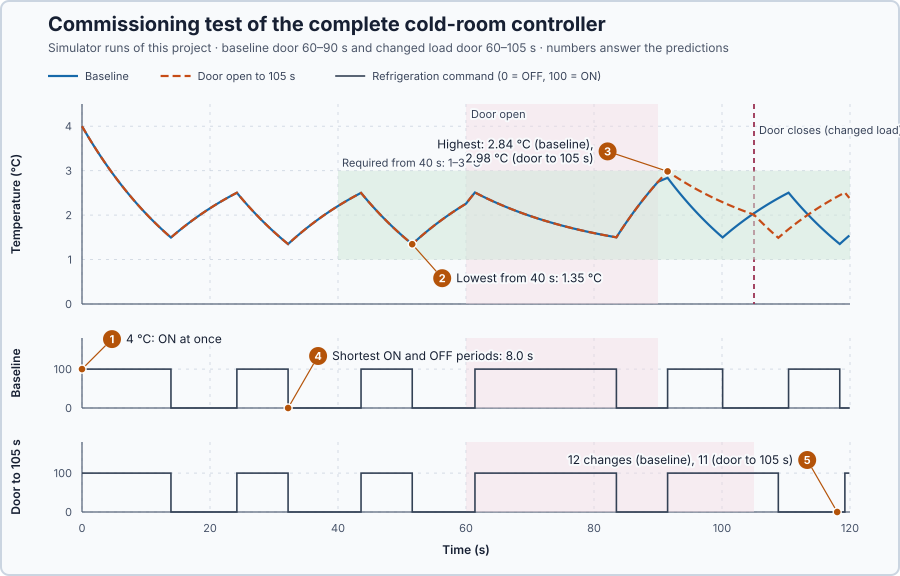

# 4. Cold-room commissioning

You will write and test a complete cold-room ON/OFF controller using only the feedback, hysteresis, dwell, and basic ST ideas from Lessons 1–3. You will choose a changed-load experiment and defend the result against fixed temperature and compressor timing requirements.

## The problem

Lesson 1 identified the cold-room process, temperature measurement, refrigeration command, and door disturbance. Lesson 2 showed that one switching temperature chatters: 760 command changes in 120 s. Lesson 3 separated ON and OFF thresholds and required a minimum state time, which cut that to 12 changes with every state lasting at least 8 s. Each rule was tested on its own.

We will combine those ideas in one controller you write, and decide from two recorded runs whether it meets the room's requirements.

## What we need

We need to establish whether the complete controller keeps the room within
its temperature band while respecting compressor switching times, including
when the heat load changes. Testing each rule separately does not establish
that the combined controller meets those requirements.

## The new idea

**Commissioning** means checking that the finished controller does its job against requirements stated before the test, and deciding pass or fail from the recording. Here the simulator tests the complete controller under a changing heat load.

**In words.** Commissioning has three parts:

1. **Requirements first.** Before the test, write down what the controller must achieve, each as a number you can check in the recording: a temperature band, a minimum ON and OFF time, the allowed command values.
2. **A test that challenges them.** Run the controller under the conditions it must handle: a normal run and a run with a changed load.
3. **A decision from the recording.** Check every sample against every requirement. A single failure fails the controller. You then explain the failure from the trace, never by changing a requirement after seeing the result.

In PLC terms, it is a site acceptance test: the test protocol is agreed before the test, and the signature depends only on what the recording shows.

**The formula.** Each requirement is a condition that must hold for every sample:

$$
L \le PV(t) \le U \text{ for every } t_1 \le t \le t_2, \qquad \Delta t_k \ge T_{dwell} \text{ for every period } k, \qquad u(t) \in \{0, 100\}.
$$

- $PV(t)$ is the measured temperature at sample time $t$, in °C;
- $L$ and $U$ are the lower and upper limits of the product band, in °C;
- $t_1$ and $t_2$ are the start and end of the time window in which the band applies, in seconds;
- $\Delta t_k$ is the length of the $k$-th completed normal ON or OFF period, and $T_{dwell}$ the dwell time, in seconds;
- $u(t)$ is the applied command, in percent.

The controller passes only if all three conditions hold.

**This lesson's requirements.** The controller uses Lesson 3's rules: hysteresis requests ON at 2.5 °C and OFF at 1.5 °C and keeps its previous request in between; an 8 s dwell, 80 updates of 0.1 s, decides when a changed request may be applied. These are design choices for this simulation.

The exercise uses one continuous experiment clock whose time zero is **Confirm and start**. The baseline run lasts 120.1 s, and the door opens from 60 s through 90 s: long enough to show the initial cooldown, the closed-door cycle and the changed heat load. Times in your records must be measured from that single start, not from simulator startup or from a later screen action.

Declare before running: after the initial cooldown, from 40 s to the end of the run, PV must remain in the product band 1–3 °C, so $L = 1$ °C, $U = 3$ °C, $t_1 = 40$ s and $t_2 = 120.1$ s. Every normal completed ON and OFF period must last at least $T_{dwell} = 8$ s, and every applied command must be exactly 0 or 100. The band is a teaching requirement, not a claim about a real cold room.

**Example.** An invented record shows the arithmetic:

1. At 45.0 s the reading is 1.62 °C: $1 \le 1.62 \le 3$, so this sample passes.
2. At 20.0 s the reading is 3.40 °C: that is before $t_1 = 40$ s, so the band does not apply yet; the room may start warm.
3. An OFF period lasts 7.6 s: $7.6 < 8$, so the controller fails, whatever the temperatures did. Do not hide such a period behind a tolerance; sample resolution may be reported separately from the requirement.
4. A command of 50 % would fail the third condition: this compressor is either OFF or ON.

**The changed load.** For the second run, choose and declare one different door-open duration, such as 60–105 s, or a supplied additional heat-load event. Keep SP, thresholds, dwell, initial state, clock and product band unchanged. Your experiment design must explain why the changed load tests the same controller requirement without changing the requirement to make a result pass.

## Prediction

Before running, answer:

1. At PV = 4 °C, what request should the controller make?
2. After the initial cooldown, how low will the temperature go: will it stay above 1 °C? Hysteresis requests OFF at 1.5 °C, but dwell can keep refrigeration ON a little longer.
3. How high will it go with the door open until 90 s, and until 105 s: will it stay below 3 °C?
4. Will every ON and OFF period last at least 8 s?
5. Will the two runs switch equally often?
6. What evidence would make you reject the controller rather than quietly change thresholds or dwell?

A command that is exactly OFF or ON says nothing about whether the product stays inside its band.

## Implementation

Use the fixed teaching case:

- setpoint SP=2 °C;
- initial measured temperature PV=4 °C;
- compressor initially OFF;
- initial OFF-time already qualified as complete;
- refrigeration command exactly 0 or 100;
- ON threshold 2.5 °C;
- OFF threshold 1.5 °C;
- minimum normal ON and OFF dwell time 8 s.

The controller must preserve its previous requested state between 1.5 and 2.5 °C. Dwell delays a normal requested change until the current applied state has lasted 8 s. A stop or abort forces OFF immediately; that interruption is not counted as a normal completed interval. After a normal restart, the OFF timer must be qualified again before an automatic ON transition.

Write the controller in the lesson's src/Main.st. Declare REAL values for SP, PV, thresholds, elapsed state time, and dt, and BOOL values for requested and applied compressor state. Use the ST constructs already taught: IF/ELSIF/ELSE, Boolean comparisons, AND, assignment, and a retained previous state.

First calculate the hysteresis request. Do not assign a new request between thresholds. Then calculate whether the requested change differs from the applied state and whether the applied state has lasted at least 8 s. Apply the change only when both conditions are true. Keep the stop instruction separate so an abort can force OFF immediately. Increment the state timer using the actual elapsed time and reset it whenever the applied state changes, including a forced stop. Classify forced interruptions separately when assessing normal dwell intervals.

The program must expose requested state, applied state, threshold values, time in current state, dwell eligibility, door state, SP, PV, and experiment elapsed time. Use the later controller-mode and recovery lessons if you add those optional extensions.

`DoorCloseScan=900` closes the door after 90 s; choose 1050 for the stated 105 s alternative, then restart before the comparison. One scan is 0.1 s.

## Experiment in Control Studio

1. Stop and restart Simulator. Confirm SP=2 °C, PV=4 °C, requested and applied compressor OFF, initial OFF-time qualified, state timer at the declared reset value, door closed, and all prior forces released. Do not rely on an initial history left by a previous run.
2. In the **truST** side bar, select **Control Studio**. On **Identify**, choose **Project experiment** from **Method**. **Signals** already shows `P1.Setpoint · Setpoint (°C)`, `P1.ProcessValue · Process value (°C)` and `P1.CompressorCommand · Applied output (%)`, the compressor command; add `P1.CompressorRunning · MV (%)`, the compressor's reported state, `P1.DwellElapsed · state (s)`, the time in the current state, and `P1.SwitchCount · state (1)`. The thresholds and the requested state are variables in your program; the door is visible in the temperature trace.
3. Write down the fixed product band 1–3 °C, 8 s normal dwell requirement, and command-state rule before starting. Select **Review project test** and check the declared 120.1 s duration.
4. Select **Confirm and start**. Treat that action as clock time zero. Observe the initial cooldown and the door opening at 60–90 s. Do not change SP, thresholds, dwell, or command manually during the automatic run.
5. Record every normal applied-state change and its interval. Count the normal state changes over the same 120 s enabled window in both runs and compare the counts; no additional switching-count limit is imposed. Check that a request between thresholds retains its previous value and that a requested reversal waits for 8 s.
6. At completion, Control Studio shows **Project test completed. Outputs restored.** Confirm automatic control is disabled, applied command is OFF and door is closed; right-click the plot and choose **Save recording…** to keep the run. For a changed-load run, restart from the exact initial state, choose and declare your alternate door duration or heat-load event, and repeat the same 120.1 s clock.
7. Select Abort test if PV leaves −10 to 10 °C, a command is not 0 or 100, a signal stops updating, or you cannot supervise the run. Abort forces OFF immediately. If Simulator is unresponsive, use the debug toolbar Stop and confirm OFF before restarting.

## Evidence and decision

The figure shows the reference solution's baseline run and its changed-load run with the door open until 105 s. The numbered marks answer the predictions with the same numbers.

| Run | Temperature from 40 s | Shortest ON / OFF | State changes |
| --- | ---: | ---: | ---: |
| Baseline, door 60–90 s | 1.35–2.84 °C | 8.0 s / 8.0 s | 12 |
| Door open until 105 s | 1.35–2.98 °C | 8.0 s / 8.0 s | 11 |

At 4 °C the controller requested ON at once. The lowest temperature, 1.35 °C at 51.6 s, is below the 1.5 °C OFF threshold because the 8 s dwell kept refrigeration ON a little longer, yet it stays above 1 °C. The highest temperature was 2.84 °C in the baseline and 2.98 °C with the longer door opening, both at 91.5 s: the longer load used up almost all of the 3 °C margin. Every completed period lasted at least 8.0 s, and every command was exactly 0 or 100. The longer run switched once less, because the open door kept the room warmer and refrigeration ran longer.

The controller passes the core assessment only when:

- the baseline record has one continuous Confirm-and-start clock and the declared 60–90 s door event;
- PV remains in 1–3 °C from 40 s through completion;
- every normal completed ON and OFF interval is at least 8 s;
- every applied command is exactly OFF/0 or ON/100;
- the changed-load run uses a learner-declared different door duration or supplied heat event while retaining the same initial state and requirements; and
- the learner explains any failure from the trace rather than changing requirements afterward.

The reference solution meets every requirement in both runs, so it is accepted for this simulated room. Your own controller passes when your record shows the same: compare your temperatures, periods and switch counts with the table, and explain any difference from your traces rather than by changing a requirement. Separate forced shutdown intervals from normal dwell intervals: a stop or abort demonstrates recovery to OFF; it does not prove a normal dwell interval. The product band is an exercise acceptance rule, not a real refrigeration safety limit.

## Conclusion

A complete cold-room controller uses hysteresis to prevent chatter and dwell to protect normal compressor timing. The learner writes the state logic, runs a fixed baseline, chooses a changed-load test, and decides from explicit temperature, timing, and command evidence.

## Check yourself

1. **Your run shows one OFF period of 7.9 s. Does the controller pass?**
   No. Every normal period must be at least 8 s; 7.9 s fails the dwell requirement, however close it is.
2. **The temperature fell to 1.35 °C although OFF is requested at 1.5 °C. Why?**
   When the temperature reached 1.5 °C, refrigeration had been ON for less than 8 s. Dwell kept it ON until the
   8 s were complete, and the room kept cooling meanwhile.
3. **The longer door opening raised the highest temperature from 2.84 °C to 2.98 °C. Should you widen the band to 0.5–3.5 °C to be safe?**
   No. The band is a requirement fixed before the test. Changing it after seeing the result would hide a problem
   instead of solving it; here the controller passes without any change.

## Reason for the next lesson

The cold-room controller uses the refrigeration equipment’s two available states. It regulates temperature within a band by switching between them. The next application is an electric water heater whose power can be adjusted continuously; we need a rule for how much heating to request, not only whether it is ON or OFF.

[Proportional control](../../01-feedback-foundations-and-temperature-control/04-water-heater-p/README.md) calculates that variable command from temperature error.
