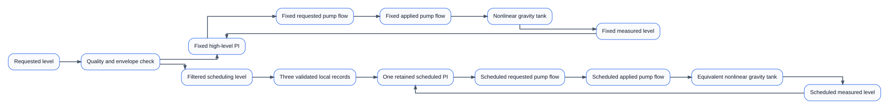
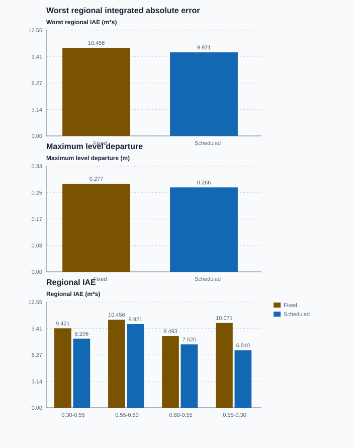

# Commission full-range control of a gravity-drained tank

Course position: Lesson 80 of 84. Previous lesson: [Commission one jacketed-reactor control architecture](../79-reactor/README.md). Next lesson: [Select delay compensation for a conveyor oven](../81-conveyor-oven/README.md).

**Lesson objective:** Prove the limitation of one fixed PI, qualify three local tank models, and validate one tracked gain-scheduled PI across the complete operating envelope without applying revision 80.

**Evidence class:** Simulation evidence. Every executable result in this lesson is deterministic Simulation evidence, not physical tank or pump evidence.

## The problem

The equipment in this lesson is Vented gravity-drained water tank with
variable-speed inlet pump. This is Lesson 80, the nonlinear-control capstone:
you will commission this tank across its qualified range from 0.30 through
0.80 metres, and controller revision 80 remains unapplied.

The equipment is a vertical vented water tank with a constant cross-sectional
area. A variable-speed inlet pump adds water. A fixed outlet drains water under
gravity. The tank area is 1.0 square metre, and the pump can apply from 0 through
0.060 cubic metres per second. Both values are declared configured teaching
values representing a mid-size vented tank and pump, new to the course; on
real equipment the tank area comes from a diameter measurement and the pump's
range comes from its rated data sheet.

The liquid level ($h$) is water height, in metres. The inlet pump flow ($q_{\mathrm{in}}$) is
the volume added each second, in cubic metres per second. The gravity outlet
flow ($q_{\mathrm{out}}$) is the volume leaving each second in the same unit. The tank area
($A$) is stored volume per metre of level. The outlet coefficient ($c$) describes
the fixed outlet and has units of square metres times square-root metre per
second; its declared configured value is `0.050`. A learner would obtain it
physically by measuring steady outlet flow at one known level and solving
$c=q_{\mathrm{out}}/\sqrt{h}$, then confirming that estimate at a second level.

The requested level is the setpoint, and the measured liquid level is the
process value. The requested pump flow ($q_{\mathrm{requested}}$) is the controller's
calculation. The applied pump flow ($q_{\mathrm{applied}}$) is the bounded and available
flow delivered to the plant. The pump is a one-sided actuator: it can add water
but cannot request or apply negative inflow.

The qualified control range is 0.30 through 0.80 metres. The simulation abort
boundaries are 0.20 and 0.90 metres. Those are training boundaries, not
certified low-low or high-high trips. The controller runs every 0.1 seconds,
and both equivalent tank copies receive deterministic 0.0005-metre sensor
noise from the same declared seed.


The scheduled path does not contain three competing controllers. One retained
PI receives one complete interpolated parameter record between updates.

Lesson 79 coordinated several authority paths for a locally fixed reactor
model. Here the control objective remains tank level, but the plant itself
changes with operating level. Gravity outflow rises with the square root of
level. Consequently a given pump-flow change produces different gain and
response time low and high in the tank.

Lesson 34 derived local gravity-tank models, and Lesson 58 introduced gain
scheduling. This capstone joins the complete workflow. We first measure the
fixed controller's regional limitation. We then qualify local models before
using them, configure one scheduled PI, and prove that parameter updates,
manual authority, faults, and recovery all act through the same pump output.

## What we need

We need to prove where one fixed controller becomes inadequate and whether operating-point-dependent settings improve the complete tank range enough to justify their validity and maintenance burden. Transitions, faults, approval, and rollback must remain explicit.

## The new idea

### Begin with conservation of water

Gravity outlet flow grows with the square root of liquid level. Stored water
increases when inlet pump flow exceeds outlet flow and decreases when outlet
flow exceeds inlet flow. Only after those physical meanings and units are clear
do we write the outlet relationship and volume balance:

$q_{\mathrm{out}} = c \cdot \sqrt{h}$

$A \cdot dh/dt = q_{in} - q_{\mathrm{out}}$

At equilibrium the level no longer changes, so inlet flow equals outlet flow.
The equilibrium pump flow at one level is therefore the outlet coefficient
multiplied by the square root of that level:

$0.050\sqrt{0.30}=0.02739$, $0.050\sqrt{0.55}=0.03708$, $0.050\sqrt{0.80}=0.04472$
cubic metres per second.

### Replace the curve only within one local region

The equilibrium level ($h_{\mathrm{eq}}$) is the steady level around which a small test is
performed. The level deviation ($\Delta h$) is measured level minus equilibrium
level, in metres. The pump-flow deviation ($\Delta q$) is applied pump flow minus
equilibrium pump flow, in cubic metres per second.

A tangent is a straight local approximation of a curve. The local steady gain
($K_{\mathrm{h}}$) states the final level-deviation change per pump-flow-deviation change.
The local time constant ($T_{\mathrm{h}}$) is the time required for about 63.2 percent of a
small first-order response. Differentiating the square-root balance gives:

$K_h=\frac{2\sqrt{h_{\mathrm{eq}}}}{c}$

$T_h=\frac{2A\sqrt{h_{\mathrm{eq}}}}{c}$

The tangent slope of outflow is
$dq_{out}/dh=c/(2\sqrt{h_{eq}})$. Substitution of small deviations into the
volume balance gives
$A\,d\Delta h/dt=\Delta q-[c/(2\sqrt{h_{eq}})]\Delta h$. Dividing by that
outflow slope and comparing with
$T_h d\Delta h/dt+\Delta h=K_h\Delta q$ produces the two expressions above.

At 0.30, 0.55, and 0.80 metres, local steady gain $K_{h}$ is 21.91, 29.66, and
35.78 metres per cubic metre per second. Local time constant $T_{h}$ is 21.91,
29.66, and 35.78 seconds. The equal numerical values result from A being 1.0;
their meanings and units remain different.

These values are predictions from simulator parameters, not physical
identification. At each operating point, use a separately restored bounded
pulse, fit the local model, and use unused validation data to test prediction.
Retain residual shape and parameter uncertainty. Reject a model that fails its
local record, and never extrapolate a tangent model across the entire curve.

### Derive the fixed and local PI records

Proportional gain ($K_p$) states how much requested pump-flow change is produced
per metre of present level error. Integral gain ($K_i$) states how quickly
accumulated level error changes retained pump flow, per metre-second.

For the declared 10-second local design time, all three records use $K_p$ equal to
0.100 cubic metres per second per metre. Their $K_i$ values are 0.00456, 0.00337,
and 0.00280 cubic metres per second per metre-second from low to high level. The
fixed baseline uses the conservative high-level value 0.00280 everywhere. It is
expected to be unnecessarily slow low in the tank.

The integral values follow from $K_i=K_p/T_h$: `0.100/21.91 = 0.00456`,
`0.100/29.66 = 0.00337`, and `0.100/35.78 = 0.00280`. The gain falls as the
tank becomes slower, explaining why one high-level value gives away low-level
speed.

### Interpolate only accepted records

The scheduling variable ($\rho$) is the qualified requested operating level. It
is known before the transition and is not controller error. The interpolation
fraction ($\alpha$) states how far $\rho$ lies from lower validated point $\rho_{0}$ to
upper validated point $\rho_{1}$. A scheduled parameter is represented by $\theta$:

$\alpha = (\rho - \rho_{0}) / (\rho_{1} - \rho_{0})$

$\theta(\rho) = \theta_{0} + \alpha \cdot (\theta_{1} - \theta_{0})$

A 2-second filter prevents an abrupt requested-level change from creating an
abrupt parameter change. `Control.PIDGainScheduler` returns the complete
parameter record, including gains, limits, anti-windup, and tracking. The
program applies that record atomically between PID calls; no scan can mix an
old gain with a new limit. A request below 0.30 or above 0.80 metres is rejected,
not silently extrapolated.

### Preserve physical authority through every mode

`Automatic` grants the fixed or scheduled PI pump authority. `Manual` applies a
reviewed manual flow while the automatic controller uses external tracking from
the actual applied pump flow. `ControlledStop` reduces the applied pump flow to
zero. `Safe` closes the pump when required quality, schedule, timing, envelope,
or pump availability is invalid.

Tracking aligns retained controller state with physical authority. It does not
make invalid data valid. After restoration, the first Automatic request may
differ from the preceding applied flow by no more than 0.0005 cubic metres per
second. Requested and applied signals stay separate throughout this sequence.

### Define the full-range comparison measures

The common low-middle-high-middle-low record produces four regions, one for
each setpoint transition. Regional integrated absolute level error is the sum
of absolute setpoint-minus-measurement error, multiplied by the 0.1-second
sample interval, accumulated over one region, in metre-seconds. Worst regional
IAE is the largest of the four regional values, so it reports the single
weakest transition rather than an average that could hide it. Maximum level
departure is the largest absolute setpoint-minus-measurement difference over
the complete run, in metres. Both measures are defined here, before either is
used to state a prediction.

## Prediction

Before running, record these predictions:

1. Equilibrium pump flows are 0.02739, 0.03708, and 0.04472 cubic metres per
   second at 0.30, 0.55, and 0.80 metres.
2. Local gains and time constants increase from 21.91 through 35.78 as level
   rises.
3. Fixed high-level $K_i$ is slowest in the low region. The scheduled $K_i$ changes
   continuously from 0.00456 to 0.00280 without exceeding the common pump
   limit.
4. For the common low-middle-high-middle-low record, scheduling should reduce
   worst regional integrated absolute level error by at least 5 percent without
   increasing maximum level departure.
5. Invalid quality, invalid scheduling, pump unavailability, or an out-of-
   envelope request closes the applied pump. Manual return and restored
   Automatic remain within 0.0005 cubic metres per second.

## Implementation

The shipped program instantiates one small `TankController` twice. Each contains
one real `Control.PID`. Only the scheduled instance enables the real
`Control.PIDGainScheduler` and applies its complete accepted record.

```st
ScheduledParameters := GainScheduler.Update(
    OperatingPoint := RequestedLevel,
    CycleTime := CycleTime
);

IF ScheduledControlEnabled AND ScheduleValid THEN
    ActiveParameters := ScheduledParameters.Parameters;
ELSE
    ActiveParameters := FixedParameters;
END_IF;
PIDController.Configure(Parameters := ActiveParameters);

PIDInput.Setpoint := RequestedLevel;
PIDInput.ProcessValue := LevelMeasurement;
CandidatePumpFlow := PIDController.Update(Input := PIDInput);
```

`OperatingMode`, `LevelSetpoint`, `MeasuredLevel`, `LevelQualityGood`,
`SchedulingAvailable`, `PumpAvailable`, `ManualPumpFlow`,
`RequestedPumpFlow`, `AppliedPumpFlow`, `FilteredSchedulingLevel`, `ActiveKp`,
`ActiveKi`, `ScheduleValid`, `ScheduleClamped`, `TrackingActive`, `FaultActive`,
and `ControllerRevision` expose the complete implementation. The ST contains no
experiment clock, result metric, accepted label, or precomputed winner.

## Experiment in Control Studio

The learner-facing workflow is exactly **Monitor → Test**. The project owns the
complete 420-second low-middle-high-middle-low sequence for both equivalent
tanks and restores the safe 0.30-metre request. Native tests own local-model
qualification, comparison, faults, and pass/fail result.

### Control Studio actions

1. **Monitor** — Start the **Simulator**, then open **truST sidebar → Control Studio → Monitor → Response**.
   - **Baseline check:** Wait until the header shows **Simulation**, **Running**, and current data. Confirm Requested liquid level (SP, m); Fixed-PI measured level (PV, m); Fixed-PI requested pump flow (MV, m3/s), including units, limits, mode, and quality. The initial operating point is Requested liquid level = 0.3 m, Fixed-PI measured level = 0.3 m, Scheduled-PI measured level = 0.3 m, Fixed-PI applied pump flow = 0.027386127875 m3/s, Scheduled-PI applied pump flow = 0.027386127875 m3/s, Controller revision = 80 (dimensionless). The unresolved baseline problem is: The conservative high-level integral gain is unnecessarily slow in the low-level region.
   - **Decision before action:** Read **Prediction** above, then state what should move first and in which direction. Use this decision rule: Accept scheduling only when all local models and the scheduling variable are qualified, the common full-range requirements improve, and boundaries plus authority transitions remain deterministic and bumpless.
   - **Successful evidence:** The Response plot advances, the displayed values are finite and current, and **Start recording** is enabled. Select **Start recording** only after those conditions are visible.
   - **Recovery:** If recording is disabled or the plot reports unavailable or stale samples, stop the Simulator, correct the displayed runtime or binding problem, restart it, and repeat the baseline check.
   - **Record:** Write down the initial SP, PV, requested/applied MV where available, controller mode, and your predicted response before opening Test.

2. **Test** — Open **truST sidebar → Control Studio → Test**.
   - **Baseline check:** Confirm **Experiment** = **Observe without excitation**, **Amplitude** = **0** (disabled), and **Maximum duration (s)** = **420.1**. The reviewed authority is **Experiment authority** (`P1.ExperimentEnabled`). The project owns the complete low-middle-high-middle-low request sequence:
0.30 m through 30 seconds, 0.55 m from 30 through 120 seconds, 0.80 m from 120
through 240 seconds, 0.55 m from 240 through 330 seconds, and 0.30 m from 330
through 420 seconds before the 420.1-second restoration.
   - **Decision before action:** Before selecting **Review test**, predict the response direction and confirm the requested change remains inside Fixed-PI measured level 0.2 m to 0.9 m; Scheduled-PI measured level 0.2 m to 0.9 m; Fixed-PI applied pump flow 0 m3/s to 0.06 m3/s; Scheduled-PI applied pump flow 0 m3/s to 0.06 m3/s. The run exists to compare the fixed and scheduled controllers across the same full low-middle-high-middle-low envelope, so scheduling can be accepted only if it improves the worst-region result without a hidden cost.
   - **Successful evidence:** Select **Review test**, verify the signal, requested bound, duration, restoration, and stop conditions, then select **Confirm and start**. The state changes to **Running**, **Abort test** remains available, and the terminal state confirms completion and restoration while Response shows the measured SP/PV/MV sequence.
   - **Recovery:** For a rejected, stale, unsafe, unavailable, failed, or aborted state, remove experiment authority. The project closes the pump, restores valid scheduling inputs, and restores the 0.30-metre request.
   - **Record:** Compare the response with your prediction and retain the terminal state, restoration result, and deterministic seed **20260829**.

Identify, Tune, and Validate are not learner steps. The native executable test
owns local-model fitting, schedule comparison, abnormal cases, and pass/fail;
disabled generic panels are not evidence.

## Evidence and decision

Hold nonlinear plant equations, initial state, setpoint sequence, sample time,
noise seed, pump constraints, metric windows, and validity rules equal. Change
only fixed high-level integral gain versus the accepted interpolated record.
Regional integrated absolute level error and maximum level departure were
defined above, before Prediction used them.

Applied pump-flow total variation is the sum of
consecutive absolute applied-flow changes, in cubic metres per second.
Schedule parameter jump is the largest consecutive change in active $K_i$.
Authority return bump is the first Automatic requested flow minus the last
Manual or Safe applied flow, in cubic metres per second. Settling time and
final-window error are reported only when the declared level band, pump-span
band, and dwell all pass; otherwise the result is `Not settled`.

First classify every interval as eligible, tracking, saturated, unqualified,
invalid, aborted, or not settled. Only eligible regional results may be ranked.

The executable candidate shall satisfy all of these requirements:

- scheduled worst regional IAE is at least 5 percent lower than fixed PI —
  lesson.json encodes this as scheduled worst regional IAE below `9.9336`
  metre-seconds, which is 95 percent of the fixed run's own measured worst
  regional IAE of `10.4565` metre-seconds in this deterministic record, so the
  absolute gate and the relative rule are the same requirement;
- scheduled maximum level departure does not exceed the fixed result;
- level remains within 0.20 through 0.90 metres and applied pump flow remains
  within 0 through 0.060 cubic metres per second;
- active $K_p$ remains 0.100 and active $K_i$ remains continuously within 0.00280
  through 0.00456, with no mixed parameter record;
- invalid level quality, invalid schedule, pump unavailable, and out-of-envelope
  requests close the scheduled pump deterministically;
- Manual return, restored Automatic, and scheduling changes remain bounded by
  0.0005 cubic metres per second per scan;
- ControlledStop closes the pump, and revision 80 remains unchanged.

The focused native run produced the following eligible Simulation results:

| Transition | Fixed high-level PI IAE | Scheduled PI IAE |
| --- | ---: | ---: |
| 0.30 to 0.55 m | 9.4206 m·s | 8.2063 m·s |
| 0.55 to 0.80 m | 10.4565 m·s | 9.9208 m·s |
| 0.80 to 0.55 m | 8.4930 m·s | 7.5196 m·s |
| 0.55 to 0.30 m | 10.0708 m·s | 6.8101 m·s |

Worst regional IAE falls from 10.4565 to 9.9208 metre-seconds, an improvement
of 5.12 percent that just passes the declared 5-percent requirement. Maximum
level departure falls from 0.2773 to 0.2657 metres. Applied pump-flow total
variation rises from 0.25403 to 0.26092 cubic metres per second, so the improved
regional error has a small but visible actuator-activity cost.

The largest consecutive scheduled $K_i$ change is 0.00005667 cubic metres per
second per metre-second. The largest tested Manual, fault-restoration, envelope-
restoration, or ControlledStop return bump is exactly 0.00050000 cubic metres
per second. Invalid authority closes the pump, ControlledStop reaches zero, and
revision 80 remains unchanged.

These conclusions use sensible precision for the simulated measurement and
calculation. Retained plots must preserve the same sample interval, windows,
seed, signals, units, and eligibility states. Source inspection is not
executable evidence.



[Complete trace](figures/gravity-tank-capstone-evidence-trace.csv) · [Decision summary](figures/gravity-tank-capstone-evidence-summary.csv)

## Conclusion

The square-root outlet's slope decreases as level rises. A pump-flow change
therefore produces a larger final level change and a slower response high in
the tank. The fixed high-level $K_i$ protects the slow region but gives away useful
speed low in the tank. The scheduled controller interpolates only among models
qualified beforehand; it is neither online identification nor adaptation.

Filtering avoids abrupt parameters, atomic configuration prevents mixed
records, and one retained PI avoids parallel controllers fighting for the pump.
External tracking uses $q_{\mathrm{applied}}$ because that is the flow the plant actually
received. Scheduling is worthwhile only if its full-range improvement exceeds
the cost of model qualification, boundary handling, testing, and maintenance.

## Reason for the next lesson

You can now decide whether measured operating-point dependence justifies gain
scheduling, qualify its local models, and validate the complete authority and
boundary behavior. A fixed controller remains preferable when it already meets
all full-range requirements.

Revision 80 remains unapplied. Physical work requires an independently reviewed
tank and pump topology, overflow and dry-run protection, capacity, isolation,
instrument quality, limits, excitation, abort, restoration, explicit approval,
and rollback immediately before action. Simulation evidence must not be
presented as physical evidence.

Lesson 81 keeps the model-validation discipline but moves to a conveyor oven,
where transport delay can consume stability margin even when the local gain and
time constant are well understood.
