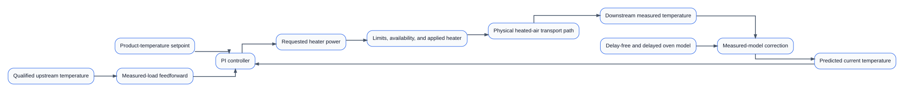
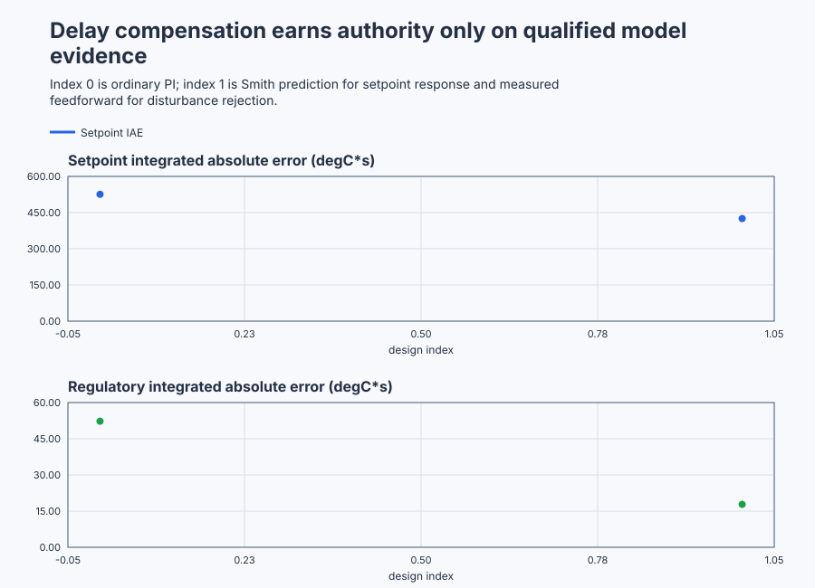

# Select delay compensation for a conveyor oven

Course position: Lesson 81 of 84.
Prerequisite: `control-capstone-gravity-tank`.

**Lesson objective:** Identify and validate the delayed oven, qualify ordinary PI, feedforward, and Smith candidates from time and frequency evidence, then retain an unapplied architecture that survives declared mismatch and fallback tests.

Plant: Continuous food-drying conveyor with recirculated heated-air duct.

This is Lesson 81, the delay-control capstone. You will commission downstream
temperature control for a continuous food-drying conveyor oven. Normal operation
begins at 20 degrees Celsius and requests 35 degrees Celsius. Controller
revision 81 remains unapplied. Every result is deterministic **Simulation
evidence**, not physical oven evidence.

## The problem

The equipment in this lesson is Continuous food-drying conveyor with recirculated heated-air duct.

Product travels on a belt through a recirculated heated-air duct. A downstream
sensor measures product temperature from 15 through 60 degrees Celsius. Heater
power is one-sided: it can add heat from 0 through 100 percent but cannot apply
negative heating. Its command can change by at most 10 percentage points per
second.

The heater command ($u$) is heater power in percent. The downstream product
temperature ($y$) is the measured product temperature in degrees Celsius. The
process gain ($K$) is eventual product-temperature change per heater percentage
point. The time constant ($T$) describes how quickly the visible response develops
after it begins. The transport delay ($L$) is the time before a heater change can
first affect the downstream sensor.

Around the declared product, airflow, moisture, and belt-speed region, K is 0.8
degrees Celsius per percent, T is 12 seconds, and L is 16 seconds. The
controller runs every 0.1 seconds. Its deterministic sensor noise has a
0.08-degree-Celsius standard deviation.

The upstream inlet-temperature deviation ($D_{\mathrm{inlet}}$) is measured inlet
temperature minus its normal value, in degrees Celsius. A qualified minus-
2-degree event is announced upstream at 54 seconds. The physical load reaches
the downstream product at 70 seconds. Feedforward heater action started at 54
seconds traverses the same 16-second path.

At the simulator boundary, the physical upstream load is converted to its
equivalent thermal input and added to applied heater power before the common
delay. That net input is plant truth, not controller feedback. Invalid upstream
quality removes feedforward authority but does not make the physical load
disappear.

The requested heater power ($MV_{\mathrm{requested}}$) is the controller calculation before
external authority. The applied heater power ($MV_{\mathrm{applied}}$) is the bounded,
available command delivered to the simulated actuator. These signals remain
separate through Automatic, Manual, ControlledStop, Safe, and fallback.


Feedforward and prediction use different early information. Feedforward knows a
specific measured load. Smith prediction estimates heater action already in
transport. Neither removes physical transport delay.

Lesson 80 used gain scheduling because gravity-tank dynamics changed with
operating level. This oven remains inside one qualified local region, so gain
scheduling has no measured purpose. Its limitation is the 16-second gap between
heater action and downstream evidence.

Increasing ordinary PI gain makes the controller correct again before earlier
heat is visible. The strongest robust ordinary PI therefore misses the required
90-percent rise time. Separately, a qualified upstream temperature measurement
reveals one disturbance before it reaches the product. The lesson must not
pretend these are the same problem: feedforward addresses the measured inlet
load, while prediction addresses action in the delayed feedback path.

## What we need

We need to add complexity to the delayed oven only when ordinary feedback cannot meet a declared requirement. Identification, prediction, measured-load compensation, delay compensation, mismatch, fallback, and heater authority must form one qualified chain.

## The new idea

### Identify the delayed plant before designing compensation

The operating heater command ($u_{0}$) is the steady command before a test. The
operating temperature ($y_{0}$) is the corresponding steady product temperature.
The local model says downstream temperature responds to an earlier heater
command. After defining those quantities, the relationship is:

$T \cdot dy(t)/dt + (y(t) - y_{0}) = K \cdot (u(t - L) - u_{0})$

A 10-percent heater step predicts an eventual 8-degree-Celsius rise because
0.8 times 10 equals 8. The sensor shows no attributable response for 16 seconds.
About 63.2 percent of the rise then develops during the following 12 seconds.
The delay-to-time-constant ratio is:

$L / T = 16 / 12 = 1.333$

Use a bounded heater step with declared initial state, amplitude, duration,
sample time, limits, aborts, and restoration. Fit both a delay-free first-order
model and a first-order-plus-dead-time (FOPDT) model. Use unused validation data
to compare predictions, residual bias, residual autocorrelation, and parameter
uncertainty. Reject the FOPDT model if its delay or residual evidence is not
credible; a visually plausible curve is not enough.

### Establish the strongest ordinary fallback

Proportional gain ($K_p$) is requested heater percentage points per degree Celsius
of present error. Integral gain ($K_i$) is retained heater percentage points per
degree-Celsius-second of accumulated error.

The accepted ordinary PI uses $K_p$ equal to 0.46875 and $K_i$ equal to 0.0390625 in
those units. The next aggressive candidate uses $K_p$ equal to 0.9375 and $K_i$ equal
to 0.078125. It is rejected before closed-loop use because its nominal phase
margin is below 35 degrees. The accepted baseline is therefore the
highest-bandwidth eligible ordinary controller, not a weak straw comparison.

### Read Bode and Nyquist evidence as stability evidence

Angular frequency states how quickly a sinusoidal test repeats, in radians per
second. Loop magnitude is the amplification around the loop. Loop phase is the
angular lag around it. Crossover frequency is where loop magnitude equals one.
Phase margin is the remaining phase before minus 180 degrees at crossover. Gain
margin is the gain factor available at the minus-180-degree phase crossing.
Delay margin is the additional pure delay predicted to consume the phase
margin.

After these meanings are established, delay margin is calculated from phase
margin in radians divided by crossover angular frequency:

$delay margin = phase margin / crossover frequency$

The accepted ordinary PI must retain at least 35 degrees phase margin and 2
seconds delay margin over the declared model uncertainty. Its Bode plot must
show the physical delay phase rather than wrapping it into a misleading smooth
trace.

A Nyquist plot follows the complete indented contour around imaginary-axis
poles. State the open-loop right-half-plane pole count (P), count clockwise
encirclements ($N$) of minus one, and infer closed-loop right-half-plane poles ($Z$)
using the declared convention. The accepted ordinary fallback requires Z equal
to zero. A single nominal step or a wrapped phase plot cannot establish that.

### Use the upstream measurement only for its physical load

The feedforward gain ($K_{\mathrm{ff}}$) is the required heater change per degree Celsius of
qualified inlet-temperature deviation. The oven heater gain is 0.8 degrees
Celsius per percentage point, so compensation uses:

$K_{\mathrm{ff}} = -1 / K = -1.25 percent per degree Celsius$

For $D_{\mathrm{inlet}}$ equal to minus 2 degrees Celsius:

$MV_{\mathrm{ff}} = K_{\mathrm{ff}} \cdot D_{\mathrm{inlet}} = (-1.25) \cdot (-2) = 2.5 percent$

The contribution begins at 54 seconds so compensating heat and the physical
load both reach the downstream product near 70 seconds. Invalid upstream
quality sets feedforward to zero without disabling otherwise valid feedback.
Feedforward never bypasses heater amplitude, slew, interlocks, or PI trim.

### Predict current temperature without claiming faster physics

The delay-free model output ($y_{\mathrm{model\,now}}$) estimates current product-temperature
effect before transport delay. The delayed model output ($y_{\mathrm{model\,delayed}}$)
estimates what that same model says the downstream sensor should report now.
The model correction ($c_{\mathrm{model}}$) is measured temperature minus delayed-model
temperature. The predicted temperature combines current model effect with that
measured correction:

$c_{\mathrm{model}} = y_{\mathrm{measured}} - y_{\mathrm{model\,delayed}}$

$y_{\mathrm{predicted}} = y_{\mathrm{model\,now}} + c_{\mathrm{model}}$

For the delay-free model $G_0(s)=K/(Ts+1)$, choose the PI zero to cancel the
model pole: $C(s)=K_p(1+1/(T_i s))$ with $T_i=T$. The remaining nominal loop
is $K K_p/(T s)$. Asking that loop to close like $1/(\lambda s+1)$ therefore
requires $K K_p/T=1/\lambda$, so

$K_p = T/(K\lambda) = 12/(0.8\cdot6)=2.5$

$K_i = K_p/T_i = 2.5/12=0.2083333$

Here $\lambda=6$ seconds is the desired delay-free response time, not a claim
that the physical 16-second transport disappears. The Smith PI controls from
$y_{\mathrm{predicted}}$ only while history, quality, operating region, model evidence, and
the 5-degree-Celsius correction bound are valid. Otherwise measured downstream
temperature owns fallback. Model mismatch means actual K, T, or L differs from
the retained model; prediction error then grows even though physical transport
has not changed.

### Keep one explicit authority sequence

`Automatic` applies the selected feedback path plus qualified feedforward.
`Manual` applies reviewed heater power while the automatic controller tracks
$MV_{\mathrm{applied}}$. `ControlledStop` ramps applied power to zero. `Safe` closes the
heater for invalid downstream temperature or unavailable heater authority.
Invalid model evidence removes prediction but retains measured feedback;
invalid upstream quality removes feedforward only.

## Prediction

Before running, record these predictions:

1. A 10-percent step produces an eventual 8-degree rise, a 16-second silent
   interval, a following 12-second time constant, and L/T equal to 1.333.
2. The accepted ordinary PI passes 35-degree phase-margin and 2-second delay-
   margin requirements; the aggressive candidate fails at least one declared
   time or robustness condition.
3. The qualified minus-2-degree upstream event requests 2.5 percent feedforward
   immediately at 54 seconds and reduces regulatory IAE after 70 seconds by at
   least 20 percent.
4. Feedforward does not improve the earlier setpoint window. Nominal Smith plus
   feedforward reaches 33.5 degrees Celsius at least 15 percent sooner and has
   lower setpoint-window IAE than ordinary PI.
5. Moderate mismatch at K equal to 0.76, T equal to 13 seconds, and L equal to
   17 seconds remains bounded but degrades correction or error. Severe mismatch
   at K equal to 0.60, T equal to 18 seconds, and L equal to 22 seconds causes
   measured-feedback fallback.

## Implementation

The shipped `OvenController` composes one real `Control.PID` and one real
`Control.SmithPredictorFOPDT`. Three instances compare accepted ordinary PI,
ordinary PI plus feedforward, and Smith PI plus the same feedforward.

```st
PredictorResult := Predictor.Update(Input := PredictorInput);
IF PredictorActive THEN
    PredictedTemperature := PredictorResult.PredictedProcessValue;
ELSE
    PredictedTemperature := TemperatureMeasurement;
END_IF;

IF FeedforwardEnabled AND UpstreamQualityGood THEN
    FeedforwardContribution := LREAL#-1.25 * UpstreamTemperatureDeviation;
END_IF;

ControllerInput.ProcessValue := PredictedTemperature;
ControllerInput.FeedForward := FeedforwardContribution;
RequestedHeaterPower := TemperatureController.Update(Input := ControllerInput);
```

The actual program exposes `OperatingMode`, `TemperatureSetpoint`,
`MeasuredTemperature`, `PredictedTemperature`, `UpstreamTemperatureDeviation`,
`UpstreamQualityGood`, `TemperatureQualityGood`, `ModelValid`,
`PredictorHistoryComplete`, `PredictorActive`, `PredictorFallback`,
`FeedforwardContribution`, `RequestedHeaterPower`, `AppliedHeaterPower`,
`DelayFreeModel`, `DelayedModel`, `ModelCorrection`, `TrackingActive`,
`FaultActive`, and `ControllerRevision`. It contains no experiment timing,
metric, winner, or silently applied revision.

## Experiment in Control Studio

This procedure observes the complete project-owned comparison under controlled
conditions. Control Studio supplies only permission to run it. The project owns
the setpoint, disturbance, mismatch, fallback, stop, and restoration sequence.
The deterministic Simulation seed is 20260829.

### Control Studio actions

1. **Monitor** — Start the **Simulator**, then open **truST sidebar → Control Studio → Monitor → Response**.
   - **Baseline check:** Wait until the header shows **Simulation**, **Running**, and current data. Confirm Product-temperature setpoint (SP, degC); Ordinary-PI product temperature (PV, degC); Ordinary requested heater power (MV, %), including units, limits, mode, and quality. The initial operating point is Product-temperature setpoint = 20 degC, Ordinary-PI product temperature = 20 degC, Feedforward product temperature = 20 degC, Integrated product temperature = 20 degC, Ordinary applied heater power = 0 %, Feedforward applied heater power = 0 %, Integrated applied heater power = 0 %, Controller revision = 81 (dimensionless). The unresolved baseline problem is: The strongest ordinary PI that passes the robustness envelope still misses the required delayed setpoint rise and cannot act before a measured upstream load reaches the downstream sensor.
   - **Decision before action:** Read **Prediction** above, then state what should move first and in which direction. Use this decision rule: Use feedforward only for qualified upstream temperature and prediction only while model evidence is valid; otherwise retain the strongest robust measured-feedback PI.
   - **Successful evidence:** The Response plot advances, the displayed values are finite and current, and **Start recording** is enabled. Select **Start recording** only after those conditions are visible.
   - **Recovery:** If recording is disabled or the plot reports unavailable or stale samples, stop the Simulator, correct the displayed runtime or binding problem, restart it, and repeat the baseline check.
   - **Record:** Write down the initial SP, PV, requested/applied MV where available, controller mode, and your predicted response before opening Test. Stop recording before leaving Monitor.

2. **Test** — Open **truST sidebar → Control Studio → Test**.
   - **Baseline check:** Set **Experiment** = **Observe without excitation**, **Amplitude** = **0**, and **Maximum duration (s)** = **180.1**. The only writable lesson signal is Boolean `P1.ExperimentEnabled`. Amplitude zero is intentional: the runnable project requests 35 degC at 10 seconds, applies the qualified upstream event at 54 seconds, and owns all later mismatch, invalid-data, fallback, stop, and restoration cases.
   - **Decision before action:** Before selecting **Review test**, confirm that enabling the Boolean authority is safe and predict what should happen at 10, 54, and 70 seconds. Check the declared temperature, heater, correction, quality, and availability limits; do not substitute a Control Studio setpoint step for the project sequence.
   - **Successful evidence:** Select **Review test**, verify that the sole write is `P1.ExperimentEnabled`, the amplitude is zero, the duration is 180.1 seconds, and restoration is `FALSE`; then select **Confirm and start**. The terminal state must show completion and restoration while Response contains the project-owned SP/PV/MV sequence.
   - **Recovery:** For a rejected, stale, unsafe, unavailable, failed, or aborted state, read the displayed reason. Confirm `P1.ExperimentEnabled = FALSE`, wait for the project to restore 20 degC, qualified inputs, measured-feedback authority, and safe heater state, then review a new test.
   - **Record:** Compare the response with your prediction and retain the terminal state, restoration result, and deterministic seed **20260829**.

## Evidence and decision

### Measures and comparison

Hold initial state, physical model, setpoint, upstream event, downstream event,
limits, sample schedule, duration, seed, metric windows, and validity rules
equal. PI versus feedforward changes only the qualified feedforward path. PI
plus feedforward versus Smith plus feedforward changes the feedback design and
declares its different accepted tuning.

Setpoint-window integrated absolute temperature error is the sum of absolute
setpoint error multiplied by 0.1 seconds from 10 through 70 seconds, in degree-
Celsius-seconds. Regulatory IAE uses 70 through 180 seconds. The 90-percent rise
time runs from the 10-second request until measured temperature first reaches
33.5 degrees Celsius. Overshoot is peak measured temperature minus 35 degrees
Celsius. Heater total variation is cumulative applied-heater movement in
percentage points.

Also retain upstream-to-feedforward onset delay, predictor-active fraction,
peak absolute correction, fallback count, saturation and rate-limit occupancy,
and final-window mean absolute error from 170 through 180 seconds. Final error
is eligible only after the declared temperature and heater spans prove settling;
otherwise report `Not settled`. Frequency evidence retains the exact model,
controller, grid, contour, crossings, margins, P, N, Z, and uncertainty case.

### Validation

Classify each interval as eligible ordinary feedback, eligible feedforward,
eligible prediction, model mismatch, correction limited, fallback, saturated,
rate limited, invalid, aborted, or not settled before ranking it.

The executable campaign shall establish all of the following:

- accepted ordinary PI has no more than 2 degrees Celsius overshoot, no more
  than 0.5 degree final-window error, at least 35 degrees phase margin, at least
  2 seconds delay margin, and stable Nyquist evidence; the aggressive candidate
  fails a declared requirement;
- PI plus qualified feedforward reduces regulatory IAE by at least 20 percent
  without claiming setpoint improvement;
- nominal Smith plus the same feedforward reaches 90 percent at least 15 percent
  sooner and reduces setpoint-window IAE relative to ordinary PI;
- moderate mismatch remains bounded but worsens correction, settling, or error;
  severe mismatch or invalid model evidence uses measured-feedback fallback;
- invalid upstream quality removes only feedforward; invalid downstream quality
  or unavailable heater closes $MV_{\mathrm{applied}}$;
- Manual return and ControlledStop track actual applied heater power, all heater
  limits and slew are respected, and revision 81 remains unchanged.

The focused native campaign produced this Simulation evidence. Each time-domain
row is eligible because its required signals stayed finite and within the
declared operating and authority limits.

| Evidence | Accepted ordinary PI | PI plus feedforward | Smith PI plus feedforward |
| --- | ---: | ---: | ---: |
| 90-percent rise time | 52.5 s | 52.5 s | 43.1 s |
| Setpoint-window IAE | 525.81 degC*s | 525.81 degC*s | 425.25 degC*s |
| Regulatory IAE | 52.25 degC*s | 17.80 degC*s | not used for the feedforward decision |
| Applied-heater total variation | 86.85 pp | 88.35 pp | 418.65 pp |

Smith prediction is 17.9 percent faster by the declared rise measure. The
feedforward comparison improves regulatory IAE by 65.9 percent. The table also
shows the cost of the faster Smith response: much greater heater movement.
That cost remains visible rather than being hidden by the selected result.

The accepted ordinary PI has 0.232 degree Celsius overshoot and 0.067 degree
Celsius final-window mean absolute error. Its crossover frequency is 0.03125
radians per second, phase margin is 61.35 degrees, gain margin is 3.14, and
delay margin is 34.26 seconds. The complete indented Nyquist contour has zero
clockwise encirclements of minus one, a minimum critical-point distance of
0.629, and therefore zero closed-loop right-half-plane poles because the plant
has zero open-loop right-half-plane poles. The aggressive candidate is
ineligible before closed-loop use because its 32.70-degree phase margin is
below the declared 35-degree minimum.

Peak absolute model correction rises from 2.249 degrees Celsius nominally to
3.038 degrees Celsius under moderate mismatch. Severe mismatch produces 1,119
measured-feedback fallback scans; those scans are not ranked as Smith-predictor
performance.

The retained time, Bode, and Nyquist plots must be generated from the same
focused native run. Source inspection or an attractive nominal trace cannot
replace that evidence.



[Complete trace](figures/conveyor-oven-capstone-evidence-trace.csv) · [Decision summary](figures/conveyor-oven-capstone-evidence-summary.csv)

## Conclusion

Ordinary feedback waits because no downstream measurement can reveal heat still
in transit. Upstream feedforward addresses a different fact: one measured load
is known early enough to launch compensating heat through the same path. Smith
prediction estimates the current delay-free heater effect, while measured-minus-
delayed-model correction anchors that estimate to the real sensor.

The accepted ordinary PI remains essential because it owns fallback. Its Bode,
Nyquist, and delay evidence bound that fallback independently of the predictor's
nominal speed. As model mismatch grows, correction and error expose the loss of
prediction credibility. The correct response is measured feedback, not confident
extrapolation.

## Reason for the next lesson

You can now distinguish a measurable disturbance from delayed feedback, select
the simplest technique that answers each retained failure, and defend predictor
fallback from the same robustness evidence as ordinary control.

Revision 81 remains unapplied. A physical oven requires independent review of
product limits, moisture and kinetics, heater and airflow capacity, belt state,
fire protection, electrical authority, topology, excitation, abort,
restoration, explicit approval, and rollback immediately before action.
Simulation evidence must not be presented as physical evidence.

Lesson 82 keeps the same evidence discipline but moves to a distillation
process, where two manipulated variables and two measured outputs interact and
single-loop decisions are no longer independent.
