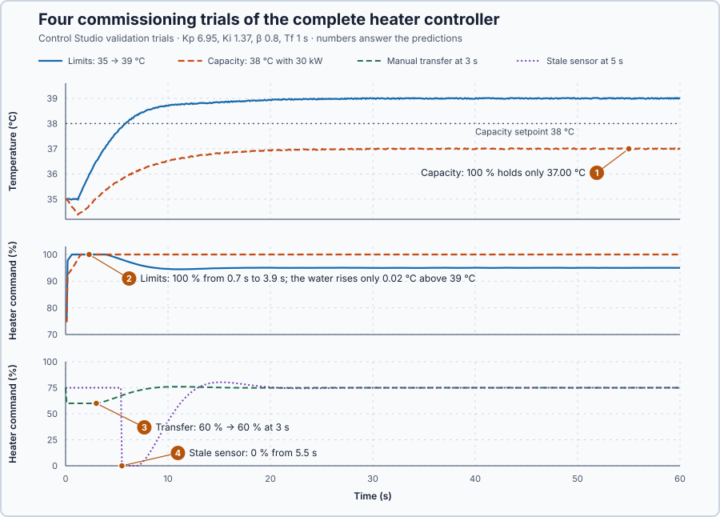

# 30. Heater commissioning

You will commission the complete heater controller: check the heater's capacity, declare the requirements, and assess every requirement with its own trial in Control Studio before applying the controller.

## The problem

Lesson 29 made the controller check every reading: an invalid or frozen reading switched the heater off within half a second, and recovery needed an acknowledgement, three fresh readings and a new Auto request. Lessons 22–29 each added one mechanism and tested it on its own: tuning, setpoint weighting, filtering, timing, initialization, transfer, parameter updates and measurement validity. The installed heater still runs an introductory PI ($K_p = 2$, $K_i = 0.5$, $\beta = 1$, $T_f = 0$), and the mechanisms have not been combined into one controller. Working parts do not show that the complete controller meets its temperature requirements and handles startup, transfer, limits, updates and faults without conflicting decisions.

We will combine every mechanism in one program, declare the requirements before any result, and assess each requirement with its own trial.

## What we need

We need:

1. one program that combines every mechanism, with one owner of the heater command;
2. requirements declared before any result, including what the heater cannot do; and
3. one observation and one decision for each requirement.

## The new idea

**Heater commissioning** checks the finished heater controller against all its requirements: target and disturbance response, startup, mode changes, limits, parameter changes and measurement faults. For this heater, it means one program that combines every mechanism of Lessons 22–29, a record of requirements written before any result, and one trial and one decision for each requirement.

**In words.** Commissioning is the acceptance test of a control loop, the same idea as the site acceptance test a PLC engineer runs from a test protocol before handing over a machine. It has four parts:

1. **Capacity first.** Before testing the controller, check what the heater can deliver at all. A requirement beyond the heater's power cannot be met by any controller, so it is recorded as a limit of the plant, not tested as a failure of the tuning.
2. **Requirements before results.** Every requirement and its limits are written down before the first trial, so that no result can move the target afterwards.
3. **One trial and one decision for each requirement.** A trial shows only what it exercises: a perfect setpoint step says nothing about a frozen sensor.
4. **One program with one command writer.** The mechanisms run in a fixed order in every scan. Each stage decides what the later stages may do, and only one place writes the heater command, so no two mechanisms can fight over it.

The stages run in this order:

1. Sensor and validity (Lesson 29): an unusable reading latches a fault with zero heat and frozen memory.
2. Parameters (Lesson 28): a changed set is adopted only whole and valid, at one boundary.
3. One command writer: the fault gives 0 %; otherwise Manual commands the heater until Auto is active.
4. Initialization (Lesson 26): every remembered value comes from the actual condition at startup, on request and after recovery.
5. Timing (Lesson 25): each update uses the measured interval; unusable intervals are refused.
6. Tracking and transfer (Lesson 27): in Manual the remembered values follow the applied command, and the transfer scan reproduces it.
7. PI update (Lessons 22–24): `Control.PID` with $\beta$ on the filtered measurement and back-calculation anti-windup.

**The formula.** The heater's energy balance says that the heat stored in the water changes by the heat delivered minus the heat lost and extracted:

$$
50\,\frac{dT}{dt} = 2\,u(t-1) - 10\,(T - 20) - D .
$$

At equilibrium the temperature does not change, $dT/dt = 0$, so the heat delivered equals the heat lost, and the holding command is

$$
u_{hold} = \frac{H\,(T - T_a) + D}{a}.
$$

- $T$ is the water temperature, in degrees Celsius, and $dT/dt$ how fast it changes, in °C per second;
- 50 is the water's heat capacity, in kilojoules per °C;
- $u(t-1)$ is the command one second earlier, in percent: the heater delivers $a = 2$ kW per percent, one second after the command;
- $H = 10$ kW per °C is the heat loss per degree above the ambient temperature $T_a = 20$ °C;
- $D$ is the heat extracted by a load, in kilowatts; and
- $u_{hold}$ is the command that holds $T$ steady, in percent.

**Example: what the heater can hold.** Follow the numbers:

1. 35 °C without extraction: $u_{hold} = (10 \times 15 + 0)/2 = 75$ %.
2. 35 °C with 30 kW: $(150 + 30)/2 = 90$ %.
3. 38 °C without extraction: $(10 \times 18)/2 = 90$ %.
4. 38 °C with 30 kW: $(180 + 30)/2 = 105$ %, more than the heater has.
5. At 100 % with 30 kW, the heater can hold only the temperature at which loss and extraction use up its 200 kW: $10\,(T - 20) + 30 = 200$, so $T = 20 + 170/10 = 37$ °C. No controller can hold 38 °C under that load.
6. 39 °C, the limits trial: $(10 \times 19)/2 = 95$ %, inside the range. On the way there, though, the controller asks for more heat than the final 95 %, and the command meets the 100 % limit.

The capacity table collects these holding commands:

| Operating point | $u_{hold}$ |
| --- | ---: |
| 35 °C | 75 % |
| 35 °C with 30 kW | 90 % |
| 38 °C | 90 % |
| 38 °C with 30 kW | 105 % |

**The limitation.** A calculated holding command is a prediction from the model, not measured proof: each one is confirmed only by its trial. Commissioning qualifies the controller only for what its trials exercise, on this simulated heater; it is not a physical qualification.

## Prediction

Before running, answer these questions:

1. At which operating point is the heater beyond capacity, and at what temperature will the capacity trial settle?
2. In the limits trial, 35 → 39 °C, how long will the heater stay at 100 %, and how far will the water rise above 39 °C?
3. What command will the manual-transfer trial show across the switch at 3 s?
4. When will the stale-sensor trial remove heat?
5. Which requirement has no trial of its own, and what decides it?

| Trial | Command needed | Expected |
| --- | ---: | --- |
| Limits, 39 °C | 95 % | 100 % for a few seconds, then 95 % |
| Capacity, 38 °C with 30 kW | 105 % | 100 %, settling at 37 °C |
| Manual transfer | 60 % held | 60 % across the switch |
| Stale sensor from 5 s | — | 0 % from 5.5 s |

## Implementation

Open [`src/Main.st`](src/Main.st): it is the Lesson 29 program, with the seven stages in the order above. The installed heater starts with the introductory PI; commissioning replaces it through one parameter update.

**Exercise.** Run the tests in [`src/tests.st`](src/tests.st) from the **Testing** view. They check the capacity table (75, 90, 90 and 105 %) and the validity limits. Then work out the holding command at 37 °C with 20 kW: $(10 \times 17 + 20)/2 = 95$ %.

## Experiment in Control Studio

The commissioning record is written before any result:

| Requirement | Trial | Limits |
| --- | --- | --- |
| Setpoint response | 35 → 38 °C | rise ≤ 1 °C above 38 °C; settled within ±0.1 °C in 15 s; error ≤ 0.2 °C |
| Disturbance recovery | 30 kW at 35 °C | lowest ≥ 33 °C; error ≤ 0.2 °C from 30 s; settled within ±0.1 °C by 30 s |
| Startup | initialized start at 35 °C | command 74–76 %; temperature 34.9–35.1 °C |
| Manual transfer | 60 % hold, Auto at 3 s | command 59.9–60.1 % across the switch; recovery as for the load trial |
| Limits | 35 → 39 °C, 95 % needed | rise ≤ 1 °C; error and settling as for the load trial; command 0–100 % |
| Capacity | 38 °C with 30 kW, 105 % needed | observation only: command and temperature range |
| Measurement fault | stale sensor from 5 s to 6 s, Auto at 7 s | 0 % from 5.5 s to 6.9 s; error ≤ 0.2 °C from 40 s |
| Parameter update | **Apply** | the complete set adopted at one boundary |

1. Open this lesson's project and start **Simulator**. The heater holds 35 °C with 75 % in Manual on the introductory PI. In the **truST** side bar, select **Control Studio**.
2. On **Identify**, keep **Method** at **Automatic** and select **Identify plant**; the model is G(s) = (0.2) / (5.1s +1) · e^(−1s).
3. On **Tune**, choose **P1.Controller · PI** and **Manual**. Enter the controller of Lessons 22–29: **Proportional gain (Kp)** 6.95, **Integral gain (Ki)** 1.37, **Setpoint weight (β)** 0.8 and **Measurement filter time (Tf)** 1.
4. Select **Requirements…** and enter **Setpoint change (°C)** 3, **Maximum steady-state error (°C)** 0.2, **Maximum settling time (s)** 15, **Settling band (±°C)** 0.1 and **Validation duration (s)** 60. Select **Done**, then **Tune controller**.
5. On **Validate**, select **Validate controller** and decide every row of the record.
6. Select **Apply**: the parameter update. Control Studio shows **Applied**.

## Evidence and decision

The numbered marks answer predictions 1–4. From the validation:

| Requirement | Measured | Decision |
| --- | --- | --- |
| Setpoint response | rise 0.034 °C; error 0.081 °C; settled in 6.7 s | Pass |
| Disturbance recovery | lowest 33.69 °C; error 0.025 °C; settled in 16.4 s | Pass |
| Startup | command 74.95–75.05 %; temperature 34.98–35.02 °C | Pass |
| Manual transfer | command 60 % → 60 %; lowest 33.28 °C; settled in 21.2 s; error 0.033 °C | Pass |
| Limits | 100 % from 0.7 s to 3.9 s; rise 0.019 °C; settled in 18.7 s; error 0.026 °C | Pass |
| Capacity | command 100 %; temperature settles at 37.00 °C | Beyond capacity, as calculated |
| Measurement fault | 0 % from 5.5 s to 7.0 s; lowest 27.88 °C; error 0.040 °C from 40 s | Pass |
| Parameter update | **Applied** | Pass |

1. Only 38 °C with 30 kW is beyond capacity: the capacity trial held 100 % and settled at 37.00 °C, the calculated equilibrium.
2. The limits trial held 100 % for 3.2 s, from 0.7 s to 3.9 s, and the water rose only 0.019 °C above 39 °C: the anti-windup kept the integral from piling up while the command was limited.
3. The transfer kept the command at 60 % across the switch; the next update added 0.17 point.
4. The stale sensor removed heat at 5.5 s, when its last reading was 0.5 s old.
5. The parameter update has no trial of its own: **Apply** decides it, by adopting the complete set at one boundary.

Every declared requirement has its own trial and passes. The capacity shortfall is a property of the heater, not of the tuning. The controller is commissioned for this simulated heater, and Control Studio reports **Applied**. This is not a physical qualification.

## Conclusion

Commissioning qualifies the complete controller, not its parts: capacity first, requirements declared in advance, and one trial and decision for each requirement, including startup, transfer, limits, updates and faults. A requirement without its own evidence is untested.

For this heater, all seven declared trials and the parameter update passed, and the one shortfall, 37 °C instead of 38 °C under a 30 kW load, was the calculated limit of the heater.

## Check yourself

1. **What holding command does the heater need at 36 °C with 10 kW of extraction?**
   $u_{hold} = (10 \times 16 + 10)/2 = 85$ %.
2. **Why is the capacity trial's 1 °C shortfall not a tuning failure?**
   At 100 % with 30 kW the heater can hold at most 37 °C. No controller can deliver more heat than the heater's
   maximum, whatever its gains.
3. **Why does each requirement need its own trial?**
   Passing one trial says nothing about behaviour that trial never exercised: a perfect setpoint response does not
   show that a transfer or a frozen sensor is handled.

## Reason for the next lesson

The electric heater applies its command at once. The next heater is fed through a valve that cannot move as fast as it is commanded: its motor moves the stem at a limited speed, so a command inside 0–100 % is not yet a delivered position.

[Actuator tracking](../../01-feedback-foundations-and-temperature-control/08-heating-valve-rate-tracking/README.md) follows that moving actuator.
