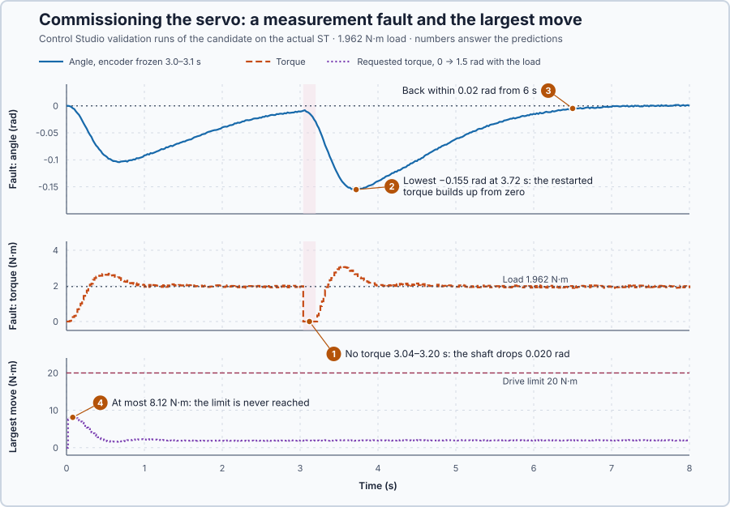

# 41. Servo commissioning

In this assessment, you will commission the complete position controller of the drum shaft: declare the requirements, assess each one with its own trial in Control Studio, and apply the controller only for what the evidence supports.

## The problem

Lessons 34–40 each added one piece to the shaft: P, D, the integral against the drum load, the derivative filter, the discrete update, its incremental form, and tuning by Control Studio. In Lesson 40, Control Studio designed $K_p$ 18.77, $K_i$ 17.46 and $K_d$ 7.27 for the program's own law, which settled within 0.02 rad from 3 s and held the 1.962 N·m weight. The heater lessons on initialization, bumpless transfer, parameter updates and measurement validity added the operating mechanisms.

But the servo controller has not been assessed as a whole: working pieces do not show that the complete servo positions, holds the load, stays within the drive's torque and handles startup, mode changes and a measurement fault without conflicting decisions. We will assess all of these on one program, against requirements written down first.

## What we need

We need to:

1. know what the load does when the drive gives no torque;
2. run every mechanism in one program, in a fixed order, with one owner of the torque; and
3. test each requirement with its own trial and decide from the recording.

## The new idea

**Servo commissioning** checks the finished position controller on the same shaft: moving to targets, holding a load, staying within torque limits, starting, mode changes and faults.

**In words.** Commissioning is the servo's acceptance test, like the site acceptance test of a machine: the requirements are written down before any trial, each requirement gets its own trial, and each trial ends in a pass or a fail decided from the recording. Four things make it more than a repeat of Lessons 34–40:

1. **The load decides what a failure costs.** The weight pulls whether the drive works or not. Whenever the drive gives no torque, during a measurement fault for example, the shaft falls: slowly at first, then faster and faster. Every moment without torque costs position.
2. **One program, one order, one owner of the torque.** All mechanisms run in one program, in a fixed order, and each stage decides what the later ones may do:
   1. **Encoder validity:** a reading older than two updates (0.04 s), outside −π to π rad or of bad quality latches a fault. The fault gives zero torque, freezes the controller and clears the Auto request; recovery needs an acknowledgement, three fresh readings and a new Auto request.
   2. **Parameters:** a changed set is adopted with its filter time, only as a whole and only if valid.
   3. **One torque writer:** the fault and the safety stop give 0 N·m; otherwise Manual commands the torque until automatic control is active.
   4. **Initialization:** every kept value is set from the actual condition at startup, on request and after a recovery.
   5. **Filter and PID:** the angle filter, then `Control.PID` with its setpoint weight and anti-windup. In Manual and at the switch to Auto, the kept values follow the applied torque.
3. **Mechanisms that are right alone can conflict.** Lesson 37's program restarted its filter at the switch to Auto, which is harmless at rest. Here, after a measurement fault, the load is falling when Auto resumes. At the switch, bumpless transfer sets the integral so that the torque continues smoothly, counting on D braking the fall at its full speed. A restarted filter suddenly reports only a sixth of that speed, D's braking collapses, and the torque turns negative: the controller pushes the falling load down. The bumpless-transfer rule makes the restart unnecessary, so here the filter runs in every mode.
4. **The claim stops where the evidence stops.** A trial shows only what it exercises. A limit that no trial reaches is not tested, however well the mechanism worked in its own lesson.

For this lesson's shaft, the 2 kg weight hangs on the drum in the loaded trials, and the simulated drive has no brake: only torque holds the load.

**The formula.** Without torque, Lesson 34's shaft equation with the load becomes

$$
J\dot\omega = -\tau_L - B\omega .
$$

From rest, the speed approaches $-\tau_L/B$ as an exponential, the same shape as the heater's approach to a new temperature:

$$
\omega(t) = -\frac{\tau_L}{B}\left(1 - e^{-Bt/J}\right).
$$

Adding up the speed over time gives how far the shaft turns. That sum is Lesson 6's integral, the area under the speed curve, written $\int_0^t \ldots\,ds$ for the area from time 0 to $t$. Here $\int_0^t (1 - e^{-Bs/J})\,ds = t - \frac{J}{B}(1 - e^{-Bt/J})$; differentiating the right-hand side gives back $1 - e^{-Bt/J}$, which confirms it. So the angle is

$$
\theta(t) = -\frac{\tau_L}{B}\left(t - \frac{J}{B}\left(1 - e^{-Bt/J}\right)\right).
$$

- $t$ is the time since the torque was lost, in seconds;
- $\omega(t)$ is the shaft's speed, in radians per second, and $\theta(t)$ how far the shaft has turned since the torque was lost, in radians; negative is downwards, the way the weight pulls;
- $\tau_L$ is the load torque, in newton-metres; and
- $J$ is the inertia, in kg·m², and $B$ the friction, in N·m·s/rad.

At first, while friction is still small, the drop grows with the square of the time, like free fall: $\theta \approx -\tau_L t^2/(2J)$.

**Example: the drum load when the torque is lost.** The 2 kg weight on the 0.1 m drum gives $\tau_L = 2 \times 9.81 \times 0.1 = 1.962$ N·m, and the shaft has $J = 1$ kg·m² and $B = 1$ N·m·s/rad. Follow the numbers:

1. **Where the fall is heading.** $-\tau_L/B = -1.962/1 = -1.962$ rad/s: with the torque off for good, the shaft would end up turning backwards at almost 2 rad/s.
2. **A 0.1 s dropout.** $1 - e^{-0.1} = 0.0952$, so the speed is $-1.962 \times 0.0952 = -0.187$ rad/s and the drop $-1.962 \times (0.1 - 0.0952) = -0.0095$ rad.
3. **A 0.5 s dropout.** $1 - e^{-0.5} = 0.3935$, so the speed is $-0.772$ rad/s and the drop $-1.962 \times (0.5 - 0.3935) = -0.209$ rad: five times the time, twenty-two times the drop.
4. **The filter conflict.** After a 0.76 s fall, the speed is $-1.962 \times (1 - e^{-0.76}) = -1.04$ rad/s. At the switch to Auto, D brakes that full speed with about $7 \times 1.04 = 7.3$ N·m, and bumpless transfer sets the integral so that P, I and D together continue the applied 0 N·m. A restarted filter reports a sixth of the speed at the next update, so D drops to about $7.3/6 = 1.2$ N·m and the torque falls by about 6 N·m. With the candidate's gains, the calculated first Auto torque is −5.9 N·m: the controller pushes the falling load down.
5. **The first torque of a move.** The setpoint weight, Lesson 23's idea used on the shaft since Lesson 36, decides how hard a move starts. For a 0.5 rad target change, the installed set ($K_p = 16$, $K_i = 4$, $\beta = 1$) first requests $16 \times 1 \times 0.5 + 4 \times 0.5 \times 0.02 = 8.04$ N·m. The candidate ($K_p = 16$, $K_i = 12$, $\beta = 0.3$) requests $16 \times 0.3 \times 0.5 + 12 \times 0.5 \times 0.02 = 2.52$ N·m.

**The limitation.** No controller holds the load while the drive gives no torque: step 3 shows how fast the position is lost. A physical hoist needs a brake that engages when the torque is removed, and this assessment makes no holding claim during faults. The trials show only what they exercise, and they are simulation results, not a physical qualification. The requirement limits in the commissioning record are teaching choices for this simulated axis.

## Prediction

Before running, answer these questions:

1. How far does the load drop in the 0.16 s without torque during the measurement fault?
2. Does the load stop falling as soon as the torque returns?
3. Will the shaft be back within 0.02 rad of its target by 6 s?
4. With $\beta = 0.3$, can the largest move reach the drive's ±20 N·m limit?

| | Value |
| --- | ---: |
| Drop after 0.16 s without torque, from rest | 0.024 rad |
| Drop after 0.76 s without torque, from rest | 0.45 rad |
| First torque for a 1 rad target change, installed set ($\beta = 1$) | 16.08 N·m |
| First torque for a 1 rad target change, candidate ($\beta = 0.3$) | 5.04 N·m |

## Implementation

Open [`src/Main.st`](src/Main.st); it runs the five stages above. The installed set is Lesson 39's ($K_p = 16$, $K_i = 4$, $K_d = 7$, $\beta = 1$, $T_f = 0.1$ s). Commissioning replaces it with the candidate from the derivative-filter lesson ($K_p = 16$, $K_i = 12$, $K_d = 7$, $\beta = 0.3$, $\gamma = 0$, $T_f = 0.1$ s) through one parameter update.

**ST practice.** Find the stage that clears the Auto request on a fault and explain why recovery must need a new Auto request rather than resuming by itself. Then open [`src/tests.st`](src/tests.st) and run its tests from the **Testing** view: they check the load drop, the validity limits, the whole-set check and the first update of each set.

## Experiment in Control Studio

The commissioning record, written before any result:

| Requirement | Trial | Limits |
| --- | --- | --- |
| Positioning | 0 → 1 rad, no load | peak ≤ 1.1 rad; settled within 0.02 rad by 4 s; activity ≤ 50 N·m |
| Load rejection | 1.962 N·m coupled at 0 s | error within ±0.02 rad from 4 s; activity ≤ 50 N·m |
| Torque limits | 0 → 1.5 rad with the load | requested and applied torque within ±20 N·m; peak ≤ 1.65 rad |
| Startup | initialized start at rest | torque within ±0.5 N·m; angle within ±0.01 rad |
| Manual transfer | Manual holds 1.962 N·m, Auto at 2 s | torque 1.76–2.16 N·m from 1.9 to 2.2 s; angle within ±0.01 rad |
| Measurement fault | encoder frozen 3.0–3.1 s; acknowledged at 3.1 s; Auto at 3.2 s | zero torque from 3.08 to 3.18 s; within ±2 rad; error within ±0.02 rad from 6 s |
| Parameter update | **Apply** | the complete set adopted at one boundary |

1. Open this lesson's project and start **Simulator**; the shaft rests at 0 rad in Manual on the installed controller. In the **truST** side bar, select **Control Studio**. On **Identify**, set **Method** to **Supplied plant model**, select **Open model…** and choose `shaft-model.json`.
2. On **Tune**, choose **Controller** `P1.Controller · PID` with **Manual**: 16 in **Proportional gain (Kp)**, 12 in **Integral gain (Ki)**, 7 in **Derivative gain (Kd)**, 0.3 in **Setpoint weight (β)**, 0 in **Derivative setpoint weight (γ)** and 0.1 in **Measurement filter time (Tf)**. Select **Requirements…**, enter **Setpoint change (rad)** 1, **Maximum steady-state error (rad)** 0.02, **Maximum settling time (s)** 4, **Settling band (±rad)** 0.01 and **Validation duration (s)** 8, select **Done**, then **Tune controller**.
3. On **Validate**, select **Validate controller**. Control Studio runs every trial of the record on the actual ST; decide each row.
4. When every row passes, select **Apply**: the parameter update. Control Studio reports **Applied**.

To repeat, select **Restore previous settings**, then start again from step 2.

## Evidence and decision

The numbered marks answer the predictions with the same numbers. From the validation runs:

| Requirement | Measured | Decision |
| --- | --- | --- |
| Positioning | overshoot 0.007 rad; settled at 2.42 s; activity 28.7 N·m | Pass |
| Load rejection | error 0.0014 rad from 4 s; torque 0 to 2.68 N·m; activity 19.8 N·m | Pass |
| Torque limits | requested = applied, 0 to 8.12 N·m; overshoot 0.009 rad | Pass, limit not reached |
| Startup | torque −0.09 to 0.09 N·m; angle within ±0.0014 rad | Pass |
| Manual transfer | torque 1.92 to 2.06 N·m; angle −0.0012 to 0.0028 rad | Pass |
| Measurement fault | zero torque from 3.04 to 3.20 s; lowest −0.155 rad; error 0.0155 rad from 6 s | Pass, drop observed |
| Parameter update | the complete set adopted at one boundary | Pass: **Applied** |

1. The drive gave no torque from 3.04 to 3.20 s, and the shaft dropped 0.020 rad, close to the predicted 0.024 rad.
2. No: after the restart the controller built its torque up from zero, as initialization sets it, and the load kept falling until the torque exceeded 1.962 N·m, to −0.155 rad at 3.72 s.
3. The shaft was back within 0.0155 rad from 6 s, inside the 0.02 rad requirement.
4. No: with $\beta = 0.3$ the largest move requested at most 8.12 N·m, so this commissioning does not exercise the anti-windup at ±20 N·m.

Every declared requirement passed and the candidate was applied, but the evidence bounds the claim. The fault is handled correctly for the drive, not for the load: a physical hoist must hold its load with a brake that engages when the torque is removed, and this assessment makes no holding claim during faults. These are simulation results, not a physical qualification.

## Conclusion

Commissioning qualifies the complete servo, not its parts: the load physics first, requirements declared in advance, and one trial and decision for each requirement, including startup, mode changes, updates and faults. Mechanisms that are correct alone can conflict, as the filter restart did.

For this shaft, the candidate passed all seven requirements and was applied; the trials never reached the torque limit, and without a brake no controller holds the load while the drive has no torque.

## Check yourself

1. **How far does the load fall in 0.3 s without torque, from rest?**
   $\theta = -1.962 \times (0.3 - (1 - e^{-0.3})) = -1.962 \times 0.0408 = -0.080$ rad.
2. **Why did the shaft keep falling after the torque returned at 3.2 s?**
   The controller restarted from the actual condition, zero torque, and its torque had to build up past 1.962 N·m
   before it could stop the load.
3. **The largest move never reached ±20 N·m. What does this commissioning therefore not show?**
   That the anti-windup works at the torque limit; no trial pushed the drive there.

## Reason for the next lesson

The heater got PI and the shaft PID, each by the lessons that introduced them, not by a reasoned choice. A new process needs its controller family chosen from its model and its requirements.

[Controller families](../../04-controller-selection-and-plant-models/27-controller-selection/README.md) compares P, PI, PD and PID on the heater and the shaft against the same requirements.
