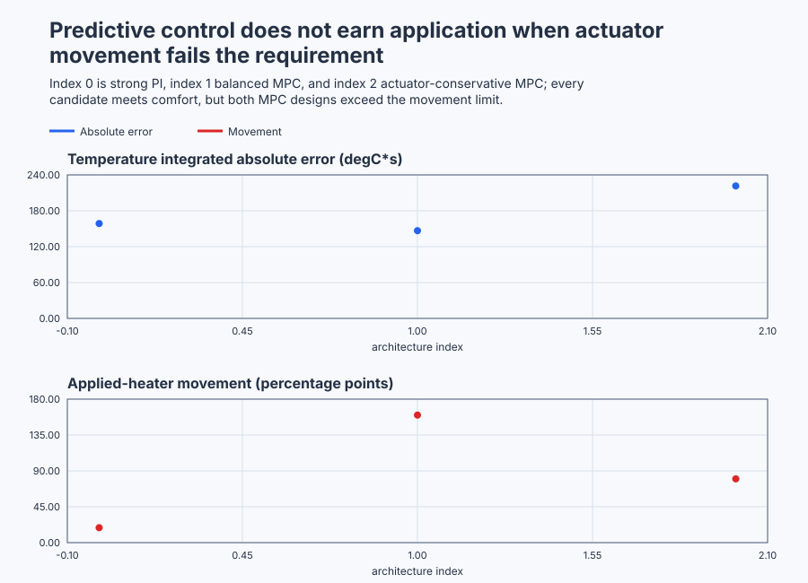

# Decide whether predictive building control earns its complexity

Course position: Lesson 83 of 84.
Prerequisite: `control-capstone-distillation`.

**Lesson objective:** Qualify the model and load estimator, screen the strongest eligible conventional baseline, execute all 729 constrained predictive sequences, and decide whether MPC improves the building enough to justify its additional actuator and lifecycle cost.

Plant: Two thermally coupled office zones with a shared heating-power limit.

## The problem

The equipment in this lesson is Two thermally coupled office zones with a shared heating-power limit.

The equipment consists of two thermally coupled office zones with shared
hydronic heating. Outdoor temperature, occupancy heat and tariff forecasts are
available to both controller candidates.
The zone-one air temperature and zone-two air temperature are measured in
degrees Celsius. Each zone has a one-sided heating command in percent: it can
add heat but cannot actively cool the room. Outdoor temperature is measured in
degrees Celsius. Occupancy heat gain is represented as an equivalent
temperature input in degrees Celsius. Electricity tariff is a relative price.

The zone-one temperature setpoint and zone-two temperature setpoint are both
21 degrees Celsius. The individual heaters are limited to 0 through 100
percent, may move by at most 20 percentage points per one-minute interval, and
together may request at most 170 percent. The required comfort interval is
20.0 through 22.5 degrees Celsius. The model is qualified only between 15 and
27 degrees Celsius.

The requested manipulated variables are the heater commands calculated by the
controller before plant authority and constraints. The applied manipulated
variables are the bounded commands actually delivered to the simulated
heaters. Requested and applied heating are retained separately.

The nominal simulation uses two coupled heat balances. It omits humidity,
solar radiation, wall states, ventilation and water-loop dynamics. A second
simulation increases outdoor heat loss by about 11 percent without telling the
controller. This is a controlled model-mismatch exercise, not a physical
building identification. Every result in this lesson is **Simulation
evidence**, not physical-plant evidence.

Lesson 82 showed that a central coordinator did not earn its complexity when
static decoupling already satisfied the distillation column's normal-envelope
requirements. Here, future outdoor temperature, occupancy and tariff changes
are available before they occur, and both zones share future comfort and
heating constraints. That creates a real reason to evaluate prediction and
optimization.

It does not prove that model-predictive control is best. A predictive design
must beat the strongest eligible conventional baseline under the same plant,
schedule, constraints and initial state. It must also justify the estimator,
forecast service, computation, commissioning effort and maintenance burden.

## What we need

We need the simplest controller that keeps both coupled office zones comfortable within the shared heating limit and lifecycle constraints. Predictive control is justified only if qualified evidence improves on strong feedback enough to repay its added movement and maintenance cost.

## The new idea

### From heat balance to the sampled model

During one minute, each zone retains part of its present temperature, exchanges
heat with the other zone, loses heat outdoors, and receives heater and
occupancy heat. Exact sampling of those continuous heat balances produces a
rule that predicts the next temperature from the present temperatures and
inputs.

The sampled state-transition matrix ($\mathbf{A}_{\mathrm{d}}$) describes how the two present air
temperatures influence the two temperatures one minute later:

$\mathbf{A}_d=\begin{bmatrix} 0.875659571463&0.029177846573\\ 0.029177846573&0.875659571463 \end{bmatrix}$

The sampled input matrix ($\mathbf{B}_{\mathrm{d}}$) describes how zone-one heating, zone-two
heating, outdoor temperature, zone-one occupancy and zone-two occupancy affect
the temperatures one minute later:

$\mathbf{B}_d=\begin{bmatrix} 0.018727354703&0.000305161690&0.095162581964&0.093636773515&0.001525808449\\ 0.000305161690&0.018727354703&0.095162581964&0.001525808449&0.093636773515 \end{bmatrix}$

The larger diagonal heater coefficients show that each heater primarily warms
its own zone. The smaller off-diagonal coefficients show thermal coupling.

### Correcting an unmeasured thermal load

Both air temperatures are measured. An observer that merely estimates those
same measured temperatures would add no information. The additive-load
estimator instead represents an unmeasured net thermal-load bias and asks
whether unmeasured heat gain or loss made the real next temperature differ
from the previous prediction.

The previous one-step predicted temperature ($T_{\mathrm{pred\,prev}}$) is the temperature
predicted on the preceding interval, in degrees Celsius. The current measured
temperature ($T_{\mathrm{measured}}$) is the sensor value now, in degrees Celsius. The
innovation ($\nu$) is their difference, in degrees Celsius:

$\nu = T_{\mathrm{measured}} - T_{\mathrm{pred\,prev}}$

The estimated thermal-load bias ($\hat{d}$) is an additive temperature correction
per one-minute step, in degrees Celsius per step. The estimator gain (Ke) is
the fraction of the latest innovation incorporated into the estimate and has
the value 0.4. After those quantities are defined, the update is:

$d_{\mathrm{hat\,next}} = \operatorname{clamp}\left(\hat{d} + Ke \cdot \nu,-1,1\right) {}^\circ\mathrm{C}/step$

In this lesson, the estimator gain Ke remains 0.4.

Every future prediction receives the retained bias. The estimate is bounded
because an estimator is not permission to hide a serious model or sensor
failure. Measurement quality must be good, both temperatures must be within
the model range, and the absolute innovation must not exceed 2 degrees
Celsius. Otherwise predictive authority is removed.

### Selecting a fair conventional baseline

A cascade controller requires a separately measured inner process variable
that responds meaningfully faster than the main controlled variable. This
project has no measured supply-water temperature, coil state or fast valve-loop
variable. Cascade is therefore **Ineligible: no qualified inner variable**.
Inventing an unmeasured inner loop would be false complexity, not a stronger
baseline.

The strongest eligible conventional baseline is the qualified incremental PI
pair from Lesson 68. The proportional gain ($K_p$) is 20 percent per degree
Celsius, written `20 percent/degC`. The integral gain ($K_i$) is 0.02 percent per
degree-Celsius second, written `0.02 percent/(degC*s)`. It uses fresh
measured temperatures, outdoor-load operating-point compensation, applied-
output tracking, and the same individual, move and shared limits as the
predictive controller.

### What the optimizer actually decides

The prediction horizon (N=3) covers the next three one-minute intervals. At
each position each heater may use the move grid `{-20,0,+20}` percentage
points. There
are six decisions—two heaters at three future positions—so the complete grid
contains 3 raised to the sixth power, or 729 sequences.

The temperature weight penalizes predicted comfort error. The energy weight
penalizes tariff-weighted heat. The move weight penalizes actuator movement.
The objective is their summed cost over the three predictions. After defining
the predicted temperature error ($e$), relative tariff ($p$), heater command ($u$)
and heater change ($\Delta u$), the calculation is:

$J = \sum\left(w_{T} \cdot e^{2} + w_{E} \cdot p \cdot u + w_{\Delta} \cdot \Delta u^{2}\right)$

The Balanced candidate uses temperature weight 100, energy weight 0.01 and
move weight 0.0025. An actuator-conservative candidate increases the move
weight while leaving the plant, schedule, limits, horizon and move grid
unchanged.

Receding horizon means that only the first move of the selected sequence is
applied. One minute later the controller measures again, updates the load
estimate and solves all 729 sequences again. Later moves are predictions, not
commands already sent to the heaters.

Configuration validity, enumeration completion, a feasible result, an
infeasible result and solver failure describe different facts. A completed search
with zero feasible sequences is infeasible. Invalid weights, stale or invalid
measurements, excessive innovation, or an incomplete search are failures, not
infeasibility. Neither may silently reuse a stale predictive move.

## Prediction

Start both measured temperatures and both setpoints at 21 degrees Celsius.
Set each previous applied heater command to 80 percent, outdoor temperature to
5 degrees Celsius, occupancy gains to zero and estimated biases to zero.

For a zero first move, the zone-one prediction is:

$\begin{aligned} T_{1,\mathrm{next}}={}&0.875659571463(21)+0.029177846573(21)\\ &+0.018727354703(80)+0.000305161690(80)\\ &+0.095162581964(5)=21.00000\,{}^\circ\mathrm{C} \end{aligned}$

Zone two gives the same result. Predict 729 evaluated sequences, at least one
feasible sequence and a zero first move, leaving both heaters at 80 percent.

Now raise the minimum predicted comfort temperature to 22 degrees Celsius.
The allowed first moves and shared limit cannot make both next temperatures
reach 22 degrees. Predict a completed 729-sequence search, zero feasible
sequences and bounded PI fallback. A negative temperature weight instead makes
the configuration invalid before search begins.

On the increased-loss plant, predict measured temperatures below the nominal
one-step prediction. The innovations and estimated biases should therefore be
negative. Once qualified, the bias-corrected one-step residual should be
smaller than the residual obtained with the bias fixed at zero.

## Implementation

The actual Structured Text calculates the innovation before updating the
bounded bias:

```st
Innovation1 := Zone1Temperature - PreviousPrediction1;
EstimatedBias1 := LIMIT(
    LREAL#-1.0,
    EstimatedBias1 + EstimatorGain * Innovation1,
    LREAL#1.0
);
```

The same source enumerates six future move choices online. Every eligible
candidate uses the sampled matrices and estimated biases, tests every hard
constraint and adds the three objective terms. The selected first requested
commands then pass through mode, availability, move, individual and shared
limits to become applied commands.

The controller exposes `EstimatorInitialized`, `EstimatorValid`, both previous
predictions, innovations and biases; `CandidateCount`,
`FeasibleCandidateCount`, `BestObjective`, `SolverComplete`, `SolverFeasible`,
`Infeasible` and `FallbackActive`; requested and applied heating; operating
mode, quality, availability, tracking, fault state and controller revision 83.
It contains no prerecorded plan, precomputed policy or embedded winner.

## Experiment in Control Studio

This procedure tests one declared lesson change under controlled conditions. Run the three-step finite-grid optimizer against the identical plant and schedule, applying only each solve's first move. The declared event lasts 1200 seconds. It restores Current outdoor temperature to 5 degC afterward. The deterministic Simulation seed is 20260829.

### Control Studio actions

1. **Monitor** — Start the **Simulator**, then open **truST sidebar → Control Studio → Monitor → Response**.
   - **Baseline check:** Wait until the header shows **Simulation**, **Running**, and current data. Confirm Zone-one temperature setpoint (SP, degC) and Zone-two temperature setpoint (SP, degC); Zone-one temperature (PV, degC) and Zone-two temperature (PV, degC); Requested zone-one heating (MV, %) and Requested zone-two heating (MV, %), including units, limits, mode, and quality. The initial operating point is Zone-one temperature setpoint = 21 degC, Zone-two temperature setpoint = 21 degC, Zone-one temperature = 21 degC, Zone-two temperature = 21 degC, Applied zone-one heating = 80 %, Applied zone-two heating = 80 %, Applied outdoor temperature = 5 degC. The unresolved baseline problem is: The reactive PI pair cannot use forecast preview or prove predicted comfort feasibility, but it remains the strongest eligible conventional baseline because this plant has no qualified faster inner variable for cascade control.
   - **Decision before action:** Read **Prediction** above, then state what should move first and in which direction. Use this decision rule: Apply only the first move after all 729 sequences complete and at least one satisfies every hard constraint; compare qualified weight candidates with PI and retain the simplest controller meeting all declared comfort, energy, movement, robustness, and lifecycle requirements.
   - **Successful evidence:** The Response plot advances, the displayed values are finite and current, and **Start recording** is enabled. Select **Start recording** only after those conditions are visible.
   - **Recovery:** If recording is disabled or the plot reports unavailable or stale samples, stop the Simulator, correct the displayed runtime or binding problem, restart it, and repeat the baseline check.
   - **Record:** Write down the initial SP, PV, requested/applied MV where available, controller mode, and your predicted response before opening Test.

2. **Test** — Open **truST sidebar → Control Studio → Test**.
   - **Baseline check:** Set **Experiment** = **Load disturbance step**, **Amplitude** = **-1 degC**, and **Maximum duration (s)** = **1200**. The affected signal is **Current outdoor temperature**; it starts at 5 degC and must restore to 5 degC.
   - **Decision before action:** Before selecting **Review test**, predict the response direction and confirm the requested change remains inside Applied zone-one heating 0 % to 100 %; Applied zone-two heating 0 % to 100 %; Zone-one temperature 15 degC to 27 degC; Zone-two temperature 15 degC to 27 degC.
   - **Successful evidence:** Select **Review test**, verify the signal, requested bound, duration, restoration, and stop conditions, then select **Confirm and start**. The state changes to **Running**, **Abort test** remains available, and the terminal state confirms completion and restoration while Response shows the measured SP/PV/MV sequence.
   - **Recovery:** For a rejected, stale, unsafe, unavailable, failed, or aborted state, read the displayed reason, restore Current outdoor temperature to 5 degC, wait for current data, and review a new test. Exercise invalid data, stale data, unbounded innovation, and an unavailable heater; verify Manual fallback and ControlledStop.
   - **Record:** Compare the response with your prediction and retain the terminal state, restoration result, and deterministic seed **20260829**.

3. **Identify** — After **Stop recording**, open **truST sidebar → Control Studio → Identify**.
   - **Baseline check:** Use **Qualify recording** to inspect sample count, duration, timing, excitation, and clipping. **Model selection**, **Fit estimation run**, and **Accept model for design** are the shared low-order model workflow; they do not replace the project-owned **Evidence-based selection between qualified incremental PI and three-step finite-grid model-predictive control with additive-load estimation** model and must not be accepted as this lesson's design authority.
   - **Decision before action:** Decide whether the recording contains the input/output change needed for **Evidence-based selection between qualified incremental PI and three-step finite-grid model-predictive control with additive-load estimation** before fitting anything.
   - **Successful evidence:** A qualified recording has current, finite, sufficiently excited data. Use the project-owned model described under **Implementation** and **Evidence and decision**, and record its assumptions, units, validity range, and rejection rule.
   - **Recovery:** If qualification reports stale, clipped, poorly excited, or insufficient data, return to Test and repeat the bounded experiment; never force or relabel a rejected fit.
   - **Record:** State which model is retained or rejected and why, explicitly identifying the runnable project as the model authority.

4. **Tune / Design** — Open **truST sidebar → Control Studio → Tune**.
   - **Baseline check:** **Design method** and **Generate candidate** are disabled because **Evidence-based selection between qualified incremental PI and three-step finite-grid model-predictive control with additive-load estimation** is designed by the runnable project; shared Control.PID tuning is unavailable. Do not select an unrelated PID method.
   - **Decision before action:** Apply the equations and choices under **Implementation**, then compare the declared alternatives under **Evidence and decision** before accepting **Evidence-based selection between qualified incremental PI and three-step finite-grid model-predictive control with additive-load estimation**.
   - **Successful evidence:** Use **Monitor → Signals** to correlate the implemented project-owned design with its named live states and outputs. A disabled shared designer is only a visible ownership boundary, not successful design evidence.
   - **Recovery:** If the project-owned prerequisites or qualification flags are false, return to Test or Identify as directed by the lesson and do not bypass them with a generic PID candidate.
   - **Record:** State why the project-owned design is eligible, conditional, or rejected, including the decisive trade-off.

5. **Validate** — Open **truST sidebar → Control Studio → Validate**.
   - **Baseline check:** **Run required validation** is disabled because no shared Control.PID candidate exists. **Requirement details** and **Save result** cannot be used to claim a shared result; project-owned validation is executed by the runnable project's declared oracle.
   - **Decision before action:** Use the predeclared comparisons: normal_mpc_candidate_count == 729 (dimensionless) (tolerance 0 (dimensionless)); maximum_individual_heating <= 100 % (tolerance 0.001 %); normal_mpc_comfort_violation == 0 degC*s (tolerance 0.01 degC*s); infeasible_feasible_sequence_count == 0 (dimensionless) (tolerance 0 (dimensionless)).
   - **Successful evidence:** Correlate the unrounded project-owned results with the named live signals and events in Monitor. Each applicable requirement must have a value, unit, limit, tolerance, evidence class, and Pass, Conditional pass, Fail, or Inconclusive disposition.
   - **Recovery:** If the project run aborts, becomes stale, fails, or violates restoration, discard that run and repeat the declared Test. Never present a disabled button or retained README table as newly executed evidence.
   - **Record:** State the validation disposition and name every failed or inconclusive requirement before continuing.

## Evidence and decision

### Measures and comparison

The zone absolute-error integral is the sum of absolute setpoint-minus-
temperature error multiplied by the 60-second interval, in degree-Celsius
seconds. Smaller is better.

Comfort-violation magnitude accumulates temperature outside 20.0 through 22.5
degrees Celsius, in degree-Celsius seconds. Comfort-violation duration counts
seconds outside that interval. Both must be zero for an eligible normal run.

Tariff-weighted heating is the sum of relative tariff times both applied heater
commands times the interval, in relative cost-percent seconds. Applied-heater
movement is total variation: the sum of absolute changes in both applied
commands, in percentage points. It may exceed 100 percentage points because it
is cumulative movement, not an instantaneous command.

Also retain peak individual and shared heating, time at constraints, fallback
duration, completed/infeasible/failed solve counts, innovation root-mean-square
value and bias-corrected one-step prediction error. Define every window and
validity condition before examining the result. Classify a run before ranking
it. Before running, declare that an MPC candidate may use at most twice the
qualified PI controller's applied-heater movement. A candidate outside that
ratio is ineligible for application even if its private objective is smaller.

### Validation

The independent oracle and Structured Text must agree on candidate count,
feasible count, first move and objective within declared tolerance. Applied
heaters must remain within 0 through 100 percent, move by no more than 20
percentage points per interval, and sum to no more than 170 percent. Normal MPC
must complete without fallback and maintain comfort.

Controller qualification uses the unrounded calculated values. The retained
table and plot data round aggregate engineering metrics to two decimal places,
matching the precision used to communicate the result and preventing
irrelevant last-bit floating-point differences between supported hosts from
changing the lesson artifact.

The retained nominal Simulation run produced:

| Controller | Status | Error integral | Comfort violation | Tariff-weighted heating | Applied-heater movement | Peak shared heat |
| --- | --- | ---: | ---: | ---: | ---: | ---: |
| Qualified incremental PI | Eligible | 158.67 degC*s | 0.00 degC*s | 46,624 cost-percent-s | 18.7 pp | 166.3% |
| Balanced finite-grid MPC | Eligible | 146.72 degC*s | 0.00 degC*s | 46,200 cost-percent-s | 160.0 pp | 160.0% |
| Actuator-conservative MPC | Ineligible: movement | 221.57 degC*s | 0.00 degC*s | 45,660 cost-percent-s | 80.0 pp | 160.0% |

In direct PI-versus-MPC order, the error integrals are 158.67 and 146.72
degree-Celsius seconds, tariff-weighted heating values are 46,624 and 46,200
cost-percent-seconds, and applied-heater movements are 18.7 and 160.0
percentage points.

Balanced MPC reduced the error integral by 7.5 percent and tariff-weighted
heating by 0.9 percent, but moved the heaters about 8.6 times as much. This is a
tradeoff, not an automatic win. The actuator-conservative candidate reduced
movement to 80.0 percentage points and tariff-weighted heating to 45,660
cost-percent-seconds, but its error integral increased to 221.57
degree-Celsius seconds and its movement was still about 4.3 times the PI
baseline. Neither MPC candidate satisfies the predeclared movement ratio.
Qualified PI therefore remains the application recommendation; MPC remains an
unapplied research candidate.

On the declared outdoor-loss mismatch, uncorrected one-step residual
root-mean-square value was 0.16434 degrees Celsius. Bias correction reduced it
to 0.01363 degrees Celsius, while both estimates converged to -0.16335 degrees
Celsius per interval. This qualifies the estimator for the declared mismatch;
it does not authorize excessive innovation or invalid measurement quality.
The 22-degree case must complete all 729 candidates and report zero feasible
sequences. Negative weight must be invalid rather than infeasible. Bad quality
or unavailable heating must remove plant authority. Manual return and
ControlledStop must be bounded and tracked. Recovery requires restored inputs
and a new complete feasible solve. Controller revision 83 must remain
unchanged.



[Complete trace](figures/building-hvac-capstone-evidence-trace.csv) · [Decision summary](figures/building-hvac-capstone-evidence-summary.csv)

## Conclusion

Trace one interval from measured temperature to innovation, bounded load-bias
update, all three corrected predictions, constraint checks, objective terms,
the selected first request and the applied heater command. That trace explains
what the optimizer actually did; its private objective value alone does not
prove engineering benefit.

Preview can change a present command because a future weather, occupancy or
tariff change affects predicted cost and feasibility. Receding horizon limits
the commitment to one move because the next real measurement can disagree with
the model. The estimator reduces a small persistent mismatch but deliberately
withdraws authority when the discrepancy is too large to trust.

The nominal result also shows why added mathematical sophistication is not a
decision criterion. A modest accuracy and energy improvement may lose when it
causes excessive valve movement, depends on fragile forecasts or costs more to
commission and maintain.

## Reason for the next lesson

Use predictive control when forecast preview and future coupled constraints
create a material advantage that a qualified simpler controller cannot meet.
Do not add MPC merely because a model exists. A building without qualified
forecasts, a maintainable estimator and reliable solver/fallback evidence is
outside this conclusion.

Physical use requires identified building and actuator dynamics, qualified
forecast services, privacy-safe occupancy data, equipment interlocks,
facilities, cybersecurity and safety review, explicit approval immediately
before application, post-application monitoring and rollback. No physical
building is operated here.

Lesson 84 removes the prescribed controller family. You must apply this same
evidence discipline to a self-selected real plant and justify the simplest
complete control architecture from its observed requirements and failures.
