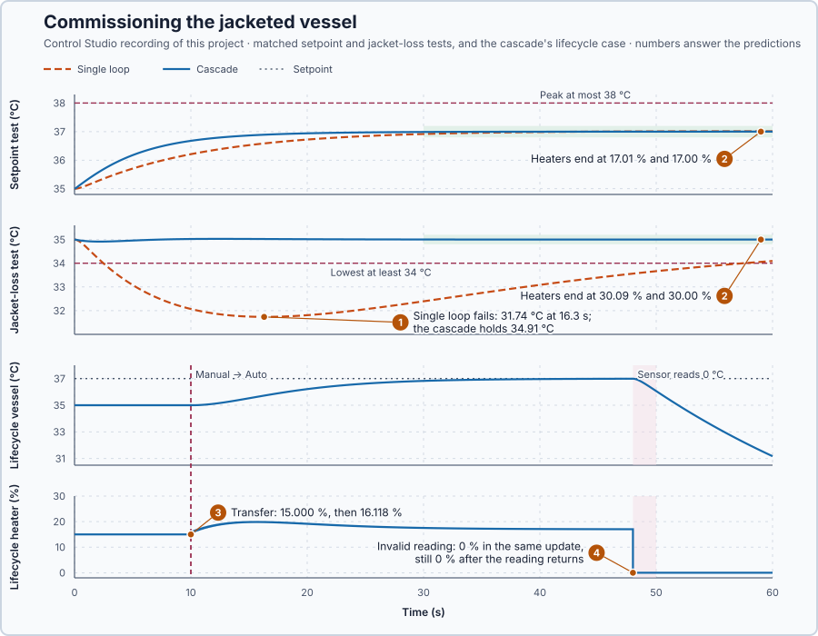

# 68. Vessel commissioning

You will choose, from its requirements and heat balance, which control structures the jacketed vessel needs, compare the candidates in matched tests, and check the chosen one as a whole: startup, the switch to Auto and a failed sensor.

## The problem

Lesson 67's Smith predictor gave the delayed heater a step with 0.1 % overshoot, where the same gains without the model overshot by 15.1 %. Lessons 63, 65, 66 and 67 each solved one problem on its own: cascade, split range, override and prediction. These structures have not been combined and compared for the vessel. The jacketed vessel must now follow a change from 35 to 37 °C, ride through a 30 kW jacket loss, start up in Manual, switch to Auto and survive a failed sensor. Adding every structure adds controllers to tune, states to track and failures to verify.

We will choose the combination this vessel needs from its requirements and heat balance, and test it as a whole.

## What we need

We need to:

1. fix the requirements before any result;
2. decide from the heat balance which structures the vessel needs at all;
3. compare the remaining candidates in matched tests; and
4. check the chosen arrangement's startup, transfer and fault behaviour.

## The new idea

**Vessel commissioning** picks the combination of loops the vessel needs and checks it against its performance, limits and operating requirements. Here the requirements and the heat balance decide the candidates, not the list of structures we happen to know.

**In words.** Commissioning means choosing, not collecting. Every structure added is another controller to tune, more stored values to track and more failures to verify, so a structure earns its place only by meeting a requirement that a simpler arrangement fails. The method has three parts:

1. **Requirements first.** What the vessel must do, which limits it must keep and which operating cases it must survive are written down before any result, so the results cannot shape them.
2. **One question per structure.** Each structure of Lessons 63 to 67 solves one kind of problem, and the heat balance tells whether this vessel has that problem. If it does not, the structure stays out.
3. **Matched tests.** The remaining candidates run the same tests, and the simplest that meets every requirement is chosen.

It is the same discipline as a factory acceptance test: the test list is agreed before the machine is shown, and the machine passes it or does not.

**The formula.** The heat balance stays the same for every candidate. At steady state the vessel loses $2(T_v - 20)$ kW, the jacket passes it on at 10 kW per °C of difference, and the heater supplies it plus any loss from the jacket:

$$
T_j = T_v + 0.2\,(T_v - 20), \qquad u = \frac{2\,(T_v - 20) + D_j}{2} .
$$

Let:

- $T_v$ and $T_j$ be the vessel and jacket temperatures, in °C;
- $u$ be the heater command, in %, worth 2 kW per point within 0–100 %; and
- $D_j$ be an extra heat loss from the jacket, in kW.

The requirements, fixed before any result, each a separate 60 s test from rest at 35 °C:

| Test | Requirement |
| --- | --- |
| Setpoint 35 → 37 °C | peak at most 38 °C; within 0.2 °C from 30 to 60 s |
| 30 kW jacket loss at 35 °C | vessel at least 34 °C; within 0.2 °C from 30 to 60 s |
| Lifecycle | start in Manual at the 15 % holding command; Manual → Auto without a jump; an invalid reading removes heat in the same update and stays latched |

A reading is valid within 30–40 °C for the vessel and 20–55 °C for the jacket.

**Example: choosing for the jacketed vessel.** First the balance:

1. At 35 °C the vessel loses $2 \times 15 = 30$ kW: jacket $35 + 0.2 \times 15 = 38$ °C, heater $30/2 = 15$ %.
2. At 37 °C it loses $2 \times 17 = 34$ kW: jacket 40.4 °C, heater 17 %.
3. With the 30 kW jacket loss at 35 °C: heater $(30 + 30)/2 = 30$ %. Every demand is heat, within the heater's 0–200 kW.

Then each structure answers its question:

1. **Earlier correction of a jacket disturbance?** The 30 kW loss acts on the jacket, so the cascade is a candidate.
2. **Cooling as well as heating?** The balance never asks for negative heat, so split range is not needed.
3. **A maximum jacket temperature?** None is specified, so override is not needed.
4. **A long known delay?** The heater acts on the jacket without a delivery delay, so Smith prediction is not needed.
5. **Startup, transfer and fault behaviour?** Required, as for the heater in Lessons 26, 27 and 29.

The candidates are therefore the single-loop PI, the simplest, and the cascade. The rule: recommend the simplest arrangement that meets every requirement; the cascade is justified only if the single loop fails the jacket loss. The single loop uses $K_p = 2.5$ %/°C and $K_i = 0.1$ %/(°C·s), as in Lesson 63; the cascade uses Lesson 63's Control Studio design, outer 0.8717 and 0.21 per second, inner 25.25 %/°C and 13.59 %/(°C·s).

The lifecycle requirement rests on tracking. In Manual every controller follows the held command, and the outer PI follows the jacket, so their stored values already match the plant. The first update with Auto requested is still a tracking update. On the next, with 37 °C requested and the vessel at 35 °C, a tracked outer PI moves the jacket setpoint only by its integral part, $0.21 \times 2 \times 0.1 = 0.042$ °C; one whose stored error is still zero adds the proportional step $0.8717 \times 2 = 1.743$ °C as well.

**The limitation.** A choice made this way holds only for the requirements and tests it was made with. Cooling and a jacket limit were not required, so the chosen arrangement says nothing about them; a later requirement for either would reopen questions 2 and 3. The same holds for sizes: a 40 kW jacket loss at 37 °C would need $(34 + 40)/2 = 37$ %, still within the heater's range, but it is not one of the tests and is not claimed.

## Prediction

Before running, answer these questions:

1. Which requirement can the single loop fail, and why?
2. Where do the heaters end in the setpoint test and in the jacket-loss test?
3. The lifecycle vessel switches to Auto with 37 °C requested and the vessel at 35 °C. What does the heater command on the transfer update and on the next? What would a cascade command whose stored values had not tracked in Manual?
4. What happens to the heater when the vessel reading becomes invalid?

| Quantity | Predicted |
| --- | ---: |
| Heater holding 37 °C | 17 % |
| Heater holding 35 °C with the 30 kW loss | 30 % |
| Tracked cascade's first automatic update | 15 + 25.25 × 0.042 + 13.59 × 0.042 × 0.1 = 16.12 % |
| Untracked cascade's first automatic update | 15 + 25.25 × 1.785 + 13.59 × 1.785 × 0.1 = 62.5 % |

## Implementation

Open [`src/Main.st`](src/Main.st). The project holds five copies of the jacketed vessel. The project test steps the setpoint to 37 °C on a single-loop vessel, a cascade vessel and the lifecycle vessel, and removes 30 kW from the jackets of a second single-loop vessel and a second cascade vessel. The lifecycle vessel runs the cascade: Manual at 15 % until 10 s, then Auto; from 48 to 50 s its vessel reading is 0 °C, a failed sensor. The function block `ReactorTrain` owns the heater and, every update, checks both readings (an invalid one sets 0 % at once and latches), lets exactly one arrangement write the heater, keeps every controller that does not write it in Manual tracking the applied command (the outer PI tracks the jacket), starts each controller from the vessel at rest, and limits the heater to 0–100 % and the jacket setpoint to 20–50 °C.

```st
HoldingJacketC := VesselC + LREAL#0.2 * (VesselC - LREAL#20.0);
HoldingCommandPct := (LREAL#2.0 * (VesselC - LREAL#20.0) + JacketLossKw) / LREAL#2.0;
ReadingsValid := VesselC >= LREAL#30.0 AND VesselC <= LREAL#40.0 AND JacketC >= LREAL#20.0 AND JacketC <= LREAL#55.0;
```

**Exercise.** By hand: the jacket holding 35 °C and 37 °C is 38 °C and 40.4 °C; the heater holding 35 °C, 37 °C and 35 °C with the loss is 15 %, 17 % and 30 %; a 0 °C vessel reading or a 56 °C jacket reading is invalid. Open [`src/tests.st`](src/tests.st) and run its tests from the **Testing** view.

## Experiment in Control Studio

1. Open this lesson's project and start **Simulator**. The five vessels rest at 35 °C, their jackets at 38 °C, with 15 %. In the **truST** side bar, select **Control Studio**.
2. On **Identify**, choose **Project experiment** from **Method**. **Signals** already shows `P1.SetpointC · Setpoint (°C)`, `P1.LifecycleVesselC · Process value (°C)` and `P1.LifecyclePct · Applied output (%)`, the lifecycle vessel; add `P1.SingleStepVesselC · state (°C)`, `P1.CascadeStepVesselC · state (°C)`, `P1.SingleStepPct · state (%)` and `P1.CascadeStepPct · state (%)`.
3. Answer the predictions before starting.
4. Select **Review project test** and check the declared **62.1 s** duration: 2 s at rest, then the 60 s tests.
5. Select **Confirm and start**.
6. After the run, hover 10 s and 30 s after the step. Then show the jacket-loss test, `P1.SingleLossVesselC`, `P1.CascadeLossVesselC`, their jackets and commands and `P1.JacketLossKw`, and hover each vessel's lowest point. Finally show the lifecycle vessel with `P1.LifecycleJacketSetpointC`, `P1.LifecycleAuto`, `P1.LifecycleFault` and `P1.LifecycleReadingValid`, and hover the transfer at 10 s and the fault at 48 s. Control Studio shows **Project test completed. Outputs restored.**

Select **Abort test** to stop early. To repeat, stop and restart **Simulator**; only a restart clears the fault latch.

## Evidence and decision



The numbered marks answer the predictions with the same numbers. From Control Studio's recording, times from the start of the tests:

| Requirement | Single loop | Cascade |
| --- | ---: | ---: |
| Setpoint test: peak ≤ 38 °C | 37.01 °C at 60 s | 37.00 °C at 60 s |
| Setpoint test: largest error, 30–60 s | 0.083 °C | 0.013 °C |
| Jacket loss: vessel ≥ 34 °C | **31.74 °C** at 16.3 s | 34.91 °C at 2.2 s |
| Jacket loss: largest error, 30–60 s | **2.61 °C** | 0.003 °C |
| Heater at 60 s, setpoint test / jacket loss | 17.01 % / 30.09 % | 17.00 % / 30.00 % |

| Lifecycle requirement | Result | Decision |
| --- | --- | --- |
| Start in Manual | 15.000 % until 9.9 s, vessel 35.000 °C | pass |
| Manual → Auto at 10 s, 37 °C requested | 15.000 % on the transfer update, 16.118 % on the next | pass |
| Invalid reading at 48 s | 0 % in the same update; latched; still 0 % after the reading returned at 50 s | pass |

1. The single loop failed the jacket loss: it saw the loss only once the vessel had cooled, its jacket fell to 33.88 °C and the vessel to 31.74 °C. The cascade's inner loop raised the heater to 30.55 % within seconds; the jacket fell only to 37.46 °C and the vessel to 34.91 °C.
2. The heaters ended at the balance's values: 17.01 % and 17.00 % at 37 °C, 30.09 % and 30.00 % under the loss.
3. The tracked transfer gave 15.000 % and then 16.118 %; an untracked cascade would have started at 62.5 %. The vessel reached 36.99 °C by 48 s.
4. At the invalid reading the heater went to 0 % in the same update and stayed off after the reading returned; the vessel cooled to 31.17 °C by 60 s.

Both met the setpoint test; the jacket loss separated them. The cascade costs a second controller to tune and track, and holds the vessel at 34.91 °C instead of 31.74 °C under the loss. The recommendation is the cascade, for these two events and this lifecycle case; cooling and a jacket limit were not required and are not claimed. These are simulation results.

## Conclusion

Commissioning starts from requirements and a heat balance, not from the list of available structures. Here only the jacket disturbance justified an added structure, and only after the single loop failed it in a matched test.

For the jacketed vessel, the cascade met both tests and its startup, transfer and fault requirements, for the conditions tested and no others.

## Check yourself

1. **The vessel must be held at 36 °C. What jacket temperature and heater command does that need?**
   The vessel loses 2 × 16 = 32 kW, so the jacket must be 3.2 °C warmer, 39.2 °C, and the heater must give 32 kW: 16 %.
2. **Why were split range and override left out?**
   The balance never asks for negative heat, and no jacket limit was specified, so they would meet no requirement.
3. **Why did the cascade's heater not jump at the Manual → Auto transfer?**
   In Manual every controller tracked the held command and the jacket, so the first automatic update continued from
   matching stored values.

## Reason for the next lesson

Next, two vessels share a wall, and each has its own heater. Each heater warms both vessels, so it is unclear which heater should control which temperature.

[Multivariable process paths](../../10-multivariable-control/61-mimo-paths/README.md) measures how strongly each heater moves each vessel.
