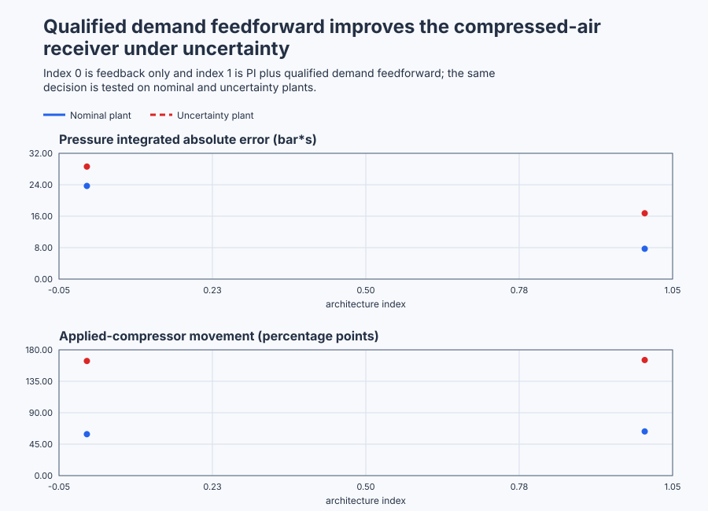

# Defend an independent compressed-air control-system recommendation

Course position: Lesson 84 of 84.
Prerequisite: `control-capstone-building-hvac`.

**Lesson objective:** Commission and defend the simplest unapplied controller satisfying the compressed-air reference requirements, then apply the same evidence discipline to a learner-selected platform-supported plant.

Plant: Factory compressed-air receiver supplied by one variable-speed compressor.

## The problem

The equipment in this lesson is Factory compressed-air receiver supplied by one variable-speed compressor.

The reference equipment is a compressed-air header supplied through a receiver
by one variable-speed compressor. Header pressure is the controlled quantity,
measured in bar. Compressor-delivery request is the manipulated quantity,
measured in percent of design delivery. Actual compressor delivery is measured
in percent. Plant air demand is a measured disturbance, also in percent of
design flow.

The normal pressure setpoint is 7.0 bar. Normal demand and delivery are 50
percent. Compressor request is limited to 0 through 100 percent and may change
by at most 10 percentage points each second. The normal operating requirement
is 6.5 through 7.5 bar. The hard local test boundary is 6.0 through 8.0 bar.

The installed drive owns the compressor's internal delivery loop. The PLC
requests delivery and observes actual delivery; it does not replace the drive
controller. A pressure relief valve and independently owned high-pressure trip
protect the real vessel. They are not functions of this controller, and this
Simulation cannot prove them.

The two shipped plants are equivalent copies. One runs qualified feedback PI.
The other runs the same PI with measured-demand feedforward. A second
configuration changes the compressor lag and receiver rate gain. All results
are **Simulation evidence**, not physical evidence.

For your own capstone, select another named plant only when the platform can
execute it. Declare its purpose, owner, sensors, actuator, disturbances, units,
operating region, equipment limits, external safety functions, evidence class
and approval authority before designing control.

Lesson 83 showed why advanced mathematics must not decide the winner. Balanced
model-predictive control slightly improved building error and energy but failed
the predeclared actuator-movement requirement. Qualified PI remained the
application recommendation.

The final lesson therefore removes the prescribed technique. You must begin
with what the new equipment needs, identify the failures that matter, and use
only enough control architecture to resolve them. A simple controller that
misses a requirement is unacceptable. An advanced controller without an
evidenced problem to solve is also unacceptable.

## What we need

We need a repeatable engineering process that begins with equipment purpose and measurable requirements, gathers only the model evidence the decision needs, rejects inapplicable structures, and defends the simplest eligible recommendation. The learner, not the lesson title, must decide which supported controller family wins.

## The new idea

### Receiver pressure follows flow imbalance

The receiver stores compressed air. Header pressure rises when compressor
delivery exceeds plant demand, falls when demand exceeds delivery, and remains
constant when the flows balance.

The header pressure ($p$) is the receiver pressure in bar. Actual compressor
delivery ($q_{\mathrm{c}}$) is delivered air in percent of design flow. Plant demand ($\mathbf{q}_{\mathrm{d}}$)
is consumed air in percent of design flow. The receiver rate gain ($K_{r}$) states
how quickly pressure changes for each percentage point of delivery-demand
imbalance, in bar per percent-flow second.

After those physical quantities are defined, the local balance is:

$dp/dt = K_{r} \cdot (q_{\mathrm{c}}-q_{\mathrm{d}})$

The reference receiver rate gain is 0.005 bar per percent-flow second. At equal
delivery and demand, the difference is zero and pressure does not change.

The delivery request ($u$) is the target sent to the installed compressor drive,
in percent. The delivery time constant ($T_{\mathrm{c}}$) is the time required for the
first-order response to complete about 63.2 percent of a requested change, in
seconds. The reference time constant is 5 seconds. The local delivery model is:

$dq_{\mathrm{c}}/dt = (u-q_{\mathrm{c}})/T_{\mathrm{c}}$

This model is useful near the declared operating point. It omits temperature,
moisture, compressor staging, pipe-network modes, drive internals and certified
protection dynamics.

### Evidence before design

A requirement states what acceptable operation means before results are seen.
A hypothesis predicts one observable effect. An independent variable is the
single deliberate change in an experiment. Controlled conditions are all
conditions held equal. An identification record estimates model quantities. An
unused validation record tests prediction on data that was not fitted. Model
uncertainty states the credible range of those estimates. Evidence class says
whether a result came from calculation, configured Simulation truth, an
identified model, or a physical plant.

The reference needs only two dynamic quantities. A bounded compressor-request
pulse identifies delivery time constant. A separately restored delivery-demand
imbalance identifies receiver rate gain. An unused demand sequence validates
both. Each experiment begins and ends at 7 bar, 50 percent delivery and 50
percent demand. Fitting the configured matrix back to itself is not independent
validation.

The executable identification records estimate a 5.000-second delivery time
constant and a 0.005000-bar-per-percent-flow-second receiver rate gain. On the
unused ten-second validation record, measured and independently predicted
delivery are both 54.323 percent; measured and predicted pressure are both
7.0419 bar within the displayed precision.

### Screen architectures instead of collecting them

Screen **ON/OFF, P, PI, PID, feedforward, cascade, scheduling, Smith
prediction, MIMO and MPC** against this topology:

- ON/OFF wastes a continuously variable compressor and creates avoidable
  pressure cycling.
- Proportional control alone cannot provide an unknown nonzero equilibrium
  delivery at zero pressure error unless its operating bias is exactly right.
- Proportional-integral control is eligible because integral action corrects
  persistent unmeasured flow imbalance.
- Derivative action is rejected because the identified lag and pressure-noise
  evidence does not establish a damping benefit that justifies its sensitivity.
- Measured-demand feedforward is eligible because one percentage point of
  additional steady demand needs one percentage point of additional delivery.
- Cascade is ineligible because the installed drive already owns the delivery
  inner loop; adding another PLC inner loop would duplicate authority.
- Scheduling, Smith prediction, MIMO control and MPC are rejected because the
  declared local plant shows no large operating-range change, dominant dead
  time, interacting manipulated variable or predictive constraint conflict.

These conclusions belong to this reference topology and operating region. They
are not universal rankings of the methods.

### The two eligible candidates

The pressure setpoint ($SP$) is the desired header pressure in bar. The measured
header pressure ($PV$) is the sensor value in bar. The pressure error ($e$) is the
setpoint minus measured pressure:

$e = SP - PV$

The feedback contribution ($MV_{\mathrm{feedback}}$) is the controller output produced from
pressure error. The feedforward contribution ($MV_{\mathrm{feedforward}}$) is the qualified
demand change relative to the 50-percent operating point. The requested
compressor delivery ($MV_{\mathrm{requested}}$) is the controller's total command before
plant authority. The applied compressor request ($MV_{\mathrm{applied}}$) is the bounded
command delivered to the simulated drive.

Both candidates use proportional gain $K_p = 40 percent/bar$, integral gain
$K_i = 1.0 percent/(bar \cdot s)$, a 50-percent bias, zero derivative, combined
anti-windup, one second update, and actual-delivery tracking during external
authority. The integrated candidate uses:

$MV_{\mathrm{feedforward}} = q_{\mathrm{d}} - 50 percent$

$MV_{\mathrm{requested}} = MV_{\mathrm{feedback}} + MV_{\mathrm{feedforward}}$

Feedforward enters the shared PID authority before amplitude and rate limiting.
Adding it after the returned output would bypass anti-windup and make requested
and applied commands disagree without controller knowledge.

The measured controller interval ($\Delta t$) is the elapsed update time in
seconds. It is qualified from 0.8 through 1.2 seconds. Both PID integration and
the 10-percentage-point-per-second slew limit use that measured interval;
invalid timing removes automatic authority.

### Stability and authority

The complete open loop combines the PI law, the integrating receiver and the
first-order compressor lag. Closed-loop poles show whether natural modes decay.
A Bode plot gives phase margin, gain margin and delay margin. Sensitivity shows
how model disturbance and uncertainty reach pressure. These are local linear
control measures, not compressor-protection certification.

For the selected PI, the independent characteristic calculation gives one real
closed-loop pole at -0.0285 per second and a complex pair at -0.0858 plus or
minus 0.1666 radians per second. The Bode oracle gives crossover frequency
0.159 radians per second, phase margin 42.6 degrees, no finite gain-margin
crossing, and delay margin 4.69 seconds. Maximum sensitivity is 1.626. These
values qualify the declared local design; they do not qualify another receiver
or the external protection system.

Automatic gives the qualified controller authority. Manual applies a reviewed
operator request through the same limits. ControlledStop ramps the request to
zero. Safe closes authority immediately. Invalid primary pressure, invalid
actual-delivery feedback or unavailable compressor fails closed. Invalid demand
removes feedforward but retains qualified PI feedback. During external
authority each PID tracks measured actual delivery so return to Automatic is
bumpless.

## Prediction

At 7 bar, 50-percent actual delivery and 50-percent demand, flow imbalance is
zero. Predict zero pressure rate.

When demand changes from 50 to 65 percent while delivery is still 50 percent,
the imbalance is -15 percentage points:

$dp/dt = 0.005 \cdot (50-65) = -0.075 bar/s$

Qualified one-for-one feedforward immediately adds 15 percentage points to the
request. The first request is limited by the 10-percentage-point-per-second
rate boundary, and the five-second compressor lag prevents actual delivery
from changing instantly. Pressure will therefore dip, but feedforward should
begin correcting before feedback PI sees the full pressure error.

An unmeasured leak is absent from feedforward. Predict that integral action
must supply the missing trim. Predict zero applied request for invalid pressure,
invalid delivery, unavailable compressor or Safe mode. Predict PI-only
operation when demand quality is invalid.

## Implementation

The actual Structured Text uses two shared `Control.PID` instances with the
same parameters. Only the integrated path receives qualified demand
feedforward:

```st
IF FeedforwardQualified THEN
    IntegratedFeedforward := MeasuredDemand - LREAL#50.0;
ELSE
    IntegratedFeedforward := LREAL#0.0;
END_IF;

IntegratedInput.FeedForward := IntegratedFeedforward;
IntegratedRequested := IntegratedController.Update(Input := IntegratedInput);
```

The source exposes `FeedbackRequested`, `IntegratedFeedback`,
`IntegratedFeedforward`, `IntegratedRequested`, `FeedbackApplied`,
`IntegratedApplied`, and both actual deliveries. Mode, pressure quality, demand
quality, delivery quality, compressor availability, tracking, fault state and
controller revision 84 remain observable. The program contains no response
metric, precomputed trace, selected winner or application approval.

## Experiment in Control Studio

This procedure tests one declared lesson change under controlled conditions. Add qualified measured-demand feedforward through the same PID, actuator, anti-windup and tracking boundary on an equivalent plant. The declared event lasts 300 seconds. It restores Measured plant air demand to 50 % afterward. The deterministic Simulation seed is 20260829.

### Control Studio actions

1. **Monitor** — Start the **Simulator**, then open **truST sidebar → Control Studio → Monitor → Response**.
   - **Baseline check:** Wait until the header shows **Simulation**, **Running**, and current data. Confirm Header pressure setpoint (SP, bar); Feedback-plant header pressure (PV, bar) and Integrated-plant header pressure (PV, bar); Manual feedback-plant request (MV, %) and Manual integrated-plant request (MV, %), including units, limits, mode, and quality. The initial operating point is Header pressure setpoint = 7 bar, Feedback-plant header pressure = 7 bar, Integrated-plant header pressure = 7 bar, Feedback-plant actual delivery = 50 %, Integrated-plant actual delivery = 50 %, Measured plant air demand = 50 %. The unresolved baseline problem is: Feedback PI reacts only after demand imbalance has changed header pressure.
   - **Decision before action:** Read **Prediction** above, then state what should move first and in which direction. Use this decision rule: Select PI plus measured-demand feedforward only if common normal, uncertainty, actuator, stability and abnormal evidence satisfies every predeclared requirement.
   - **Successful evidence:** The Response plot advances, the displayed values are finite and current, and **Start recording** is enabled. Select **Start recording** only after those conditions are visible.
   - **Recovery:** If recording is disabled or the plot reports unavailable or stale samples, stop the Simulator, correct the displayed runtime or binding problem, restart it, and repeat the baseline check.
   - **Record:** Write down the initial SP, PV, requested/applied MV where available, controller mode, and your predicted response before opening Test.

2. **Test** — Open **truST sidebar → Control Studio → Test**.
   - **Baseline check:** Set **Experiment** = **Load disturbance step**, **Amplitude** = **15 %**, and **Maximum duration (s)** = **300**. The affected signal is **Measured plant air demand**; it starts at 50 % and must restore to 50 %.
   - **Decision before action:** Before selecting **Review test**, predict the response direction and confirm the requested change remains inside Feedback-plant header pressure 6 bar to 8 bar; Integrated-plant header pressure 6 bar to 8 bar; Feedback PI applied request 0 % to 100 %; Integrated applied request 0 % to 100 %. Apply the same evidence process to a learner-selected, platform-supported plant only after defending the shipped reference compressed-air receiver.
   - **Successful evidence:** Select **Review test**, verify the signal, requested bound, duration, restoration, and stop conditions, then select **Confirm and start**. The state changes to **Running**, **Abort test** remains available, and the terminal state confirms completion and restoration while Response shows the measured SP/PV/MV sequence.
   - **Recovery:** For a rejected, stale, unsafe, unavailable, failed, or aborted state, read the displayed reason, restore Measured plant air demand to 50 %, wait for current data, and review a new test.
   - **Record:** Compare the response with your prediction and retain the terminal state, restoration result, and deterministic seed **20260829**.

3. **Identify** — After **Stop recording**, open **truST sidebar → Control Studio → Identify**.
   - **Baseline check:** Use **Qualify recording** to inspect sample count, duration, timing, excitation, and clipping. **Model selection**, **Fit estimation run**, and **Accept model for design** are the shared low-order model workflow; they do not replace the project-owned **Requirements-led architecture selection, independent modelling, PI tuning, measured-demand feedforward, robustness and abnormal validation** model and must not be accepted as this lesson's design authority.
   - **Decision before action:** Decide whether the recording contains the input/output change needed for **Requirements-led architecture selection, independent modelling, PI tuning, measured-demand feedforward, robustness and abnormal validation** before fitting anything.
   - **Successful evidence:** A qualified recording has current, finite, sufficiently excited data. Use the project-owned model described under **Implementation** and **Evidence and decision**, and record its assumptions, units, validity range, and rejection rule.
   - **Recovery:** If qualification reports stale, clipped, poorly excited, or insufficient data, return to Test and repeat the bounded experiment; never force or relabel a rejected fit.
   - **Record:** State which model is retained or rejected and why, explicitly identifying the runnable project as the model authority.

4. **Tune / Design** — Open **truST sidebar → Control Studio → Tune**.
   - **Baseline check:** **Design method** and **Generate candidate** are disabled because **Requirements-led architecture selection, independent modelling, PI tuning, measured-demand feedforward, robustness and abnormal validation** is designed by the runnable project; shared Control.PID tuning is unavailable. Do not select an unrelated PID method.
   - **Decision before action:** Apply the equations and choices under **Implementation**, then compare the declared alternatives under **Evidence and decision** before accepting **Requirements-led architecture selection, independent modelling, PI tuning, measured-demand feedforward, robustness and abnormal validation**.
   - **Successful evidence:** Use **Monitor → Signals** to correlate the implemented project-owned design with its named live states and outputs. A disabled shared designer is only a visible ownership boundary, not successful design evidence.
   - **Recovery:** If the project-owned prerequisites or qualification flags are false, return to Test or Identify as directed by the lesson and do not bypass them with a generic PID candidate.
   - **Record:** State why the project-owned design is eligible, conditional, or rejected, including the decisive trade-off.

5. **Validate** — Open **truST sidebar → Control Studio → Validate**.
   - **Baseline check:** **Run required validation** is disabled because no shared Control.PID candidate exists. **Requirement details** and **Save result** cannot be used to claim a shared result; project-owned validation is executed by the runnable project's declared oracle.
   - **Decision before action:** Use the predeclared comparisons: normal_pressure_envelope_violation == 0 bar*s (tolerance 0.001 bar*s); regulatory_iae_improvement >= 30 % (tolerance 0.1 %); applied_movement_increase <= 25 % (tolerance 0.1 %); maximum_applied_request <= 100 % (tolerance 0.001 %).
   - **Successful evidence:** Correlate the unrounded project-owned results with the named live signals and events in Monitor. Each applicable requirement must have a value, unit, limit, tolerance, evidence class, and Pass, Conditional pass, Fail, or Inconclusive disposition.
   - **Recovery:** If the project run aborts, becomes stale, fails, or violates restoration, discard that run and repeat the declared Test. Never present a disabled button or retained README table as newly executed evidence.
   - **Record:** State the validation disposition and name every failed or inconclusive requirement before continuing.

## Evidence and decision

### Measures and comparison

Pressure integrated absolute error is the sum of absolute setpoint-minus-
pressure error multiplied by one second, in bar-seconds. Maximum pressure
departure is the largest absolute setpoint-minus-pressure value, in bar.
Settling time is reported only after pressure enters and remains in the
declared two-percent band.

Normal-envelope violation accumulates pressure outside 6.5 through 7.5 bar in
bar-seconds and also records duration. Requested and applied total variation
sum consecutive absolute command changes in percentage points. Also retain
peak delivery, time at a limit, maximum requested-to-actual tracking residual,
feedforward onset delay, stability margins, sensitivity peak, model residual
and recovery bump.

Before results are viewed, require at least 30 percent lower regulatory
pressure integrated absolute error and no more than 25 percent additional
applied movement versus feedback PI. Every candidate must also preserve the
normal pressure envelope, hard limits, qualified stability margins,
deterministic abnormal authority and rollback.

### Validation

The native test must compile and execute this Structured Text against both
equivalent nominal plants and both equivalent uncertainty plants. Independent
continuous, sampled, identification, time-domain and frequency-domain oracles
must agree within declared tolerances. A source-code formula or static plot is
not execution evidence.

The retained nominal result table is generated from that common executable
campaign:

| Candidate | Status | Pressure IAE | Maximum departure | Normal-envelope violation | Applied movement |
| --- | --- | ---: | ---: | ---: | ---: |
| Qualified feedback PI | Eligible | 23.70 bar*s | 0.483 bar | 0.000 bar*s | 59.3 pp |
| PI plus measured-demand feedforward | Eligible | 7.72 bar*s | 0.282 bar | 0.000 bar*s | 63.2 pp |

Feedforward reduces nominal pressure IAE by 67.4 percent while increasing
applied movement by 6.6 percent. It passes both the 30-percent improvement and
25-percent movement criteria.

The uncertainty run uses an eight-second compressor lag, receiver rate gain
0.004 bar per percent-flow second, an unmeasured five-percent leak,
plus-or-minus 0.005-bar deterministic sensor noise and alternating 0.9/1.1-
second intervals:

| Candidate | Status | Pressure IAE | Maximum departure | Normal-envelope violation | Applied movement |
| --- | --- | ---: | ---: | ---: | ---: |
| Qualified feedback PI | Ineligible: envelope | 28.62 bar*s | 0.534 bar | 0.169 bar*s | 164.1 pp |
| PI plus measured-demand feedforward | Eligible | 16.75 bar*s | 0.359 bar | 0.000 bar*s | 165.4 pp |

The integrated candidate improves uncertainty IAE by 41.5 percent with 0.8
percent additional movement and remains inside the normal pressure envelope.
It is therefore the simplest candidate satisfying every declared reference
requirement. Revision 84 remains an unapplied recommendation.

Invalid demand must remove feedforward while qualified PI continues. Invalid
primary pressure or unavailable compressor must fail closed. Invalid actual-
delivery feedback must remove automatic authority because tracking is no longer
trustworthy. Manual and ControlledStop must remain bounded and return without
an unacceptable bump. Recovery requires restored quality and a new reviewed
run. Controller revision 84 remains unchanged and unapplied.



[Complete trace](figures/independent-capstone-evidence-trace.csv) · [Decision summary](figures/independent-capstone-evidence-summary.csv)

## Conclusion

Trace the engineering argument without skipping a link. Flow imbalance creates
pressure change. Bounded experiments identify compressor lag and receiver rate
gain. Those quantities justify the PI calculation and stability analysis.
Measured demand justifies feedforward. Both terms pass through one authority,
anti-windup and tracking boundary. Equivalent run evidence decides whether the
added feedforward is worth retaining.

Feedforward acts before pressure error because demand changes first. It cannot
correct an unknown leak or a wrong gain, so PI trim remains necessary. The
compressor lag limits how quickly even a perfect demand measurement can affect
real delivery. The rejected advanced structures add ownership, tuning and
maintenance cost without an observed failure that requires them.

## Reason for the next lesson

The compressed-air reference proves the final assessment workflow is
executable; it is not a controller recipe for every plant. Produce a
reproducible engineering report for your learner-selected plant. Include
requirements, topology, safety ownership, theory, calculations, experiment and
restoration approvals, raw records, identified models and uncertainty,
architecture rejections, tuning or design, stability and robustness, normal and
abnormal validation, the selected unapplied revision, application approval,
rollback, monitoring and maintenance triggers.

Keep calculations, configured Simulation truth, identified-model evidence and
physical evidence visibly separate. Course completion requires you to defend
every material choice and limitation. It does not authorize physical operation
without independently reviewed topology and explicit approval immediately
before each physical experiment or application.
