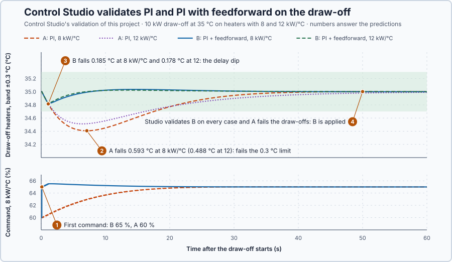

# 89. Independent design

In this lesson, you will design the control of a hot-water heater for stated requirements: check that they are feasible, then take two candidates, PI and PI with feedforward, through Control Studio's Identify, Tune and Validate across the heat-loss range, and apply the simplest one that meets every requirement.

## The problem

Lesson 88's heater trusted a reading only on evidence: a sustained disagreement removed heat at 5.2 s, and a change of sensor moved the command by at most 0.032 points. Each lesson so far added one mechanism against one problem. A real installation brings competing requirements, uncertainty and disturbances together, and the course's methods have not yet been combined by you alone.

A production line draws hot water from the heater at 35 °C, and the setpoint is sometimes raised by 1 °C. The line switches on draw-offs of 10 kW without warning, but a flow meter measures each one. The heat loss lies between 8 and 12 kW/°C, the range of lesson 86, and the line tolerates at most 0.3 °C of deviation during a draw-off. We will state the requirements first, check that they are feasible, validate two candidates alike in Control Studio, and apply and defend the one its evidence supports.

## What we need

We need to:

1. state the requirements before any test and check that the heater can meet them;
2. choose two candidates worth comparing and build both in ST;
3. validate both alike across the heat-loss range; and
4. decide by a rule fixed in advance, and say what the evidence covers.

## The new idea

**Independent design** means stating the requirements yourself, choosing two suitable designs, calculating whether they can work, building both in ST, and defending your choice with measured evidence. For the heater, the hard requirement is the 0.3 °C limit during a draw-off, so the candidates differ in how they answer a draw-off.

**In words.** Until now each lesson brought its problem and its method together. Here you choose. Independent design is a fixed order of steps for using the course's methods, so that the choice rests on evidence and not on a favourite controller. It works like a factory acceptance test: the test cases and the pass criteria are agreed before the test, and the equipment passes or fails against them. The parts:

1. **Requirements first.** Write down what must hold, in numbers, for which cases and over which range of the process, before any test.
2. **Feasibility.** Calculate whether the plant can meet them at all, at the worst end of the range. If it cannot, no controller will.
3. **Two candidates.** Take the simplest design that might pass, and a second one that answers the requirement that is hardest to meet.
4. **The same tests for both.** Build both in ST and validate them on the same cases across the whole range.
5. **A rule fixed in advance.** Decide, before seeing results, how the evidence will choose, and afterwards state what the evidence covers and what it does not.

For the heater this means: the draw-off limit is the hard requirement, so one candidate is a plain PI and the other adds a feedforward of the measured draw-off.

**The formula.** Holding a temperature $T$ against a draw-off $D$ needs the command

$$
u_{hold} = \frac{H(T - T_a) + D}{a} \le 100\ \% ,
$$

and a feedforward of the measured draw-off supplies its heat directly:

$$
u_{ff} = \frac{D}{a} .
$$

- $H$ is the heat loss, in kW/°C, between 8 and 12 kW/°C;
- $T_a = 20$ °C is the surroundings' temperature, and $T$ the water's, in °C;
- $D$ is the draw-off, in kW, measured by the flow meter; and
- $a = 2$ kW per point is the heater power per command point.

The feedforward's heat arrives only after the 1 s delivery delay. During that second the water, with 50 kJ/°C of heat stored, follows $50\dot x = -Hx - D$ for its deviation $x$, a first-order response with time constant $50/H$, so it falls by

$$
\Delta T = \frac{D}{H}\left(1 - e^{-H/50}\right)
$$

before the extra heat arrives. No feedback can prevent that fall either: during the delay nothing the controller does reaches the water.

**Example: the heater's design.** The requirements, declared now:

| Case | Requirement |
| --- | --- |
| Setpoint 35 → 36 °C | peak at most 37 °C; within 0.2 °C of 36 °C from 30 s to 60 s |
| Measured 10 kW draw-off at 35 °C | within 0.3 °C of 35 °C from 0 s to 60 s; within 0.2 °C from 30 s to 60 s |

Each case must pass at 8, 10 and 12 kW/°C, from rest at 35 °C, with the command limited to 0–100 % and updated every 0.1 s.

1. Feasibility at the worst end, $H = 12$: 36 °C needs $12 \cdot 16/2 = 96$ %, and 35 °C against 10 kW needs $(12 \cdot 15 + 10)/2 = 95$ %. The requirements ask nothing the heater cannot deliver.
2. Candidate A is lesson 86's candidate A, the PI with $K_p = 2.5$ %/°C and $K_i = 0.5$ %/(°C·s), proven stable for every heat loss in the range. It must wait for a draw-off to lower the temperature before it reacts.
3. Candidate B is the same PI with lesson 62's feedforward, $u_{ff} = D/2$. It depends only on the 2 kW per point, not on the uncertain $H$.
4. B through a smaller draw-off, 5 kW at the nominal 10 kW/°C: the feedforward adds $5/2 = 2.5$ points at once, and before that heat arrives the water falls by $(5/10)(1 - e^{-0.2}) = 0.5 \cdot 0.181 = 0.091$ °C (calculated).
5. The decision rule, fixed now: recommend the simplest candidate that passes every case at every heat loss. A is simpler, with no flow meter and no feedforward path; if neither passes, redesign.

**The limitation.** The validation keeps some things fixed: a 1 s delay, an exact draw-off measurement, healthy sensors (lesson 88) and local control (lesson 87). A flow meter that reads 10 % low would leave 1 kW of a 10 kW draw-off, 0.5 points, uncompensated (calculated), and only the integral term would remove it.

## Prediction

Before running, answer these questions:

1. What is each candidate's first command when a draw-off starts at 8 kW/°C?
2. Which requirement do you expect to decide the comparison, and at which heat loss is A worst?
3. Does the heat-loss range change B's fall?
4. Which candidate will the rule recommend? The run may prove you wrong.

| B's fall during the delay | 8 kW/°C | 10 kW/°C | 12 kW/°C |
| --- | ---: | ---: | ---: |
| $(D/H)(1 - e^{-H/50})$ | 0.185 °C | 0.181 °C | 0.178 °C |

## Implementation

Open [`src/Main.st`](src/Main.st). The project is the line heater, 10 kW/°C with 1 s, under the real `Control.PID` as PI, with a feedforward of the measured draw-off `LoadKw` through a lead/lag; with equal lead and lag it is the gain times the draw-off:

```st
FeedforwardCommandPct := FeedforwardGain * (FilteredLoadKw + LeadS / LagS * (LoadKw - FilteredLoadKw));
```

`Parameters` start as candidate A and `FeedforwardGain` at 0; Control Studio's **Apply** replaces them. A temperature outside 0–80 °C latches `SafetyAbort`, which removes heat and the draw-off. [`provided-model.json`](provided-model.json) is the heater's heat balance, sampled every 0.1 s with the 1 s delay as ten steps. [`control-loop.json`](control-loop.json) declares the validation scenarios: the setpoint step on models of the 8 and 12 kW/°C heaters, and the 10 kW draw-off on those models and on the project's heater, each with the declared requirements.

**Exercise.** By hand: with equal lead and lag, a 10 kW draw-off gives $0.5 \cdot 10 = 5$ points of feedforward; `HoldingCommandPct` at 8 kW/°C and 35 °C gives 60 %, and `DelayDipC` at 12 kW/°C gives $0.833(1 - e^{-0.24}) = 0.178$ °C. Then run [`src/tests.st`](src/tests.st) from the **Testing** view; it checks these values and the rule.

## Experiment in Control Studio

1. Open this lesson's project and start **Simulator**. The heater rests at 35 °C with 75 % and no draw-off. In the **truST** side bar, select **Control Studio**.
2. On **Identify**, choose **Supplied plant model** from **Method** and open `provided-model.json`. Control Studio shows a **Discrete state-space model · 2 inputs, 1 output**: heater command and draw-off to water temperature.
3. Answer the predictions.
4. On **Tune**, choose **P1.Controller · Feedforward** in **Controller** and **Manual** in **Tuning method**, and enter candidate A: **Proportional gain (Kp)** 2.5, **Integral gain (Ki)** 0.5, **Control.PID DerivativeGain** 0, **Feedforward gain** 0, **Lead time** 1 and **Lag time** 1. Select **Requirements…**, enter **Setpoint change (°C)** 1, **Maximum steady-state error (°C)** 0.2, **Maximum settling time (s)** 30, **Settling band (±°C)** 0.1 and **Validation duration (s)** 60, and select **Done**. Select **Tune controller**.
5. On **Validate**, select **Validate controller**. Control Studio runs the actual ST for 60 s on the project's heater and on every declared scenario.
6. On **Tune**, enter **Feedforward gain** 0.5 for candidate B, select **Tune controller**, validate again, and select **Apply**. Control Studio shows **Applied** and offers **Restore previous settings**.

Select **Abort** to stop validation early. To repeat, stop and restart **Simulator**.

## Evidence and decision



The numbered marks answer the predictions with the same numbers. Control Studio's validation; it lists each error limit as **Maximum steady-state error**:

| Case | A, feedforward gain 0 | B, feedforward gain 0.5 |
| --- | ---: | ---: |
| Setpoint step, 10 kW/°C: settling, late error | 15.5 s, 0.0396 °C | 15.5 s, 0.0396 °C |
| Setpoint step, 8 kW/°C: late error, range | 0.0044 °C, 35–36 °C | 0.0044 °C, 35–36 °C |
| Setpoint step, 12 kW/°C: late error, range | 0.0807 °C, 35–35.99 °C | 0.0807 °C, 35–35.99 °C |
| Draw-off, 8 kW/°C: deviation, late error | 0.5926 °C Fail, 0.0559 °C | 0.1848 °C, 0.0098 °C |
| Draw-off, 10 kW/°C: deviation, late error | 0.5355 °C Fail, 0.0836 °C | 0.1813 °C, 0.0092 °C |
| Draw-off, 12 kW/°C: deviation, late error | 0.4881 °C Fail, 0.1016 °C | 0.1778 °C, 0.0085 °C |

1. B's first command after the draw-off was 65 %, A's 60 %: the feedforward acts at once, the PI only once an error appears.
2. The draw-off limit decided: the setpoint steps were identical, because without a draw-off B's feedforward is zero, while A fell 0.5926 °C at 8 kW/°C, its worst, and 0.4881 °C at 12 kW/°C.
3. B fell 0.1848, 0.1813 and 0.1778 °C, the predicted delay dips: the range hardly changed them.
4. The rule recommends B: Control Studio showed **Verification failed: Observed measurement exceeds the declared limit. Next: Tune again.** for A and kept **Apply** unavailable; B passed every case and was applied.

In the first second both fell alike, because B's extra heat was still on its way; at 6 s A's command had risen only to 62.62 %, while B was back at 34.97 °C. B's cost is a flow meter and a feedforward path; its benefit is every draw-off within 0.185 °C. The evidence covers heat losses of 8–12 kW/°C, a 1 s delay, an exact draw-off measurement, healthy sensors and local control. These are simulation results, not a test of the physical heater.

## Conclusion

A defensible design starts from requirements and a feasibility check, not from a favourite controller: the candidates answer the requirement that is hard to meet, are validated alike across the stated uncertainty and are judged by a rule written before the results.

For the heater, Control Studio validated both candidates from 8 to 12 kW/°C; only PI with feedforward kept every draw-off within 0.3 °C, so the rule recommended it and it was applied.

## Check yourself

1. **What fall during the delay would a 6 kW draw-off cause at 10 kW/°C?**
   $(6/10)(1 - e^{-0.2}) = 0.109$ °C.
2. **Why did both candidates fall alike during the first second?**
   B's extra 5 points reach the water only after the 1 s delivery delay, so for that second both heaters lose the
   same heat.
3. **Why is the rule written before the validation?**
   A rule chosen after seeing the results could be bent to favour a candidate; fixed in advance, it lets the evidence
   decide.

## Reason for the next lesson

The course ends here. What remains is physical commissioning on real equipment: verifying the implementation on the real heater and testing what the simulation kept fixed, the real delay, the flow meter's error, sensor faults and the network.
