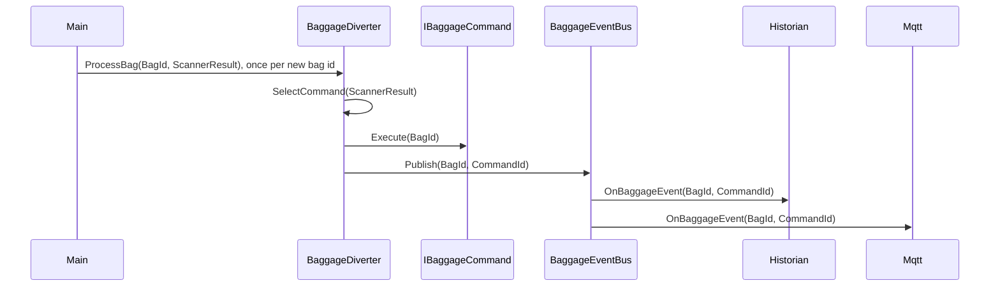

# Airport Baggage Diverter: Command and Observer

A barcode scanner reads each bag and the controller actuates one of three solenoids: divert left,
divert right or reject. Run the classic version and the OOP version of the diverter and read how
the OOP version separates picking a decision from telling everyone that it happened. You learn the
Command and Observer patterns in Structured Text, and when the classic `IF` is the better answer.

## What you learn

- Command: each decision is a function block of its own behind one interface, `IBaggageCommand`,
  so the code that picks a decision returns an object and the code that carries it out calls its
  `Execute`, whichever decision it is.
- Observer: a bus calls every subscriber that it holds, `IBaggageEventSubscriber`, when a decision
  is made, so an audit consumer is a subscriber and not a branch of the decision.
- The classic version is shorter and right while one diverter has a few lanes and few consumers;
  the OOP version earns its larger size when decisions or consumers multiply.

## What you need

- This repository: both projects name the OSCAT library by its path in it, `libraries/oscat` and
  `libraries/oscat/oop`. And `trust-dev`, from the truST extension for VS Code or a release archive,
  on the `PATH`.
- About 15 minutes.

## Step by step

1. From the root of the repository, run the classic project's test:

    ```bash
    trust-dev test --project examples/OSCAT/airport_baggage_command_observer/non-oop
    ```

    ```text
    Running 1 ST test(s) in examples/OSCAT/airport_baggage_command_observer/non-oop
    PASS [1/1] TEST_PROGRAM::ClassicBaggageBranchesOnScannerResult (src/Tests.st) [0ms]
    1 passed, 0 failed, 0 errors (5569ms)
    ```

2. Read the classic diverter, `ClassicBaggageDiverter` in `non-oop/src/Main.st`. Its `ProcessBag`
   picks the command with an `IF` on the scanner's result, 1 for left, 2 for right and anything else
   for reject, counts the event and returns the command's id:

    ```st
    IF ScannerResult = INT#1 THEN
        LastCommandIdValue := INT#1;
    ELSIF ScannerResult = INT#2 THEN
        LastCommandIdValue := INT#2;
    ELSE
        LastCommandIdValue := INT#3;
    END_IF;
    EventCountValue := EventCountValue + INT#1;
    ```

3. Run the OOP project's tests:

    ```bash
    trust-dev test --project examples/OSCAT/airport_baggage_command_observer/oop
    ```

    ```text
    Running 3 ST test(s) in examples/OSCAT/airport_baggage_command_observer/oop
    PASS [1/3] TEST_PROGRAM::BaggageCommandExecutesScannerDecision (src/Tests.st) [0ms]
    PASS [2/3] TEST_PROGRAM::BaggageObserverPublishesAuditEvent (src/Tests.st) [0ms]
    PASS [3/3] TEST_PROGRAM::BaggageDiverterAccumulatesEventsAcrossScans (src/Tests.st) [0ms]
    3 passed, 0 failed, 0 errors (6221ms)
    ```

4. Read the keystone of the OOP version, `BaggageDiverter` in `oop/src/Main.st`. `SelectCommand`
   only picks, and `ProcessBag` carries out what it picked and publishes it:

    ```st
    IF ScannerResult = INT#1 THEN
        SelectCommand := Left;
    ELSIF ScannerResult = INT#2 THEN
        SelectCommand := Right;
    ELSE
        SelectCommand := Reject;
    END_IF;
    ```

    ```st
    CurrentCommand := SelectCommand(ScannerResult := ScannerResult);
    IF CurrentCommand.Execute(BagId := BagId) THEN
        LastBagIdValue := BagId;
        LastCommandIdValue := CurrentCommand.CommandId;
        Bus.Publish(BagId := BagId, CommandId := LastCommandIdValue);
    END_IF;
    ```

    `Left`, `Right` and `Reject` are instances of `DivertLeftCommand`, `DivertRightCommand` and
    `RejectBagCommand`; `CurrentCommand` holds the chosen one as an `IBaggageCommand`, and `Bus`
    calls the historian and the MQTT subscriber in turn.

5. Read `Main` at the end of `oop/src/Main.st`. It wires the diverter once, decides a bag when the
   scanner reports a new bag id, and sets the solenoid outputs from the last decision:

    ```st
    IF (BagIdRaw <> INT#0) AND (BagIdRaw <> Diverter.LastBagId) THEN
        Diverter.ProcessBag(BagId := BagIdRaw, ScannerResult := ScannerResultRaw);
    END_IF;
    LeftOut := Diverter.LastCommandId = INT#1;
    RightOut := Diverter.LastCommandId = INT#2;
    RejectOut := Diverter.LastCommandId = INT#3;
    ```

## What happened

**Picking and carrying out.** In the classic version one `IF` both decides and records. In the OOP
version `SelectCommand` returns one of three command objects, and `ProcessBag` calls `Execute` and
reads `CommandId` through the interface, without knowing which object it has. A new lane is a new
command function block and one more branch in `SelectCommand`: `ProcessBag`, the bus and the
subscribers stay as they are.

**Telling everyone.** `BaggageEventBus` holds the two subscribers that `Initialize` gives it and
calls `OnBaggageEvent` on each when `ProcessBag` publishes. The historian counts the events
(`EventCount`), and the MQTT subscriber marks a message ready to send (`MqttPublishReady`). The
tests check both after a bag, and `BaggageDiverterAccumulatesEventsAcrossScans` checks that three
bags give three events and that the last decision wins.

**Where the classic version strains.** It is fine while it only picks a lane. When the auditors ask
for an event log, the SCADA for MQTT events and the historian for a record with the bag's id, each
consumer adds lines to every branch of the `IF`, and no decision is stored anywhere to replay. The
OOP version keeps each consumer in its own subscriber.

**One decision per bag.** `Main` processes a bag when its id changes, so each bag gives one
decision and one audit event, not one in every 50 ms scan. The commands write no outputs: `Main`
maps `LastCommandId` to `LeftOut`, `RightOut` and `RejectOut` in one place.



## Try it yourself

- Map the scanner's results differently: in `oop/src/Main.st`, change
  `IF ScannerResult = INT#1 THEN` to `IF ScannerResult = INT#2 THEN` and run the OOP tests again:

    ```bash
    trust-dev test --project examples/OSCAT/airport_baggage_command_observer/oop
    ```

    ```text
    FAIL [1/3] TEST_PROGRAM::BaggageCommandExecutesScannerDecision src/Tests.st:6 [0ms]
        reason   : ASSERT_EQUAL failed: expected 2, actual 1
    PASS [2/3] TEST_PROGRAM::BaggageObserverPublishesAuditEvent (src/Tests.st) [0ms]
    FAIL [3/3] TEST_PROGRAM::BaggageDiverterAccumulatesEventsAcrossScans src/Tests.st:35 [0ms]
        reason   : ASSERT_EQUAL failed: expected 1, actual 3
    1 passed, 2 failed, 0 errors (6269ms)
    ```

    A result of 2 now picks the left command, 1, and a result of 1 falls through to reject, 3: the
    tests pin which command each result selects. Change it back afterwards.
- Add a fourth lane: a function block that implements `IBaggageCommand` with its own `CommandId`,
  an instance of it in `BaggageDiverter`, and one more branch in `SelectCommand`.
- Add a third audit consumer: `BaggageEventBus` has two named slots, so a third subscriber needs a
  change of the bus itself. That is the limit of this example's bus.

## Reference

- Patterns used: [Command](../../../docs/guides/oop-concepts-in-st.md#command) and
  [Observer](../../../docs/guides/oop-concepts-in-st.md#observer), with
  [interfaces](../../../docs/guides/oop-concepts-in-st.md#interface) and
  [IMPLEMENTS](../../../docs/guides/oop-concepts-in-st.md#implements),
  [polymorphism](../../../docs/guides/oop-concepts-in-st.md#polymorphism) and
  [composition](../../../docs/guides/oop-concepts-in-st.md#composition).
- What the example leaves out:
    - decision replay, which needs the decisions stored as data and a loop that executes them
      again; `../chemical_dosing_command` keeps an audit log of executed command ids, but no example
      executes stored commands again;
    - subscribers that come and go at run time: the bus has two fixed slots;
    - command parameters: each `Execute` takes only the bag's id.
- When not to use this:
    - one diverter with three lanes that never grows: use `non-oop/`;
    - a single audit consumer that will not multiply;
    - no need to replay or queue decisions: Command pays off fully only when decisions are data.
- Files: `non-oop/src/Main.st` and `non-oop/src/Tests.st`, the classic project;
  `oop/src/Main.st`, the interfaces, the commands, the subscribers, the bus, the diverter and
  `Main`, and `oop/src/Tests.st`, the OOP project. The OOP project's `io.toml` declares a Modbus TCP
  device (unit 190 at `127.0.0.1:1514`) and an MQTT broker at `127.0.0.1:1883`, and its
  `runtime.toml` an OPC UA server.

### Integration map

| Tag | Address | Direction |
| --- | --- | --- |
| `Diverter.BagIdRaw` | `%IW0` | IN |
| `Diverter.ScannerResultRaw` | `%IW2` | IN |
| `Diverter.LeftOut` | `%QX0.0` | OUT |
| `Diverter.RightOut` | `%QX0.1` | OUT |
| `Diverter.RejectOut` | `%QX0.2` | OUT |
