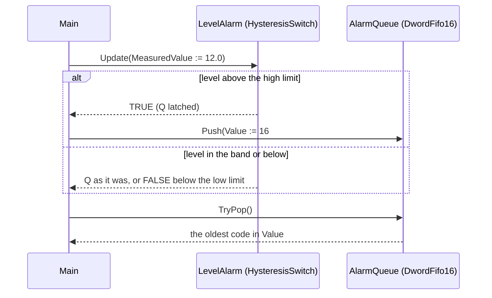

# Boiler Feedwater Alarm: A Hysteresis Switch and an Alarm Queue

Raise a boiler drum's high-level alarm with a hysteresis switch and hand its code to an alarm queue,
first in classic Structured Text with OSCAT's function blocks, then with the OSCAT OOP library's
`HysteresisSwitch` and `DwordFifo16`. You learn what a hysteresis band does, how a queue decouples
the scan that raises an alarm from the one that reads it, and how two library objects compose
without a function block of your own.

## What you learn

- A hysteresis switch trips above its high limit and clears only below its low limit, so a level
  that wobbles inside the band does not toggle the alarm.
- A first-in, first-out queue keeps the alarm codes that one scan pushes until another scan pops
  them, in the order they came.
- The OOP version composes two library objects and adds no function block: its design is the order
  in which `Main` calls them.

## What you need

- This repository: both projects name the OSCAT library by its path in it,
  `libraries/oscat` and `libraries/oscat/oop`. And `trust-dev`, from the truST extension for VS Code
  or a release archive, on the `PATH`.
- About 10 minutes.

## Step by step

1. From the root of the repository, run the classic project's test:

    ```bash
    trust-dev test --project examples/OSCAT/boiler_feedwater_alarm/non-oop
    ```

    ```text
    Running 1 ST test(s) in examples/OSCAT/boiler_feedwater_alarm/non-oop
    PASS [1/1] TEST_PROGRAM::BoilerFeedwaterAlarmClassicQueuesAlarmCode (src/Tests.st) [0ms]
    1 passed, 0 failed, 0 errors (4705ms)
    ```

2. Read the classic program, `non-oop/src/Main.st`. It calls OSCAT's `HYST` and `FIFO_16` every
   scan:

    ```st
    LevelAlarm(In := FeedwaterLevelPercent, HIGH_LIMIT := REAL#10.0, LOW_LIMIT := REAL#3.0);
    AlarmQueue(DIN := DWORD#16#B001, E := TRUE, RD := FALSE, WD := LevelAlarm.Q, RST := FALSE);
    AlarmQueue(DIN := DWORD#0, E := TRUE, RD := TRUE, WD := FALSE, RST := FALSE);
    AlarmCode := AlarmQueue.DOUT;
    ```

    The level is 12 %, above the high limit of 10 %, so `LevelAlarm.Q` is TRUE. The first call of
    the queue writes the code `16#B001` while `Q` is TRUE, and the second reads it into
    `AlarmCode`. The test runs the same calls and checks `Q` and the code.

3. Run the OOP project's tests:

    ```bash
    trust-dev test --project examples/OSCAT/boiler_feedwater_alarm/oop
    ```

    ```text
    Running 6 ST test(s) in examples/OSCAT/boiler_feedwater_alarm/oop
    PASS [1/6] TEST_PROGRAM::BoilerFeedwaterAlarmOopQueueAlarmCode (src/Tests.st) [0ms]
    PASS [2/6] TEST_PROGRAM::BoilerFeedwaterAlarmRespondsToLevelTransitions (src/Tests.st) [0ms]
    PASS [3/6] TEST_PROGRAM::BoilerFeedwaterAlarmBoundaryConditions (src/Tests.st) [0ms]
    PASS [4/6] TEST_PROGRAM::BoilerFeedwaterAlarmQueueIsFifo (src/Tests.st) [0ms]
    PASS [5/6] TEST_PROGRAM::BoilerFeedwaterAlarmQueueResetClears (src/Tests.st) [0ms]
    PASS [6/6] TEST_PROGRAM::BoilerFeedwaterAlarmTwoSwitchesAreIndependent (src/Tests.st) [0ms]
    6 passed, 0 failed, 0 errors (7251ms)
    ```

4. Read the OOP program, `oop/src/Main.st`. It sets the switch's limits and the queue up once, in
   the first scan, and then calls them every scan:

    ```st
    IF LevelAlarm.Update(MeasuredValue := FeedwaterLevelPercent) THEN
        IF AlarmQueue.Push(Value := DWORD#16#B001) THEN
        END_IF;
    END_IF;
    IF AlarmQueue.TryPop() THEN
        AlarmCode := AlarmQueue.Value;
    END_IF;
    ```

    `Update` returns the switch's latched `Q`, `Push` puts a code at the end of the queue and
    answers whether it fitted, and `TryPop` takes the oldest code into `Value` and answers whether
    there was one.

5. Read the test `BoilerFeedwaterAlarmRespondsToLevelTransitions` in `oop/src/Tests.st`. It moves
   one switch through 12.0, 7.0, 1.0 and 12.0 again: the first value trips it, 7.0 lies in the band
   and keeps it tripped (`Window` TRUE), 1.0 clears it, and 12.0 trips it again, which pushes a
   second code onto the queue.

## What happened

**The hysteresis band.** Between the low limit, 3 %, and the high limit, 10 %, the switch keeps
what it was: `Q` changes only when the level leaves the band, upwards to TRUE and downwards to
FALSE. `BoilerFeedwaterAlarmBoundaryConditions` shows that the limits themselves are inside the
band: 10.0 does not trip the switch, 10.001 does, and only a value below 3.0 clears it.

**The queue between two scans.** The program that raises an alarm and the reader of the alarm
code need not run in the same scan: the queue keeps up to 16 codes, `BoilerFeedwaterAlarmQueueIsFifo`
shows that they come out in the order they went in, and `Reset` empties it. That is why the OOP
program resets the queue only in its first scan: a reset in every scan would throw away the codes
that the reader has not taken yet.

**Composition.** The OOP project defines no function block. `Main` owns a `HysteresisSwitch`, a
`DwordFifo16` and the `RealRange` of the limits, and composes them by calling one after the other.
A second drum takes a second switch, as `BoilerFeedwaterAlarmTwoSwitchesAreIndependent` shows: each
switch keeps its own `Q`. The classic project does the same with OSCAT's `HYST` and `FIFO_16`, whose
inputs it sets in each call.



## Try it yourself

- Keep the level below the trip point: in `non-oop/src/Tests.st`, change `In := REAL#12.0` to
  `In := REAL#9.0` and run the classic test again:

    ```bash
    trust-dev test --project examples/OSCAT/boiler_feedwater_alarm/non-oop
    ```

    ```text
    FAIL [1/1] TEST_PROGRAM::BoilerFeedwaterAlarmClassicQueuesAlarmCode src/Tests.st:12 [0ms]
        reason   : ASSERT_TRUE expected TRUE, got FALSE
        source   : ASSERT_TRUE(IN := LevelAlarm.Q);
    0 passed, 1 failed, 0 errors (4938ms)
    ```

    A level of 9 % lies in the band of a switch that never tripped, so `Q` stays FALSE and the
    queue gets no code. Change it back afterwards.
- Add a low-level alarm for the same drum: a second `HysteresisSwitch` whose `Update` you invert,
  with a code of its own, `16#B002`, pushed onto the same queue.
- Watch the queue fill: push more than 16 codes without popping one and see what `Push` answers.

## Reference

- Patterns used: [composition](../../../docs/guides/oop-concepts-in-st.md#composition).
- When not to use this:
    - one drum with one threshold, where a single `IF` is shorter than two objects;
    - an alarm consumer that the controller drives directly, where the queue buys nothing;
    - a plant whose own alarm library you must use, where `DwordFifo16` duplicates its plumbing.
- What the showcase leaves out: the low-level trip, a second drum, acknowledgement and a
  historian; the level is a constant, so the tests exercise the band and the queue without a
  plant. For composition in a whole plant, see `../boiler_room_heating_plant` (an alarm bus with
  alarm classes) and `../cold_storage_plant` (a tree of rooms).
- Files: `non-oop/src/Main.st` and `non-oop/src/Tests.st`, the classic project;
  `oop/src/Main.st` and `oop/src/Tests.st`, the OOP project; each has `src/Configuration.st` and
  `trust-lsp.toml`.
