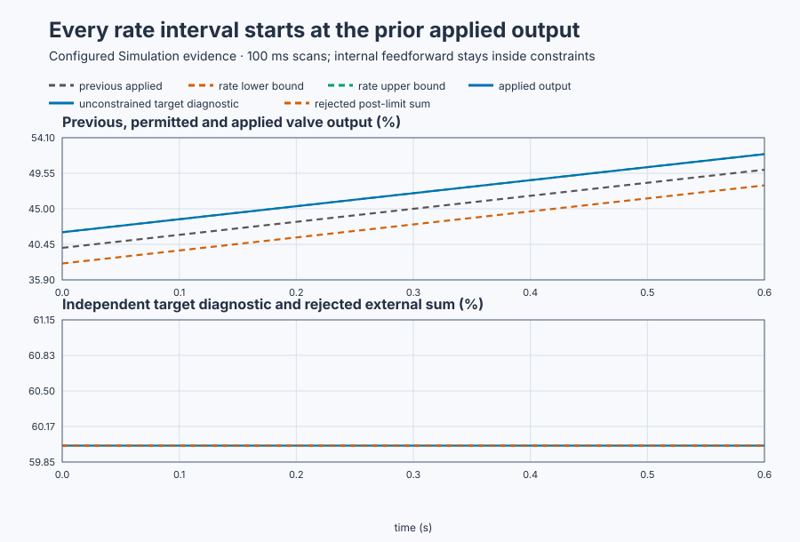

# Atomic PID updates and signal ordering on a booster pump

Course position: Lesson 29 of 84. Previous lesson: [Bumpless authority
transfer](../28-booster-pump-bumpless-transfer/README.md). Next lesson: Invalid
data and [safe behavior](../30-booster-pump-invalid-data/README.md).

**Lesson objective:** Apply a complete PID configuration as one revision and
distinguish the valid internal feedforward path from an invalid post-limit sum.

This lesson uses simulation. Its results are not physical-plant evidence.

**Equipment:** Variable-speed booster pump with recirculation valve.

## Where this lesson begins

Lesson 28 aligned state when valve authority changed. Alignment can still be
destroyed inside one scan if that scan sees half of one tuning record and half
of another. An online booster pump maintains discharge pressure by moving a recirculation
valve. An engineer may prepare new tuning while the old tuning is running. A
measured disturbance may also supply an additional valve contribution.

The valve accepts 0–100 percent and can move at only a declared rate. Pressure
is measured in bar. The controller must never expose a partly updated tuning or
let any contribution bypass the valve constraints.

Every scan must use one complete parameter revision and one constraint-aware
path for every contribution. A half-applied configuration or a feedforward sum
added after limits must be impossible.

## Coherent state and calculation order

The **candidate configuration** is the complete proposed set of PID parameters.
The **active configuration** is the complete record the controller uses for the
current scan. A **configuration revision** identifies one whole active record.
A **coherent snapshot** contains either the complete old configuration or the
complete new configuration, never a mixture. A **scan boundary** separates one
controller update from the next.

The **feedback contribution ($\Delta MV_{\mathrm{feedback}}$)** is the output change caused
by setpoint and pressure differences, measured in percentage points. The
**feedforward contribution ($\Delta MV_{\mathrm{feedforward}}$)** is an output change derived
from a measured disturbance, also in percentage points. Lesson 53 teaches how
to design it; here its known value exposes ordering.

The **nominal requested output ($MV_{\mathrm{requested}}$)** is the controller result before
constraints. It is private controller state. The lesson therefore publishes an
**unconstrained target diagnostic**: an independent calculation of the raw
PI/feedforward target before anti-windup and limits. It is evidence only and
cannot command the plant. The **applied output ($MV_{\mathrm{applied}}$)** is the valve
command after anti-windup, amplitude limits, and rate limits. The **previous
applied output ($MV_{\mathrm{previous\,applied}}$)** anchors the next allowed rate interval.

An atomic update performs one record assignment and one `Configure` call before
the next update. The order inside the authoritative path is:

1. Read one coherent parameter snapshot.
2. Calculate feedback and feedforward contributions.
3. Apply anti-windup and output constraints.
4. Retain and publish the applied output.

Feedforward enters `PIDInput.FeedForward` before anti-windup and limits. Adding
it after `Control.PID` returns would bypass both the constraints and the state
used by the next scan.

## Deriving the two predictions

The previous applied valve output is 40 percent. The old proportional gain is
5 percent per bar and the old integral gain is 1 percent per bar-second. The
candidate values are 15 and 3. The sample interval is 0.1 seconds.

For a 1 bar setpoint increase with unchanged pressure,
\(\Delta e=1-0=1\) bar. The incremental proportional contribution is

\[
\Delta MV_P=K_p\Delta e=(15\ \%/\mathrm{bar})(1\ \mathrm{bar})=15\%.
\]

The new error is also 1 bar, so the integral contribution is

\[
\Delta MV_I=K_i\Delta t\,e
=(3\ \%/(\mathrm{bar\,s}))(0.1\ \mathrm{s})(1\ \mathrm{bar})=0.3\%.
\]

The coherent increment is \(15+0.3=15.3\) points, so the output moves from
40% to 55.3%. A mixed scan using new \(K_p=15\) but old \(K_i=1\) would instead
calculate \(15+1(0.1)(1)=15.1\) and 55.1%. That number belongs to neither
complete revision.

For the ordering case, start at zero error and 40% applied output. The
controller's unconstrained feedforward target is \(40+20=60\%\). The permitted
rate movement is

\[
\Delta MV_{\max}=r_{\max}\Delta t=(20\%/\mathrm{s})(0.1\ \mathrm{s})=2\%.
\]

Therefore the current allowed interval is

\[
[MV_{\mathrm{previous}}-2,\ MV_{\mathrm{previous}}+2]=[38,42]\%.
\]

The controller must return 42%. Adding feedforward after a returned 40% would
produce 60%, outside that interval and invisible to anti-windup state.

## Implementation

The production path uses one `Control.PID`. Candidate fields become one active
record before the controller is configured:

```st
ActiveParameters := CandidateParameters;
Controller.Configure(Parameters := ActiveParameters);

Input.FeedForward := FeedForward;
ValveCommand := Controller.Update(Input := Input);
```

`RejectedExternalSum` and the mixed sequential update are calculation-only
simulation diagnostics. Neither can drive the plant.

## Experiment in Control Studio

Control Studio executes the two valid operations in a project-owned sequence.
Test writes one reviewed Boolean authority,
\(\mathtt{P1.ExperimentEnabled}\), for 10.1 seconds. The project initializes at
6 bar and 40%, atomically applies the complete new record with the 1 bar
setpoint step, then reinitializes the aligned 40% state and sends 20%
feedforward through the PID under the 20%/s rate limit. Returning authority
false selects the station's safe 30% output.

Fresh native states own the mixed-revision and rejected external-sum
diagnostics. They never drive the UI plant. The deterministic Simulation seed
is 20260829.

### Control Studio actions

1. **Monitor** — Start the **Simulator**, then open **truST sidebar → Control Studio → Monitor → Response**.
   - **Baseline check:** Wait for **Simulation**, **Running**, current samples, and good quality. Confirm SP/PV = 6 bar, station safe output = 30%, feedforward = 0, controller not ready, active revision 0, and experiment authority false. Add candidate and active parameters, revision, configured-this-scan, mixed diagnostic, feedforward, unconstrained target, rate bounds, applied output, limit flags, and authority to **Signals**.
   - **Decision before action:** Write the coherent 55.3%, mixed 55.1%, constrained 42%, and rejected 60% predictions. Confirm only the coherent and constraint-aware paths may drive the valve.
   - **Successful evidence:** The plot advances, values are finite/current, quality is good, and **Start recording** is enabled. Select **Start recording**.
   - **Recovery:** For stale, unavailable, nonfinite, or poor-quality data, stop the Simulator, correct the displayed fault, restart, and repeat the baseline check.
   - **Record:** Note the initial record, revision, applied output, rate interval, and four predictions.

2. **Test** — Open **truST sidebar → Control Studio → Test**.
   - **Baseline check:** Confirm **Experiment** = **Observe without excitation**, **Amplitude** = **0** (disabled), and **Maximum duration (s)** = **10.1**. The reviewed authority is \(\mathtt{P1.ExperimentEnabled}\); the project owns initialization, apply pulse, SP, feedforward, and restoration.
   - **Decision before action:** Confirm the plan writes only that Boolean and restores it false. Require pressure within 0–12 bar and applied output within 0–100%. No mixed configuration or post-limit sum may enter the plant path.
   - **Successful evidence:** Select **Review test**, verify authority, timeout, stop conditions, and false restoration, then **Confirm and start**. Keep **Abort test** available. Observe one complete revision change and 55.3% result, then the reinitialized feedforward case with a 60% target and 42% constrained output, followed by safe restoration.
   - **Recovery:** Abort for nonfinite/out-of-range data, a mixed active record, or output outside the displayed rate interval. Confirm authority false and safe 30% output before retrying.
   - **Record:** Retain terminal state, restoration, scan/revision/parameter snapshot, applied output before/after, feedforward, unconstrained target, rate bounds, limit flags, and seed.

There is no separate disabled Validate stage. The native test owns rejected
diagnostics; Monitor and Test expose only the production paths.

## Evidence and decision

### Measures and comparison

**Configuration coherence** is true only when all active fields match either
the complete old revision or the complete new revision at every update.

The **first-update increment** is
\(\Delta MV_1=MV_{\mathrm{after}}-MV_{\mathrm{before}}\), in percentage
points. It preserves direction; use its absolute value only when the
requirement concerns size rather than opening versus closing.

The **external-sum limit violation** is
\(v_{\mathrm{external}}=\max(MV_{\mathrm{rejected}}-MV_{\mathrm{allowed,max}},0)\).
The maximum with zero means a value inside the limit has no violation; here it
is \(60-42=18\) percentage points.

The **applied-output rate** is
\(r_k=(MV_k-MV_{k-1})/\Delta t_k\). Division by measured elapsed time converts
each output change to percent per second. Opening rate must not exceed the
positive limit and closing rate must not be more negative than the negative
limit.

| Case | Active gains | First/applied output | Engineering state |
| --- | --- | ---: | --- |
| Atomic revision | $K_p$ 15, $K_i$ 3 | 55.300% | Coherent revision 1 |
| Mixed diagnostic | $K_p$ 15, $K_i$ 1 | 55.100% | Invalid mixed record |
| Internal feedforward | $K_p$ 5, $K_i$ 1 | 42.000% | Rate limited correctly |
| Rejected external sum | Not a controller path | 60.000% | Bypasses limit |

The independent unconstrained target diagnostic remains 60.000 percent during
six consecutive rate intervals. Each interval lasts 0.1 seconds and starts from
the previous applied output. Its lower and upper bounds are calculated from that
applied value, not from the unconstrained target. The applied sequence advances
from 42.000 to 52.000 percent without leaving those bounds, and the rate-limited
state remains true on all six scans.



[Retained run](figures/atomic-update-run.csv) ·
[Plot data](figures/atomic-update-trace.csv) ·
[Decision summary](figures/atomic-update-summary.csv)

### Validation

Accept the production update only when every controller scan sees a complete
old or complete new record. The mixed case must be labelled invalid, not
treated as another tuning result. Require the internal feedforward path to
return 42.000 percent on its first scan and remain within 20 percent per second
for all six consecutive scans. Each rate interval must use the previous applied
output as its starting point. The 60.000 percent external sum must remain
disconnected from the plant.

## Conclusion

The equations are not the entire controller. The scan that chooses parameters
and the point where contributions enter are part of its behavior. A mixed
record creates a controller that nobody selected. A post-limit sum creates a
command that anti-windup and rate limiting never observed.

One atomic record and one constraint-aware output path keep the calculation,
retained state, and physical valve command consistent.

## Reason for the next lesson

Use this pattern for online tuning, gain scheduling, selector stations, and
multiloop structures. Atomicity does not prove that values are finite, fresh,
safe, or timely. Lesson 30 addresses invalid data and deterministic recovery.
