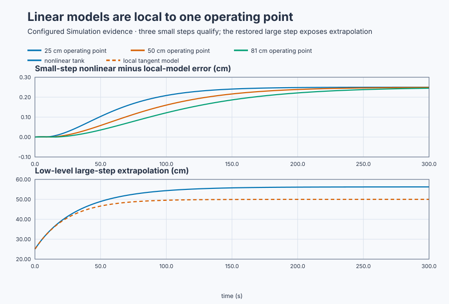

# Linearize a gravity-drained tank

Course position: Lesson 34 of 84. Previous lesson: [Conservation-law
models](../33-tank-heater-conservation/README.md). Next lesson:
[poles, zeros, and real plant classes](../35-pole-zero-plant-classes/README.md).

**Lesson objective:** Derive a first-order transfer function for a
gravity-drained tank at three operating points and use executable error evidence
to decide where each local model is valid.

This open-loop workshop is simulation evidence, not physical-plant evidence.

## The problem

**Equipment:** Gravity-drained water tank with variable-speed inlet pump.

A variable-speed pump supplies a vertical tank. Liquid leaves through a fixed
outlet under gravity. We measure tank level in centimetres, perform the physical
balance in metres, and command inlet flow in cubic metres per second.

The tank area is constant, the liquid properties do not change, and the outlet
coefficient is fixed. There is no overflow, sensor dynamic, pump dynamic,
disturbance, or controller in this lesson.

Lesson 33 prescribed inlet and outlet flow independently, giving a constant-gain
integrator. Here, gravity makes outlet flow depend on level. The same inlet-flow
change produces a different equilibrium and response speed at low and high
level. One linear model cannot therefore be assumed valid across the tank.

## From the nonlinear balance to a local model

Tank-volume accumulation equals inlet flow minus gravity outlet flow. Define
tank area ($A$) in square metres, level ($h$) in metres, inlet flow ($q$) in
cubic metres per second, and outlet coefficient ($c$) in
$\mathrm{m^2\sqrt{m}/s}$. The physical balance is

\[
A\frac{dh}{dt}=q-c\sqrt h.
\]

The left side is stored-volume change: area times level rate has units
$\mathrm{m^3/s}$. The two terms on the right are inlet and outlet volume flow
in the same unit. The units of $c$ make $c\sqrt h$ a volume flow. The square
root makes the relation **nonlinear**: doubling level does not double outlet
flow.

An **operating point** is a constant inlet flow ($q_0$) and level ($h_0$) at
which accumulation is zero. Setting the derivative to zero gives

\[
0=q_0-c\sqrt{h_0},\qquad q_0=c\sqrt{h_0}.
\]

Define deviations from that equilibrium by $\Delta h=h-h_0$ and
$\Delta q=q-q_0$. A **first-order Taylor approximation** replaces the curved
outlet relation with its tangent. Since the derivative of $c\sqrt h$ is
$c/(2\sqrt h)$, near $h_0$

\[
c\sqrt h\approx c\sqrt{h_0}
 +\frac{c}{2\sqrt{h_0}}\Delta h.
\]

Substitute $h=h_0+\Delta h$ and $q=q_0+\Delta q$ into the physical balance.
The equilibrium terms cancel because $q_0=c\sqrt{h_0}$:

\[
\frac{d\Delta h}{dt}
=-\frac{c}{2A\sqrt{h_0}}\Delta h+\frac{1}{A}\Delta q.
\]

The approximation is local because its tangent slope was evaluated at one
$h_0$. Terms involving $(\Delta h)^2$ and higher powers were discarded, so
error grows as the level moves farther from that point.

The **Laplace transform**, with zero initial deviation, turns the time
derivative into multiplication by the complex-frequency variable $s$:

\[
\left(As+\frac{c}{2\sqrt{h_0}}\right)\Delta H(s)=\Delta Q(s).
\]

Divide output by input, then divide numerator and denominator by
$c/(2\sqrt{h_0})$:

\[
\frac{\Delta H(s)}{\Delta Q(s)}
=\frac{2\sqrt{h_0}/c}{(2A\sqrt{h_0}/c)s+1}
=\frac{K}{\tau s+1}.
\]

The static gain $K$ is final output deviation divided by a constant input
deviation. The time constant $\tau$ sets the local exponential response speed.
Comparing the two denominator forms derives

\[
K=\frac{2\sqrt{h_0}}{c},\qquad
\tau=\frac{2A\sqrt{h_0}}{c}.
\]

Model **order** counts independent dynamic modes. A **pole** locates such a
mode, a **zero** shapes how the input appears at the output, and **dead time**
postpones the response. This first-order model has one pole at $-1/\tau$, no
finite zero, and no dead time. We do not invent an FOPDT delay merely because
that model form is familiar.

## Calculate the predictions before running

Use $A=0.5\ \mathrm{m^2}$ and
$c=0.02\ \mathrm{m^2\sqrt m/s}$. At $h_0=0.25$ m, for example,

\[
q_0=0.02\sqrt{0.25}=0.010000\ \mathrm{m^3/s},
\]

\[
K=\frac{2\sqrt{0.25}}{0.02}=50.000\
\frac{\mathrm m}{\mathrm{m^3/s}},\qquad
\tau=\frac{2(0.5)\sqrt{0.25}}{0.02}=25.000\ \mathrm s.
\]

The same substitutions at all three operating points give:

| $h_0$ (m) | $q_0$ (m³/s) | $K$ (m/(m³/s)) | $\tau$ (s) | pole $-1/\tau$ (1/s) |
|---:|---:|---:|---:|---:|
| 0.25 | 0.010000 | 50.000 | 25.000 | -0.040000 |
| 0.50 | 0.014142 | 70.711 | 35.355 | -0.028284 |
| 0.81 | 0.018000 | 90.000 | 45.000 | -0.022222 |

For a constant small change $\Delta q=0.001\ \mathrm{m^3/s}$, the local
steady change is $\Delta h=K\Delta q$. The predicted rises are therefore
0.05000, 0.07071, and 0.09000 m, or **5.000, 7.071, and 9.000 cm**.

The exact nonlinear equilibrium follows by solving
$q_0+\Delta q=c\sqrt{h_\mathrm{eq}}$:

\[
h_\mathrm{eq}=\left(\frac{q_0+\Delta q}{c}\right)^2.
\]

It predicts rises of 5.250, about 7.321, and 9.250 cm. Thus each small-step
tangent prediction is about 0.250 cm low. At the low operating point, a larger
$0.005\ \mathrm{m^3/s}$ step gives a local rise of $50(0.005)=0.25$ m, while
the nonlinear equation gives
$((0.010+0.005)/0.02)^2-0.25=0.3125$ m. The 6.25 cm error shows why the
discarded curvature matters away from the operating point.

## Implementation

There is no controller under test. The actual Structured Text derives each
tangent model and advances it at the 100 ms sample interval:

```st
LowEquilibriumFlow := OutletCoefficient * SQRT(LowOperatingLevelMetres);
LowGain := LREAL#2.0 * SQRT(LowOperatingLevelMetres) / OutletCoefficient;
LowTimeConstant :=
    LREAL#2.0 * TankAreaSquareMetres * SQRT(LowOperatingLevelMetres)
    / OutletCoefficient;
LowPole := -LREAL#1.0 / LowTimeConstant;
LowLocalDeviationMetres := LowLocalDeviationMetres
    + SampleTimeSeconds
    * ((-LowLocalDeviationMetres + LowGain * FlowDeviation) / LowTimeConstant);
```

Three simulator plants independently execute the nonlinear gravity balance
from the same physical parameters and operating points.

## Experiment in Control Studio

Control Studio exposes the common small-step case. Test writes one reviewed
Boolean, `P1.ExperimentEnabled`, for 300.1 seconds. While it is true, the
project applies $\Delta q=0.001\ \mathrm{m^3/s}$ to all three tanks and local
models. When it becomes false, the project restores $\Delta q=0$. A fresh
native run owns the separate $0.005\ \mathrm{m^3/s}$ low-level boundary case,
because it needs a fresh equilibrium and a different excitation. The
deterministic Simulation seed is 20260829.

### Control Studio actions

1. **Monitor** — Start the **Simulator**, then open **truST sidebar → Control Studio → Monitor → Response**.
   - **Baseline check:** Wait until the header shows **Simulation**, **Running**, and current data. Confirm Low-tank level (PV, m) and Middle-tank level (PV, m); Low-tank inlet flow (MV, m3/s) and Middle-tank inlet flow (MV, m3/s), including units, limits, mode, and quality. The initial operating point is Inlet-flow deviation = 0 m3/s, Low-tank inlet flow = 0.01 m3/s, Low-tank level = 0.25 m, Middle-tank inlet flow = 0.0141421356 m3/s, Middle-tank level = 0.5 m, High-tank inlet flow = 0.018 m3/s, High-tank level = 0.81 m. The unresolved baseline problem is: A tangent model derived at low level cannot represent the nonlinear tank over its complete operating range.
   - **Decision before action:** Read **Prediction** above, then state what should move first and in which direction. Use this decision rule: Use a local model only with its operating point, declared range, and validated error evidence.
   - **Successful evidence:** The Response plot advances, the displayed values are finite and current, and **Start recording** is enabled. Select **Start recording** only after those conditions are visible.
   - **Recovery:** If recording is disabled or the plot reports unavailable or stale samples, stop the Simulator, correct the displayed runtime or binding problem, restart it, and repeat the baseline check.
   - **Record:** Write down the initial SP, PV, requested/applied MV where available, controller mode, and your predicted response before opening Test.

2. **Test** — Open **truST sidebar → Control Studio → Test**.
   - **Baseline check:** Confirm **Experiment** = **Observe without excitation**, **Amplitude** = **0** (disabled), and **Maximum duration (s)** = **300.1**. The only writable signal is `P1.ExperimentEnabled`; it starts false and must restore false.
   - **Decision before action:** Before selecting **Review test**, predict all three final changes and confirm the project-owned commands keep Low-tank level inside 0–1 m, Middle-tank level inside 0–1 m, and High-tank level inside 0–1.2 m. Use the run only to test the local approximations; do not Identify, Tune, or Apply.
   - **Successful evidence:** Select **Review test**, verify the Boolean authority, timeout, false restoration, and stop conditions, then select **Confirm and start**. Keep **Abort test** available. Response must show the same 0.001 m³/s deviation in all three physical and local models, followed by restoration to zero.
   - **Recovery:** Abort for stale, invalid, nonfinite, or out-of-range data. Confirm authority false and flow deviation zero, wait for current data, then review a new test.
   - **Record:** Retain terminal state, restoration, physical and local levels, operating points, parameters, final errors, and seed **20260829**.

There is no separate disabled Validate stage. The native executable evidence
owns the independent arithmetic and large-step boundary case; Monitor and Test
expose the common small-step case.

## Evidence and decision

### Measures and comparison

For operating point $i$, **local-model prediction error** is

\[
e_i(t)=100\left|h_{\mathrm{nonlinear},i}(t)
-h_{\mathrm{local},i}(t)\right|\ \mathrm{cm}.
\]

The factor 100 converts metres to centimetres; the absolute value prevents
positive and negative differences from cancelling. A final error is called an
equilibrium error only after both traces satisfy the declared late-slope
limit. Otherwise it is merely an error at that timestamp.

Before viewing results, declare the `+0.001 m3/s` case valid when final error is
at most **0.30 centimetres** at all three operating points. Label the
`+0.005 m3/s` case outside the small-signal validity case; its expected error is
more than 5 cm.



[Retained run](figures/gravity-tank-linearization-run.csv) ·
[Plot data](figures/gravity-tank-linearization-trace.csv) ·
[Decision summary](figures/gravity-tank-linearization-summary.csv)

### Validation

Independent arithmetic must reproduce every equilibrium flow, gain, time
constant, and pole. The nonlinear tanks must hold their operating points before
the step. The executable results were:

| Case | Absolute nonlinear-versus-local error |
|---|---:|
| Low, small step | 0.250 cm |
| Middle, small step | 0.249 cm |
| High, small step | 0.245 cm |
| Low, large step | 6.241 cm — outside validity |

The measured large-step error was **6.241 centimetres**, outside the declared
small-signal validity case.

The complete small-step transients and qualified equilibria must agree within
the declared limit. The large-step divergence is expected model-boundary
evidence, not a failed solver.

## Conclusion

At higher level, the tangent of the square-root outlet curve gives larger local
gain and a longer time constant. Linearization preserves that nearby tangent,
not the entire curved relationship. The pole describes one local exponential
mode; it does not make the physical tank globally linear.

These three local plant models are **not gain scheduling**. Gain scheduling
would change a controller according to operating region; no controller exists
here.

## Reason for the next lesson

A transfer function is a compact local input-output model derived under stated
assumptions and zero initial deviation. Always retain its operating point,
input and output ranges, and validation evidence. Lesson 35 uses poles and
zeros to predict qualitative behavior across several real plant classes.
