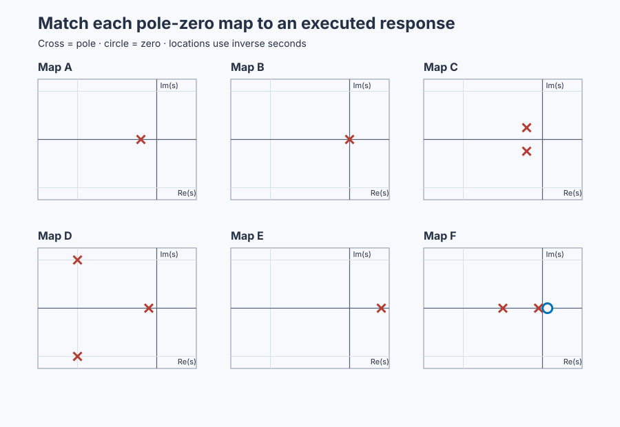

# Predict plant responses from poles and zeros

Course position: Lesson 35 of 84. Previous lesson: [Gravity-tank
linearization](../34-gravity-tank-linearization/README.md). Next lesson:
[state space and interconnected tanks](../36-two-tank-state-space/README.md).

**Lesson objective:** Predict and justify six qualitative open-loop responses
from pole-zero locations and validate each match against executable evidence.

All results are simulation evidence, not physical-plant evidence.

## The problem

**Equipment:** Heated vessel, storage tank, flexible drive, overhead crane,
magnetic bearing, and boiler drum.

The workshop contains a heated vessel, storage tank, flexible motor drive,
overhead crane, magnetic bearing, and boiler drum. One normalized test request
is converted into physical heater command, net flow, torque, force, bearing
force, and feedwater change. Outputs retain temperature, level, position,
displacement, and drum-level units.

The models describe declared local operating regions. There is no feedback
controller or hidden stabilizing loop.

Lesson 34 derived one gravity-tank transfer function. Repeating coefficient-by-
coefficient reasoning for every new plant is slow and can hide general
limitations. Poles and zeros let us predict decay, integration, oscillation,
instability, inverse response, and dominant dynamics before selecting a model
or controller.

## From pole locations to observable motion

A transfer function relates an input deviation to an output deviation when the
initial deviations are zero. A **pole ($p$)** is a value of the complex frequency
variable that makes its denominator zero. A pole represents a plant's natural
mode. A **zero ($z$)** makes the numerator zero and shapes how an input appears at
the measured output.

The **complex plane** has a horizontal real part and vertical imaginary part.
Locations with negative real part occupy the **left half-plane**. Positive real
part is the **right half-plane**. Their intersection is the **origin**.

A negative-real pole produces exponential decay. A pole at the origin produces
integration, so a constant input creates a continuing ramp. A positive-real
pole produces exponential growth. A complex-conjugate pole pair produces
oscillation: its real part sets decay or growth, and its imaginary part sets
oscillation frequency.

The **natural frequency** describes the pair's unforced oscillation rate. The
**damping ratio** describes how rapidly that motion loses energy. **Dominant
poles** are the observable modes that decay most slowly and govern the late
response. A weakly excited or unobserved mode need not dominate merely because
it is close to the origin.

A left-half-plane zero can accelerate or reshape a response. A
right-half-plane zero can make the initial response move opposite the eventual
change. That is **inverse response**. It differs from **dead time**: inverse
response can move immediately in the wrong direction, while dead time produces
no response during its delay.

**Pole-zero cancellation** is physically fragile. An uncertain plant mode
remains internally present even when input-output algebra appears to cancel it.
Never try to cancel an unstable or lightly damped pole with an approximate
controller zero.

## Derive six predictions before revealing the traces

The heater model is $G(s)=1/(5s+1)$. Its pole is the denominator root
$s=-1/5=-0.2\ \mathrm{s^{-1}}$. A unit step has response
$y(t)=1-e^{-t/5}$, so at one time constant,
$y(5)=1-e^{-1}=0.63212$. The negative exponential decays without changing
sign, which predicts a monotonic rise to equilibrium.

The storage tank model is $G(s)=0.2/s$. A unit step has transform $1/s$, so
$Y(s)=0.2/s^2$. The inverse transform is $y(t)=0.2t$: its origin pole retains
a **0.2 cm/s** slope instead of creating a finite equilibrium.

The flexible drive denominator has the standard second-order form
$s^2+2\zeta\omega_n s+\omega_n^2$. Its roots are

\[
p=-\zeta\omega_n\pm j\omega_n\sqrt{1-\zeta^2}.
\]

With $\omega_n=1$ rad/s and $\zeta=0.2$, the roots are
$-0.2\pm j0.9799\ \mathrm{s^{-1}}$. The imaginary part causes oscillation;
the negative real part makes its envelope decay. The standard step overshoot
follows from the first peak of that decaying sinusoid:

\[
M_p=e^{-\pi\zeta/\sqrt{1-\zeta^2}}
=e^{-\pi(0.2)/\sqrt{0.96}}=0.5266.
\]

The predicted peak is therefore $1+M_p=1.527$, with repeated crossings of the
final value.

The overhead-crane denominator factors as
$(s+0.1)((s+1)^2+16)$. It therefore has a slow real pole at $-0.1$ and a
faster pair at $-1\pm j4$. Their envelopes decay as $e^{-0.1t}$ and $e^{-t}$.
The oscillatory pair is prominent early, but after several seconds the
$e^{-t}$ term is much smaller than $e^{-0.1t}$, so the slow pole controls the
tail.

The magnetic-bearing state is $\dot x=0.4x+u$. Its positive pole makes the
homogeneous term $e^{0.4t}$ grow. From $x(0)=0$ under the declared
$u=0.0001$ N input,

\[
x(t)=\frac{u}{0.4}(e^{0.4t}-1).
\]

Solving $x=0.010$ m gives
$t=\ln(1+0.4(0.010)/0.0001)/0.4=\ln(41)/0.4=9.28$ s. The test must abort at
10 mm; this plant is never included in the ordinary 30-second UI run.

The boiler model is

\[
G(s)=\frac{-0.4s+0.025}{(s+0.05)(s+0.5)}.
\]

Its poles are stable, its zero solves $-0.4s+0.025=0$, giving
$s=+0.0625$, and its steady unit-step value is $G(0)=1$. For a step input,
the initial slope is the high-frequency coefficient
$\lim_{s\to\infty}sG(s)=-0.4$, so level moves negative immediately even
though its final change is positive. This is inverse response, not dead time.

## Implementation

There is no controller under test. The actual Structured Text converts one
bounded request into the six physical inputs:

```st
HeaterCommand := LREAL#20.0 * BoundedExperiment;
TankNetFlow := LREAL#1.0 * BoundedExperiment;
DriveTorque := LREAL#1.0 * BoundedExperiment;
CraneForce := LREAL#1.0 * BoundedExperiment;
BoilerFeedwater := LREAL#1.0 * BoundedExperiment;

IF BearingExperimentEnabled THEN
    BearingForce := LREAL#0.0001 * BoundedExperiment;
ELSE
    BearingForce := LREAL#0.0;
END_IF;
```

The six simulator declarations use the same parameters as the pole-zero maps.

## Experiment in Control Studio

Control Studio executes the five bounded plants together. Test writes one
reviewed Boolean, `P1.ExperimentEnabled`, for 30.1 seconds. Authority true makes
the project set its normalized experiment to one; authority false restores it
to zero. The unstable bearing is a separate fresh native run with its own
10-millimetre abort. Predict from the hidden maps, commit the matches, and only
then reveal the identities. The deterministic Simulation seed is 20260829.

### Control Studio actions

1. **Monitor** — Start the **Simulator**, then open **truST sidebar → Control Studio → Monitor → Response**.
   - **Baseline check:** Wait until the header shows **Simulation**, **Running**, and current data. Confirm Heater temperature (PV, degC) and Tank level (PV, cm); Heater command (MV, %) and Tank net flow (MV, L/s), including units, limits, mode, and quality. The initial operating point is Normalized experiment = 0 (dimensionless), Heater command = 0 %, Heater temperature = 20 degC, Tank net flow = 0 L/s, Tank level = 50 cm, Drive torque = 0 N m, Drive position = 0 rad, Crane force = 0 N. The unresolved baseline problem is: Transfer-function coefficients do not by themselves teach which observable response signature follows from each mode.
   - **Decision before action:** Read **Prediction** above, then state what should move first and in which direction. Use this decision rule: Accept each map-to-response match only when the learner predicts and cites an observable causal signature.
   - **Successful evidence:** The Response plot advances, the displayed values are finite and current, and **Start recording** is enabled. Select **Start recording** only after those conditions are visible.
   - **Recovery:** If recording is disabled or the plot reports unavailable or stale samples, stop the Simulator, correct the displayed runtime or binding problem, restart it, and repeat the baseline check.
   - **Record:** Write down the initial SP, PV, requested/applied MV where available, controller mode, and your predicted response before opening Test.

2. **Test** — Open **truST sidebar → Control Studio → Test**.
   - **Baseline check:** Confirm **Experiment** = **Observe without excitation**, **Amplitude** = **0** (disabled), and **Maximum duration (s)** = **30.1**. The only writable signal is `P1.ExperimentEnabled`; it starts false and must restore false. Confirm the bearing force remains zero in this UI run.
   - **Decision before action:** Before selecting **Review test**, write the expected heater fraction, tank slope, drive peak, crane tail, and boiler initial/final signs. Confirm tank level remains within 0–100 cm and heater temperature within 0–100 °C. These are response-class experiments; do not Identify, Tune, or Apply.
   - **Successful evidence:** Select **Review test**, verify Boolean authority, timeout, false restoration, and stop conditions, then **Confirm and start**. Keep **Abort test** available. Response must show five physical commands rise together, bearing force remain zero, and all commands return to zero afterward.
   - **Recovery:** Abort for stale, nonfinite, invalid, or out-of-range data. Confirm authority false and every physical command zero before reviewing a new test.
   - **Record:** Retain terminal state, restoration, five input/output traces, committed matches, measured metrics, and seed **20260829**.

There is no separate disabled Validate stage. Native executable evidence owns
the independent arithmetic and abort-bounded magnetic-bearing run; Monitor and
Test expose the five bounded response classes.

## Evidence and decision

### Measures and comparison

**Monotonicity** requires every resolved increment
$y_{k+1}-y_k$ after the step to have the expected sign. **Late slope** over
$[t_a,t_b]$ is $(y(t_b)-y(t_a))/(t_b-t_a)$. **Overshoot** is
$(y_{\max}-y_\infty)/|y_\infty-y_0|$ when a finite steady value is eligible.
**Crossing count** counts sign changes of $y-y_\infty$.

**Dominant-tail decay rate** compares equal-duration late response increments.
**Unstable growth ratio** compares displacement magnitude at two declared
times. **Inverse-response minimum** is the most negative output, accompanied by
its time and the eventual final sign. First-response time above sensor
resolution distinguishes immediate wrong-direction movement from dead time.

Metrics requiring a steady value are **Not settled** for the tank and magnetic
bearing. Do not compute their overshoot or steady-state error.

The figure uses declared normalized scales only to compare response signatures.
The retained run preserves all six physical outputs and the separate
magnetic-bearing abort record.

First match these generated maps to the predicted signatures without revealing
the equipment names:



[Committed matches and revealed identities](figures/pole-zero-plant-classes-matches.csv)

<details>
<summary>Reveal the pole-zero map identities</summary>

| Map | Equipment |
|---|---|
| A | Heated vessel |
| B | Storage tank |
| C | Flexible drive |
| D | Overhead crane |
| E | Magnetic bearing |
| F | Boiler drum |

</details>

Now compare those committed matches with the executed responses:


[Retained run](figures/pole-zero-plant-classes-run.csv) ·
[Plot data](figures/pole-zero-plant-classes-trace.csv) ·
[Decision summary](figures/pole-zero-plant-classes-summary.csv)

### Validation

The native executable run measured:

| Plant | Evidence |
|---|---:|
| Heater | 0.632 five-second fraction |
| Tank | 0.200 cm/s late slope |
| Flexible drive | 1.527 peak, nine crossings |
| Crane | 0.607 dominant-tail ratio |
| Magnetic bearing | 9.3 s to abort |
| Boiler drum | -0.505 minimum, +0.554 final |

Accept a match only when both its map and measured signature justify it. The
pole-zero plot is invalid if generated from parameters different from the
executable plant.

## Conclusion

The heater's stable real mode decays monotonically. The tank's origin pole
retains slope. The flexible drive exchanges stored mechanical energy while its
negative real part damps it. The crane's fast swing fades before its slow mode.
The bearing's positive pole grows without feedback. The boiler's
right-half-plane zero produces immediate opposite movement despite stable
poles.

The boiler zero limits aggressive control, and uncertain unstable or flexible
modes must not be cancelled. These are model-based predictions that still need
operating-range validation.

## Reason for the next lesson

Pole-zero structure predicts important limitations before tuning. Lesson 36
introduces state space because a transfer function can hide internal stored
quantities; interconnected-tank internal levels must remain explicit.
