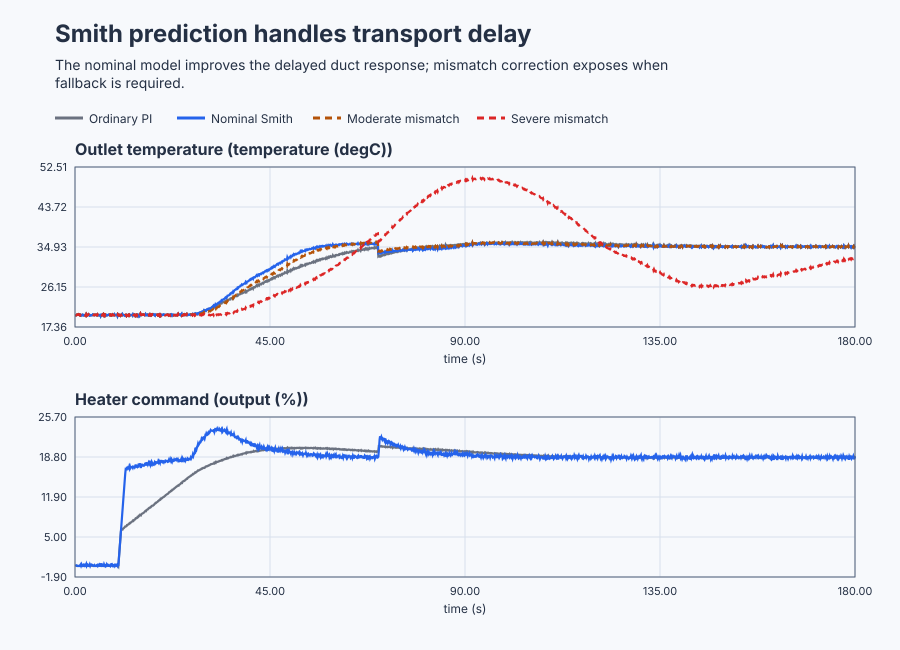

# Compensate conveyor-oven transport delay with a Smith predictor

Course position: Lesson 59 of 84. Prerequisite: gravity-tank gain scheduling in Lesson
58. Every result is **Simulation evidence**. It is not evidence from a physical
oven and does not authorize operation of a belt or heater.

**Lesson objective:** Qualify the strongest acceptable ordinary proportional-integral controller, design a Smith predictor from an independently validated delayed plant model, and decide whether its nominal benefit remains acceptable when process gain, time constant, or transport delay differs from that model.

## The problem

A continuous food-drying conveyor carries product through a recirculated
heated-air duct. Heater power is commanded from 0 through 100 percent. A
downstream product-temperature sensor measures from 15 through 60 degrees
Celsius. Air and belt transport mean a heater change takes 16 seconds to reach
that sensor.

Around 20 degrees Celsius and zero heater command, the local process gain is
0.8 degrees Celsius per heater percent and its time constant is 12 seconds.
The heater can move at no more than 10 percentage points per second. The
simulated sensor has deterministic 0.08-degree-Celsius noise. A 2-degree-Celsius
inlet-temperature loss occurs at 70 seconds.

Lesson 58 used gain scheduling because plant dynamics changed with operating
level. This oven stays inside one qualified operating region, so gain
scheduling has no measured reason to act. Its limitation is transport delay.

Ordinary feedback sees only downstream temperature. During the 16 seconds after
a heater change, that sensor cannot reveal the action already travelling
through the oven. Increasing ordinary PI gain makes the controller issue more
correction before earlier heating becomes visible. Eventually overshoot,
cycling, or poor robustness prevents further gain increases. The strongest
acceptable ordinary PI is therefore still slower than desired.

## What we need

We need the controller to act on a useful estimate of current oven temperature instead of waiting only for the delayed downstream measurement. That benefit must survive declared model mismatch and fall back safely when the prediction is not trustworthy.

## The new idea

### Delayed plant

The **heater command ($u$)** is requested heater power in percent. The
**downstream product temperature ($y$)** is measured in degrees Celsius. The
**operating heater command ($u_{0}$)** is the steady command from which a local
experiment begins. The **operating temperature ($y_{0}$)** is its steady
temperature.

The **process gain ($K$)** is eventual temperature change per heater-percent
change, in degrees Celsius per percent. The **time constant ($T$)** is the time
in seconds for about 63 percent of an eventual response to appear after it
begins. The **transport delay ($L$)** is the time in seconds before the downstream
sensor begins responding.

The local temperature tends toward the equilibrium created by an earlier
heater command, not the command being sent now:

$T\frac{dy(t)}{dt} + \left(y(t) - y_0\right) = K\left(u(t-L) - u_0\right)$

For K = 0.8 degrees Celsius per percent, a permanent 10 percent heater step
eventually raises temperature by 8 degC. The downstream sensor shows no
attributable change during the first 16 s. After that delay, about 63 percent of
the 8-degree rise appears during the next 12 s. The delay-to-time-constant
ratio is L/T = 16/12 = 1.333, so transport delay dominates the feedback
dynamics.

### Strongest acceptable ordinary PI

The **proportional gain ($K_p$)** is heater-percent request per degree Celsius of
present error. The **integral gain ($K_i$)** is heater-percent request accumulated
per degree-Celsius-second. The **closed-loop design time ($\lambda$)** is the
chosen response-speed target in seconds.

**Overshoot** is the largest temperature above setpoint after the request.
**Settling time** is the time until temperature enters and remains inside the
declared band. **Phase margin** is the additional phase lag, in degrees, that
the linear loop can tolerate at its gain crossover. **Delay margin** is the
additional pure delay, in seconds, that reaches the stability boundary.

Control Studio generates a monotonic candidate sweep from conservative to
aggressive. Every candidate uses the complete delayed model and common heater
constraints. It must stay bounded under declared gain, time-constant, and delay
perturbations; limit overshoot to 2 degrees Celsius; settle with no more than
0.5 degree Celsius final-window error; retain at least 35 degrees phase margin;
and retain at least 2 seconds delay margin.

The accepted ordinary PI uses $K_p$ = 0.46875 percent per degree Celsius and $K_i$ =
0.0390625 percent per degree-Celsius-second. The next-more-aggressive candidate
uses $K_p$ = 0.625 and $K_i$ = 0.052083. It must fail at least one predeclared
criterion to prove that the accepted tuning is the strongest eligible
candidate, rather than merely the weakest tuning tried.

The numbers follow the same first-order design rule used earlier, now retaining
the delay in the ordinary-feedback denominator:
$K_p=T/[K(\lambda+L)]$, $T_i=T$, and $K_i=K_p/T_i$. With the accepted
$\lambda=16$ seconds, $K_p=12/[0.8(16+16)]=0.46875$ and
$K_i=0.46875/12=0.0390625$. The next candidate halves the design time to 8
seconds, giving $K_p=12/[0.8(8+16)]=0.625$ and $K_i=0.052083$. It is faster by
construction, but eligibility still depends on the robustness limits.

### Smith prediction

The **delay-free model output ($y_{\mathrm{m0}}$)** estimates the current temperature effect
of all heater action, including action still travelling through the oven. The
**delayed model output ($y_{\mathrm{mL}}$)** estimates what the downstream sensor should
currently show. The **measured product temperature ($y_{\mathrm{meas}}$)** is the actual
downstream sensor value.

The **model correction ($\mathbf{c}_{m}$)** is measured temperature minus delayed-model
temperature. The **predicted current temperature ($y_{\mathrm{pred}}$)** is delay-free model
temperature plus that correction. All four temperatures use degrees Celsius.

$c_m = y_{\mathrm{meas}} - y_{\mathrm{mL}}$

$y_{\mathrm{pred}} = y_{\mathrm{m0}} + c_m$

The Smith PI is designed from the validated delay-free model with $K_p$ = 1.875
percent per degree Celsius and $K_i$ = 0.15625 percent per
degree-Celsius-second. It is not an ordinary-feedback candidate.

For the predictor design, the controller acts on the delay-free estimate, so
the same 8-second design target uses $L=0$ in the tuning equation:
$K_p=12/[0.8(8)]=1.875$ and $K_i=1.875/12=0.15625$. The physical plant still
contains 16 seconds of transport; only the model signal seen by the controller
is delay-free.

The PI receives $y_{\mathrm{pred}}$ only when the input history is complete, sensor quality
is valid, signals remain in their qualified envelope, and absolute correction
is below 5 degC. Reaching the 5-degree-Celsius correction limit is invalid
model evidence. It removes predictor authority and returns the loop to ordinary
measured feedback; it is not counted as successful prediction.

### Disturbance and model mismatch

Smith prediction removes nominal delay from the controller's internal
setpoint-feedback path. It does not make physical transport disappear. An
unmeasured inlet-temperature disturbance still travels to the downstream
sensor.

**Model mismatch** means actual process gain, time constant, or delay differs
from the retained internal model. The delayed model then disagrees with the
sensor and correction grows. **Predictor availability** means all history,
quality, model, and envelope conditions permit predicted feedback.
**Measured-feedback fallback** means ordinary sensor feedback deterministically
owns the loop when any condition fails.

The retained model applies only around the product, airflow, belt speed, and
temperature region used to identify it.

## Prediction

Before running, calculate the 8 degC eventual response to a 10-percent heater
step, the first 16 s with no downstream response, the following 12 s
63-percent interval, and L/T = 1.333.

Predict that the next-more-aggressive ordinary PI violates at least one
robustness condition. Predict that nominal Smith control reaches 90 percent of
the requested temperature rise at least 15 percent sooner and has lower
setpoint-window integral absolute temperature error than accepted ordinary
feedback because its delay-free model responds before the sensor. Report
post-disturbance regulatory error separately. Predict that
moderate mismatch increases error, correction, or settling time. Predict that
severe mismatch reaches a validity boundary and causes measured-feedback
fallback. Do not predict removal of the delayed inlet disturbance.

## Implementation

The shipped program contains one real Control.PID and one real
Control.SmithPredictorFOPDT. Ordinary feedback and Smith control are separate
restored designs; the code selects their reviewed gains only during
initialization and never jumps tuning in a running experiment.

```st
IF PredictorActive THEN
    PredictedProcessValue := PredictorResult.PredictedProcessValue;
ELSE
    PredictedProcessValue := ProcessValue;
END_IF;
Input.ProcessValue := PredictedProcessValue;
ManipulatedValue := Controller.Update(Input := Input);
```

The program exposes measured and predicted temperature, delay-free and delayed
model outputs, correction, heater request, selected gains, predictor enable,
active and fallback states, model validity, quality, and history completeness.
It contains no timed setpoint, hidden plant perturbation, metric, or preferred
result.

## Experiment in Control Studio

This procedure observes the complete project-owned oven experiment. The
project owns the temperature request, predictor/fallback logic, and restoration
to 20 degrees Celsius; Control Studio writes only one Boolean authority signal.
The plant scenario owns the inlet-temperature event. The deterministic
Simulation seed is 20260829.

### Control Studio actions

1. **Monitor** — Start the **Simulator**, then open **truST sidebar → Control Studio → Monitor → Response**.
   - **Baseline check:** Wait until the header shows **Simulation**, **Running**, and current data. Confirm Product-temperature setpoint (SP, degC); Downstream product temperature (PV, degC); Heater-power request (MV, %), including units, limits, mode, and quality. The initial operating point is Product-temperature setpoint = 20 degC, Downstream product temperature = 20 degC, Predicted current product temperature = 20 degC, Heater-power request = 0 %. The unresolved baseline problem is: The highest-bandwidth ordinary PI that passes the robustness envelope still reacts only after the downstream sensor sees transported heater action. Use Control Studio Monitor before Identify and Tune; retain 10 s at the 35 degC baseline, then the 70 s event and the 180 s restoration boundary.
   - **Decision before action:** Read **Prediction** above, then state what should move first and in which direction. Use this decision rule: Accept prediction only when its nominal improvement, mismatch degradation, correction limit and deterministic measured-feedback fallback are all visible.
   - **Successful evidence:** The Response plot advances, the displayed values are finite and current, and **Start recording** is enabled. Select **Start recording** only after those conditions are visible.
   - **Recovery:** If recording is disabled or the plot reports unavailable or stale samples, stop the Simulator, correct the displayed runtime or binding problem, restart it, and repeat the baseline check.
   - **Record:** Write down the initial SP, PV, requested/applied MV where available, controller mode, and your predicted response before opening Test.

2. **Test** — Open **truST sidebar → Control Studio → Test**.
   - **Baseline check:** Set **Experiment** = **Observe without excitation**, **Amplitude** = **0**, and **Maximum duration (s)** = **180.1**. Confirm the only writable signal is **Experiment authority** (`P1.ExperimentEnabled`, `%MX90.7`). The project holds 20 degrees Celsius for 10 seconds, requests 35 degrees Celsius, and restores 20 degrees Celsius when authority clears; the simulation scenario applies the declared 70-second inlet disturbance.
   - **Decision before action:** Before selecting **Review test**, predict when the model can move before the sensor and confirm measured/predicted temperature can remain within 15 through 60 degrees Celsius, heater within 0 through 100 percent, and correction strictly inside plus or minus 5 degrees Celsius.
   - **Successful evidence:** Select **Review test**, verify zero external excitation, authority, duration, restoration, and stop conditions, then select **Confirm and start**. Response must show the full project-owned request, history qualification, prediction, disturbance response, and any fallback. At termination authority clears and setpoint is 20 degrees Celsius.
   - **Recovery:** For a rejected, stale, unsafe, unavailable, failed, or aborted state, read the reason, confirm authority is false and the setpoint restored to 20 degrees Celsius, wait for current data, and review a new observation.
   - **Record:** Compare the response with your prediction and retain terminal state, restoration, and seed **20260829**. The native lesson test owns the ordinary-candidate sweep and mismatch verdicts; this observation does not create generic Identify, Tune, or Validate evidence.

## Evidence and decision

### Measures and comparison

Hold initial state, setpoint and disturbance events, limits, 0.1-second sample
schedule, 180-second duration, noise seed, and metric windows equal. During the
ordinary sweep, change only tuning. In the architecture comparison, record
honestly that ordinary feedback uses its accepted robust tuning while Smith
control uses its separately designed delay-free tuning. In mismatch runs,
change only declared actual plant parameters while retaining the internal
model.

Define measures before results. **Integral absolute temperature error** sums
absolute setpoint error times 0.1 seconds, in degree-Celsius-seconds. **Peak
overshoot** is maximum measured temperature minus setpoint, in degrees Celsius.
**Heater total variation** sums consecutive absolute applied-heater changes, in
percentage points. Also record 2-percent settling time, final-window absolute
error, saturation and rate-limit duration, predictor-active fraction, peak
absolute correction, correction-limit duration, and fallback count.

Final error is the mean absolute error from 170 through 180 seconds and is
eligible only if temperature and heater spans prove settling. Predictor metrics
during invalid or fallback samples are not ranked as Smith performance.

### Validation

The accepted ordinary PI must pass every declared nominal and perturbation
condition. The next-more-aggressive candidate must fail at least one, proving
the selection boundary.

Nominal Smith control must remain finite, respect the same heater constraints,
settle within 0.5 degree Celsius, reach 90 percent of the requested rise at
least 15 percent sooner, and have lower setpoint-window integral absolute
temperature error than accepted ordinary feedback. Regulatory error after the
70-second disturbance is reported
separately because prediction does not remove physical disturbance transport.
Moderate mismatch must remain bounded but show worse error, correction, or settling than
nominal Smith. Severe mismatch or correction saturation must remove predictor
authority and use measured feedback; that interval is classified Fallback and
is not ranked as successful prediction.

The deterministic executable runs produced:

| Case | Total IAE (°C·s) | Setpoint-window IAE (°C·s) | 90% rise time | Overshoot / correction | Result |
| --- | ---: | ---: | ---: | --- | --- |
| Accepted ordinary PI | 580.2065 | 532.7046 | 51.4 s | 1.0989 °C overshoot | Eligible baseline |
| Next ordinary candidate | 543.3157 | Not ranked | Not ranked | 2.9317 °C overshoot | Rejected above 2 °C |
| Nominal Smith | 499.1734 | 466.9899 | 41.3 s | 3.1547 °C peak correction | Eligible; rise is 19.6% faster |
| Moderate mismatch | 531.1725 | Retained in artifact | Retained in artifact | 4.2351 °C peak correction | Bounded degradation |
| Severe mismatch | Not ranked | Not ranked | Not ranked | 1,102 fallback samples | Fallback, not Smith evidence |

The final-window mean absolute errors are 0.0661 °C for accepted ordinary PI
and 0.0623 °C for nominal Smith. These values belong only to the declared
deterministic Simulation runs.

Classify each result as Valid, Not settled, Unstable, Saturated, Rate limited,
Model mismatch, Correction limited, Fallback, Invalid, or Aborted before
ranking it.

### Retained evidence

The plot is generated by the executable heated-air-duct experiment. It compares ordinary feedback with the Smith predictor and makes the effect of model mismatch visible.



[Complete trace](figures/heated-air-duct-smith-evidence-trace.csv) · [Decision summary](figures/heated-air-duct-smith-evidence-summary.csv)

## Conclusion

Ordinary PI over-corrects because heater action is physically in transit but
absent from measured temperature. Nominal Smith control uses the delay-free
model to represent that action immediately. Measured-minus-delayed-model
correction prevents the estimate from drifting freely away from the sensor.

Mismatch makes the delayed model disagree with measurement. Rising correction
and fallback therefore expose the limit of model confidence. The physical
transport delay remains present in product response and disturbance rejection;
only the controller's nominal internal feedback path has changed.

## Reason for the next lesson

Use Smith prediction only for a delay-dominant process with a validated model,
declared uncertainty envelope, bounded correction, monitored validity, and
deterministic measured-feedback fallback. Nominal improvement alone is not
enough.

Lesson 60 examines a different failure: an uncharacterized or mechanically
sticking final control element can invalidate otherwise sound controller and
model assumptions. A physical oven experiment additionally requires reviewed
heater capacity, airflow, belt speed, product and fire limits, I/O topology,
abort/restoration plan, and explicit approval immediately before action.
