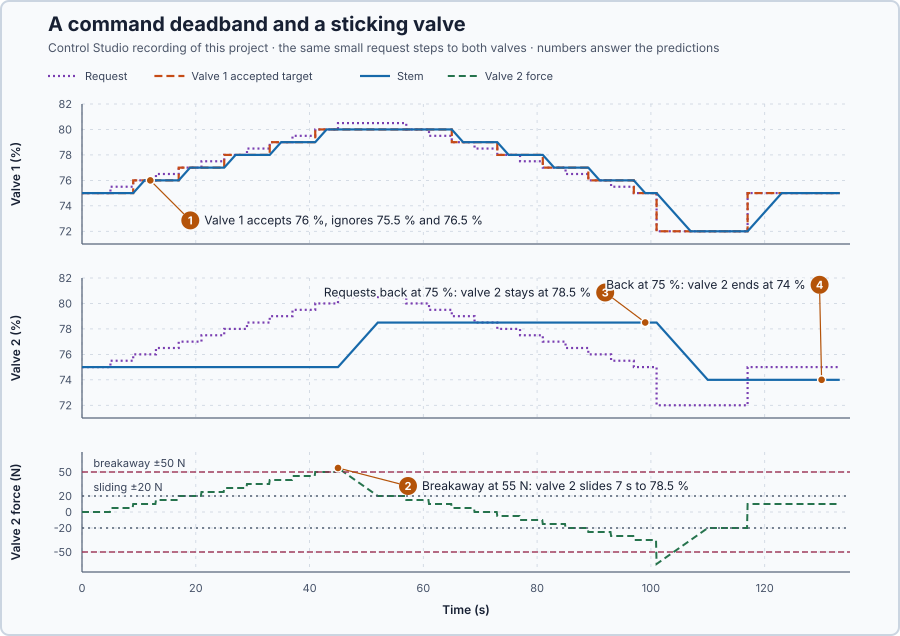

# 33. Valve stiction

In this lesson, you will probe two valves that both move in steps and tell them apart from their recorded signals. One positioner ignores small requests on purpose; the other valve sticks and then jumps. Neither is a tuning problem.

## The problem

Lesson 32 measured where the valve settles: with the fixed supply the flow rose from 1.421 kg/s at 70 % to 1.650 kg/s at 85 %, and the second 75 % point reproduced the first, 1.500 kg/s, so the steady characteristic showed no hysteresis. A real valve can still misbehave on the way: it may ignore a small request, or the valve sticks and jumps when the request has grown. In a temperature loop that looks like a badly tuned controller, and the flow alone cannot tell why.

We will probe two valves with the same small steps and find the cause of their steps from the request, the stem position, the force and the flow.

## What we need

We need to:

1. see whether a request reached the valve's positioner at all;
2. see whether the stem moved when the request changed, and if not, how hard it was being pushed; and
3. decide from those signals what must be repaired, before anyone touches the controller.

## The new idea

**Stiction** is a valve that sticks. It ignores small commands, then jumps when the push becomes big enough. A **deadband** is different: the controller deliberately ignores small changes. Both look like poor tuning, but neither is. Here valve 1's positioner, the small controller on the valve that sets the stem position, has a command deadband, and valve 2 has a stem that is held by friction.

**In words.** Both faults make a valve move in steps, for different reasons:

1. **A deadband is a rule in the command path.** The positioner accepts a new target only when it differs enough from the last accepted one, so smaller changes never reach the stem. PLC engineers use the same idea on purpose, for example a threshold below which an analog change is not sent, to save an actuator from wearing itself out with tiny movements. The stem itself moves freely and follows every accepted target exactly.
2. **Stiction is mechanical friction.** The positioner pushes the stem with a force that grows with the distance between where the stem should be and where it is. Friction holds the stem until the push exceeds the **breakaway force**, the static friction of the resting stem. Once the stem moves, the friction drops to a smaller sliding value, so the stem shoots off and stops only when the push has fallen to that sliding friction, short of its target. Pushing a heavy box across a floor feels the same: you push harder and harder, nothing happens, then it suddenly slides, more easily than it started.

In a temperature loop both look like poor tuning. The water is slightly too cold, so the PI raises its request a little, and the stem does not move. The error stays, so the integral keeps raising the request, until the valve moves at once, too far, and the water overshoots; then the same happens downwards. The loop keeps hunting, and retuning only changes the size and period of this cycle. The flow alone cannot tell the two causes apart. Two other signals can: whether the request reached the positioner, and how hard the stem was pushed.

**The formula.** Valve 1's positioner compares each request with its last accepted target. When

$$
|r - u_t| \ge d ,
$$

the request becomes the new accepted target; otherwise the target keeps its value. Valve 2 accepts every request, and its positioner pushes the stem with the force

$$
F = k_s\,(u_t - x) .
$$

The stem starts to move when $|F| > F_b$, and once moving it stops when $|F| \le F_m$; moving upwards, that is at $x = u_t - F_m/k_s$.

- $r$ is the request from the controller and $u_t$ the accepted target, in percent;
- $d$ is valve 1's deadband, 1 point;
- $F$ is the positioner's drive force, in newtons, and $k_s$ its stiffness, 10 N per point of position;
- $x$ is the measured stem position, in percent; and
- $F_b = 50$ N is the breakaway force and $F_m = 20$ N the sliding friction.

**Example: both valves at 75 %.** Follow the numbers:

1. Valve 1 receives 75.8 %: $|75.8 - 75| = 0.8$, less than 1 point, so its target stays at 75 % and the stem does not move. At 76.2 %, $|76.2 - 75| = 1.2$: the target becomes 76.2 %, and the stem follows it.
2. Valve 2 receives 76 %: $F = 10 \times (76 - 75) = 10$ N, well below 50 N, so the stem stays at 75 % although its target moved.
3. The request reaches 80.5 %: $F = 10 \times 5.5 = 55$ N, above 50 N, so the stem breaks away. It slides until the force has fallen to the 20 N sliding friction, at $x = 80.5 - 20/10 = 78.5$ %, and sticks again, 2 points short of its target.

The two faults therefore leave different evidence:

| Observation | Deadband (valve 1) | Stiction (valve 2) |
| --- | --- | --- |
| Accepted target | unchanged for small requests | follows every request |
| Force | stays small | builds up while the stem is held |
| Stem | follows the accepted target | holds, then jumps and stops short |
| After a reversal | follows | holds until the force exceeds breakaway in the other direction |

**The limitation.** In a real installation the force is not measured: the friction is inside the valve, and usually only the request and the stem position are recorded. This program simulates valve 2's friction so that the force can be seen. The 1-point deadband, the 50 N breakaway force and the 20 N sliding friction are teaching values chosen to make the effects visible.

## Prediction

Before running, answer these questions:

1. Which of the requests 75.5, 76 and 76.5 % does valve 1 accept?
2. At which request does valve 2 break away from 75 %, and where does its stem stop?
3. What does valve 2's stem do while the request steps back down from 80.5 % to 75 %?
4. After a reversal to 72 %, where does valve 2 stop, and where is it when the request returns to 75 %?

| Request | Valve 1 accepted target | Valve 2 force | Valve 2 stem |
| ---: | ---: | ---: | ---: |
| 75.5 % | 75 % | 5 N | 75 % |
| 76 % | 76 % | 10 N | 75 % |
| 80.5 % | 80 % | 55 N | 75 % → 78.5 % |

## Implementation

Open [`src/Main.st`](src/Main.st). Both valves are simulated at a regulated 100 kPa, so the flow is 0.02 kg/s per point, and their motors move each stem at 0.5 % per second. Valve 1's positioner applies the command deadband:

```st
DeadbandTargetPct := AcceptedTarget(Request := ValveRequestPct, LastAccepted := DeadbandTargetPct,
    Deadband := CommandDeadbandPct);
```

Valve 2 accepts every request. Its friction is simulated in the program so that the force can be observed; in a real installation the friction is in the valve and only the stem position is measured:

```st
StickyForceN := DriveForce(Stiffness := StiffnessNPerPct, Target := ValveRequestPct, Stem := StickyStemPct);
IF NOT Sliding AND ABS(StickyForceN) > BreakawayForceN THEN
    Sliding := TRUE;
END_IF;
IF Sliding AND ABS(StickyForceN) <= MovingFrictionN THEN
    Sliding := FALSE;
END_IF;
```

**Exercise.** Use `DriveForce` by hand: with the stem held at 78.5 % and the request at 72 %, the force is $10 \times (72 - 78.5) = -65$ N, beyond the −50 N breakaway, so the stem slides down until $|F| = 20$ N, at $72 + 2 = 74$ %. Then run the tests in [`src/tests.st`](src/tests.st) from the **Testing** view; they check the deadband decisions and the 55 N, 78.5 %, −65 N and 74 % values.

## Experiment in Control Studio

The probes run when the project test starts: 0.5-point request steps every 4 s up to 80.5 %, a 12 s hold, 0.5-point steps back to 75 %, a reversal to 72 % for 16 s and the return to 75 %.

1. Open this lesson's project and start **Simulator**. Both valves rest at 75 %. In the **truST** side bar, select **Control Studio**.
2. On **Identify**, choose **Project experiment** from **Method**. **Signals** already shows `P1.StickyStemPct · Process value (%)`, valve 2's stem, and `P1.ValveRequestPct · Applied output (%)`, the request; add `P1.DeadbandTargetPct · state (%)`, `P1.DeadbandStemPct · state (%)`, `P1.StickyForceN · state (N)`, `P1.DeadbandFlowKgS · state (kg/s)` and `P1.StickyFlowKgS · state (kg/s)`.
3. Answer the predictions before starting.
4. Select **Review project test** and check the declared **133.1 s** duration, which covers the steps up, the hold, the steps down, the reversal and the return.
5. Select **Confirm and start**; this is time zero.
6. Watch valve 2's force grow while its stem stays put, then the jump. After the run, hover the end of each probe and classify each valve.
7. At completion, Control Studio shows **Project test completed. Outputs restored.**

Select **Abort test** to stop early. To repeat, restart **Simulator**.

## Evidence and decision



The numbered marks answer the predictions with the same numbers. Values from the recording at the end of each probe:

| Request | Valve 1 accepted target | Valve 1 stem | Valve 2 force | Valve 2 stem |
| --- | ---: | ---: | ---: | ---: |
| 75.5 % | 75 % | 75 % | 5 N | 75 % |
| 76 % | 76 % | 76 % | 10 N | 75 % |
| 76.5 % | 76 % | 76 % | 15 N | 75 % |
| 80 % | 80 % | 80 % | 50 N | 75 % |
| 80.5 % | 80 % | 80 % | 55 N, then 20 N | 75 %, then 78.5 % |
| 80 % down to 75 % | 80 % down to 75 % in 1-point steps | follows | 15 N down to −35 N | 78.5 % |
| 72 % | 72 % | 72 % | −65 N, then −20 N | 78.5 %, then 74 % |
| 75 % | 75 % | 75 % | 10 N | 74 % |

1. Valve 1 accepted 76 % but not 75.5 % or 76.5 %: its target changes only when the request is 1 point from the last accepted target, and its stem follows that target exactly. The request arrived; the positioner ignored it.
2. Valve 2 accepted every request, but its stem held at 75 % while the force grew by 5 N per step. At 80.5 % the force reached 55 N, the stem broke away and slid for 7 s to 78.5 %, where the force had fallen to 20 N.
3. The decreasing requests reduced the force to −35 N without moving the stem: its flow stayed at 1.570 kg/s while valve 1's returned to 1.50 kg/s.
4. The reversal to 72 % produced −65 N; the stem slid to 74 % and stayed there when the request returned to 75 %. The request ended where it started, but valve 2 ended 1 point low, passing 1.480 kg/s instead of 1.50 kg/s: with stiction, the position depends on the path.

The cost of the deadband is resolution: valve 1 cannot make changes smaller than 1 point. Its benefit is fewer small movements. Stiction has no benefit. Decision: valve 1 needs a smaller command deadband, below the resolution the loop needs; valve 2 needs valve service. Retuning would repair neither. These are simulation results, not a physical valve test.

## Conclusion

A deadband and stiction both make a valve move in steps, but they leave different evidence. An ignored request leaves the accepted target unchanged. Stiction holds the stem although the target changed, until the force exceeds breakaway, and then the stem stops short where sliding friction wins.

For these two valves, the accepted target, the stem position and the force identified the causes; the flow alone could not. The repair belongs to the command path or the valve, not to the PI tuning.

## Check yourself

1. **Valve 2's stem rests at 74 % and the request is 79 %. Does it move?**
   $F = 10 \times (79 - 74) = 50$ N, which does not exceed the 50 N breakaway force, so the stem stays.
2. **Why did valve 2 stop at 78.5 % instead of 80.5 % after breaking away?**
   Once the stem moves, the friction drops to 20 N. The stem slides until the push has fallen to 20 N, which is
   2 points short of the target.
3. **The temperature loop keeps cycling and the flow moves in jumps. Why should you look at the accepted target and the force before retuning?**
   They show whether the positioner ignored the request (a deadband) or friction held the stem (stiction). Both need
   a repair outside the controller; retuning only changes the size of the cycle.

## Reason for the next lesson

The valve lessons treated the stem position as a result we measured. They have not shown how a motor produces and controls a position from torque, inertia and position feedback.

[Position control](../../02-derivative-action-and-dynamic-response/32-proportional-position-stiffness/README.md) moves a shaft to a target angle and derives that motion.
