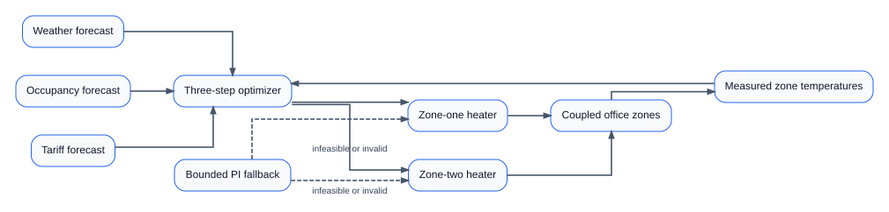
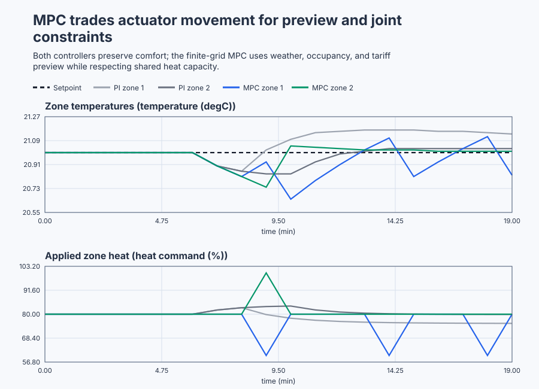

# Execute constrained two-zone building MPC

Course position: Lesson 68 of 84. Prerequisite: `control-suspension-lqr`.
Next lesson: `control-pendulum-lyapunov`.

**Equipment:** Two thermally coupled office zones with a shared heating-power
limit.

**Lesson objective:** Formulate and execute all 729 constrained heater-move sequences online, compare the resulting MPC with qualified PI, and distinguish feasible, infeasible, invalid, fallback, and recovery states.

## The problem

The equipment is a small office floor with two thermally coupled zones. Zone-one temperature ($T_1$) and zone-two temperature ($T_2$) are measured in degrees Celsius. Zone-one heating command ($u_1$) and zone-two heating command ($u_2$) are percentages. Outdoor temperature forecast ($T_o$) and zone occupancy heat-gain forecasts ($q_1$ and $q_2$) are expressed as equivalent degrees Celsius. Tariff forecast ($p$) is a relative energy price.

Each zone loses heat outdoors, exchanges heat with its neighbour, receives heater energy, and receives occupancy heat. The local continuous model uses a 600-second outdoor-loss time constant, 1800-second inter-zone coupling time constant, and heater coefficient `1/3000 degC/(percent*s)`.

For zone one, the continuous balance is

$\dot T_1=(T_o-T_1)/600+(T_2-T_1)/1800+u_1/3000+q_1/600$,

and zone two has the same equation with the zone indices exchanged. Each term is a temperature difference divided by the time over which that mechanism acts; the heater term converts percent command into degrees Celsius per second. With equal zone temperatures, neighbour exchange is zero. At 21 degrees indoors and 5 degrees outdoors, outdoor loss is $(5-21)/600=-0.026667$ degrees Celsius per second, while 80-percent heat contributes $80/3000=+0.026667$, explaining the initial equilibrium.

Exact zero-order-hold sampling every 60 seconds uses $A_d=e^{A60}$ and $B_d=\int_0^{60}e^{A\tau}B\,d\tau$. The exponential advances stored zone heat; the integral accumulates outdoor, occupancy, and heater inputs held constant for the minute. This gives sampled state-transition matrix ($\mathbf{A}_{\mathrm{d}}$):

$\mathbf{A}_d= \begin{bmatrix} 0.875659571463&0.029177846573\\ 0.029177846573&0.875659571463 \end{bmatrix}$

For input vector
$\begin{bmatrix}u_1&u_2&T_o&q_1&q_2\end{bmatrix}^{T}$, sampled input matrix
($\mathbf{B}_{\mathrm{d}}$) is:

$\mathbf{B}_d= \begin{bmatrix} 0.018727354703&0.000305161690&0.095162581964&0.093636773515&0.001525808449\\ 0.000305161690&0.018727354703&0.095162581964&0.001525808449&0.093636773515 \end{bmatrix}$


Each heater is limited to 0 through 100 percent. Each one-minute change is limited to -20 through +20 percentage points. Combined heating is limited to 170 percent. Predicted zone temperatures must remain between the nominal comfort limits of 20.0 and 22.5 degrees Celsius. The broader local model range is 15 through 27 degrees Celsius.

Requested and applied heater commands remain separate. All matrices, forecasts, temperatures, and results in this lesson are **Simulation** evidence.

Lesson 67 showed that force saturation invalidates an unconstrained LQR optimum. The active-suspension controller could only discover that conflict when requested and applied force differed.

A building has a different problem. Two slow zones share limited heating, while weather, occupancy, and energy price are known to change. The controller must choose several future moves together and reject a sequence before it violates future comfort or power limits. Reactive PI cannot do that, and clipping an unconstrained formula does not make it MPC.

## What we need

We need the two office zones to share limited heating power while considering predicted weather, occupancy, tariff, and future temperature constraints. The online search must distinguish a feasible optimum from infeasible or invalid cases and transfer safely to bounded fallback.

## The new idea

An optimization problem contains choices, an objective to minimize, and constraints every eligible choice must satisfy. Decision variables are the future heater moves. Prediction horizon ($N=3$) means the next three one-minute intervals. Control move ($\Delta u$) means change from the heater command applied in the preceding interval.

For each zone and each horizon position, the finite move set is `{-20,0,+20}` percentage points. There are two zone decisions at each of three positions, hence $2\times3=6$ decisions. Each has three choices, so the multiplication rule gives $3\times3\times3\times3\times3\times3=3^{6}=729$ sequences.

The shipped solver enumerates all 729 sequences every interval. It propagates the sampled two-zone model, rejects sequences violating individual power, shared power, rate, or predicted comfort constraints, and retains the feasible sequence with the lowest objective. This is a genuine online finite-grid constrained optimizer. It is not a continuous quadratic-program solver; its result is optimal only on the declared move grid.

Zone tracking error ($e_{i,j}$) is predicted zone temperature minus setpoint for zone $i$ at future position $j$. Squaring makes heating and cooling errors equally costly and penalizes large misses more strongly. Temperature weight ($w_T$) sets the importance of that error. Energy weight ($w_E$) prices total heating by the forecast tariff. Move weight ($w_{\Delta}$) penalizes squared command changes so sequences that chatter between grid points cost more.

$J=\sum_{j=1}^{3}\left[ w_T\left(e_{1,j}^{2}+e_{2,j}^{2}\right) +w_Ep_j\left(u_{1,j}+u_{2,j}\right) +w_{\Delta}\left(\Delta u_{1,j}^{2}+\Delta u_{2,j}^{2}\right) \right]$

Nominal values are $w_T=100$, $w_E=0.01$, and $w_{\Delta}=0.0025$. Larger temperature weight protects tracking more strongly. Larger energy weight favours lower heating when tariff is high. Larger move weight discourages valve and plant movement. These are preferences, not hard limits.

Receding horizon means applying only the first optimized move, taking a new measurement, shifting the forecasts, and solving all 729 sequences again. The unexecuted later moves are a plan, not commands already sent to equipment.

Feasibility means at least one complete sequence satisfies every constraint. Solver completion is separate: exhaustive evaluation can complete correctly with zero feasible sequences. That result is **infeasible**. A negative weight, nonfinite signal, or incomplete enumeration is an **invalid or failed solve**, not infeasibility.

The fallback is an incremental PI pair with proportional gain `20 percent/degC` and integral gain `0.02 percent/(degC*s)`. It uses the same individual, rate, and shared-power limits. It is explicitly labelled PI fallback and never inherits an MPC claim.

## Prediction

Start both temperatures and setpoints at 21 degrees Celsius. Outdoor temperature is 5 degrees Celsius, occupancy gains are zero, previous heater commands are 80/80 percent, and all three tariffs are 0.10.

For the zero-move sequence, the first prediction for zone one is:

$\begin{aligned} T_{1,k+1}={}&0.875659571463(21)+0.029177846573(21)\\ &+0.018727354703(80)+0.000305161690(80)\\ &+0.095162581964(5)=21.00000\,{}^\circ\mathrm{C} \end{aligned}$

Zone two is identical. Predict 729 evaluated sequences, at least one feasible sequence, and first commands of 80/80 percent.

Now raise the comfort minimum to 22 degrees Celsius without changing state or limits. Even the allowed first moves cannot raise both predicted zones to 22 degrees under the shared limit. Predict a completed count of 729, zero feasible sequences, $Infeasible=TRUE$, and bounded PI fallback. Predict that a negative temperature weight instead makes configuration invalid, skips enumeration, leaves $Infeasible=FALSE$, and uses the same fallback.

## Implementation

The shipped Structured Text computes PI fallback from fresh measurements, then performs six nested move loops. Each complete combination increments `CandidateCount` before its predictions and constraints are evaluated:

```st
FOR I10 := DINT#0 TO DINT#2 DO
    FOR I20 := DINT#0 TO DINT#2 DO
        FOR I11 := DINT#0 TO DINT#2 DO
            FOR I21 := DINT#0 TO DINT#2 DO
                FOR I12 := DINT#0 TO DINT#2 DO
                    FOR I22 := DINT#0 TO DINT#2 DO
                        CandidateCount := CandidateCount + DINT#1;
                        (* Predict, reject constraints, and compare objective. *)
                    END_FOR;
                END_FOR;
            END_FOR;
        END_FOR;
    END_FOR;
END_FOR;
```

`ConfigurationValid`, `SolverComplete`, `SolverFeasible`, `Infeasible`, and `FallbackActive` describe different facts. `FeasibleCandidateCount` and `BestObjective` expose the decision. `Zone1HeatRequested` and `Zone2HeatRequested` are the selected first moves; `Zone1HeatApplied` and `Zone2HeatApplied` are the bounded plant inputs.

The controller contains no `UnconstrainedMove`, precomputed affine policy, prerecorded move table, or embedded acceptance verdict.

## Experiment in Control Studio

This procedure observes the nominal 20-minute MPC schedule. The project owns outdoor temperature, occupancy, tariff forecasts, optimization, and restoration. Removing authority or detecting invalid inputs or a safety abort disables both heaters and restores the environmental inputs to their baseline values. PI, infeasible, invalid-configuration, and recovery comparisons remain separate native test records. The deterministic Simulation seed is 20260829.

### Control Studio actions

1. **Monitor** — Start the **Simulator**, then open **truST sidebar → Control Studio → Monitor → Response**.
   - **Baseline check:** Wait until the header shows **Simulation**, **Running**, and current data. Confirm both temperatures and setpoints, requested/applied heat, current disturbances, all three forecast positions, objective weights, candidate and feasible counts, solver status, active constraints, fallback state, units, limits, mode, and quality. Before authority is granted, both applied heater commands are zero and outdoor and occupancy inputs are restored to 5, 0, and 0 degrees Celsius respectively.
   - **Decision before action:** Read **Prediction** above, then state what should move first and in which direction. Use this decision rule: Use the first move only after all 729 sequences complete and at least one satisfies every hard constraint; otherwise use the explicitly identified PI fallback.
   - **Successful evidence:** The Response plot advances, the displayed values are finite and current, and **Start recording** is enabled. Select **Start recording** only after those conditions are visible.
   - **Recovery:** If recording is disabled or the plot reports unavailable or stale samples, stop the Simulator, correct the displayed runtime or binding problem, restart it, and repeat the baseline check.
   - **Record:** Write down the initial SP, PV, requested/applied MV where available, controller mode, and your predicted response before opening Test.

2. **Test** — Open **truST sidebar → Control Studio → Test**.
   - **Baseline check:** Set **Experiment** = **Observe without excitation**, **Amplitude** = **0**, and **Maximum duration (s)** = **1200.1**. The affected signal is **Experiment authority**. Amplitude zero is intentional: Test writes only `P1.ExperimentEnabled`; the project owns the weather, occupancy, and tariff schedule.
   - **Decision before action:** Before selecting **Review test**, predict why forecasts may change heater requests before the corresponding disturbance becomes current. Confirm every scheduled input and predicted/applied heater command remains inside its declared limits.
   - **Successful evidence:** Select **Review test**, verify the signal, requested bound, duration, restoration, and stop conditions, then select **Confirm and start**. The state changes to **Running**, **Abort test** remains available, and the terminal state confirms completion and restoration while Response shows the measured SP/PV/MV sequence.
   - **Recovery:** For a rejected, stale, unsafe, unavailable, failed, or aborted state, read the displayed reason, remove experiment authority, verify zero applied heat and restored environmental inputs, wait for current data, and review a new test.
   - **Record:** Stop recording only after restoration. Retain the solver counts, feasible count, first moves, objective, constraint and fallback states, terminal state, restoration result, and seed **20260829**. Use native evidence for PI and abnormal cases; do not claim this visible run executed them.

## Evidence and decision

### Measures and comparison

Zone absolute-error integral is the sum of absolute setpoint-minus-temperature error multiplied by 60 seconds, in degree-Celsius seconds. Comfort violation records both accumulated magnitude and duration below 20.0 or above 22.5 degrees Celsius.

Tariff-weighted heating use is $\sum\left(p_{k} \cdot (u1_{k}+u2_{k}) \cdot 60\right)$ in relative cost-percent seconds. Heater movement is total variation, the sum of absolute changes in both applied commands, in percentage points. Also retain peak individual and shared power, active-constraint duration, fallback duration, completed solve count, infeasible solve count, and failed solve count.

Every measure retains source signals, units, window, schedule revision, sampled model, weights, horizon, move grid, sample count, and evidence class.

### Validation

The independent oracle and shipped Structured Text must agree on evaluated count, feasible count, first move, and objective for the worked case and every normal MPC interval. Every applied command must satisfy individual, rate, and shared limits.

Controller qualification uses the unrounded calculated values. The retained
table and plot data round engineering signals and aggregate metrics to two
decimal places, matching the lesson's displayed precision and preventing
irrelevant last-bit floating-point differences between supported hosts from
changing the evidence files.

Normal MPC must complete every solve without fallback and keep both zones inside the comfort envelope. It must use no greater tariff-weighted heating cost than qualified PI without greater total comfort violation. If this finite grid does not improve PI under the declared schedule, report that result rather than manufacturing a win.

The 22-degree minimum case must complete all 729 candidates, report zero feasible candidates, and use bounded fallback. Negative temperature weight must report invalid configuration, skip enumeration, avoid an infeasible label, and use fallback. Restoring valid settings must recover on the next complete solve. Disabled mode must apply zero heat.

The shipped native execution produced the following Simulation evidence under the declared 20-minute schedule:

| Controller | Run status | Zone absolute-error integral | Comfort violation | Tariff-weighted heating | Applied-heater movement | Peak shared heating | Fallback |
| --- | --- | ---: | ---: | ---: | ---: | ---: | ---: |
| Qualified PI | Eligible | 158.67 degC*s | 0.00 degC*s, 0 s | 46,624 relative cost-percent seconds | 18.7 percentage points | 166.3 percent | 0 s |
| Finite-grid MPC | Eligible | 146.72 degC*s | 0.00 degC*s, 0 s | 46,200 relative cost-percent seconds | 160.0 percentage points | 160.0 percent | 0 s |

Both controllers maintained comfort. The MPC reduced absolute-error integral by 7.5 percent and tariff-weighted heating by 0.9 percent, but required about 8.6 times as much applied-heater movement. The result is therefore a tradeoff, not a universal MPC victory. The selected weights value tracking and tariff cost enough to accept substantially more actuator movement; a real design review would have to decide whether that wear cost is acceptable before application.

For the deliberately infeasible case, the shipped solver evaluated all 729 sequences, found zero feasible sequences, reported infeasibility, and selected bounded PI fallback. With negative temperature weight it rejected the configuration before enumeration and used fallback without falsely labelling the problem infeasible. Restoring nominal settings recovered a complete feasible solve on the next interval.

A source loop count or static screenshot does not prove that the optimizer executed correctly. These values come from the executable ST/simulator test and still require retained run and plot artifacts before the lesson is accepted as rendered evidence.

### Retained evidence



The figure keeps temperature and actuator behavior together. The [trace CSV](figures/building-hvac-mpc-evidence-trace.csv) retains weather, occupancy, tariff, requested/applied heat, solver counts, objective, constraint state, and fallback state. The [summary CSV](figures/building-hvac-mpc-evidence-summary.csv) records the common comfort, error, energy, movement, capacity, infeasibility, and recovery decisions.

## Conclusion

Follow one candidate through all three temperature predictions. At each position, first apply its heater moves, then test individual, rate, shared, and comfort constraints, then add tracking, tariff, and movement terms to its objective. Compare its final objective only with other complete feasible candidates.

Preview changes a present command because a future weather, occupancy, or price change affects predicted cost and feasibility. Only the first move is applied because the next real measurement may differ from prediction.

A completed solver may truthfully find no feasible sequence. Clipping an unconstrained command cannot prove future comfort, rate, or shared-power feasibility. Grid search also has a resolution limit: a continuous optimum between grid points is unavailable here.

## Reason for the next lesson

MPC is justified in this lesson by coupled prediction, forecast preview, and hard future constraints. A precomputed affine command or clipped PI output is not MPC.

Physical building use requires identified thermal and actuator dynamics, qualified forecasts, privacy-safe occupancy inputs, equipment interlocks, independent facilities and cybersecurity review, explicit approval immediately before application, and rollback. This lesson operates no physical building.

Lesson 69 introduces nonlinear inverted-pendulum Lyapunov reasoning because a locally successful linear prediction does not establish a region of attraction away from its operating point.
