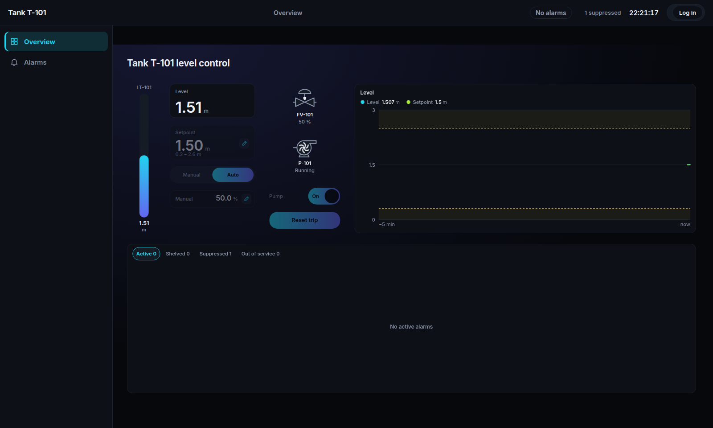
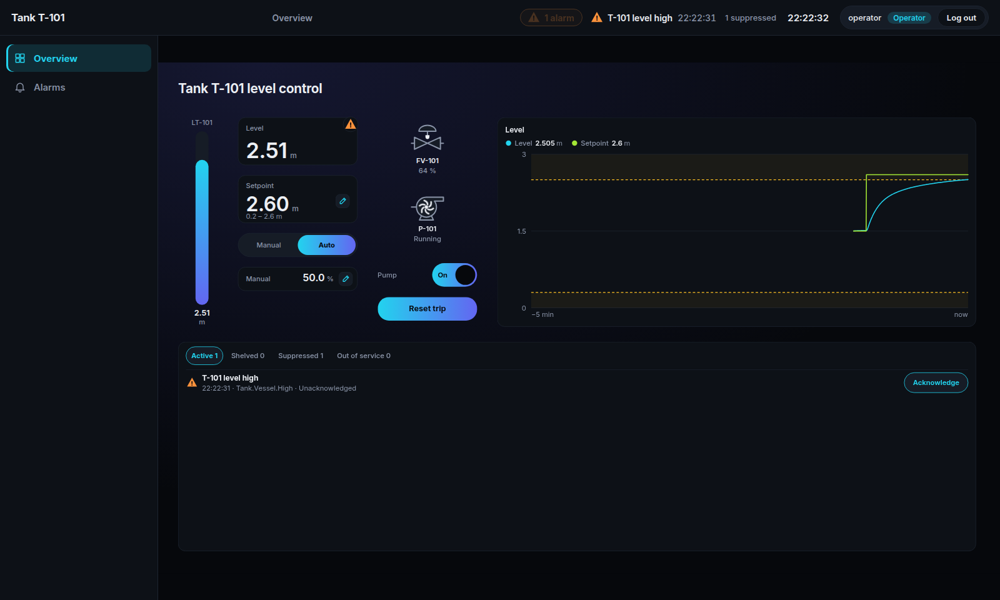
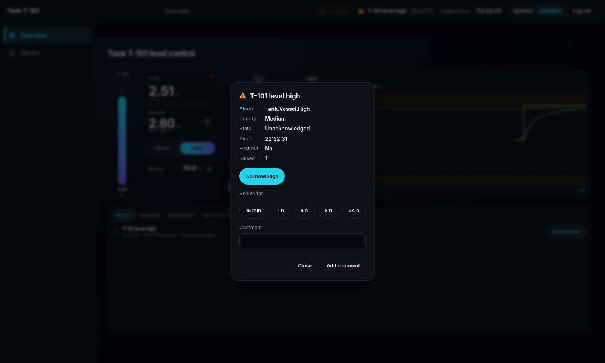
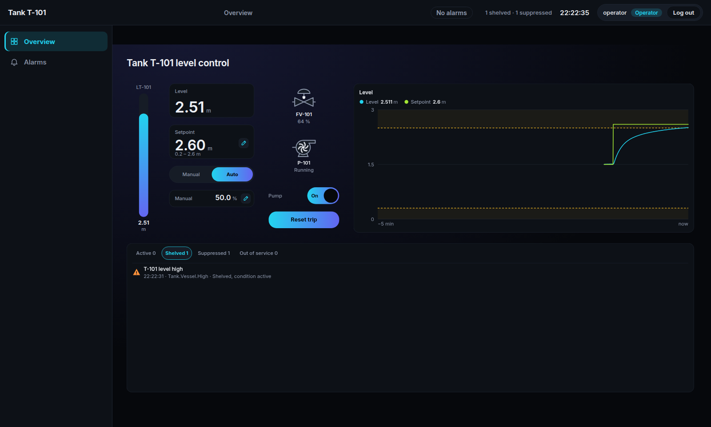
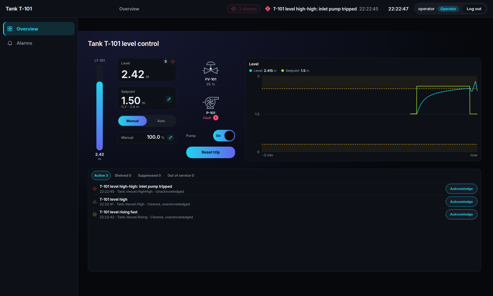
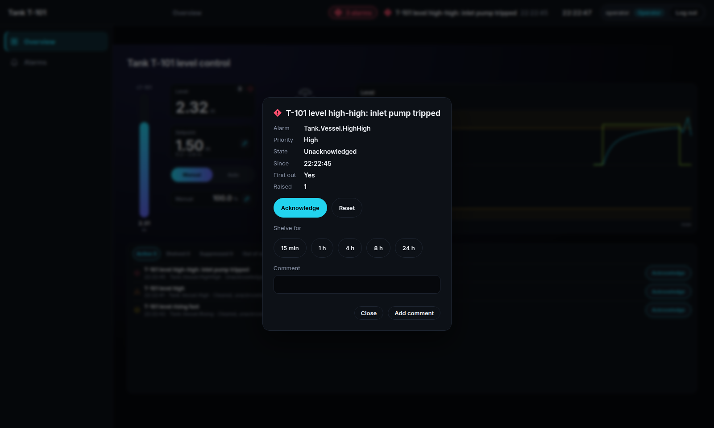
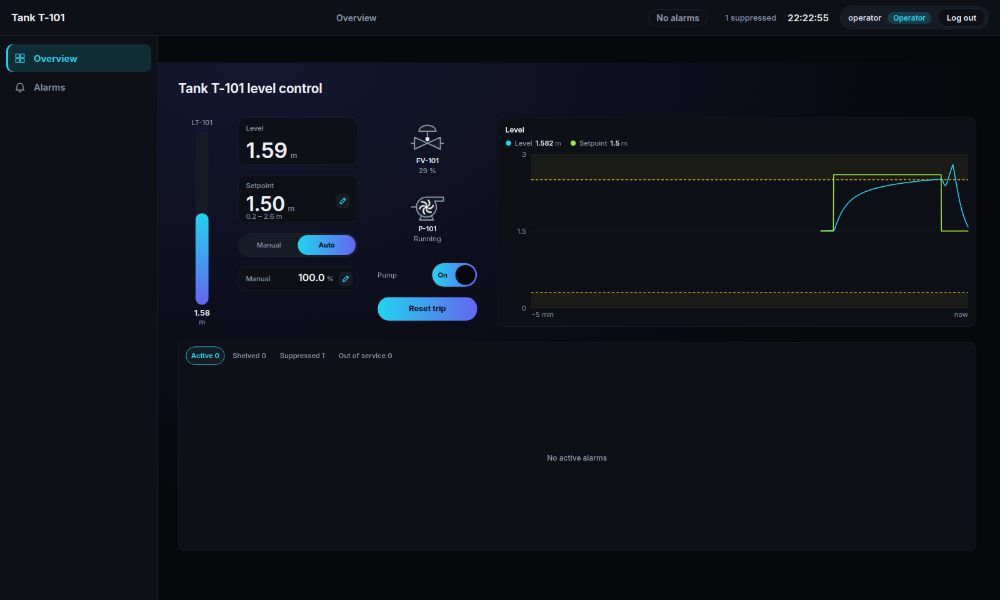
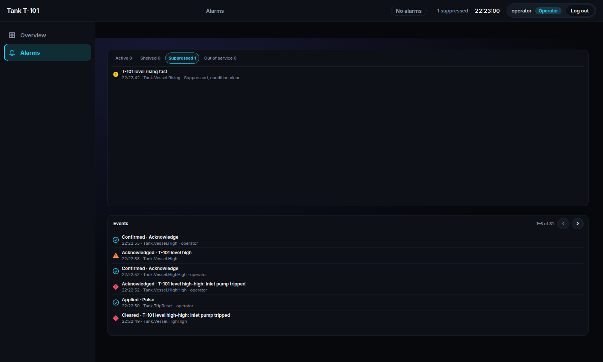
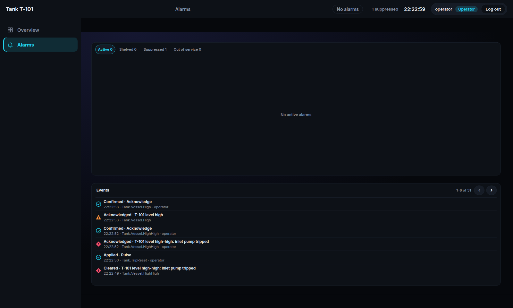

# Tutorial 24: Alarms in the HMI

This tutorial shows the Alarm library and the runtime display's alarm handling on a real project:
the tank example in [`examples/hmi_tank_level`](../../hmi_tank_level/README.md). You will see how
alarms are declared, how they look and are operated in the browser, how a trip marks its first
out, how equipment shows its alarms, and how to write your own detection.

The alarm handling follows ISA-18.2 (IEC 62682) and EEMUA 191. The full contract is
[specification 40](../../../docs/specs/40-alarm-library.md).

## 1. Run the example

```sh
cd examples/hmi_tank_level
trust-runtime build --project .
trust-runtime run --project .
```

Open <http://127.0.0.1:8080/hmi>. The level holds at 1.5 m.



## 2. Alarms are function block instances

An alarm is an instance of a block from the Alarm library, called every scan. The library comes in
through `trust-lsp.toml`:

```toml
[dependencies]
Alarm = { path = "libraries/alarm", version = "0.1.0" }
```

The tank's vessel declares its level alarms (from `src/main.st`):

```iecst
FUNCTION_BLOCK TankVessel
VAR RETAIN
    High : LimitAlarm;
    HighHigh : LimitAlarm;
    Low : LimitAlarm;
    Rising : LevelRiseAlarm;
END_VAR
    High(Value := Level, Limit := HighLimit, Deadband := 0.05,
        Message := 'T-101 level high', Priority := AlarmPriority#Medium);
    HighHigh(Value := Level, Limit := HighLimit + 0.3, Deadband := 0.05, Latching := TRUE, Group := Trips,
        Message := 'T-101 level high-high: inlet pump tripped', Priority := AlarmPriority#High);
    Low(Value := Level, Limit := LowLimit, Deadband := 0.05, Direction := LimitDirection#Low,
        Message := 'T-101 level low', Priority := AlarmPriority#Medium);
```

- **Priority:** High, Medium or Low. Keep High for what needs action now; most alarms are Low.
- **Deadband:** the level must fall 0.05 m below the limit before the alarm clears, so a level
  that hovers at the limit does not chatter.
- **`VAR RETAIN`:** the alarm keeps its state, shelving and acknowledgement across a warm restart.

The runtime finds every alarm instance by itself; nothing has to be registered.

## 3. See an alarm

As `operator` (password `operator`), set the setpoint to 2.6 m. When the level passes 2.5 m,
**T-101 level high** comes in.



- The top bar counts the alarms and shows the newest.
- The list shows unacknowledged alarms first, then by priority, then newest.
- Each priority has its own colour **and** shape: a red diamond for High, an orange triangle for
  Medium, a yellow circle for Low. A status is never shown by colour alone.

## 4. Acknowledge

Click the row to see the alarm's facts and the actions its state allows.



**Acknowledge** tells the system that someone has seen it. An alarm that clears before it is
acknowledged stays in the list as *cleared, unacknowledged* until someone does.

## 5. Shelve

Shelving takes an alarm off the active list for a while, for example during known work, without
losing it. Open the alarm and choose **Shelve for 15 min**.



It comes back by itself when the time ends, or with **Unshelve**. If its condition still holds, it
comes back unacknowledged, so nobody misses it.

## 6. A trip and its first out

The high-high level trips the inlet pump. So does a motor overload of the pump. Both alarms belong
to one first-out group, and both latch:

```iecst
VAR RETAIN
    Trips : FirstOutGroup;
END_VAR
    Vessel(Level := Level, HighLimit := HighLimit, LowLimit := LowLimit, Auto := Mode = PIDMode#Auto,
        Trips := REF(Trips), Reset := TripReset);
    Pump(Run := PumpRun, HighHigh := Vessel.TripLevel, Overload := OverloadTest,
        Reset := TripReset, Trips := REF(Trips));
    IF TripReset THEN
        Trips.Reset();
    END_IF;
```

Put the controller in **Manual** and open the valve to 100 %. The level rises past 2.8 m and the
pump trips.



Open the high-high alarm: it is marked **First out**, the cause of the trip. When several alarms
follow a trip, the first out tells which came first.



A latched alarm stays active after its condition clears. Back in Auto, once the level is below the
limit, **Reset trip** resets the latched alarms and the group, and the pump runs again.



## 7. Equipment alarms

An alarm belongs to the equipment it is declared in: the level alarms to `Tank.Vessel`, the
overload to `Tank.Pump`. An object bound to a path inside the equipment shows its alarms. The
level card is bound to `Tank.Vessel.Level`, so during the trip it showed the vessel's three alarms
with the mark of the highest priority (the screenshot in section 6). The pump P-101, bound to
`Tank.Pump.Running` and `Tank.Pump.Tripped`, shows the pump's alarms the same way; its impeller
turns while the pump runs and stands still when it trips.

## 8. Your own detection

When none of the library's blocks fits, extend the base. `LevelRiseAlarm` warns when the level
rises faster than it should:

```iecst
FUNCTION_BLOCK LevelRiseAlarm EXTENDS Alarm.Alarm
VAR_INPUT
    Level : LREAL;
    MaximumRise : LREAL := 0.05;
    CycleTime : LREAL := 0.1;
END_VAR
VAR
    Previous : LREAL;
    Started : BOOL;
END_VAR
    IF NOT Started THEN
        Previous := Level;
        Started := TRUE;
    END_IF;
    Evaluate(Condition := (Level - Previous) / CycleTime > MaximumRise);
    Previous := Level;
END_FUNCTION_BLOCK
```

It gets everything the library's alarms have: the states, acknowledge, shelving, the records and
the display. The vessel calls it with `OnDelay := T#2s` and `Suppressed := Auto`:

- **On delay:** the rise must last 2 s before the alarm comes in.
- **Suppressed by design:** in Auto the controller drives the valve, and its fast rises after a
  setpoint step need no operator action, so the alarm does not apply. In Manual it does. A
  suppressed alarm is listed on the **Suppressed** tab, so nothing is hidden.



## 9. The event log

The Alarms page's event log lists every alarm transition and every operator action with who did it
and its outcome. The runtime also writes each transition as an OpenOT record, the long-term
history.



## What you learned

- Alarms are function block instances: `LimitAlarm`, `DigitalAlarm`, `DeviationAlarm` and
  `DiscrepancyAlarm`, or your own block that extends `Alarm.Alarm`.
- Priorities show by colour and shape; the list orders by acknowledgement, priority and time.
- Acknowledge, shelve and reset are operator actions in the runtime display; each is recorded.
- A first-out group tells the cause of a trip; latching alarms wait for a reset.
- Objects show the alarms of the equipment their binding belongs to.
